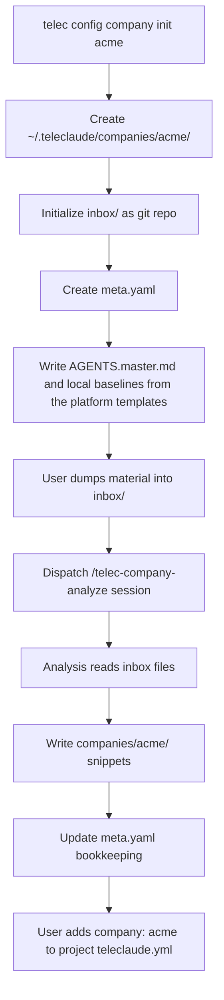
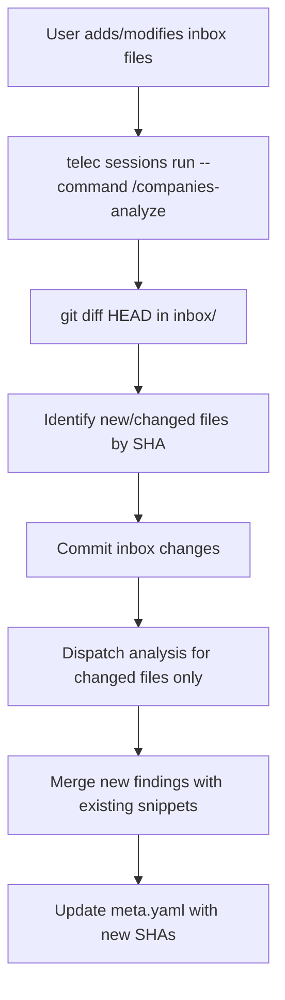
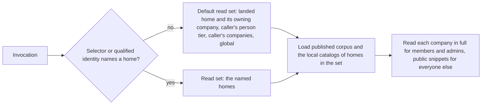

# Company Knowledge Layer — Design

## Purpose

Define how company knowledge integrates into the TeleClaude context selection
pipeline: where snippets are stored, how the context selector discovers and
filters them, how projects declare company membership, and how multi-company
isolation is enforced.

## Inputs/Outputs

<!-- planned-change:help-desks-as-deployment-output -->

| Component            | Receives                                               | Produces                                                                                                |
| -------------------- | ------------------------------------------------------ | ------------------------------------------------------------------------------------------------------- |
| Onboard command      | Company name, inbox path                               | Company directory, meta.yaml, git inbox, company master and local baselines from the platform templates |
| Machine installation | Platform templates, declared company homes             | Each company master brought back to its template; missing local baselines created                       |
| Analysis session     | Input files, existing snippets                         | Company doc snippets, updated meta.yaml                                                                 |
| Publication          | The company's committed `docs/global`                  | The company's published snippets in the shared corpus                                                   |
| Local index build    | The company's committed `docs/local`                   | The company's local catalog, kept in the company home                                                   |
| Context selector     | Caller identity, landing location, selectors, catalogs | The caller's read set, each company read at the caller's depth                                          |
| Project config       | `company: {slug}` declaration                          | The project's owning company                                                                            |
| `telec docs index`   | The read set the selector resolved                     | Company snippets in index output                                                                        |

<!-- change:help-desks-as-deployment-output -->

| Component                 | Receives                                               | Produces                                                                                                |
| ------------------------- | ------------------------------------------------------ | ------------------------------------------------------------------------------------------------------- |
| Onboard command           | Company name, inbox path                               | Company directory, meta.yaml, git inbox, company master and local baselines from the platform templates |
| Machine installation      | Platform templates, declared company homes             | Missing local baselines created                                                                         |
| Platform home convergence | Platform templates, declared company homes             | Each company master, and each enabled company desk, brought back to its template                        |
| Analysis session          | Input files, existing snippets                         | Company doc snippets, updated meta.yaml                                                                 |
| Publication               | The company's committed `docs/global`                  | The company's published snippets in the shared corpus                                                   |
| Local index build         | The company's committed `docs/local`                   | The company's local catalog, kept in the company home                                                   |
| Context selector          | Caller identity, landing location, selectors, catalogs | The caller's read set, each company read at the caller's depth                                          |
| Project config            | `company: {slug}` declaration                          | The project's owning company                                                                            |
| `telec docs index`        | The read set the selector resolved                     | Company snippets in index output                                                                        |

<!-- /planned-change:help-desks-as-deployment-output -->

## Invariants

### Storage isolation

Each company has exactly one directory: `~/.teleclaude/companies/{slug}/`.
Company directories are siblings, never nested. A company's documentation
contains only that company's snippets. No cross-company file references.

The company home has the two documentation halves every documentation home has
(`general/spec/snippet-authoring-schema`): `docs/global` is published into the
shared corpus, and `docs/local` is never published and is served from the
company's own local catalog.

### Identity

A company's published snippet carries the identity
`companies/{slug}/<taxonomy>/<rest>` and its local snippet
`local/companies/{slug}/<taxonomy>/<rest>`; each identity is the same from every
location.
Identities of different companies, projects, people, and domains never collide,
so no tier overrides another and there is no precedence to resolve.

### Project ownership

A project belongs to at most one company. The `company` field in
`teleclaude.yml` is a string matching a company slug. An invocation in a project
that declares an owning company offers that company in its default read set; a
project without the declaration offers no company beyond the caller's own.

### Reach and depth

A company's documentation enters the default read set of every member wherever
they work, and of every invocation in a project that declares the company as its
owner. Any caller reaches it from any location by naming the company: the
company selector reads its published half, the local selector its local half,
and a qualified identity the half its prefix states. Depth follows
the caller's relationship, never the location or the half: a member of the
company, or a platform admin, reads it in full; anyone else reads its
`visibility: public` snippets only. The relationship rules themselves are owned
by `general/design/configuration-tiers`.

### Multi-company isolation

A caller's view of a company they do not belong to is that company's public
snippets, whatever project they work in and whatever they name. Membership in
one company opens nothing of another.

## Primary flows

### First onboard

### Re-onboard

### Context selection with company tier

## Failure modes

### Missing company directory

A project declares `company: acme` but `~/.teleclaude/companies/acme/` does
not exist. The context selector logs a warning and proceeds without company
docs — it does not fail the session. The user is informed that onboarding
is needed.

### Stale company knowledge

Company material changes but re-onboard has not been run. Generated snippets
reflect outdated organizational state. This is expected — company knowledge
is point-in-time, updated on explicit re-onboard. The `last_onboarded_at`
timestamp in `meta.yaml` makes staleness visible.

### Inbox corruption

The inbox git repository becomes corrupted. Recovery: delete `.git/` in the
inbox directory. Next onboard will re-initialize git and process all files
as new (full analysis, no diff optimization). No snippet data is lost —
snippets live in the company's `docs/global` and `docs/local`, not in the
inbox.

### Company slug collision

Two companies with names that produce the same slug (e.g., "Acme Corp" and
"Acme-Corp" both → `acme-corp`). The onboard command detects existing
`meta.yaml` and checks the `company_name` field. If it differs, onboard
fails with a clear error suggesting a different name.

### Cross-company leakage

A misconfigured project declares the wrong company. Invocations in that project
offer the wrong company in their default read set, but depth still follows each
caller's own relationship: a caller who does not belong to that company reads
only its public snippets.

### Confidentiality read from the half

Filing a snippet in `docs/local` does not hide it, and filing it in
`docs/global` does not expose it: the half decides where a snippet is served
from, and its `visibility` with the caller's relationship decides who reads it.
Internal company material placed in `docs/global` is published into the shared
corpus and is still read in full only by members and admins.

## See Also

- ~/.teleclaude/docs/general/concept/company-knowledge.md
- ~/.teleclaude/docs/general/spec/company-scaffolding.md
- ~/.teleclaude/docs/general/procedure/company-onboarding.md
