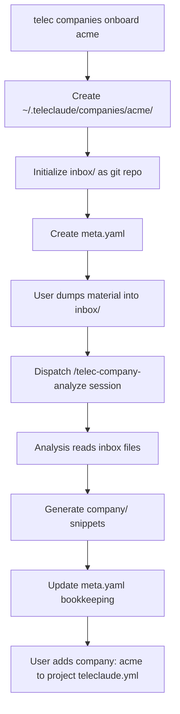
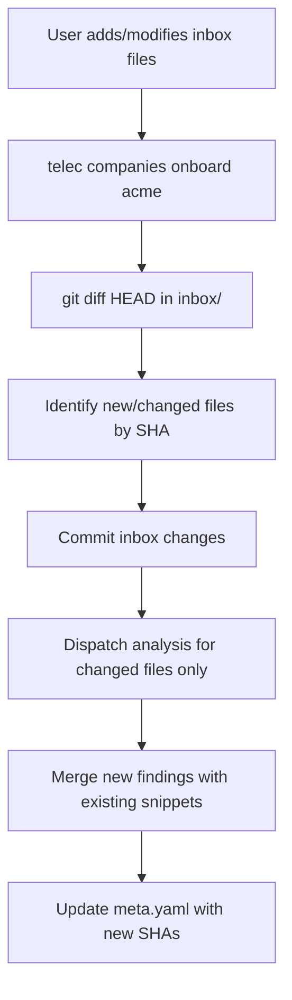
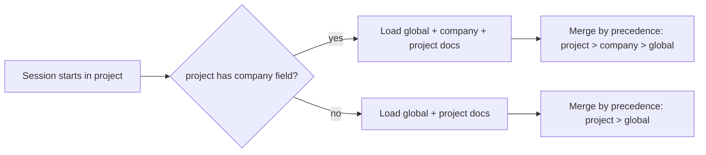

# Company Knowledge Layer — Design

## Purpose

Define how company knowledge integrates into the TeleClaude context selection
pipeline: where snippets are stored, how the context selector discovers and
filters them, how projects declare company membership, and how multi-company
isolation is enforced.

## Inputs/Outputs

| Component          | Receives                              | Produces                                   |
| ------------------ | ------------------------------------- | ------------------------------------------ |
| Onboard command    | Company name, inbox path              | Company directory, meta.yaml, git inbox    |
| Analysis session   | Input files, existing snippets        | Company doc snippets, updated meta.yaml    |
| Context selector   | Project config (company field), index | Merged context: global + company + project |
| Project config     | `company: {slug}` declaration         | Company membership for context filtering   |
| `telec docs index` | Company snippet directories           | Company snippets in index output           |

## Invariants

### Storage isolation

Each company has exactly one directory: `~/.teleclaude/companies/{slug}/`.
Company directories are siblings, never nested. A company's docs directory
contains only that company's snippets. No cross-company file references.

### Project membership

A project belongs to at most one company. The `company` field in
`teleclaude.yml` is a string matching a company slug. If absent, the
project has no company context — only global and project docs are loaded.

### Context selection hierarchy

The context selector merges three tiers in precedence order:

```
project (highest) → company → global (lowest)
```

When snippet IDs collide across tiers, the higher-precedence tier wins.
In practice, collisions are rare because each tier uses a different ID
prefix (`project/`, `company/`, domain-based for global).

### Multi-company isolation

When a session starts in a project with `company: acme`, the context
selector includes only Acme's company docs. Snippets from other companies
are never loaded, even if they exist on the same machine. The filter is
based on the `company` frontmatter field matching the project's declared
company.

### Snippet scope semantics

Company snippets use `scope: global` in their frontmatter because they
are available to multiple projects — they are not confined to a single
repository. However, they are filtered by the `company` field, making
them effectively "global within a company."

## Primary flows

### First onboard



### Re-onboard



### Context selection with company tier



## Failure modes

### Missing company directory

A project declares `company: acme` but `~/.teleclaude/companies/acme/` does
not exist. The context selector logs a warning and proceeds without company
docs — it does not fail the session. The user is informed that onboarding
is needed.

### Stale company knowledge

Company material changes but re-onboard has not been run. Generated snippets
reflect outdated organizational state. This is expected — company knowledge
is point-in-time, updated on explicit re-onboard. The `last_onboarded_at`
timestamp in `meta.yaml` makes staleness visible.

### Inbox corruption

The inbox git repository becomes corrupted. Recovery: delete `.git/` in the
inbox directory. Next onboard will re-initialize git and process all files
as new (full analysis, no diff optimization). No snippet data is lost —
snippets live in `docs/`, not in the inbox.

### Company slug collision

Two companies with names that produce the same slug (e.g., "Acme Corp" and
"Acme-Corp" both → `acme-corp`). The onboard command detects existing
`meta.yaml` and checks the `company_name` field. If it differs, onboard
fails with a clear error suggesting a different name.

### Cross-company leakage

A misconfigured project declares the wrong company. The agent loads another
company's policies. Prevention: the `company` field is a simple string match
— there is no authorization layer. This is acceptable for single-operator
deployments. For multi-tenant hosting, company isolation would need an
additional auth check, which is out of scope for the initial implementation.

## See Also

- ~/.teleclaude/docs/general/concept/company-knowledge.md
- ~/.teleclaude/docs/general/spec/company-scaffolding.md
- ~/.teleclaude/docs/general/procedure/company-onboarding.md
