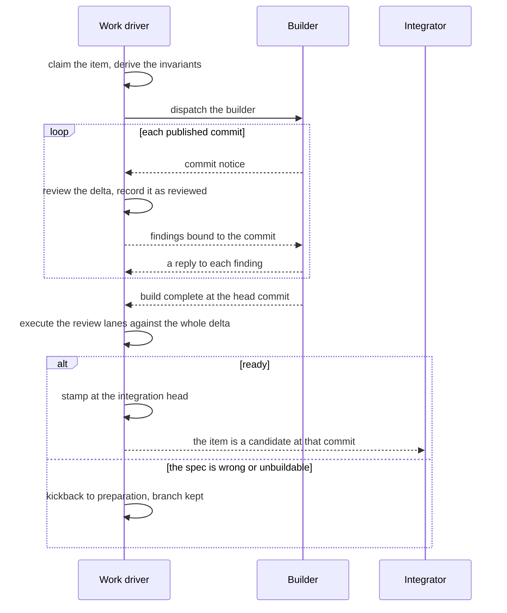

# Work — Design

## Required reads

- @~/.teleclaude/docs/sdlc/design/lifecycle/overview.md

## Purpose

Define how a prepared spec is realized into code.

Two sessions carry work. The work driver
(`sdlc/procedure/lifecycle/work/overview-v2`) holds the item, derives the
invariants it holds the build to, scrutinizes every commit and decides
readiness. The builder it dispatches (`sdlc/procedure/lifecycle/work/build-v2`)
owns the mechanism and answers every finding. Review is continuous: each
published commit reaches the driver, which reviews it against the spec as it
lands, and the final judgment is the stamp.

## Inputs/Outputs

**Inputs**

- the prepared spec at the body revision preparation judged
- the reviewed pending contracts the spec references
- the item's branch and worktree
- computed supporting context and evidence where automation can provide it

**Outputs**

- commits on the item's branch, each recorded as reviewed by the driver
- findings bound to commits, each answered by the builder
- a stamp bound to the commit that is ready, carrying the driver's lane report
- or a return to preparation with its reason, when the spec itself is wrong

## Invariants

- The driver judges and the builder writes. The driver qualifies as the
  independent reviewer because it did not write the code.
- Work builds against the prepared spec, not against a plan. The builder may
  change the mechanism freely; the spec it may not.
- Every published commit is reviewed against the delta since the last commit the
  driver recorded as reviewed, so no commit is skipped and none is reviewed
  twice.
- A finding names the contract it contradicts and the condition that reaches
  it. A finding answered is not a verdict.
- Before the stamp the driver executes every applicable lane of
  `sdlc/policy/definition-of-done-lanes` against the item's whole delta, and
  stamps only when no Requirement-Violation, Critical or Important finding is
  unresolved.
- The stamp binds one commit at the integration head; a head that moves past it
  before the integrator admits the item requires a new stamp.
- Work never edits the spec to make a finding pass. A finding that shows the
  spec wrong or unbuildable returns the item to preparation.
- On a bug, nothing changes beyond what the spec's cause requires
  (`sdlc/procedure/debugging`).

## Primary flows

### The review loop

### A ready item questioned before admission

Until the integrator admits a ready item, a stated reason can bring a work
driver back to it. The driver tests the reason against the spec and the stamped
commit, and either returns the item to preparation or releases it to remain
ready in its original order.

## Failure modes

- The driver reviews only the latest commit and misses what earlier commits
  changed.
- Findings become narrow patches that introduce new misalignment, because the
  driver judged the patch rather than the invariant.
- A stamp is performed with lanes skipped, or with a blocking finding still
  unresolved.
- The builder treats a finding as a verdict and stops, or treats a contract
  contradiction as a mechanism choice and continues.
- Work patches around a wrong spec instead of returning the item to preparation.

## See Also

- ~/.teleclaude/docs/sdlc/procedure/lifecycle/work/overview-v2.md —
  operational steps for driving work
- ~/.teleclaude/docs/sdlc/procedure/lifecycle/work/build-v2.md
