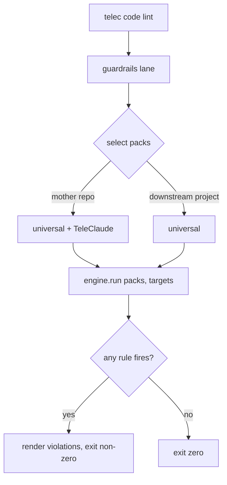

# Guardrails Engine — Design

## Required reads

- @~/.teleclaude/docs/software-development/design/project-toolchain.md
- @~/.teleclaude/docs/general/principle/intelligence-boundaries.md

## Purpose

TeleClaude's guardrails are its opinionated quality bar — substantive
code/structure checks that run as the always-run lane of `telec code lint`.
This design makes that lane
**portable**: a domain-blind engine runs rules supplied by **packs**, so a side
project can run TeleClaude's quality bar behind its own `telec code lint`
without inheriting TeleClaude-specific rules.

Adoption is **convergence, not negotiation**: a project that adopts the
guardrails trends toward the bar over time. There is no hybrid quality-juggling
and no per-project quality configuration. The only flex for brownfield reality
is the **exemption ramp** — visible, justified, shrinking local escape hatches
that trend to zero.

## Inputs/Outputs

**Inputs**

- A **pack selection** — which rule packs run for this invocation.
- **Target paths** — the scoped file list (or repo-wide on a full run), handed
  down by the guardrails lane exactly as today's lane steps receive targets.
- **Exemption ramp state** — inline `# guard:` markers in source, plus curated
  baseline/exemption files (`forbid_new_unit_tests` grandfather baseline,
  `snapshot-testing` exemptions). These narrow a locked rule for known
  pre-adoption sites only.

**Outputs**

- A non-zero exit with rendered violations when any selected rule fires;
  success otherwise. The engine emits no warnings tier — every rule is at
  **error**.

**Packs**

- **Universal pack** — rules valid for any project. Ships to every project that
  runs `telec code lint`. Holds no TeleClaude-specific knowledge.
- **TeleClaude pack** — TeleClaude-specific rules. Active only where the TC pack
  is selected (the mother repo); never applies to a downstream project.

## Invariants

1. **The engine is domain-blind.** It runs whatever rules a selected pack
   registers and holds no project-specific rule knowledge. Project-specific
   rules live in packs, never in the engine.
2. **Every lane is locked-on at error.** There is no per-lane enable/disable, no
   severity (`off|warn|error`), and no caps tuning. There is no
   `teleclaude.yml guardrails:` quality-config surface anywhere — a project
   cannot turn a guardrail down.
3. **Guardrails are not watching-the-watchers.** A guardrail catches a
   substantive issue in the code or structure. It must NOT police whether
   someone weakened a tool's config, suppressed a tool's rule, or unwired the
   pipeline — that erosion-watching belongs to the TeleClaude checkpoint
   (protected-config-file watching) and to reviewers, not to a guardrail. This
   invariant is the discriminator that decides what a guardrail may check.
4. **Quality controls are never project stances.** A config toggle would be a
   project-wide *stance* (a different, equally-valid choice); guardrails are not
   stances, so they are locked. Brownfield adoption flexes ONLY via **exemption
   ramps** (inline `# guard:` markers + curated baseline/exemption files that can
   only shrink), never via project config. The ramps trend to zero as the
   project converges.
5. **Pack scope is by selection, not by config.** Universal-pack rules apply to
   every linted project; TC-pack rules apply only when the TC pack is selected.
   The selection is a property of which project is being linted, not a tunable.

## Primary flows

- **Mother repo (`telec code lint` on TeleClaude):** the lane selects the
  universal pack and the TeleClaude pack; the engine runs both rule sets against
  the targets.
- **Downstream project (`telec code lint` on an adopting project):** the lane
  selects only the universal pack; TC-pack rules do not apply.
- **`forbid_new_unit_tests`:** a locked universal rule with a **grandfather
  baseline** — the path-keyed set of unit tests present at adoption, in a curated
  file that can only shrink. A unit test on the baseline is grandfathered; one
  not on it is new and is blocked. The baseline is captured from the actual
  `tests/unit` tree at adoption (empty when the project has no unit tests). The
  rule prevents backsliding; raising functional coverage is owned by procedures
  and agent judgment, not by the guardrail (per
  `general/principle/intelligence-boundaries`).

## Failure modes

- **A new `tests/unit/test_*.py` not on the baseline** fails the lane; a
  grandfathered one passes. A rename of a grandfathered test reads as new
  (path-keyed baseline) — re-baseline on that rare migration.
- **A `dict[str, Any]` without a `# guard: loose-dict` marker**, a brittle
  string-content assertion in a test, or a module over the locked size cap
  without an exemption marker fails the lane.
- **A project tries to tune a guardrail** (severity, cap, toggle): there is no
  surface to do so — the attempt has nowhere to land. The only sanctioned
  narrowing is an exemption-ramp marker or baseline entry, which is visible and
  shrinking.
- **A guardrail is proposed that watches tool-config or pipeline wiring:** it is
  rejected by Invariant 3 — that concern routes to the checkpoint and reviewers.

## See Also

- ~/.teleclaude/docs/software-development/design/project-toolchain.md — where the
  guardrails lane sits in the `telec code` / `make` split and how packs distribute.
