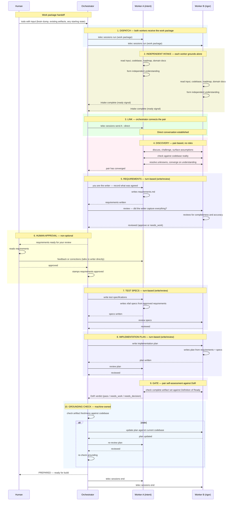

# Prepare Overview — Procedure

## Required reads

- @~/.teleclaude/docs/general/concept/agent-characteristics.md
- @~/.teleclaude/docs/software-development/procedure/lifecycle/prepare/discovery.md
- @~/.teleclaude/docs/software-development/procedure/lifecycle/prepare/plan-draft.md
- @~/.teleclaude/docs/software-development/procedure/lifecycle/prepare/readiness-gate.md

## Goal

Drive the prepare state machine by calling `telec todo prepare [slug]` in a loop.
The machine dispatches a persistent pair of workers who explore the problem
together and then produce artifacts in turns. The orchestrator dispatches what
the machine requests and supervises the pair.

Produce reviewed, human-approved, and grounded preparation artifacts for a todo.

## Preconditions

1. `todos.db` roadmap exists and is readable.
2. Target slug is active (not icebox, not delivered) when slug is provided.

## Steps

### 1. Enter the state machine

Call `telec todo prepare [slug]`. Read the returned instruction block.

### 2. Execute the instruction

The state machine returns a linear script for the current state. The
orchestrator executes it verbatim and then calls `telec todo prepare [slug]`
again. The orchestrator never makes routing decisions — the machine owns
sequencing.

### The prepare flow

#### Full workflow

#### Step details

**1. Dispatch** — The orchestrator dispatches both workers with the same work
package. Each worker receives the todo's input (whatever it carries — brain
dump, existing requirements, any starting state). The workers are NOT linked
at this point.

**2. Independent intake** — Each worker reads and grounds itself independently:
the input, the codebase (ground truth), the roadmap (project direction), and
applicable domain docs. Each forms their own understanding before any
discussion. This independence is critical — it preserves the value of having
two perspectives. If they are linked during intake, one's confusion becomes
the other's confusion.

**3. Link** — After both workers signal intake complete, the orchestrator links
them via `telec sessions send <A> --direct`. From this point, turn-complete
outputs are cross-shared automatically.

**4. Discovery** — Pair-based. No roles. Both explore the problem through their
natural lens. They discuss, challenge each other, surface hidden assumptions,
check against codebase reality, resolve unknowns, and converge on what the
requirements should be.

**5. Requirements** — Turn-based. The orchestrator assigns `A` as writer. `A`
records what the pair agreed on as `requirements.md`. `B` reviews: did the
writer capture everything? If gaps are found, the writer corrects.

**6. Human approval** — The human reads the requirements. The human may talk
directly to the writer to add or correct things. When satisfied, the
orchestrator stamps approval. The machine does not proceed to test specs until
the human has approved.

**7. Test specs** — Turn-based. `A` writes expected-failure-marked test specs.
`B` reviews. Specs stay close to the just-approved requirements while context
is hot.

**8. Implementation plan** — Turn-based. `B` writes the plan (rigor lens
drives execution planning). `A` reviews (intent lens checks the plan serves
the intended outcome).

**9. Gate** — The pair checks their own complete artifact set against Definition
of Ready. This is self-assessment. If gaps exist, the machine routes back. If
a decision is needed, escalate to the human.

**10. Grounding check** — Machine-owned freshness check. If referenced files
changed since grounding, the plan must be updated and re-reviewed.

**PREPARED** — Terminal success. Cleanup all sessions.

**BLOCKER** — The machine cannot proceed. Sessions stay alive for the human.

### 3. Supervision

After dispatching workers:

1. Set a heartbeat timer.
2. Wait for worker notifications.
3. On notification: call `telec todo prepare [slug]` again to advance.
4. If a worker stalls (heartbeat fires with no progress), open a direct
   conversation to resolve. If still stuck after two iterations, record
   blockers and stop.

### Human touchpoints

- The human may edit preparation artifacts directly at any time, then hand the
  todo back to the machine with `telec todo reconcile [slug]`.
- The human approves requirements before test specs begin.
- The human may be escalated to when the machine or pair encounters a blocker
  requiring judgment.

### Events

| Phase transition            | Event                           |
| --------------------------- | ------------------------------- |
| Discovery dispatched        | `prepare.discovery_started`     |
| Requirements written        | `prepare.requirements_drafted`  |
| Requirements human-approved | `prepare.requirements_approved` |
| Test specs written          | `prepare.test_specs_drafted`    |
| Test specs reviewed         | `prepare.test_specs_approved`   |
| Plan written                | `prepare.plan_drafted`          |
| Plan reviewed               | `prepare.plan_approved`         |
| Grounding invalidated       | `prepare.grounding_invalidated` |
| Re-grounding completed      | `prepare.regrounded`            |
| Preparation complete        | `prepare.completed`             |
| Preparation blocked         | `prepare.blocked`               |

## Outputs

1. `requirements.md` — human-approved.
2. Test specification files (expected-failure-marked).
3. `implementation-plan.md`.
4. Grounding metadata in `todos.db` state.
5. Session cleanup on PREPARED terminal.

## Recovery

1. If a worker session fails, read the error and retry once. On second failure,
   record the blocker and stop.
2. If the state machine returns an unexpected instruction, log it and stop.
3. If direct conversation with a worker stalls, write blockers to `dor-report.md`
   and stop.
