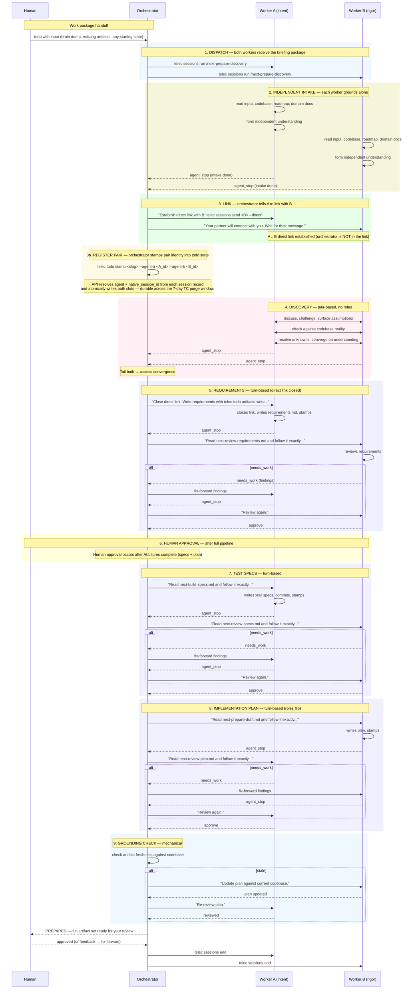

# Prepare Overview — Procedure

## Required reads

- @~/.teleclaude/docs/general/concept/agent-characteristics.md
- @~/.teleclaude/docs/software-development/procedure/lifecycle/prepare/discovery.md
- @~/.teleclaude/docs/software-development/procedure/lifecycle/prepare/plan-draft.md

## Goal

Drive the prepare state machine by calling `telec todo prepare [slug]` in a loop.
The machine dispatches a persistent pair of workers who explore the problem
together and then produce artifacts in turns. The orchestrator dispatches what
the machine requests and supervises the pair.

Produce reviewed, human-approved, and grounded preparation artifacts for a todo.

## Preconditions

1. Target slug is active (not icebox, not delivered) when slug is provided.
2. `telec roadmap list` confirms the slug is in the roadmap.

## Steps

### 1. Enter the state machine

Call `telec todo prepare [slug]`. Read the returned instruction block.

### 2. Execute the instruction

The state machine returns a linear script for the current state. The
orchestrator executes it verbatim and then calls `telec todo prepare [slug]`
again. The orchestrator never makes routing decisions — the machine owns
sequencing.

### The prepare flow

#### Full workflow

#### Step details

**1. Dispatch** — The orchestrator dispatches both workers with the same
briefing package (`/next-prepare-discovery`). Each worker receives the todo's
input. The workers are NOT linked at this point.

**2. Independent intake** — Each worker reads and grounds itself independently:
the input, the codebase (ground truth), the roadmap (`telec roadmap list`),
and applicable domain docs. Each forms their own understanding before any
discussion. This independence preserves the value of two perspectives. The
orchestrator knows intake is done when both workers emit `agent_stop`.

**3. Link** — After both workers have stopped (intake complete), the
orchestrator tells A to establish a direct link with B by sending:
`telec sessions send <B_id> 'Starting paired discovery' --direct`. The
orchestrator tells B to wait for the connection. The orchestrator is NOT
part of the direct link — it stays outside.

**3b. Register pair identity** — The orchestrator stamps both slots into todo
state with `telec todo stamp {slug} --agent-a <A_id> --agent-b <B_id>`. The
API resolves `active_agent` and `native_session_id` for each session and
writes both slots atomically. Without this step the state machine cannot see
the pair and the formation script would re-emit on every re-entry. The stored
`native_session_id` keeps the slot revivable past the 7-day TC session purge
window — the agent's own transcript files survive even after the TC row is
gone, and `telec sessions revive <native_session_id> --agent <agent>` can
resurrect the slot from those files.

**4. Discovery** — Pair-based. No roles. Both explore the problem through
their natural lens. They discuss, challenge each other, surface hidden
assumptions, check against codebase reality, resolve unknowns, and converge.
When both workers go idle, the orchestrator reads both tails and assesses:
have they converged?

**5. Requirements** — Turn-based. The direct link is closed. The orchestrator
tells A: "Close your direct link. Write the agreed requirements with
`telec todo artifacts write {slug} requirements <content>`. When done, stamp
`telec todo stamp {slug} --requirements-ready`." A writes and goes idle.
The orchestrator then tells B to review by loading the review command:
"Read `~/.teleclaude/commands/next-review-requirements.md` and follow it
exactly..." If B finds gaps (`needs_work`), the orchestrator relays findings
to A for fix-forward, then B reviews again.

**6. Human approval** — After the full pipeline completes (specs + plan +
reviews), the orchestrator presents the full artifact set to the human. The
human reviews at their own pace and may interject at any point by messaging
a worker directly. Fix-forward only — no return to discovery.

**7. Test specs** — Turn-based. Orchestrator tells A to load the spec-building
command (`next-build-specs`). A writes xfail specs and stamps. Orchestrator
then tells B to load the spec-review command (`next-review-specs`).
Fix-forward loop if needed.

**8. Implementation plan** — Turn-based, roles flip. Orchestrator tells B
to load the plan-drafting command (`next-prepare-draft`). B writes the plan
and stamps. Orchestrator then tells A to load the plan-review command
(`next-review-plan`). Fix-forward loop if needed.

**9. Grounding check** — Mechanical freshness check. If referenced files
changed since grounding, the plan writer (B) updates, the reviewer (A)
re-reviews. If fresh: PREPARED.

**PREPARED** — Terminal success. Cleanup all sessions.

**BLOCKER** — The machine cannot proceed. Sessions stay alive for the human.

#### Turn-based protocol

During write/review turns, the orchestrator follows a strict protocol:

1. **Message only the active worker.** The other worker is not messaged.
2. **Wait for agent_stop.** The active worker goes idle when done.
3. **Then call `telec todo prepare {slug}`.** The machine emits the next action.
4. **Fix-forward on needs_work.** Relay findings to the writer. Writer fixes.
   Writer goes idle. Reviewer reviews again. No going back to discovery.
5. **Never message both simultaneously about the same task.** One works, the
   other waits.

#### Command loading for turn-based roles

When the machine tells the orchestrator to message a pair member for a new
role (reviewing, spec building, plan drafting), the message uses the
command-loader pattern:

> Read `~/.teleclaude/commands/next-{command}.md` and follow it exactly as
> the active instruction set for this session. Treat the following as provided
> inputs: {slug}

This ensures the worker loads the full command artifact with its Required
reads, role definition, and discipline — the same context it would receive
from a fresh `telec sessions run` dispatch.

The one exception: the requirements writer. After discovery, the writer
already has all the context from the briefing package. The orchestrator
sends only the exact CLI command to write and stamp — no command loading
needed.

### 3. Supervision

After dispatching workers:

1. Set a heartbeat timer.
2. Wait for worker notifications.
3. On notification: call `telec todo prepare [slug]` again to advance.
4. If a worker stalls (heartbeat fires with no progress), send a message
   to check. If still stuck after two iterations, record blockers and stop.

### Human touchpoints

- The human may edit preparation artifacts directly at any time, then hand
  the todo back to the machine with `telec todo reconcile [slug]`.
- The human approves the full artifact set after the pipeline completes.
- The human may interject to any worker at any time by messaging them directly.
- The human may be escalated to when the machine encounters a blocker
  requiring judgment.

### Events

| Phase transition            | Event                           |
| --------------------------- | ------------------------------- |
| Discovery dispatched        | `prepare.discovery_started`     |
| Requirements written        | `prepare.requirements_drafted`  |
| Requirements human-approved | `prepare.requirements_approved` |
| Test specs written          | `prepare.test_specs_drafted`    |
| Test specs reviewed         | `prepare.test_specs_approved`   |
| Plan written                | `prepare.plan_drafted`          |
| Plan reviewed               | `prepare.plan_approved`         |
| Grounding invalidated       | `prepare.grounding_invalidated` |
| Re-grounding completed      | `prepare.regrounded`            |
| Preparation complete        | `prepare.completed`             |
| Preparation blocked         | `prepare.blocked`               |

## Outputs

1. `requirements.md` — human-approved.
2. Test specification files (expected-failure-marked).
3. `implementation-plan.md`.
4. Grounding metadata in todo state.
5. Session cleanup on PREPARED terminal.

## Recovery

1. If a worker session fails, read the error and retry once. On second failure,
   record the blocker and stop.
2. If the state machine returns an unexpected instruction, log it and stop.
3. If a worker stalls, send a check message and assess.
