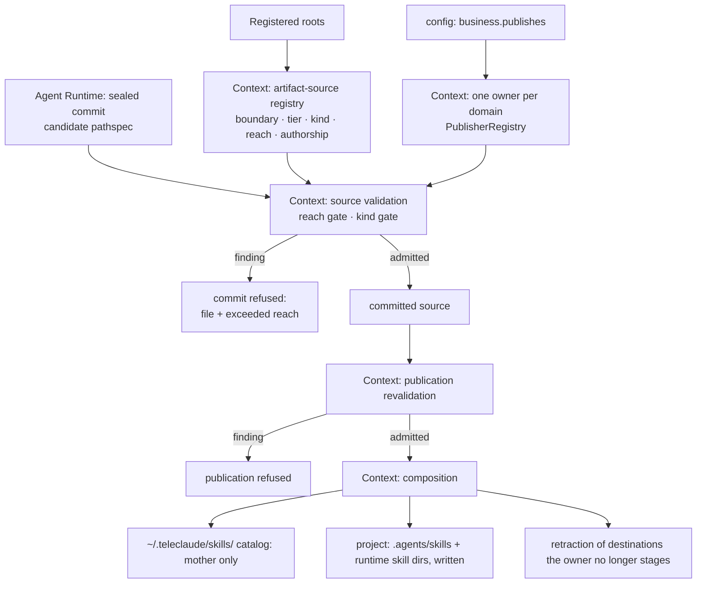

# Agent Artifact Distribution — Design

## Required reads

- @docs/local/spec/domain/context.md
- @docs/local/spec/feature/context/agent-runtime-deployment.md

## Purpose

Realize artifact distribution across several bounded contexts without letting
any of them absorb another's rule. `context` owns the artifact-source
registry, reach validation, composition, and deployment of skills. `config`
owns the publishing declaration that bounds a repository's global reach. What
an agent is assigned at session start is a published procedure, resolved by
`agent_runtime` under the procedure-entry contract
(`local/projects/teleclaude/spec/feature/agent_runtime/procedure-entry`); no
artifact kind exists for it, and this design distributes none. This document
owns only the relationships among those contracts; every behavior resolves to
one context's own spec.

The target it preserves: one tiered source shape at every repository root,
global skills from the mother alone, `.agents/` as delivery output only, and no
loss of offered artifacts at any point in a migration.

## Inputs/Outputs

**Inputs**

- Authored sources under a repository's `agents/global/skills/<name>/` and
  `agents/local/skills/<name>/`, plus the authored global-skill catalog master
  and the untiered global master and addenda at the artifact root.
- The repository's publishing declaration (`business.publishes`), read through
  `config`'s existing `publishes_for_root` contract, and the registered-root set.

**Outputs**

- The global skill catalog at `~/.teleclaude/skills/`, composed from the
  mother's `agents/global/skills/<name>/` folders alone.
- Project delivery: each project's `agents/local/skills/*` rendered into that
  project's runtime skill directories and into `.agents/skills/`. `.agents/`
  is a delivery location and is never read as an authored source.
- Validation findings that name the file and the reach it exceeds, or both
  files and the colliding name. Pathspec-scoped findings refuse the sealed
  commit; publication repeats source validation as defense in depth and
  refuses that publication run on a finding.
- The deployed-artifacts ownership manifest, keyed by relative destination
  path. A destination a repository once staged and no longer stages — the
  retired command corpus under `~/.teleclaude/commands/` included — is
  retracted on that repository's next publication.
- The artifact-source registry: one typed owner declaring every source
  boundary, the kind it carries, its tier and reach, and whether its content is
  authored by TeleClaude or incorporated from a third party. A boundary selects
  either one exact file, one uniformly classified directory tree, or the
  immediate package directories below a root. It holds no filesystem access,
  validation, deployment, or checkpoint behavior; its consumers read it and
  restate nothing.

## Invariants

### Ownership

- **`context` owns the registry, reach, composition, and retraction.** The
  registry is the single statement of which path boundaries are sources, of
  which kind, at which tier, with which reach, and under which authorship. Every
  consumer — validation (`teleclaude/resource_validation/_artifacts.py`), global
  skill discovery (`teleclaude/global_skills.py`), distribution
  (`scripts/distribute.py`), recorded-commit publication
  (`teleclaude/sync.py`), the checkpoint publication scope
  (`teleclaude/constants.py`), onboarding inference
  (`teleclaude/project_setup/init_flow.py`), and the commit gate's review
  routing (`teleclaude/cli/telec/handlers/code.py`) — derives its directory set
  from the registry and restates nothing.
- **Publication is bound to one recorded repository contribution.** Context
  materializes the triggering repository at the immutable recorded commit and
  repeats the registry-backed reach and kind validation on that snapshot before
  composition. A finding refuses the publication action. Distribution
  reconciles artifacts under that repository's canonical-root ownership key and
  preserves every other repository's manifest entries and deployed artifacts;
  it never reads another checkout to advance another owner's contribution.
- **Reach is a registry attribute, resolved against `config`'s declaration.** A
  global skill record's reach is the mother alone. A project record's reach is
  the repository itself. The one-owner-per-domain resolution reuses the docs
  publisher registry (`teleclaude/docs_publishers.py`, `PublisherRegistry`).
- **`agent_runtime` owns what a session is assigned.** A dispatch names a
  published procedure by its snippet ID; resolution, role, brief and session
  metadata are the procedure-entry contract's, and this design records only
  that no artifact participates.
- **`config` owns the declaration, never the gate.** `business.publishes` says
  what a repository may reach; `context` decides admission from it.

### Authorship decides review routing

- Every source path matches exactly one non-overlapping registry boundary;
  absence or overlap is a registry contract violation. That matched record
  declares the path authored or incorporated. Authored content is TeleClaude's
  own — masters and addenda — and a commit touching it routes to required
  doc-hygiene review. Incorporated content is a third-party skill package the
  platform republishes unchanged, so a commit touching it routes to no separate
  post-commit doc-hygiene review. The adoption security gate is owned by
  `general/procedure/skill-management` under `sdlc/policy/ai-agent-security`;
  this design classifies doc-hygiene routing and neither restates nor weakens
  that gate.
- The mixed global-skills tree is represented by two disjoint registry
  boundaries: the exact `agents/global/skills/AGENTS.master.md` file is an
  authored catalog-master record, while each immediate
  `agents/global/skills/<name>/` directory is an incorporated-package record.
  The package selector admits directories only, so it cannot absorb the master;
  every consumer asks the registry for the matched record and carries no local
  path exception.

### Reach gate

- A folder under `agents/global/skills/` from a non-mother root is refused.
- A kind directory under `agents/global/` or `agents/local/` other than
  `skills/` is refused as outside the artifact model.
- Nothing under `.agents/` is ever enumerated as a source by any consumer.
- A global source outside a repository's reach is a finding, never a silent
  skip. The sealed commit runs Context's artifact validation over its pathspec
  and refuses the commit on that finding. Publication repeats the same reach
  validation before composition as defense in depth and refuses the run rather
  than publishing an inadmissible source.

### Ownership of deployed files

- **Ownership is per publishing repository, never per phase.** A destination
  is a place several repositories write into, and retraction removes what a
  source owned and no longer stages. The owner recorded for a deploy is the
  repository that ran it, at every phase, so two repositories never subtract
  each other's files.
- **The manifest carries a schema version.** Domain code reads only the
  versioned shape; a forward migration of an older manifest runs once, in
  place, before any reconciliation reads it.

## Primary flows

## Failure modes

- **A root authors a global skill from a non-mother root.** The sealed commit
  is refused with the file and the reach it exceeds. If an inadmissible source
  reaches publication outside that path, defense-in-depth validation refuses
  the publication run and composes nothing.
- **A commit touches an incorporated package and no post-commit doc-hygiene
  review runs.** The registry suppresses only taxonomy grading; adoption remains
  gated by `general/procedure/skill-management` and the AI-agent security policy.
- **A legacy `.agents/` file a project authored by hand.** Never read, never
  adopted, never deleted by this delivery; it stays until the native-output
  sibling lands ownership records.
- **A consumer restates its own directory list instead of reading the
  registry.** A second source of truth; reviewers treat it as an ownership
  defect (`sdlc/policy/domain-ownership`).
- **A source path matches no registry boundary or more than one.** Registry
  classification fails before validation or review routing; no consumer picks
  a fallback class.
- **A retired command document survives under `~/.teleclaude/commands/`.** It is
  an owned destination the owner no longer stages and is retracted on that
  owner's next publication; a file with no ownership record is preserved and
  reported.

## See Also

- docs/local/spec/domain/context.md
- docs/local/spec/domain/context-map.md
- docs/local/spec/domain/config.md
- docs/local/spec/feature/context/agent-runtime-deployment.md
- docs/local/spec/feature/context/agent-artifact-validation.md
- docs/local/spec/feature/agent_runtime/procedure-entry.md
- docs/local/spec/feature/config/project-capability-manifest.md
