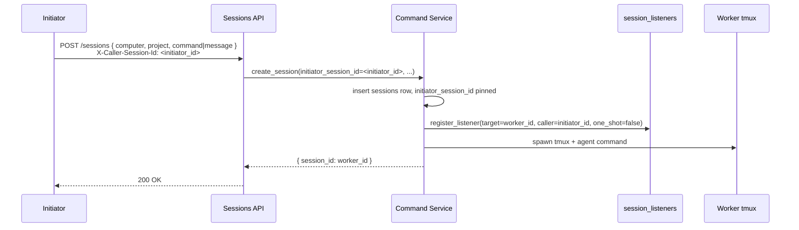
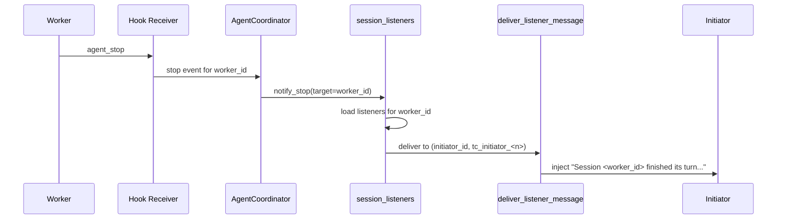
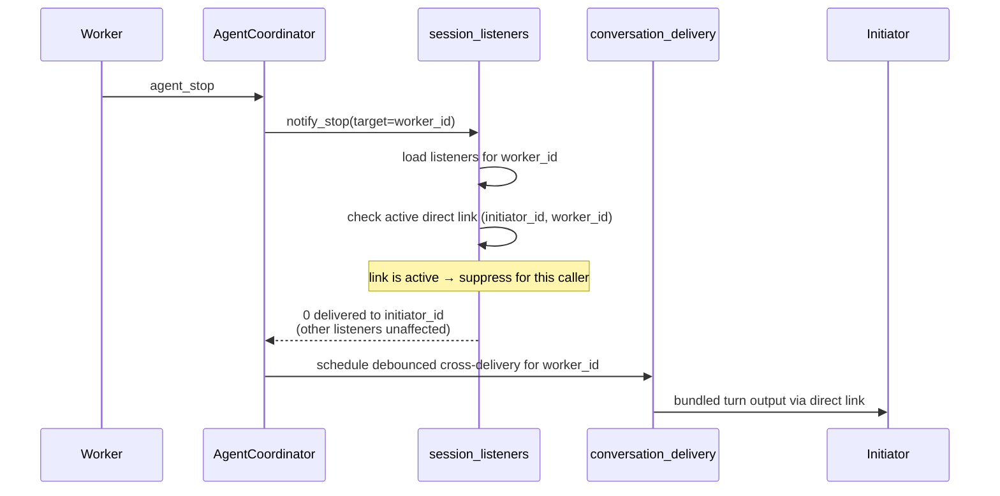

# AI-to-AI Dispatch — Design

## Required reads

- @docs/local/spec/session-subscriptions.md
- @docs/local/design/architecture/session-listeners.md

## Purpose

Enable one AI session (the **Initiator**) to spawn and supervise another (the **Worker**) asynchronously, with stop notifications delivered into the Initiator's tmux when the Worker's turn finishes. Supports fire-and-forget delegation, parallel autonomous execution, and asymmetric attention — the Initiator stays focused on its own work while the Worker progresses on the side.

This design covers the dispatch journey. Storage internals for the listener registry live in `session-listeners`. The state contract that this flow obeys lives in `session-subscriptions`.

### The personal-assistant launch

`run-pa` is a third invocation beside `run` and `start`. It carries an optional
brief and no target: the authenticated edge resolves which person the caller is through the
identity contract, reads that person's workspace from the person registry, and
creates the session there with no parent. The general verbs are unchanged and
remain ordinary routes to any folder, a person's included; the launch is the
route that removes aiming, not the only route. The inbound messaging adapters
already derive a person's workspace the same way, from the person behind a
conversation.

The launch's ownership is stated in this cross-cutting design. The agent-runtime
domain anchor carries no forward architecture.

## Inputs/Outputs

**Inputs:**

- `telec sessions run` or `telec sessions start` invocation from the Initiator (CLI or API). Carries target computer, project path, command or message, and (when relevant) `--direct`.
- `telec sessions run-pa` invocation from a caller resolving to a person. Carries an optional brief and
  nothing else: no path, no subfolder, no computer, and no person. Each of those
  is derived from the authenticated caller.
- Initiator's session identity (`X-Caller-Session-Id` header / equivalent) — pins the dispatcher identity on the new session.
- Worker `agent_stop` events from the agent CLI hook receiver.

**Outputs:**

- New Worker session record in the database. A dispatch made by an initiator
  records that initiator; a launch that pins no parent records none.
- Persistent listener row registered for the (Initiator → Worker) pair
  (`one_shot=false`), for a dispatch that has an initiator to notify.
- Stop notification injected into the Initiator's tmux when the Worker's turn ends — subject to the suppression rule in `session-subscriptions`. A session with no initiator produces none.

## Invariants

- **A person is derived, never addressed.** `run-pa` resolves its target from the
  authenticated caller's identity. The surface exposes no parameter naming a
  person, in any form, and a request carrying an unexpected field is rejected
  rather than stripped.
- **A platform admin gets their own assistant.** The call has one form and
  elevation does not widen it.
- **No caller identity, no launch.** A caller resolving to no person is refused,
  never defaulted.
- **Person workspaces stay ordinary destinations.** The general verbs start a
  session in a person's folder exactly as in any other folder. Dispatch places no
  gate on where a session lands.
- **The launch pins no parent.** No initiator is recorded for the session it
  starts, so nothing holds authority over its ending and it ends itself. The
  caller's identity resolves the person; it does not become a parent link.
  Parentage is distinct from the listener suppression that `detach` expresses
  elsewhere in this design: suppression decides who is notified, parentage
  decides who may end the session, and neither implies the other.
- **The launch carries only the supplied brief.** `run-pa` passes an optional
  brief through unchanged, without framing or added instructions. Without a
  brief, it starts the assistant with no opening message
  (`local/projects/teleclaude/spec/feature/agent_runtime/person-workspace-dispatch`).
  The assistant's conduct is governed by `personal/policy/assistant-conduct`.
- **A declared job runs only through the scheduler.** A job declared in
  configuration is launched through the scheduled path, which derives its routing
  from that declaration and runs under a job runner's role. A brief names no job
  and the launch carries no command, so no brief reaches that path. This bounds
  the scheduler's own transport only; what an assistant does when asked directly
  for work of the same kind is settled by the conduct contract it loads.
- **Person resolution and workspace location are consumed, not restated.** Which
  person a caller is resolves through the identity contract; where that person's
  workspace lives is read from the person registry. Dispatch owns only the launch
  that binds them.
- **Initiator pinning records dispatch, not command.** The dispatcher's session id is stored as `initiator_session_id` on the Worker record at creation time. It is the canonical link from child to parent, it survives daemon restart, and it is what caller-scoped cleanup and the todo claiming group read. A standing role — the integrator, the project coordinator, a scheduled job runner — takes its work from a queue, a schedule, or the fleet, so no session is pinned for it through any door, including adoption of a session already running. The human identity the work runs under is copied onto the session at creation and does not depend on the link surviving.
- **Listener kind.** Dispatch registers a persistent listener (`one_shot=false`). Repeat dispatches against the same target are deduplicated by `(caller, target)`.
- **No destructive coupling.** Opening a direct link to the Worker does not remove the dispatch-time listener. The link toggles delivery (suppression rule) but never mutates the listener row. Refuted code paths: `unregister_listener(...)` calls inside `_link_direct_sessions` and `_create_direct_link`.
- **Notification source of truth.** Stop events flow through `AgentCoordinator → session_listeners.notify_stop`. No second notification path bypasses the registry.
- **Tmux is the delivery surface.** Listener notifications are injected via `deliver_listener_message` into the Initiator's tmux session, identified by `caller_tmux_session` on the listener row.
- **Suppression while linked.** When a direct link is active between the Initiator and the Worker, listener notifications for that Initiator are skipped. The link's cross-delivery channel carries the relevant signal. See `session-subscriptions` for the canonical rule.

- **An orchestrator's authority runs downward only, and a Worker acts on no session.** A session never messages, opens or closes a direct conversation with, unsubscribes from, ends, or restarts an orchestrator above it in the dispatch chain; any other dispatch confers no mandate and restricts no upward act. The Worker's completed turn already wakes the Initiator, so the result belongs in the Worker's own output and artifacts. A Worker messages, links to and tails no other session; downward and sideways acts belong to orchestrating and standing sessions and to a session with nothing above it. See `local/projects/teleclaude/spec/feature/agent_runtime/session-authority` for the canonical rule.

## Primary flows

### 1. Dispatch and registration



### 2. Stop-time notification (no link active)



### 3. Stop-time with an active direct link (suppression path)



### 4a. The personal-assistant launch

```mermaid
sequenceDiagram
    participant Caller as Authenticated caller
    participant API as Sessions API
    participant Identity as Identity contract
    participant Registry as Person registry
    participant Create as Session creation
    participant PA as Assistant tmux

    Caller->>API: run-pa { optional brief }<br/>authenticated caller only
    API->>Identity: resolve person for this caller
    alt no person resolves
        Identity-->>API: none
        API-->>Caller: refused — no person for caller
    else person resolves
        Identity-->>API: person
        API->>Registry: workspace for this person
        Registry-->>API: destination
        API->>Create: command with that destination,<br/>no parent, no listener
        alt brief supplied
            Create->>PA: spawn with only the supplied brief
        else no brief supplied
            Create->>PA: spawn without an opening message
        end
        Create-->>API: session id
    end
```

### 4. Caller cleanup

```mermaid
sequenceDiagram
    participant Daemon
    participant Listeners
    participant Links as conversation_links

    Daemon->>Daemon: detect initiator session ended
    Daemon->>Listeners: cleanup_caller_listeners(initiator_id)
    Daemon->>Links: cleanup_session_links(initiator_id)
    Note over Listeners,Links: both axes cleared in one pass
```

## Failure modes

- **Accepting a person argument and validating it.** This reads as the same
  guarantee reached more flexibly and is a different one: anything a caller can
  pass is something a caller can be talked into passing by content it was asked
  to read. The security property is that no such parameter exists.
- **Silently dropping an unexpected person field.** A request model or parser
  that ignores what it does not recognise honours the brief while appearing to
  accept the addressing attempt. The attempt is rejected.
- **Treating existing detachment as absence of a parent.** Detachment and parentage
  are independent: a detached launch still records the caller that started it and
  only forgoes the dispatch-time subscription. A launch that reuses detachment
  alone produces an assistant with a parent that never listens, which is neither
  the governed shape nor the parentless one.
- **Refusing person-folder destinations on the general verbs.** Making the launch
  the only route turns a convenience into a gate. The inbound messaging adapters,
  side projects nested in a person's folder, and person-scoped work all start
  sessions there through the ordinary creation path, and a destination refusal
  removes them along with the route it was aimed at. Containment of what an agent
  in a person's folder may reach belongs to a sandbox, not to dispatch.

- **Worker session crashes before any turn completes.** No `agent_stop` ever fires for it; the listener row remains until caller cleanup or explicit unsubscribe. Diagnose via `telec sessions tail <worker_id>` and lifecycle status in the sessions table.
- **Initiator tmux gone before notify.** `deliver_listener_message` logs the failure; the listener row is still removed when it is `one_shot=true`, retained when persistent. Persistent listeners with no live tmux become silent — caller cleanup is the resolution.
- **Daemon restart between dispatch and stop.** Listener rows are durable (SQLite); the registration survives the restart. Recovery requires no caller action.
- **Direct link opened then closed mid-turn.** Suppression toggles cleanly per notify call — the next event after sever delivers normally.
- **Duplicate dispatch against the same worker.** Register is deduped by `(caller, target)`; second attempt is a no-op.
- **Initiator never unsubscribes after worker ends.** Caller-session cleanup removes residual listener rows when the Initiator session itself ends. Until then, the row is idle and harmless.
