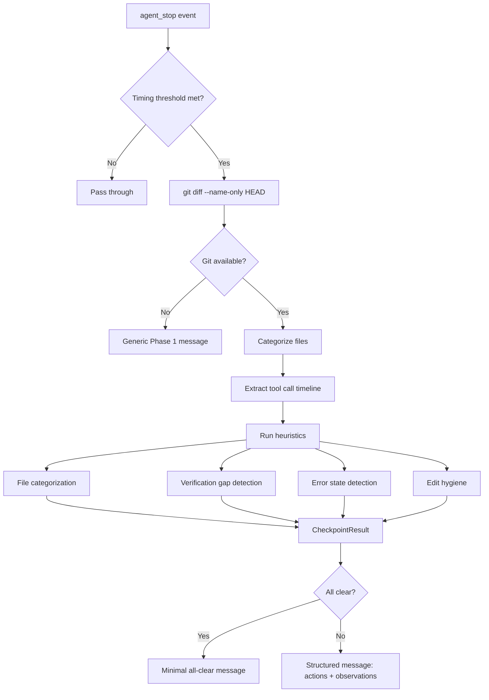
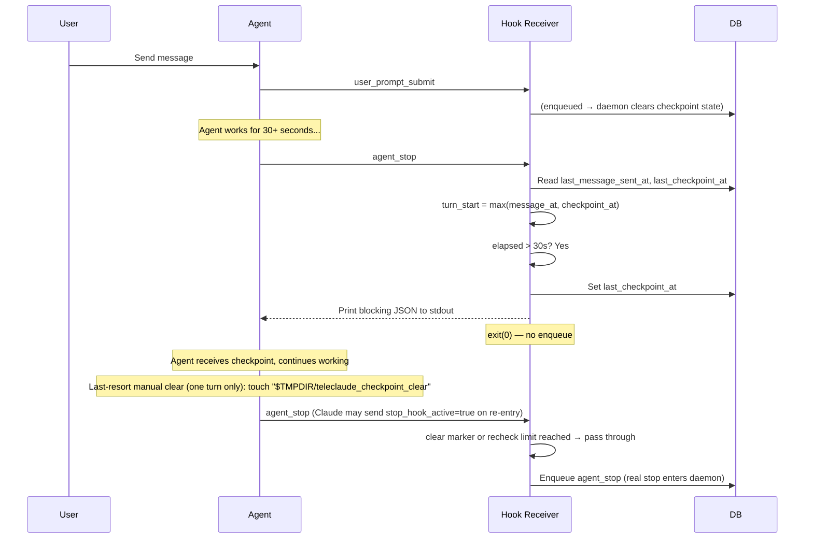
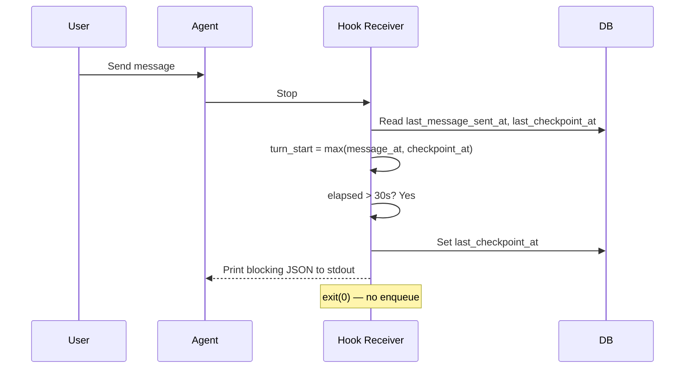
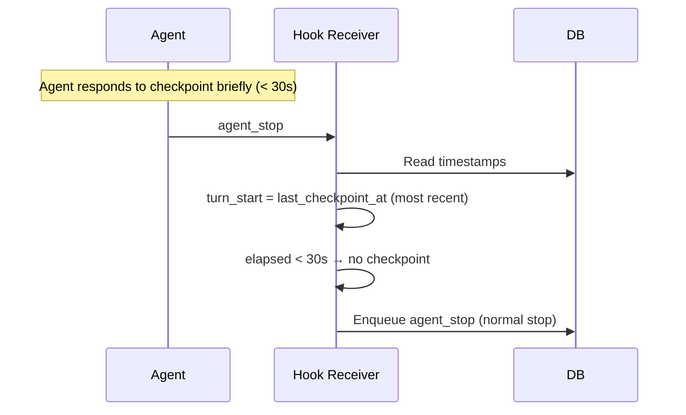
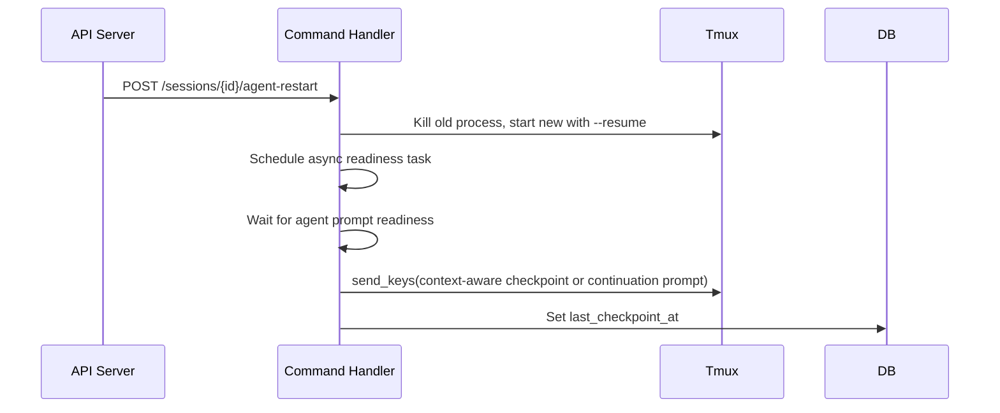

# Checkpoint System — Design

## Purpose

Deliver context-aware checkpoint messages to AI agents at natural work boundaries, prompting them to validate work and capture artifacts. The system uses a unified timer based on the most recent input event and keeps checkpoint messages invisible to session state.

Checkpoint hook output uses the semantic-envelope registry's XML renderer at the hook boundary. Bracket checkpoint recognition is retained only for historical transcript compatibility; it is not an output codec.

Two signal axes feed a shared checkpoint builder (`checkpoint.py`):

1. **File-based** — `git diff --name-only HEAD` maps changed files to file categories and judgment actions (for example, changed code may owe a live-runtime log check). After an integration-controlled canonical-root advancement, the checkout-scoped range marker carries only the outstanding log judgment when the advanced paths owe one. Deterministic maintenance is recorded and started at the advancement boundary, then runs outside checkpoint evaluation. Git is the category oracle only — never the arbiter of what is in-scope or done.
1. **Transcript-based** — Tool call timeline from the current checkpoint cycle provides file attribution, suppression evidence (action already taken), error state detection, and edit hygiene observations.

<!-- planned-change:antigravity-native-subagents-allowed -->

One delivery path exists:

- **Claude/Gemini/Codex**: Hook-based invisible checkpoint. The hook receiver (`receiver.py`) evaluates the checkpoint condition at the `agent_stop` boundary and returns blocking hook output to stdout. The agent keeps running without the checkpoint text appearing in the tmux pane.

<!-- change:antigravity-native-subagents-allowed -->

Two delivery paths exist:

- **Claude/Gemini/Codex**: Hook-based invisible checkpoint. The hook receiver (`receiver.py`) evaluates the checkpoint condition at the `agent_stop` boundary and returns blocking hook output to stdout. The agent keeps running without the checkpoint text appearing in the tmux pane.
- **Antigravity turn completed on a subagent's hook**: the turn completion of an Antigravity conversation can arrive on its provider-native subagent's idle `Stop` (`local/projects/teleclaude/spec/hook-normalized-events`). The receiver evaluates the checkpoint for the conversation's session exactly as at any `agent_stop`, answers the subagent's hook with the plain success response, and relays a required checkpoint through the hook outbox to control delivery, which brings it to the conversation (`local/projects/teleclaude/spec/feature/agent_runtime/control-delivery`).

<!-- /planned-change:antigravity-native-subagents-allowed -->

All agents call the same `get_checkpoint_content()` entry point, ensuring parity.

## Inputs/Outputs

**Inputs:**

- `agent_stop` hook event — Agent's turn ended. Triggers checkpoint evaluation.
- `user_prompt_submit` hook event — New user input. Hard-clears the recheck and clear flags for the new turn.
- `pre_tool_use` hook event — Agent finished reasoning. Tracked for other uses but not used in checkpoint decisions.
- Agent restart via API — Triggers unconditional checkpoint injection after a delay.
- `git diff --name-only HEAD` — Uncommitted files relative to HEAD, used as the category oracle for action instructions.
- Integrator-maintenance marker — checkout-scoped marker carrying canonical-root advancement ranges that still await log judgment; any integrator session on that checkout can surface and discharge it without repeating deterministic maintenance.
- `TurnTimeline` — Ordered tool calls from the current checkpoint cycle, extracted from the agent transcript via `extract_effective_tool_calls(..., scope="checkpoint")`.

- `CheckpointContext` — Session context: project path, agent name, and `role` (e.g. `"integrator"`, the session's one catalog role) threaded from the session row by the receiver. The working slug accompanies structured diagnostic records.

**Outputs:**

- `CheckpointResult` — Structured heuristic output: matched file categories, required actions, observations, all-clear flag.
- **Claude/Gemini**: Blocking JSON printed to stdout by `receiver.py`. Claude: `{"decision": "block", "reason": <context-aware message>}`. Gemini: `{"decision": "deny", "reason": <context-aware message>}`. The `agent_stop` event is NOT enqueued (agent stays running). For Claude, the reason is injected as a `<system-reminder>`. For Gemini, the reason becomes a new prompt triggering a retry turn.
- **Codex**: Blocking JSON printed to stdout by `receiver.py`: `{"decision": "block", "reason": <context-aware message>}`. The `agent_stop` event is NOT enqueued (agent keeps running). The `reason` becomes Codex's continuation prompt.
- DB field updated: `last_checkpoint_at`.

## Invariants

1. **Unified turn timer**: `turn_start = max(last_message_sent_at, last_checkpoint_at)`. The most recent input event (real user message or previous checkpoint) marks when the agent's current work period began. If `now - turn_start < 30s`, the checkpoint is skipped. This works identically for all agent types and both delivery paths.

2. **Checkpoint messages are invisible to session state**: They never persist as user input. `handle_user_prompt_submit` returns early (before notification clearing or DB writes). The native session transcript retains them as ground truth.

3. **Notification flag preservation**: Checkpoint injections do not clear the notification flag. Only real user input clears it. This prevents users from missing notifications about completed agent work.

4. **Per-turn clearing**: `handle_user_prompt_submit` clears `last_checkpoint_at` and `last_tool_use_at` on real user input so each turn starts fresh.

5. **Atomic, time-anchored checkpoint-cycle scope**: Checkpoint action selection and evidence — what judgment remains and what was observed — are scoped from the latest TeleClaude checkpoint emitted by the `Stop` hook. Before any checkpoint exists in the work, the scope falls back to the latest real user input. Dirty files from the broader user turn are filtered through this checkpoint-cycle transcript slice, so old dirty files cannot trigger new checkpoint actions after a reset. A commit records and starts deterministic maintenance at its own boundary and creates no later checkpoint maintenance obligation. Git is consulted only as the category oracle, never as the arbiter of in-scope or done.

6. **TTS dedup**: Agent output extracted at `agent_stop` is compared against `last_output_raw` in the session. If identical, summarization and TTS are skipped. This prevents double-speaking when a checkpoint-induced `agent_stop` re-extracts the same output.

7. **DB-persisted state**: Checkpoint state lives in the sessions table (`last_checkpoint_at`, `last_message_sent_at`). No in-memory state. Survives daemon restarts.

8. **Post-restart unconditional injection**: After an agent restart via the API, checkpoint injection bypasses the 30-second threshold but still waits for agent prompt readiness before sending the continuation prompt or checkpoint.

9. **Turn-scoped hook escape hatch**: The receiver honors a per-session clear marker file (`teleclaude_checkpoint_clear`) in the session temp directory. If present, `agent_stop` passes through immediately for the current turn; the marker is hard-cleared at the next `user_prompt_submit`, so a manual clear lasts one turn only. The involuntary recheck loop-guard (re-entry limiter) is retained as the hard backstop against an evidence-miss spinning forever. Otherwise, every `agent_stop` evaluates the current checkpoint-cycle scope; repeated stop events are acceptable because the latest checkpoint prompt resets files, evidence, and errors together.

<!-- planned-change:antigravity-native-subagents-allowed -->

10. **Hook stop suppression**: When `_maybe_checkpoint_output` fires for Claude/Gemini/Codex, the receiver prints blocking JSON and exits without enqueuing the `agent_stop` event. The daemon never sees the blocked stop, so no output extraction, TTS, or listener notifications fire for checkpoint turns.

<!-- change:antigravity-native-subagents-allowed -->

10. **Hook stop suppression**: When `_maybe_checkpoint_output` fires for Claude/Gemini/Codex, the receiver prints blocking JSON and exits without enqueuing the `agent_stop` event. The daemon never sees the blocked stop, so no output extraction, TTS, or listener notifications fire for checkpoint turns.

    A relayed checkpoint suppresses the forwarded `agent_stop` the same way, for every session: the turn completion is published only when the checkpoint turn it starts ends.

<!-- /planned-change:antigravity-native-subagents-allowed -->

11. **Suppressibility**: Every judgment-action heuristic checks for positive evidence in the checkpoint-cycle tool-call timeline. If the expected judgment action was already performed in that cycle (for example, a log check or targeted test), its instruction is suppressed. `telec repo commit` output that reaches the main-branch classification gate is evidence that the commit-options step was performed, even though no approved commit occurred. When all instructions are suppressed and no observations remain, the checkpoint is "all-clear".

12. **Two-layer error detection**: Layer 1 (structural gate) only fires for tool results with `is_error: true`. Layer 2 (content enrichment) pattern-matches the result snippet to produce targeted feedback. Successful commands with error-like output (e.g., log viewers showing tracebacks) never trigger observations.

13. **Fail-open design**: Git unavailable → generic Phase 1 message. Transcript unavailable → file-based instructions only (no suppression). Any exception in the builder → generic Phase 1 message. The checkpoint never blocks due to infrastructure failure.

14. **Delivery parity**: Claude, Gemini, and Codex all call the same `get_checkpoint_content()` entry point through the hook receiver, ensuring identical heuristic output regardless of agent runtime.

15. **Dynamic log-check window**: An ordinary turn-local log action derives its window from the turn start (`max(last_message_sent_at, last_checkpoint_at)`), rounded up to minutes with a minimum of `2m`. An integrator-maintenance marker instead anchors the log window at or before its earliest recorded activation and accepts only a log read made after its latest maintenance-ready time. A later read therefore covers the activation and the post-maintenance interval rather than inheriting the short turn-local window.

16. **Commit-options checkpoint policy**: Checkpoints may require running `telec repo commit` to surface the commit classification/options flow, but they must not force an approved commit at `agent_stop`. Commit decisions belong to task-completion flow and human/review gates.

17. **Silent housekeeping + short debrief policy**: Checkpoint payloads instruct agents to execute checkpoint-required housekeeping silently, then provide a short user-relevant debrief focused on task outcome, blocker, or decision request. Checkpoint chore details are omitted from user-facing messages.

18. **Code-scoped post-commit review gate**: The session-scoped authored-main-commit latch is armed by `telec repo commit` only when the committed pathspec includes code. The latch triggers only the post-commit review gate — never the action or evidence ledger; commit-action suppression derives from commit evidence in the timeline, not from the latch. Doc-only main commits commit but do not arm the review gate — under doc-first, documentation is reviewed in the lifecycle, not at the post-commit review gate.

<!-- planned-change:commit-maintenance-sheds-platform-work -->

19. **Integrator post-advance judgment**: Every canonical-main advancement records the tailored deterministic maintenance resolved for its immutable activation and starts the one-shot drain. A root commit enters through post-commit; a merge or fast-forward enters through post-merge. After the action records are durable, that same commit boundary records a checkout-scoped marker when the changed paths owe `log-check`, including a direct main commit with no todo candidate. The marker accumulates qualifying activations, each with its activation time, and carries no mechanical action id. It becomes eligible for log judgment only after every owed action for those activations has terminal success, where the restart action succeeds only once its stopped-daemon window has verified the started daemon (`local/projects/teleclaude/spec/feature/integration/post-commit-maintenance`) and the runtime's behavior after it is judged by the log read rather than by the action; a pending, failed, or interrupted action keeps the marker outstanding. The executor records the latest maintenance-ready time on the marker when this condition is met. An absent ready time also keeps the marker outstanding for integrator recovery if the executor was interrupted after removing its last action file. The integrator then reads structured results and runtime logs covering the earliest activation through the post-maintenance interval. A log read made before that ready time or with a window beginning after activation never discharges the marker. The activation's settlement announcement brings the integrator to the marker, which it finds even when an action's success file was removed before it read. Ordinary committing sessions do not receive a maintenance log judgment their project assigns to the integrator; delayed anomalies remain eligible for the log bug hunter. Checkout addressing lets a successor integrator inherit an unfinished judgment without repeating mechanical maintenance.

<!-- change:commit-maintenance-sheds-platform-work -->

19. **Integrator post-advance judgment**: Every canonical-main advancement records the tailored deterministic maintenance resolved for its immutable activation and starts the one-shot drain. A root commit enters through post-commit; a merge or fast-forward enters through post-merge. After the action records are durable, that same commit boundary records a checkout-scoped marker when the changed paths owe `log-check`, including a direct main commit with no todo candidate. The marker accumulates qualifying activations, each with its activation time, and carries no mechanical action id. It becomes eligible for log judgment only after every owed action for those activations has terminal success (`local/projects/teleclaude/spec/feature/integration/post-commit-maintenance`), and the runtime's behavior after it is judged by the log read rather than by the action; a pending, failed, or interrupted action keeps the marker outstanding. The executor records the latest maintenance-ready time on the marker when this condition is met. An absent ready time also keeps the marker outstanding for integrator recovery if the executor was interrupted after removing its last action file. The integrator then reads structured results and runtime logs covering the earliest activation through the post-maintenance interval. A log read made before that ready time or with a window beginning after activation never discharges the marker. The activation's settlement announcement brings the integrator to the marker, which it finds even when an action's success file was removed before it read. Ordinary committing sessions do not receive a maintenance log judgment their project assigns to the integrator; delayed anomalies remain eligible for the log bug hunter. Checkout addressing lets a successor integrator inherit an unfinished judgment without repeating mechanical maintenance.

<!-- /planned-change:commit-maintenance-sheds-platform-work -->

20. **The commit boundary records what a commit's paths owe**: A sealed `telec repo commit` on the canonical checkout's main branch records and starts the maintenance its committed paths owe (`local/projects/teleclaude/spec/feature/integration/post-commit-maintenance`) before returning. The checkpoint engine carries no mechanical maintenance obligation against that commit: action records and structured outcomes belong to the one-shot executor, not transcript substring matching. Tests remain cycle-local advisories on the dirty tree. In this repository no path owes `log-check`: a commit activates nothing live, and each install's runtime is judged by the installation inspector (`local/projects/teleclaude/policy/test-moratorium`). The commit remains the attributing action for files the agent committed but did not itself Edit or Write. The post-commit review latch of Invariant 18 is unaffected — routing review is a judgment, not a command, and the latch that arms it is independent of maintenance completion.

21. **Companion-drift detection**: when a turn's changed files include a live parent doc snippet (`<stem>.md`) whose non-empty pending companion sibling (`<stem>.<slug>.md`) exists on disk but is absent from the changed set, the engine surfaces an action to mirror the parent edit into the companion — catching, at agent_stop, the edit that the companion would otherwise clobber when it replaces the parent at delivery. An empty companion retires its parent instead of replacing it (`general/spec/snippet-authoring-schema`), so no edit is clobbered and it is never a mirror target. The check is a filename-derived presence and size test (reusing the companion-detection helpers the doc index uses); companion in the changed set suppresses it for free. It mechanizes only the question code may answer (presence); whether the companion is a correct mirror stays with the reviewer (intelligence-boundaries).

### Invariant 22 — Base ⊕ overlay action set

The effective action model is a TeleClaude-owned **platform-universal base** merged with a **project-declared overlay** in `teleclaude.yml` (`ProjectConfig`). The base contains disjoint checkpoint and maintenance registries plus one binding table. Base bindings attach per subscribed capability (`local/projects/teleclaude/spec/feature/config/project-capability-manifest`): `docs: enabled` and `agents: enabled` activate their fixed scopes (`docs/**`; `agents/**`, `.agents/**`, `**/AGENTS.master.md`) carrying artifact-pipeline maintenance; `code: enabled` activates toolchain maintenance and the slug-parameterized log judgment on changed code (`instrukt-ai-logs <project_slug>` with the slug read from `ProjectConfig`, superseding the hardcoded command in Invariant 15). A binding names the action a changed path owes without regard to which registry declares it. The overlay extends each registry with the project's own actions. Unreadable project config fails open to both base registries and the base bindings — the fail-open posture of Invariant 13 extended to configuration.

The platform base registries and bindings are owned by
`teleclaude/constants.py`; capability composition belongs to
`base_checkpoint_model`. Blueprint membership and its activation binding
participate only in code-enabled projects. Other base registry membership
remains unconditional, with capability-gated path bindings. Consumers resolve
the composed model rather than imposing their own capability rules, under
`sdlc/policy/domain-ownership`.

<!-- planned-change:commit-maintenance-sheds-platform-work -->

23. **Action registries and bindings (verb/noun split)**: Detection is three tables joined by action id. The **checkpoint registry** maps an id to the agent-facing `run`, transcript `evidence`, `main_only`, `off_main_eligible`, `precedence`, and optional `evidence_must_follow_last_mutation`; it carries no executable command. The **maintenance registry** maps an id to the `command` an automated consumer executes, `main_only`, `precedence`, its on-demand disposition (Invariant 29), and whether it runs while the daemon serves; it carries no agent-facing instruction or transcript evidence. Automated consumers execute selected maintenance actions in precedence waves: equal-precedence actions run concurrently, the next wave waits for every prior terminal outcome, and failure never cancels a later wave. An owed `restart` action is not a wave: it is the stopped-daemon window the other owed actions run inside, except the actions declared to run while the daemon serves, which run as waves after the window's verified start (`local/projects/teleclaude/spec/feature/integration/post-commit-maintenance`). The single **binding table** maps a scope to action ids without owning registry membership. Each action id belongs to exactly one registry, while every binding and consumer resolves through the same joined model.

<!-- change:commit-maintenance-sheds-platform-work -->

23. **Action registries and bindings (verb/noun split)**: Detection is three tables joined by action id. The **checkpoint registry** maps an id to the agent-facing instruction and the transcript evidence of its judgment; it carries no executable command. The **maintenance registry** maps an id to the command an automated consumer executes and its on-demand disposition (Invariant 29); it carries no agent-facing instruction or transcript evidence. Each registry's fields are declared by `teleclaude/config/checkpoint_schema.py`. Automated consumers execute selected maintenance actions in precedence waves: equal-precedence actions run concurrently, the next wave waits for every prior terminal outcome, and failure never cancels a later wave. No maintenance action stops, starts or replaces the daemon (`local/projects/teleclaude/spec/feature/integration/post-commit-maintenance`). The single **binding table** maps a scope to action ids without owning registry membership. Each action id belongs to exactly one registry, while every binding and consumer resolves through the same joined model.

<!-- /planned-change:commit-maintenance-sheds-platform-work -->

TeleClaude owns both platform base registries. A project references their ids in its bindings and extends the registry whose eligibility contract its project-specific action satisfies.

Canonical-main activation bindings select main-only maintenance independently
of the changed-path set, including an empty commit. They are a declared trigger
alongside path and event bindings, resolved by the shared model and matcher.
The agent-stop engine continues to select judgment actions from path bindings;
an activation binding names maintenance only. Capability composition admits the
Blueprint action and its activation binding only in code-enabled projects.

<!-- planned-change:commit-maintenance-sheds-platform-work -->

Blueprint maintenance runs after its toolchain prerequisites and, when the
activation owes the daemon's replacement, after the stopped-daemon window's
verified start, while the daemon serves. Its writer takes the Blueprint
serialization boundary beneath the maintenance drain boundary. Query
observation waits through the maintenance completion interface and then pins a
published generation; it performs no extraction and holds no Blueprint lock
while waiting for maintenance. This lock order and one execution owner follow
`sdlc/policy/code-quality-practices` and `sdlc/principle/design-fundamentals`.

<!-- change:commit-maintenance-sheds-platform-work -->

Blueprint maintenance runs after its toolchain prerequisites, while the daemon
serves. Its writer takes the Blueprint
serialization boundary beneath the maintenance drain boundary. Query
observation waits through the maintenance completion interface and then pins a
published generation; it performs no extraction and holds no Blueprint lock
while waiting for maintenance. This lock order and one execution owner follow
`sdlc/policy/code-quality-practices` and `sdlc/principle/design-fundamentals`.

<!-- /planned-change:commit-maintenance-sheds-platform-work -->

The cache baseline and query guarantee belong to `sdlc/spec/codebase-blueprint`;
the local behavioral contract is
`local/projects/teleclaude/spec/feature/workflow/blueprint-freshness`.

Every checkpoint-registry action also carries its judgment owner: an ordinary session by default, or the standing integrator for each main-only judgment action a project lists in `checkpoint.integrator_judgment`. A listed id that names no main-only checkpoint-registry action is rejected when the project's configuration is validated. The file-based engine defers an integrator-owned action for every non-integrator session, on main and off it. The declaration governs session surfacing only: the checkout-scoped marker of Invariant 19 is recorded for every qualifying advancement whether or not a project declares it, so the standing integrator judges canonical-main maintenance in every project, and a project that declares nothing also keeps each judgment surfaced to its own sessions. A project whose post-activation log judgment belongs to the integrator alone declares it there.

<!-- planned-change:commit-maintenance-sheds-platform-work -->

An action is eligible for the checkpoint registry only when its outcome cannot be established by the mechanism that performs it: the checkpoint registry governs what an agent must judge and act on, never what a command either did or did not do. Deterministic maintenance therefore carries no checkpoint registry entry and is declared in the **maintenance registry** instead — `checkpoint.maintenance` in a project's `teleclaude.yml`, a map of action id to `command`, `main_only`, `precedence`, the optional on-demand `on_demand` disposition and `owed_probe` command (Invariant 29), and the optional `runs_while_serving` flag, beside the `checkpoint.actions` map that declares judgment actions with `run` and `evidence`. An action id belongs to exactly one of the two registries across base and overlay together, and a declaration claiming an id the opposite registry already owns is rejected when the project's configuration is validated. Both registries are joined by action id into one merged model, so a single binding table and a single scope matcher serve every consumer; what differs is which registry a consumer reads. The `agent_stop` engine reads the checkpoint registry alone, which is what makes a mechanical action unsurfaceable rather than merely unsurfaced. A project declares its own actions in whichever registry this test places them. An action declares `runs_while_serving` only once it is shown to replace nothing the daemon runs on; the platform base declares it for Blueprint maintenance and publication. An action without it runs inside the stopped-daemon window whenever its activation owes one.

<!-- change:commit-maintenance-sheds-platform-work -->

An action is eligible for the checkpoint registry only when its outcome cannot be established by the mechanism that performs it: the checkpoint registry governs what an agent must judge and act on, never what a command either did or did not do. Deterministic maintenance therefore carries no checkpoint registry entry and is declared in the **maintenance registry** instead — `checkpoint.maintenance` in a project's `teleclaude.yml`, beside the `checkpoint.actions` map that declares judgment actions, each with the fields `teleclaude/config/checkpoint_schema.py` declares. An action id belongs to exactly one of the two registries across base and overlay together, and a declaration claiming an id the opposite registry already owns is rejected when the project's configuration is validated. Both registries are joined by action id into one merged model, so a single binding table and a single scope matcher serve every consumer; what differs is which registry a consumer reads. The `agent_stop` engine reads the checkpoint registry alone, which is what makes a mechanical action unsurfaceable rather than merely unsurfaced. A project declares its own actions in whichever registry this test places them.

<!-- /planned-change:commit-maintenance-sheds-platform-work -->

The conventional kinds `docs`, `agents`, and `code` are sugar over bindings: `docs` and `agents` carry fixed base scope and default actions; `code` carries a project-declared scope onto which the base `test` / `log-check` actions attach automatically.

24. **Code is an allowlist; there is no code/non-code classifier**: "Owes `test` + `log-check`" is an ordinary action set bound to a project-declared `code` scope — broad source-root globs authored at analyze-time by intelligence, never sniffed at runtime. A changed file owes test+log iff it matches such a binding; an unmatched file is silent. There is no `is_code` flag, no enumerated non-code set, and no collective cross-category code detection. A code-shaped path that must skip validation (vendored, generated) is carved out with the binding's own `exclude`. Action selection is structural glob + evidence matching over the merged declaration only — no runtime code path inspects file language or content (`general/principle/intelligence-boundaries`).

25. **One matcher, registry-owned consumer eligibility**: A single scope matcher (`include` → `override` → `exclude`) resolves the owed action set from the same merged `(registry, bindings)` for every consumer. The agent-stop engine surfaces judgment actions; post-commit and integration canonical-root advancement execute matching commands; the authored-main latch retains review routing. Consumers never recreate path, capability, location, or command tables from action ids, so tailored bindings and the registry remain the single policy owner.

### Invariant 26 — Capability-gated engine activation

The engine evaluates a turn only when the project subscribes at least one checkpoint-relevant capability — `code`, `docs`, or `agents` enabled in `teleclaude.yml`, or any project-declared binding present (`local/projects/teleclaude/spec/feature/config/project-capability-manifest`). A project with no subscribed capability receives no checkpoint at `agent_stop`: no timeline extraction, evidence scan, or commit decision — silence is derived from having nothing to enforce, never declared through an independent kill-switch. There is no standalone engine on/off flag; the `checkpoint:` section remains the overlay declaration only (Invariant 22). Commit decisions belong to `code ∨ docs`, the capabilities whose contract includes authoring committed work. Capability toggles are authored at analyze-time (`local/projects/teleclaude/procedure/checkpoint-overlay-projection`); the runtime reads the declaration only. This extends Invariant 24 one level up: no enabled/disabled classifier at engine level, only subscribed capabilities.

### Invariant 27 — Mutation ordering

The checkpoint reads mutation paths from the runtime's structured file-edit
records in the current checkpoint cycle. Commit evidence is evaluated after
the last matching record for the attributed files, or across the cycle when
there is no matching record. The post-commit review latch is eligible when
the resulting evaluation owes no commit action.

### Invariant 28 — Undeclared-write question

On a shared branch, the engine derives advisory candidates from the same
checkpoint-cycle timeline as Invariant 5: dirty paths the stopping session has
not declared that appear, as an exact path, at a write target of a successful
shell command of that cycle. A write target is a redirection destination, a
path a file-writing command creates, modifies, or removes (not a path it only
reads, such as a copy source), or the destination of a recognized write call
in an interpreter script. That destination is read from the call's own
destination expression, following a bare name to the single assignment that
binds it; a known dirty path named there is a target, and the call's content
and the script's other literals are data. A destination that cannot be read
this way, such as one computed through calls or loops, yields no target,
because the engine never evaluates code. A path that appears only in a quoted
argument of a command
that writes nothing, in heredoc data fed to a command that is not an
interpreter, as data inside a script, or in other non-target text is not at a
write target, so a
command that writes one file while carrying another path as data raises no
question about that other path. The candidates are rendered as a named question
inviting `telec repo add`; they never join the effective file set, never write a
declaration, and never raise an obligation. Edit-tool writes are not
candidates: the hook receiver declares them when the call succeeds
(`sdlc/design/workspace-scoping`). When the effective set is empty but
candidates exist, the engine still produces a decision carrying the question.
Locating write targets from shell syntax outside quotes and heredoc data, and
matching a known dirty path there, is structural; the engine never derives a
path from command text that is not already a known dirty path.

### Invariant 29 — On-demand disposition

`telec sync` performs a root's maintenance on demand through the same executor
(`local/projects/teleclaude/spec/feature/integration/on-demand-maintenance`). An
on-demand run has no activation range, so every declared maintenance action is
owed, and the registry itself tells the run what to do with each one, through
the action's `on_demand` disposition:

- `run`, the default: performed.

- `defer`: never performed on demand. The action's `owed_probe` command
  decides whether the run reports it as owed: it prints one line per reason the
  action is owed, prints nothing when nothing is owed, and exits non-zero when it
  cannot tell. With no probe, or a probe that cannot tell, the run reports that
  it cannot tell. The run names the action's command beside its reasons.

An on-demand run tells each command that it is on demand. Service lifecycle and
deployment follow the non-disruptive contract in
`local/projects/teleclaude/spec/feature/integration/on-demand-maintenance`.
Publication and Blueprint extraction read committed snapshots under their
owning contracts. Other commands read the canonical checkout as it stands.

An action whose command finds nothing to act on in a root completes and says
so rather than failing. The platform base's installation runs the root's
`make install` when the root declares an install target. Without one it reports
nothing to install and succeeds, unless the root subscribes `code`, whose
toolchain contract requires that target, and where its absence stays a failure.
Commit-boundary installation, bound only under `code`, therefore behaves as
before.

<!-- planned-change:commit-maintenance-sheds-platform-work -->

The platform base also declares converging the invoking root to its declaration
as `plumbing-convergence`
(`local/projects/teleclaude/spec/feature/reconciliation/project-plumbing-convergence`).
One base binding carries it beside the capability bindings: while a project's
committed declaration enables a help desk, a change to that declaration owes
`plumbing-convergence` and then publication, and a change to the desk's master
owes publication. In the platform home, a change to the global declaration or
to a person or company declaration owes `plumbing-convergence` and then
publication, and the platform home's publication binding covers its tier
documentation and its fixed home master set. Every on-demand run converges the
root. TeleClaude's overlay overrides `plumbing-convergence` by id with fleet
convergence, bound to its hook templates and to its help-desk and home master
templates, the latter also owing publication.

<!-- change:commit-maintenance-sheds-platform-work -->

The platform base also declares converging the invoking root to its declaration
as `plumbing-convergence`
(`local/projects/teleclaude/spec/feature/reconciliation/project-plumbing-convergence`).
One base binding carries it beside the capability bindings: while a project's
committed declaration enables a help desk, a change to that declaration owes
`plumbing-convergence` and then publication, and a change to the desk's master
owes publication. In the platform home, a change to the global declaration or
to a person or company declaration owes `plumbing-convergence` and then
publication, and the platform home's publication binding covers its tier
documentation and its fixed home master set. Every on-demand run converges the
root. TeleClaude's overlay binds its help-desk and home master templates to
publication only: a change to its hook, help-desk or home master templates
converges the fleet when the release carrying it is installed
(`local/projects/teleclaude/spec/feature/reconciliation/installed-releases`),
never at commit.

<!-- /planned-change:commit-maintenance-sheds-platform-work -->

TeleClaude's overlay declares no action that migrates, restarts or reloads the
platform: its project's commits and on-demand runs change nothing live, and
installing a release performs those effects
(`local/projects/teleclaude/spec/feature/reconciliation/installed-releases`).
The base publication action runs in the platform's project as in any project,
so its commits and on-demand runs publish the platform's documentation and
agent artifacts
(`local/projects/teleclaude/spec/feature/context/sync-pipeline-orchestration`).

<!-- planned-change:commit-maintenance-sheds-platform-work -->

The base `install` action still runs in the platform's project, at the commit
boundary and on demand, and there the project's installer prepares only that
checkout's own development environment and touches no live surface. The
overlay declares no `restart` action, so an on-demand run in the platform's
project opens no stopped-daemon window.

<!-- change:commit-maintenance-sheds-platform-work -->

The base `install` action still runs in the platform's project, at the commit
boundary and on demand, and there the project's installer prepares only that
checkout's own development environment and touches no live surface.

<!-- /planned-change:commit-maintenance-sheds-platform-work -->

An on-demand run fills a command without a range. `{after_sha}` takes the
converged tip, the `--before-sha {before_sha}` pair is omitted, and the
`--home {home}` pair carries the invocation home's path within the repository.
A commit-boundary activation omits the `--home {home}` pair. The publication
action publishes a range's owed homes when it receives a range, and rebuilds the
invocation home and the homes nested beneath it when it receives a home.

### Invariant 30 — Event bindings

Each binding declares exactly one trigger: changed paths, event types, or a
canonical-main activation. `CheckpointBindingConfig` and its closed activation
type own the declaration shape; the effective model keeps these trigger kinds
separate. Activation bindings select main-only maintenance. Trigger integrity
follows `sdlc/policy/code-quality-practices`.

An event binding names exact event types or group patterns resolved by the
platform's shared event-type matcher, and owes only maintenance-registry
actions: a checkpoint-registry id in an event binding is rejected when the
project's configuration is validated, because no agent is present to judge it.

Event bindings are consumed by one more automated consumer beside the commit
boundary (`local/projects/teleclaude/spec/feature/integration/event-bound-maintenance`).
It selects the bindings of the project that is an event's home, on every
computer holding that project's canonical checkout, from the same merged
`(registry, bindings)` model as every other consumer (Invariant 25), and hands
the owed actions to the commit-boundary executor as an event activation. The
agent-stop engine, the commit boundary and on-demand runs never select an event
binding, and the event consumer never selects a path binding. An event binding
alone does not activate the agent-stop engine (Invariant 26). An action that
only event bindings name is not a step of an on-demand run (Invariant 29): it
is owed by an event alone.

An event activation fills `{event_file}`, `{event_type}` and `{event_id}`; the
commit-range placeholders are omitted, each with the flag that precedes it. The
platform's channel convergence is not an event binding of its project: the
installation reacts to its source's pushes and releases itself
(`local/projects/teleclaude/spec/feature/reconciliation/channel-gated-self-update`).

### Invariant 31 — Stable maintenance readiness

An integrator judgment marker's maintenance-ready time records when the
condition of Invariant 19 became met: the end of the drain that left every owed
action for the marker's activations with terminal success. A later drain that
completes no owed action for those activations leaves an established ready time
unchanged, whether it runs only event activations, retries another activation's
action, or finds nothing to run. Only a new qualifying activation clears the
ready time, and the next time the accumulated activations become ready replaces
it. A covering log read made after the ready time therefore stays admissible
until the marker discharges: no owed maintenance completed after it, so its
window already covers the activation through completed maintenance, and a drain
that adds no work for the activations never turns completed judgment back into
owed judgment.

## Primary flows

### 0. Context-aware checkpoint builder

### 1. Hook-based checkpoint (Claude/Gemini)

### 2. Hook checkpoint (Codex)

### 3. Checkpoint response cycle (no re-injection for quick responses)

### 4. Post-restart checkpoint (unconditional)

## Failure modes

| Scenario                                                      | Behavior                                                        | Recovery                                            |
| ------------------------------------------------------------- | --------------------------------------------------------------- | --------------------------------------------------- |
| Daemon restart during active turn                             | Timestamps persist in DB; next `agent_stop` evaluates correctly | No action needed                                    |
| DB field missing (migration not run)                          | `AttributeError` on session access                              | Run migration 004; daemon auto-runs on startup      |
| Agent silent after checkpoint                                 | Same output re-extracted at next `agent_stop`                   | TTS dedup skips speaking; DB still updates          |
| Rapid successive stops (< 30s)                                | Checkpoint skipped due to threshold                             | Correct behavior                                    |
| Codex checkpoint loop                                         | Hook re-entry limiter detects repeated blocked stop             | Correct behavior                                    |
| Both `last_message_sent_at` and `last_checkpoint_at` are None | No turn start → checkpoint skipped                              | First real user message sets `last_message_sent_at` |
| DB unavailable in receiver                                    | `_maybe_checkpoint_output` returns None (fail-open)             | Stop passes through normally                        |
| Hook output malformed                                         | CLI ignores non-JSON stdout; agent stops normally               | Next stop re-evaluates                              |
| Git not available in hook subprocess                          | `_get_uncommitted_files` returns None → generic Phase 1 message | Correct fail-open behavior                          |
| Transcript missing or corrupt                                 | `TurnTimeline(has_data=False)` → file-based instructions only   | No suppression; all actions listed                  |
| Large transcript (>512KB JSONL)                               | Extraction reads full file via `_get_entries_for_agent()`       | Performance acceptable for checkpoint frequency     |
| False suppression (evidence substring in unrelated command)   | Action incorrectly suppressed                                   | Acceptable: false suppression > false negative (R8) |

## See Also

- docs/local/adr/0037-checkpoint-ledger-separates-commit-detection.md
- docs/local/adr/0038-companion-drift-caught-at-checkpoint.md
- docs/local/adr/0043-checkpoint-obligations-discharge-on-evidence.md
- docs/local/adr/0100-commit-maintenance-drains-after-hook-return.md — why maintenance completion is separate from commit and checkpoint completion.

<!-- planned-change:commit-maintenance-sheds-platform-work -->

- docs/local/adr/0127-maintenance-runs-serving-tolerant-steps-after-the-verified-start.md — why maintenance actions that replace nothing the daemon runs on run after the window's verified start.
- docs/local/adr/0129-overlays-can-declare-maintenance-actions-that-run-while-the-daemon-serves.md — why a project overlay can declare that a maintenance action runs while the daemon serves.

<!-- change:commit-maintenance-sheds-platform-work -->

<!-- /planned-change:commit-maintenance-sheds-platform-work -->
