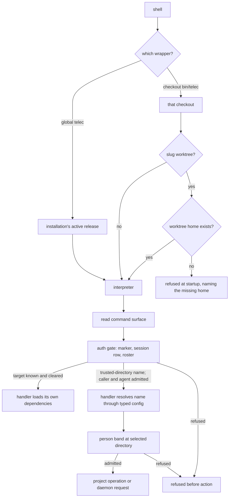

# CLI Invocation Boundary — Design

## Purpose

Give every change that touches the `telec` entry path one account of what happens
between a shell and a command's handler: which checkout's code runs, what may run
before dispatch, and where the caller is authorized. Per-command access lives in
`local/projects/teleclaude/design/cli-authorization-matrix`; caller identity and its carriage live in
`local/projects/teleclaude/spec/identity-and-auth`; the command catalog lives in `CLI_SURFACE`. This
design owns only the path that connects them.

## Inputs/Outputs

**Inputs**

- The wrapper that was invoked: the global `telec`, or a checkout's own `bin/telec`.
- The home the process runs against: for code loaded from a slug worktree,
  that worktree's home; otherwise `TELECLAUDE_HOME`, read once when the
  process starts, defaulting to the live home.
- The command line.
- The caller's identity evidence: the session identity marker and the session row it
  names, or the terminal login outside a session; and the people roster that maps a
  person to a role.

**Outputs**

- The pre-dispatch gate refuses a caller whose session identity names no
  admissible session, or a role outside a band it can decide before dispatch. A
  local caller with no identity is the operator and is cleared as the operator
  (`local/projects/teleclaude/spec/identity-and-auth` §2).

- A handler whose target is already known runs with full command clearance.
- A handler that resolves a trusted-directory name runs with caller and agent
  admission, then either completes person-band clearance on the selected
  directory or refuses before any project operation or daemon request.

## Invariants

1. **The wrapper's location selects the code.** The global `telec` runs the
   installation's active release from any working directory. A checkout's own
   `bin/telec` runs that checkout. The caller's working directory never selects code;
   handlers still receive it as the directory the command acts on.
2. **Worktree code never runs against the live home.** Code loaded from a
   slug worktree runs against the worktree's home — a clone of the home
   repository the platform provisions with the worktree
   (`local/projects/teleclaude/spec/feature/agent_runtime/isolated-home`) — whatever
   `TELECLAUDE_HOME` says, and refuses at startup, naming that home, when it
   is missing. The worktree's `bin/telec` creates no home. The integration
   worktree is not a slug worktree.
3. **`telec repo` grades a change with the change's own code.** Lint lanes, guardrail
   allowlists, schemas and the rendered command surface that judge a worktree's change
   come from that worktree, while `telec repo` itself runs installed code. A slug
   worktree's grading code runs against its worktree home and is refused when that
   home is missing; any other checkout's grading code runs against a fresh scratch
   home holding a copy of the machine configuration, discarded when grading ends.
   Neither runs against the live home. Grading runs exactly the checks the acting
   invocation context selects (`local/projects/teleclaude/design/code-commit`), no more and no fewer.
   A worktree that cannot run the selected checks in its own code is refused,
   never graded by installed rules instead. Bookkeeping commands run installed
   code and read and write the live home as usual.
4. **Only the auth gate precedes dispatch.** Before a handler runs, the CLI reads the
   command surface to identify the command and passes the caller through one gate.
   Nothing else runs, loads, or validates first.
5. **The gate is narrow.** It reads the auth the command surface declares for
   the command, and resolves the caller from the session identity marker, one session
   row, the people roster, and the organization facts the command's scope needs — the
   person's company memberships and the ownership declaration of the registered
   project the command acts on. It reads them through the configuration loader every
   other consumer uses, so they are migrated, resolved and validated the same way
   (`local/projects/teleclaude/spec/feature/config/yaml-env-var-expansion`). A value
   whose reference has no value on this computer is absent rather than invalid, so
   only a genuinely invalid document refuses: when the global configuration does not
   load, a command that resolves a caller is refused naming that document, and a
   company or project declaration that does not load contributes no membership or
   ownership. A session row is admitted by the marker that names it. The gate reads
   the machine configuration only to decide whether a computer the command names is
   this one, and loads no ORM. The gate completes person-band clearance when the acted-on object is
   known from the command or an identity record. When a command names a project by
   its machine-configured trusted-directory name, the gate resolves the caller and
   enforces any agent band without loading machine configuration. The handler
   resolves that name through the typed configuration and completes the same
   command's person-band clearance on the exact directory it will use, before
   the command's project operation or any daemon request. An unknown name is
   checked at platform scope before available names are shown. A command declared
   independent of its caller (`local/projects/teleclaude/design/cli-authorization-matrix`) passes
   the gate without any caller resolution.
6. **A command pays only for its own dependencies.** Configuration, the ORM, the daemon
   API client, history, mirrors, summarizers and the LLM SDKs load inside the handler
   of a command that needs them. A module shared by several commands imports nothing
   at module scope that one of those commands does not need. The daemon API client is
   loaded only by commands that act through the daemon, and carries no history,
   summarizer or LLM dependency.
7. **The pre-dispatch path stays lean by composition.** It loads only the modules the
   gate's own job needs, composed per `sdlc/policy/python/core`; review keeps it that
   way, and no guardrail pins the set. Help, usage and completion are answered by the
   router alone, and so is a command every caller is cleared for (caller-independent and
   desk-safe): the entry seam loads the gate only for a command whose clearance depends on
   who calls. A caller-independent command that is not desk-safe still resolves its caller,
   because an anonymous help-desk visitor is refused it. A command whose own work is trivial completes in
   roughly 200 ms from the shell; the figure is the target that shows invariants 4–6
   hold, not a limit a change is graded against.

8. **Execution locality follows the operation, not the command.** Two allowances
   govern a handler that acts in its own process, and they are distinct. A read of
   state this computer owns — a project's todo store, the mirrors, the configuration
   files, git, documentation, the terminal login — may run locally, because the
   store is the truth and a read leaves nothing for the daemon to observe. A write
   outside the daemon process is permitted only on state the daemon does not serve
   from its cache, or whose commit the daemon observes, as it observes configuration
   files through its watcher. A handler that mutates state the daemon serves from
   its cache without such observation — a todo's lifecycle state — calls the daemon's
   route for this computer exactly as it does for another; the computer named only
   selects the route's target. The route and the handler invoke the same domain
   operation; the handler is never a second implementation of it
   (`local/projects/teleclaude/design/architecture/api-server`).

## Primary flows

### Configuration command execution

Ordinary `telec config` operations submit typed requests to the addressed
daemon, including when that daemon is local. Configuration's shared editor
contract owns the read and write behavior
(`local/projects/teleclaude/spec/feature/config/kind-addressed-configuration`,
Shared configuration editor). This is the configuration-specific execution rule
within invariant 8; other commands keep their existing locality contracts.

The CLI imports configuration wire contracts and its identity and transport
dependencies. Configuration operation handlers and runtime services load in the
daemon, where their initialization is shared across requests. An unavailable
daemon returns the ordinary transport failure. Agent-operated file recovery
follows `general/policy/machine-config-mutation-authority`; the CLI carries no
offline execution fallback. Internal installation callers still use the
configuration owner's operations during setup before daemon startup
(`sdlc/principle/module-depth`).

### Todo command selection

The todo router selects its existing enum-bound named handler before loading
local reads, list/show rendering, stamping or transfer dependencies. Command-local
loading uses the bounded project exception
(`local/projects/teleclaude/policy/python-linting`). Shared helpers carry only the
dependencies every caller of that helper needs.

API-only todo actions carry the invocation directory through the lightweight
invocation-path owner. Local workflow actions load the context/project resolver
when they need the project store. List, show and artifact reads keep their local
read behavior; remove/update and other daemon actions keep their request and
receipt behavior. Leaf selection changes neither the single clearance gate nor
the directory the selected action receives.

### Invocation

### Exercising one's own change from a worktree

An agent in a slug worktree runs its bookkeeping with the global `telec` exactly as
anywhere else. To drive its own change by hand — a help path, a probe of a command it
changed — it calls the worktree's `bin/telec` and nothing more. That process runs the
worktree's code against the worktree's home, a Git clone of the home repository
the platform provisions with the worktree
(`local/projects/teleclaude/spec/feature/agent_runtime/isolated-home`): configuration, database
and state rooted in the home follow it. The home carries no session record, so
a caller-gated command run this way is refused; a probe that needs more state
than the tracked configuration is verified after delivery. State rooted in the
project — a checkout's todo store — and the daemon do not move with the home.
A command that writes project state or acts through the daemon reaches the live
one, whose code is delivered code; that behavior is verified after delivery
(`local/projects/teleclaude/policy/test-moratorium`).

## Failure modes

A command-local dependency is validated when its selected handler loads. An
import failure faults the command when that dependency loads; a successful sibling or
help invocation does not establish the deferred leaf's importability.

| Condition                              | Effect                                                                                                                                              |
| -------------------------------------- | --------------------------------------------------------------------------------------------------------------------------------------------------- |
| Machine configuration is invalid       | Commands that name a computer, and handlers that need it, fail naming the document; caller resolution, validation and repair commands keep working. |
| Global configuration does not load     | A command that resolves a caller is refused, naming the document; commands needing no caller still run.                                             |
| Session marker names no admissible row | The caller resolves to no identity inside the session; it is never widened to another identity.                                                     |
| Worktree code started                  | Runs against the worktree's provisioned home whatever `TELECLAUDE_HOME` says; live home untouched.                                                  |
| The worktree's home is missing         | Refused at startup, naming the home; nothing is created.                                                                                            |
| Daemon unreachable                     | Only commands that act through the daemon fail; everything else runs.                                                                               |

## See Also

- docs/local/adr/0102-a-telec-wrapper-runs-the-checkout-it-belongs-to.md — why the wrapper's location, not the caller's directory, selects the code.
- docs/local/spec/feature/agent_runtime/checkout-code-selection.md — the agent-facing use cases for code selection, the worktree's home, and self-grading.
- docs/local/adr/0101-clients-authorize-and-the-daemon-trusts-carried-identity.md — why the caller is authorized in the CLI process.
- ~/.teleclaude/docs/general/principle/trust-and-guardrails.md — why a write to shared state that others have read cannot be repaired by restoring it, and why a refusal names its door.
- docs/local/policy/test-moratorium.md — how changes are verified without tests, and why daemon behavior is verified after delivery.
