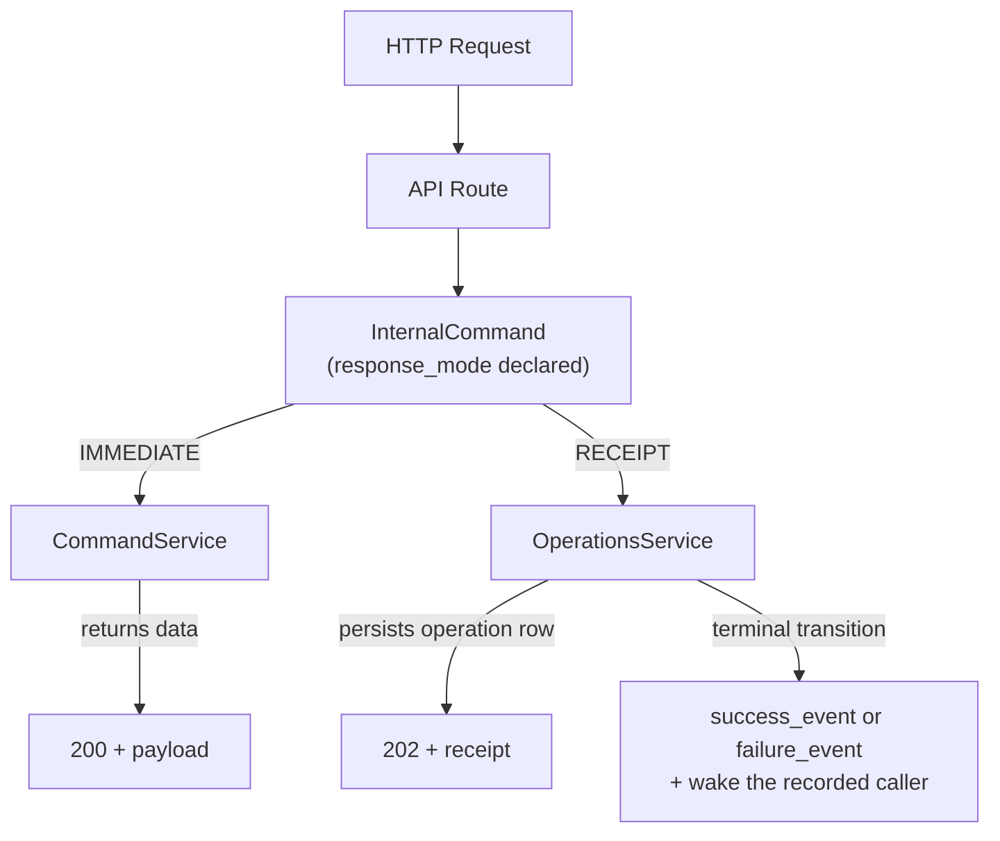
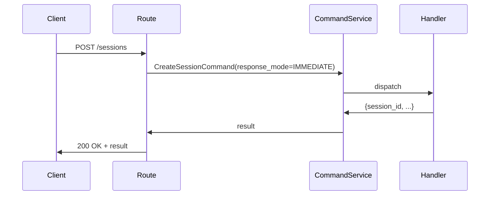
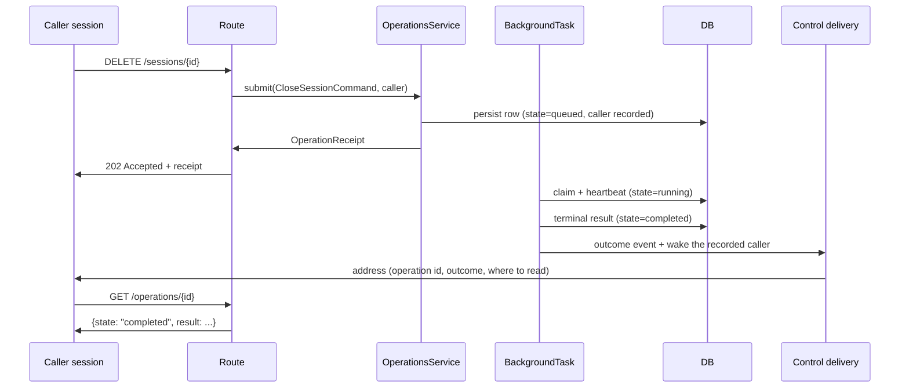
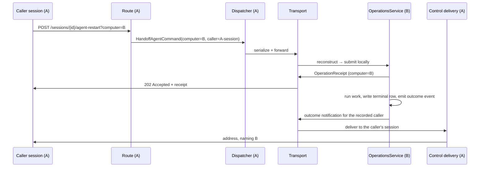

# Command Classification — Design

## Purpose

Every mutating API endpoint answers one question: does the result arrive with the
response, or after it. That answer is the command's response mode. There are two,
and no command sits between them.

The mode is a property of the command, not of the route — it lives on the
`InternalCommand` base class and is declared by each command subclass. API routes,
the transport layer, and the command dispatcher all read this property; they do not
re-derive it from `isinstance` checks or hardcoded status codes.



## Inputs/Outputs

**Inputs:** Any HTTP mutation request (POST, PUT, PATCH, DELETE) routed through
CommandService, carrying the caller provenance the API boundary resolves from the
authenticated request.

**Outputs per mode:**

- `IMMEDIATE` — `200 OK` with the command result in the body.
- `RECEIPT` — `202 Accepted` with a full `OperationReceipt`.

Command-to-mode mapping:

| Command                   | Mode                                        | Events                                                             |
| ------------------------- | ------------------------------------------- | ------------------------------------------------------------------ |
| CreateSessionCommand      | IMMEDIATE                                   | None                                                               |
| GetSessionDataCommand     | IMMEDIATE                                   | None                                                               |
| SystemCommand             | IMMEDIATE (default; instances may override) | None                                                               |
| ProcessMessageCommand     | IMMEDIATE                                   | None                                                               |
| KeysCommand               | IMMEDIATE                                   | None                                                               |
| HandleVoiceCommand        | IMMEDIATE                                   | None                                                               |
| HandleFileCommand         | IMMEDIATE                                   | None                                                               |
| StartAgentCommand         | IMMEDIATE                                   | None                                                               |
| ResumeAgentCommand        | IMMEDIATE                                   | None                                                               |
| RunAgentCommand           | IMMEDIATE                                   | None                                                               |
| UnsubscribeSessionCommand | IMMEDIATE                                   | None                                                               |
| RestartAgentCommand       | RECEIPT                                     | `agent.restart.completed` / `agent.restart.failed`                 |
| CloseSessionCommand       | RECEIPT                                     | `session.close.completed` / `session.close.failed`                 |
| HandoffAgentCommand       | RECEIPT                                     | `agent_runtime.handoff.completed` / `agent_runtime.handoff.failed` |

Todo lifecycle work (create, prepare, work, integrate, remove, rename) and task runs
are receipt-backed operations submitted by their routes directly to the
`OperationsService`; they carry no `InternalCommand` type.

### `ResponseMode` enum

```python
class ResponseMode(str, Enum):
    IMMEDIATE = "immediate"  # result returned in the response body
    RECEIPT   = "receipt"    # durable operation row, outcome events, caller delivery
```

### `InternalCommand` base fields

```python
@dataclass(kw_only=True)
class InternalCommand:
    command_type:   CommandType
    request_id:     str | None    = None
    response_mode:  ResponseMode  = ResponseMode.IMMEDIATE
    success_event:  str | None    = None  # declared if and only if RECEIPT
    failure_event:  str | None    = None  # declared if and only if RECEIPT
    computer:       str | None    = None  # owning computer; unset/local ⇒ run here, else forward
    caller:         CallerProvenance | None = None  # who asked; stamped at the API boundary

    def __post_init__(self) -> None:
        declares_events = self.success_event is not None or self.failure_event is not None
        is_async = self.response_mode is ResponseMode.RECEIPT
        if declares_events != is_async:
            raise ValueError(
                f"{type(self).__name__}: RECEIPT requires both outcome events, "
                f"and IMMEDIATE declares neither"
            )
        if is_async and (self.success_event is None or self.failure_event is None):
            raise ValueError(f"{type(self).__name__}: RECEIPT requires both success_event and failure_event")
```

`CallerProvenance` is the caller-identity block the API boundary resolves once and every
command carries: the caller's session id and computer, its resolved author kind and
display, its agent runtime and thinking mode, and its machine and job roles. It crosses
the transport with the command, so an owning computer reconstructs the same caller the
originating computer resolved.

The `computer` field is the routing key for cross-computer dispatch: it names the computer
that owns the session the command operates on. The API boundary stamps it from the request;
the dispatcher reads it to decide local execution versus forwarding.

### `OperationReceipt` fields (RECEIPT mode response)

```python
{
  "operation_id":     str,  # durable identity
  "kind":             str,  # operation kind (e.g. "todo_work")
  "state":            str,  # queued | running | completed | failed | stale
  "status_path":      str,  # /operations/{operation_id}
  "poll_after_ms":    int,  # suggested polling interval (0 if terminal)
  "computer":         str,  # the computer that owns the row and runs the work
  "success_event":    str,  # emitted on a successful terminal transition
  "failure_event":    str,  # emitted on a failed terminal transition
  "recovery_command": str,  # telec operations get {operation_id}
}
```

## Invariants

- **Mode lives on the command.** No route may hardcode a status code that contradicts the
  command's declared `response_mode`. The route reads the mode and derives the status code
  from it.
- **Dispatcher reads mode, not type.** `_dispatch_command()` must not use `isinstance`
  chains to decide whether to capture a return value. It reads `command.response_mode`.
- **Asynchrony and outcome events are the same declaration.** A command declares both
  outcome events exactly when its mode is `RECEIPT`, and neither otherwise. Construction
  rejects every other combination, so a command whose work continues after its response
  cannot present itself as synchronous.
- **The outcome is read from the event type.** Success and failure are distinct types.
  No consumer infers an outcome from a field on a shared type.
- **Atomic terminal transition.** The `OperationsService` emits the outcome event as the
  final step of writing the terminal row. The event and the row transition are never split
  across separate code paths.
- **The row is the authority, the event is a nudge.** A consumer that sees an outcome event
  before the row is terminal trusts the row.
- **The caller is recorded at submission.** The operation row carries the caller provenance
  the command arrived with. A command that arrives without one submits a caller-less
  operation; nothing is inferred to fill the gap.
- **Delivery follows the recorded caller, not the mode.** On the terminal transition, a
  recorded caller session that is still live is woken with an address — operation identity,
  outcome, and where to read the record — and never with the record's contents. A
  caller-less operation wakes nobody and loses nothing, because the row stands on its own.
- **Dispatch is computer-aware.** A session-scoped command carries `computer`, the computer
  that owns the target session. When it is unset or names the local computer, the dispatcher
  runs the command in-process. When it names a peer, the dispatcher forwards the command to
  the owning computer, which runs it through the same dispatcher and `response_mode` layer.
- **The command is the cross-computer wire format.** The serialized command itself crosses
  the transport. There is no parallel command-string vocabulary and no per-command remote
  wrapper: the owning computer reconstructs the same `InternalCommand` and dispatches it
  identically to a locally-originated one, keyed on `command_type` and `response_mode`.
- **Work, row, and emission stay together.** The computer that runs an operation owns its
  row and emits its outcome events. Neither the row nor the receipt is replicated; only the
  outcome notification crosses a machine boundary.

- **The CLI never waits on a receipt.** A `telec` command backed by a `RECEIPT` command
  prints the receipt and exits as soon as the daemon answers. Its output names the
  operation, states that the outcome is delivered to the calling session, and gives
  `telec operations get <operation_id>` as the way to read it. The wake is the only path an
  outcome takes back to an agent; a caller-less invocation reads the record with the same
  command.
- **A daemon-backed CLI command is accepted or not accepted.** Accepted is a zero exit
  carrying the `IMMEDIATE` result or the receipt; a command never exits zero on a
  failure. Not accepted is a non-zero exit carrying an error, and nothing was done. A
  request whose connection fails after it was sent and a command that sends several
  requests are the cases where a non-zero exit does not settle acceptance (Failure
  modes).

## Primary flows

### 1. IMMEDIATE command



### 2. RECEIPT command, local



### 3. RECEIPT command, owned by a remote computer

The caller's computer forwards the command; the owning computer submits it to its own
operations service, runs it, owns the row, and notifies the caller's computer on the
terminal transition. The receipt the caller holds names the owning computer, so the
caller reads the record there.



## Failure modes

- **Mode mismatch between route and command.** If a route assumes 200 but the command
  declares RECEIPT, the client receives the wrong status code. The dispatcher asserts
  `response_mode` consistency at dispatch time.
- **Operation lost on daemon restart.** Background tasks are not replayed. Queued or
  running operations are marked `stale` at startup, which is itself a terminal transition:
  the outcome event fires and the recorded caller is woken, so a restart is observable
  rather than silent.
- **Outcome event never fires.** If the background task dies before the terminal write,
  the row stays `running` until the heartbeat window expires and then becomes `stale`.
  The receipt remains the source of truth; the event is a convenience, not the authority.
- **The caller is gone when the outcome lands.** Delivery fails and is not retried. The row
  is unaffected and remains readable by whoever arrives next.
- **A command declares events without being asynchronous, or the reverse.** Construction
  raises. The invalid command never reaches the dispatcher.
- **Caller mismatch on read.** Non-admin callers attempting to inspect another session's
  operation receive a 404 rather than a 403, to avoid operation and session enumeration.

- **A request's connection fails after it was sent.** A request that times out, or
  whose connection breaks mid-request, exits non-zero without the CLI knowing whether
  the daemon accepted the work, so the accepted-or-not-accepted split does not decide
  it. The error names the timeout or the broken connection and carries no instruction
  to run the command again.
- **A command that sends several requests fails for some of them.** Each request is
  accepted or not on its own; the command reports what it knows per request, exits
  non-zero, and, when a draining or unreachable daemon refused any of them, carries the
  same wait-and-run-again instruction without stating that nothing was accepted:
  - Targetless `telec sessions end` closes children one request at a time. A refusal
    after earlier closures were accepted leaves those closures done; the error names
    the children not yet confirmed closed, which can include some it closed in that
    pass. Running it again is safe because the command is idempotent.
  - `telec history search` across several computers prints the results of every
    target that answered beside the failure of each target that did not. When no
    target answered and every failure was a draining or unreachable daemon, the
    command is not accepted and gives the full not-accepted message. Failures that
    come only from peer computers, beside answered targets, are reported with the
    results and exit zero, because the command produced its result.

## See Also

- docs/local/adr/0098-async-work-always-carries-a-receipt.md
- docs/local/adr/0119-the-cli-never-waits-on-a-receipt.md
- docs/local/design/architecture/operation-receipts.md
- docs/local/spec/feature/agent_runtime/control-delivery.md
