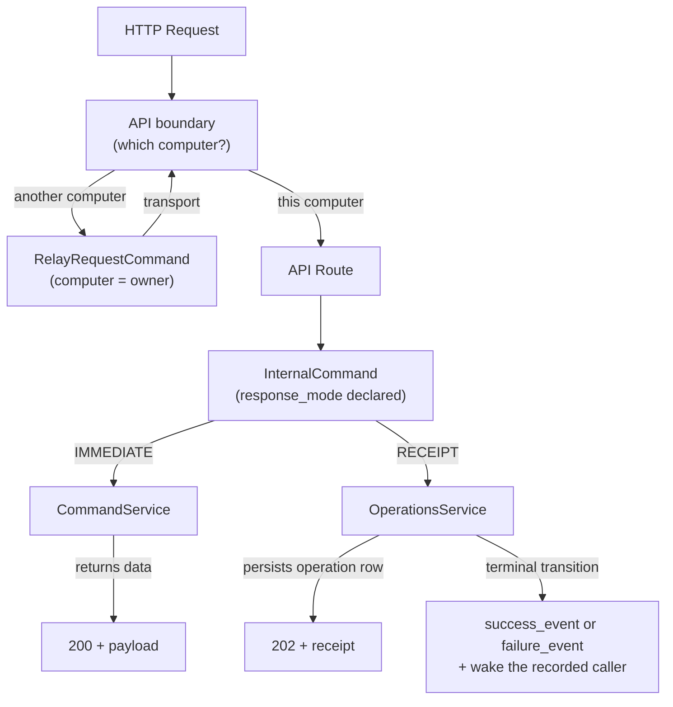
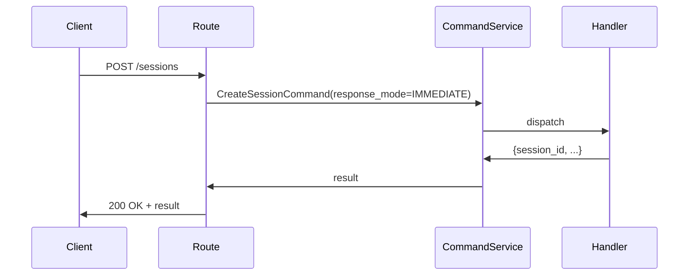
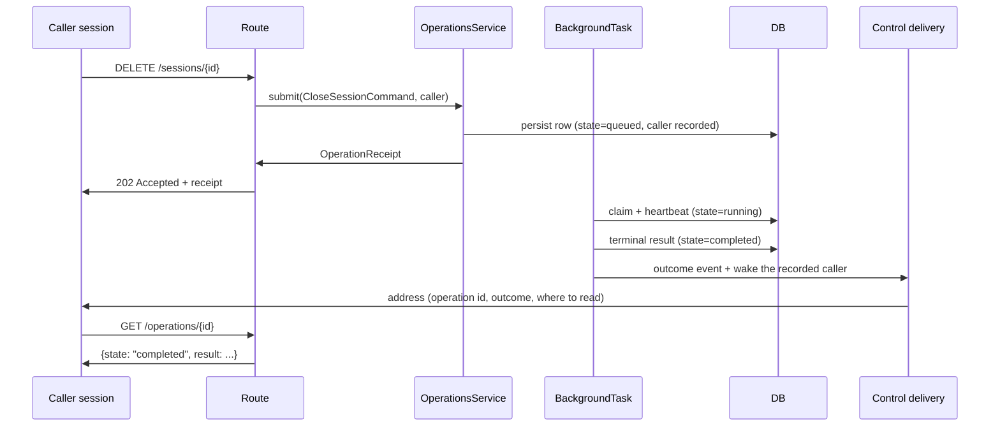
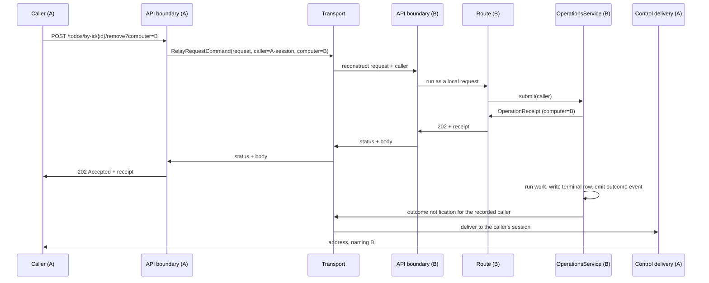

# Command Classification — Design

## Purpose

Every mutating API endpoint answers one question: does the result arrive with the
response, or after it. That answer is the command's response mode. There are two,
and no command sits between them.

The mode is a property of the command, not of the route — it lives on the
`InternalCommand` base class and is declared by each command subclass. API routes,
the transport layer, and the command dispatcher all read this property; they do not
re-derive it from `isinstance` checks or hardcoded status codes.

Every API request also answers a second question before any route runs: which
computer owns the object it addresses. A request that names another computer is
relayed to that computer at the API boundary and executes there, through the same
route and the same response mode a request made on that computer passes through,
with the person band decided there from the relayed principal; its answer returns to
the caller unchanged. A request that names this
computer, or none, runs here. No route opts into this and no route can miss it.

## Inputs/Outputs

**Inputs:** Any HTTP request routed through the API boundary, carrying the caller
provenance the boundary resolves from the authenticated request and, when the request
addresses an object another computer owns, the name of that computer.

**Outputs per mode:**

- `IMMEDIATE` — `200 OK` with the command result in the body.
- `RECEIPT` — `202 Accepted` with a full `OperationReceipt`.

A relayed request produces the same output its route produces on the owning computer:
the status code, the body and the declared work feedback cross back exactly as that
computer answered them.

Command-to-mode mapping:

| Command                   | Mode                                        | Events                                                             |
| ------------------------- | ------------------------------------------- | ------------------------------------------------------------------ |
| CreateSessionCommand      | IMMEDIATE                                   | None                                                               |
| GetSessionDataCommand     | IMMEDIATE                                   | None                                                               |
| SystemCommand             | IMMEDIATE (default; instances may override) | None                                                               |
| ProcessMessageCommand     | IMMEDIATE                                   | None                                                               |
| KeysCommand               | IMMEDIATE                                   | None                                                               |
| HandleVoiceCommand        | IMMEDIATE                                   | None                                                               |
| HandleFileCommand         | IMMEDIATE                                   | None                                                               |
| StartAgentCommand         | IMMEDIATE                                   | None                                                               |
| ResumeAgentCommand        | IMMEDIATE                                   | None                                                               |
| RunAgentCommand           | IMMEDIATE                                   | None                                                               |
| UnsubscribeSessionCommand | IMMEDIATE                                   | None                                                               |
| RelayRequestCommand       | IMMEDIATE                                   | None                                                               |
| RestartAgentCommand       | RECEIPT                                     | `agent.restart.completed` / `agent.restart.failed`                 |
| CloseSessionCommand       | RECEIPT                                     | `session.close.completed` / `session.close.failed`                 |
| HandoffAgentCommand       | RECEIPT                                     | `agent_runtime.handoff.completed` / `agent_runtime.handoff.failed` |

Todo lifecycle work (create, prepare, work, integrate, remove, rename) and task runs
are receipt-backed operations submitted by their routes directly to the
`OperationsService`; they carry no `InternalCommand` type. Addressed to another
computer, they reach that computer's route through the relay and are submitted to
that computer's `OperationsService`.

`RelayRequestCommand` is `IMMEDIATE` whatever the relayed route's own mode is: its
result is that route's complete response, a receipt included. A receipt that crosses
back this way is the owning computer's receipt, naming that computer.

### Response mode and command fields

The response mode is the command's declared `ResponseMode`, and every
`InternalCommand` carries its mode, its outcome events, the computer that owns its
object, and the caller provenance stamped at the API boundary; the declarations are
owned by `teleclaude/types/commands.py`. A command declares both outcome events
exactly when its mode is `RECEIPT`, and construction refuses every other
combination.

`CallerProvenance` is the record of who asked, resolved once at the API boundary and
carried on every command: the caller's session id and computer, its resolved author kind
and display, its agent runtime and thinking mode, and its machine and job roles. It
crosses the transport with a session-addressed command so the receiving computer records
the same caller and projects the author label — kind, display, role — on the surface
where the message lands. It is projection and record, never authority: no clearance on
the owning computer reads a role from it. The caller's identity for clearance is the
principal alone, and the owning computer resolves every authorization fact from that
principal and its own registries
(`local/projects/teleclaude/spec/feature/identity/cross-computer-authorization`). The
relay command carries no provenance beyond the caller session's address.

The `computer` field is the routing key for cross-computer dispatch: it names the computer
that owns the object the command operates on. The API boundary stamps it from the request;
the dispatcher reads it to decide local execution versus forwarding.

### `RelayRequestCommand` fields

The relay command carries one API request whole: its method, its path, its query, its
body, the caller's principal, the caller session's address — its id and computer, so
the owning computer can record who asked and wake it with the outcome — the `telec`
command the caller's surface cleared the request as, and `computer`, the computer the
request names. It carries no role, scope, author kind or runtime: everything the
caller's own surface shows about the caller stays with the caller. Its result is that
request's response: the status code, the body and the declared work feedback. The
owning computer executes the carried request against its own API as though it had
arrived there directly, as the caller the principal resolves to on that computer;
nothing about the request is interpreted on the way.

Every request a cleared command sends carries the command it was cleared as, set where
the clearance happens, so no command or route declares anything for it. The owning
computer trusts that command exactly as it trusts the principal: the relaying computer
is a peer, and the request surface it serves is not an isolation boundary between its
local processes (`local/projects/teleclaude/spec/identity-and-auth`). The owner decides
that command's person band from the principal at the scope of the object the request
addresses, read from the request and the object itself
(`local/projects/teleclaude/spec/feature/identity/cross-computer-authorization`), and
runs the request as the caller it resolved itself. Nothing from the relaying
computer's own caller headers reaches the owner's route.

### Operation receipt

A `RECEIPT` response is an `OperationReceipt`, serialized by the operations service
(`teleclaude/core/operations/service.py`). Every receipt names the computer that owns
the row and runs the work, and its recovery command addresses that computer, so a
receipt that crossed back from another computer is read and followed there.

## Invariants

- **Mode lives on the command.** No route may hardcode a status code that contradicts the
  command's declared `response_mode`. The route reads the mode and derives the status code
  from it.
- **Dispatcher reads mode, not type.** `_dispatch_command()` must not use `isinstance`
  chains to decide whether to capture a return value. It reads `command.response_mode`.
- **Asynchrony and outcome events are the same declaration.** A command declares both
  outcome events exactly when its mode is `RECEIPT`, and neither otherwise. Construction
  rejects every other combination, so a command whose work continues after its response
  cannot present itself as synchronous.
- **The outcome is read from the event type.** Success and failure are distinct types.
  No consumer infers an outcome from a field on a shared type.
- **Atomic terminal transition.** The `OperationsService` emits the outcome event as the
  final step of writing the terminal row. The event and the row transition are never split
  across separate code paths.
- **The row is the authority, the event is a nudge.** A consumer that sees an outcome event
  before the row is terminal trusts the row.
- **The caller is recorded at submission.** The operation row carries the caller provenance
  the command arrived with. A command that arrives without one submits a caller-less
  operation; nothing is inferred to fill the gap.
- **Delivery follows the recorded caller, not the mode.** On the terminal transition, a
  recorded caller session that is still live is woken with an address — operation identity,
  outcome, and where to read the record — and never with the record's contents. A
  caller-less operation wakes nobody and loses nothing, because the row stands on its own.
- **Every request addressed to a computer executes there.** The API boundary reads the
  computer a request names before any route runs. A request naming this computer, or
  none, runs here. A request naming another computer is carried whole to that computer
  as one relay command and executes there through the same route, under that computer's
  own clearance and against that computer's own state; its complete response crosses
  back unchanged. Routes therefore run only against local state, and no route holds a
  remote path of its own. Before relaying, the caller's computer applies what only it
  knows of its caller
  (`local/projects/teleclaude/spec/feature/identity/cross-computer-authorization`).
  Opening or closing a direct conversation with a session on another computer is not
  relayed; it stays on its existing path
  (`local/projects/teleclaude/spec/feature/agent_runtime/session-lifecycle`).
- **The request names its computer in one place.** The computer a request addresses is
  its `computer` query parameter, on every route alike. A route whose object is the
  caller's own session, or this daemon itself, names no computer.
- **Dispatch is computer-aware.** An adapter-originated command carries `computer`, the
  computer that owns the object it operates on. When it is unset or names the local
  computer, the dispatcher runs the command in-process. When it names a peer, the
  dispatcher forwards the command to the owning computer, which runs it through the same
  dispatcher and `response_mode` layer.
- **The command is the cross-computer wire format.** The serialized command itself crosses
  the transport. There is no parallel command-string vocabulary and no per-command remote
  wrapper: the owning computer reconstructs the same `InternalCommand` and dispatches it
  identically to a locally-originated one, keyed on `command_type` and `response_mode`.
  A relayed API request is no exception: it crosses as the one relay command, through
  the same dispatcher and the same forwarding, and the owning computer reconstructs the
  request it carries.
- **Authentication at the edge, the person band at the owner.** The caller is
  authenticated once, in the client process that serves it, and nothing authenticates
  it again anywhere. The relay carries the caller's principal and the command it was
  cleared as, and no role. The owning computer decides that command's person band
  there (`local/projects/teleclaude/spec/feature/identity/cross-computer-authorization`).
- **Work, row, and emission stay together.** The computer that runs an operation owns its
  row and emits its outcome events. Neither the row nor the receipt is replicated; only the
  outcome notification crosses a machine boundary. A caller reads a relayed operation's
  record on the computer its receipt names.

- **The CLI never waits on a receipt.** A `telec` command backed by a `RECEIPT` command
  prints the receipt and exits as soon as the daemon answers. Its output names the
  operation, states that the outcome is delivered to the calling session, and gives
  `telec operations get <operation_id>` as the way to read it. The wake is the only path an
  outcome takes back to an agent; a caller-less invocation reads the record with the same
  command.
- **A daemon-backed CLI command is accepted or not accepted.** Accepted is a zero exit
  carrying the `IMMEDIATE` result or the receipt; a command never exits zero on a
  failure. Not accepted is a non-zero exit carrying an error, and nothing was done. A
  request whose connection fails after it was sent and a command that sends several
  requests are the cases where a non-zero exit does not settle acceptance (Failure
  modes).
- **A daemon-backed CLI command addresses a computer.** Every `telec` command that acts
  through the daemon on an object a computer owns accepts the computer to address;
  omitted, it addresses this one. The command surface declares which commands these
  are. A command that acts on local state without the daemon when it addresses this
  computer reaches the daemon when it addresses another, through a request that
  performs the same operation, so the owning computer answers it as that command.

## Primary flows

### 1. IMMEDIATE command

### 2. RECEIPT command, local

### 3. A request addressed to another computer

The caller's API boundary carries the request to the owning computer as one relay
command. The owning computer's boundary resolves the relayed principal's roles from its
own registries, runs the request through its own route, and returns the route's
complete response. For a
receipt-backed route the owning computer submits the operation to its own operations
service, owns the row, and notifies the caller's computer on the terminal transition.
The receipt the caller holds names the owning computer, so the caller reads the record
there.

A read addressed to another computer follows the same path and returns that computer's
live answer: an artifact's content, a todo's state, a session's record. A refusal the
owning route raises — a todo in a state that does not allow the action, a caller without
clearance there — crosses back as that route's own status and work feedback.

## Failure modes

- **Mode mismatch between route and command.** If a route assumes 200 but the command
  declares RECEIPT, the client receives the wrong status code. The dispatcher asserts
  `response_mode` consistency at dispatch time.
- **Operation lost on daemon restart.** Background tasks are not replayed. Queued or
  running operations are marked `stale` at startup, which is itself a terminal transition:
  the outcome event fires and the recorded caller is woken, so a restart is observable
  rather than silent.
- **Outcome event never fires.** If the background task dies before the terminal write,
  the row stays `running` until the heartbeat window expires and then becomes `stale`.
  The receipt remains the source of truth; the event is a convenience, not the authority.
- **The caller is gone when the outcome lands.** Delivery fails and is not retried. The row
  is unaffected and remains readable by whoever arrives next.
- **A command declares events without being asynchronous, or the reverse.** Construction
  raises. The invalid command never reaches the dispatcher.
- **Caller mismatch on read.** Non-admin callers attempting to inspect another session's
  operation receive a 404 rather than a 403, to avoid operation and session enumeration.
- **The addressed computer cannot take the request.** A computer this one is not
  configured to reach is unknown, and a configured computer with no live presence is
  offline; neither is sent anything. A computer running a version without the relay
  rejects the relay command itself as one it does not know, and the relaying computer
  reports it as running a build without the relay. Each reaches the caller as a work
  refusal that names the computer and the reason, and nothing is executed locally in
  its place.
- **The relayed request arrives after its deadline.** Every relay command carries a
  deadline; a computer that takes it later — after coming back from being offline —
  refuses it and runs nothing, so a request its caller was told had failed never runs.
- **A relayed request names no command.** A request carrying a person or agent
  principal and no command is malformed; the owning computer refuses it, naming the
  missing command, and runs nothing. A system principal carries no person band.
- **The addressed computer refuses the caller.** The person band the owning computer
  resolves for the relayed principal decides; its refusal crosses back as the response,
  and the relaying computer records nothing as done.
- **A relayed request's transport fails after it was sent.** The caller learns neither
  acceptance nor refusal, exactly as with a local request whose connection broke; the
  error names the computer and the transport failure and carries no instruction to run
  the command again.

- **A request's connection fails after it was sent.** A request that times out, or
  whose connection breaks mid-request, exits non-zero without the CLI knowing whether
  the daemon accepted the work, so the accepted-or-not-accepted split does not decide
  it. The error names the timeout or the broken connection and carries no instruction
  to run the command again.
- **A command that sends several requests fails for some of them.** Each request is
  accepted or not on its own; the command reports what it knows per request, exits
  non-zero, and, when a draining or unreachable daemon refused any of them, carries the
  same wait-and-run-again instruction without stating that nothing was accepted:
  - Targetless `telec sessions end` closes children one request at a time. A refusal
    after earlier closures were accepted leaves those closures done; the error names
    the children not yet confirmed closed, which can include some it closed in that
    pass. Running it again is safe because the command is idempotent.
  - `telec history search` across several computers prints the results of every
    target that answered beside the failure of each target that did not. When no
    target answered and every failure was a draining or unreachable daemon, the
    command is not accepted and gives the full not-accepted message. Failures that
    come only from peer computers, beside answered targets, are reported with the
    results and exit zero, because the command produced its result.

## See Also

- docs/local/adr/0098-async-work-always-carries-a-receipt.md
- docs/local/adr/0119-the-cli-never-waits-on-a-receipt.md
- docs/local/adr/0121-computer-addressed-requests-cross-as-one-relay-command.md
- docs/local/design/architecture/operation-receipts.md
- docs/local/spec/feature/agent_runtime/control-delivery.md
- docs/local/spec/feature/identity/cross-computer-authorization.md
- docs/local/spec/feature/integration/computer-addressed-execution.md
