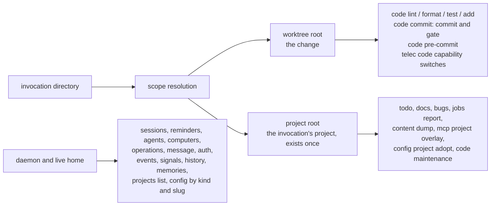

# Command Scope — Design

## Required reads

@docs/local/design/architecture/config-tier-resolution.md
@docs/local/spec/feature/agent_runtime/checkout-code-selection.md

## Purpose

A `telec` command invoked from inside a slug worktree acts on one of two sides:

- **The worktree root** — the checkout that holds the change: its files, its git
  history, its own `teleclaude.yml` and the rules it carries.
- **The shared side** — everything that exists once for every checkout. For state
  that belongs to the invocation's project — the todo store with its artifacts and
  stamps, the doc layer, the project's bug lane, its registration — that is the
  **project root**, the owning checkout. Sessions, reminders, the daemon, the live
  home and the host are shared by every project and are reached without any root of
  the invocation.

This design states, per command group, which side a command acts on. Which checkout's
code runs is a separate question, owned by
`local/projects/teleclaude/spec/feature/agent_runtime/checkout-code-selection`. How the tier declaration
and the shared-state root are resolved is owned by
`local/projects/teleclaude/design/architecture/config-tier-resolution`; this design names which of those
answers each command uses.

## Inputs/Outputs

**Input:** the invocation directory.

**Output:** one resolution carrying the invocation's roots: the context root and the
worktree root it acts in, and the project root when the invocation lies in a project
checkout. On the canonical checkout the worktree root and the project root are the same
checkout. Every command takes the root it acts on from this resolution. A command that
delegates its work to the daemon forwards the invocation directory, and the daemon takes
the root from the same resolution. No command derives a worktree or project root from
the raw invocation directory, from the repository root of the code that happens to run,
or from the daemon's own working directory.

### Associated checkout roots

The invocation resolver returns the active working checkout, logical project's
workflow-state root, authoring checkout and installed checkout as distinct
answers. Config supplies the registered association; workflow owns the resolution
of its shared state and worktree owners. Consumers request the answer their
operation acts on, following `sdlc/principle/domain-driven-design`. Every member
of an association except the installed checkout's own working tree is a
development location, including a worktree that the installed checkout held
before its association. Their environment ownership follows
`local/projects/teleclaude/spec/feature/workflow/worktree-prep-lifecycle`.

The existing root table is qualified by this association: todo records, claims,
artifacts and project-wide job/bug state remain at the primary workflow-state
root. Source preparation, pending-doc authoring, Blueprint source and integration
operate against the development checkout. Code-file operations remain in the
active worktree. Installation configuration, revision activation and runtime
assessment operate against the installed checkout. Physical maintenance records
belong to the checkout activation they describe; sharing a logical project does
not merge installation and development maintenance.

Store access consumes the canonical shared-state identity through
`local/projects/teleclaude/design/architecture/workflow-store`. Association
preserves that identity and its selected adapter; source placement supplies no
storage address or replacement store.

An association transition preserves or settles the in-flight objects whose
source ownership it changes before publishing that relationship. Workflow
serializes the transition with source placement, including worktree creation
and integration admission. A refused transition retains the existing ownership
and names the affected work; it does not repath live work. The lifecycle and
integration contracts remain owned by
`local/projects/teleclaude/design/architecture/next-machine` and
`local/projects/teleclaude/spec/feature/workflow/integration-state-machine`.

Docs and bootstrap context select the invocation's coherent view under
`local/projects/teleclaude/spec/feature/context/checkout-context-selection`.
The global CLI remains the installed controller; a development directory changes
the operation's target, not the running command's implementation. A missing
controller capability is reported through the installed contract rather than
executing development code against live state.

Project addresses name the logical identity; checkout selection is explicit and
never inferred from a `-dev` suffix. Source delivery at this boundary retains the
existing upstream-mainline contract; provisioning a companion alone provides no
public contribution handler.

<!-- planned:reviewed-pr-contributions -->

### Contribution delivery purpose

The association additionally identifies upstream-mainline authoring or
contributor-proposal delivery. A contributor handoff consumes
`local/projects/teleclaude/spec/feature/workflow/contribution-export` in its
recorded development checkout. This purpose becomes selectable together with
its export/adoption handler; missing capability is reported without entering
the upstream-mainline publication path.
<!-- /planned:reviewed-pr-contributions -->

## Invariants

1. **The change acts on the worktree.** A command whose subject is the change — its
   files, its git index and history, its quality rules, its own declaration — acts on
   the worktree root.
2. **Anything that exists once acts on the shared side.** A command that reads or
   writes state other agents or the daemon read and write concurrently acts on the
   project root, or on daemon and live-home state that no invocation root selects. A
   worktree copy of that state is a second truth another agent acts on, which
   restoring a file cannot undo (`general/principle/trust-and-guardrails`,
   interference).
3. **The `telec code` capability switches are the worktree's own.** The `code`, `docs`
   and `agents` switches, and the tier they are declared under, that decide which
   checks a worktree's commit runs are read from the worktree's own declaration: they
   describe the change. A gate the daemon evaluates for the live project is not a
   command and follows `local/projects/teleclaude/design/architecture/config-tier-resolution`.
4. **A split is stated.** A command that acts on both roots names which part acts on
   which.
5. **One resolution.** Every command obtains its root from the one scope resolution;
   no command carries its own root logic.
6. **Given locations are data, not roots.** A location a command receives as part of
   its request — the directory a new or revived session starts in — is the caller's
   choice and defaults to the invocation directory. It selects no root the command
   acts on.
7. **Installation commands act on the running installation.** A command that
   describes or configures the TeleClaude installation itself acts on the
   installation whose code runs, which `checkout-code-selection` decides. That is not
   a root of the invocation and is reported as one checkout.

8. **On-demand maintenance acts on the invocation directory's own home, from the
   canonical checkout.** `telec sync` performs the maintenance of the repository
   that owns the home whose `teleclaude.yml` sits in the invocation directory
   itself, and its publication step acts on that home and the homes nested beneath
   it in the committed tree. It takes no home from a parent directory: where the
   invocation directory holds no declaration it refuses, naming the directory. It
   acts only from the canonical checkout on its main branch: in a slug worktree,
   or on another branch, it refuses before any step and names the canonical
   checkout.

## Primary flows

### Commands that act on the worktree root

| Command                                               | Acts on                                               |
| ----------------------------------------------------- | ----------------------------------------------------- |
| `telec code lint`, `format`, `test`, `add`            | The change's files, under the worktree's own rules    |
| `telec code commit` — the commit and its quality gate | The worktree's branch, graded by the worktree's rules |
| `telec code pre-commit`                               | The worktree's own index                              |
| The `telec code` capability switches                  | The worktree's own declaration                        |

### Commands that act on the project root

| Command                                                                                 | Shared state it acts on                                                                 |
| --------------------------------------------------------------------------------------- | --------------------------------------------------------------------------------------- |
| `telec todo …`, including artifacts and stamps                                          | The one todo store; a worktree is a todo's sandbox and holds no copy                    |
| `telec docs …` in a project context                                                     | The doc layer and its generated index, authored and built only on the project root      |
| `telec bugs …`, including the suppression ledger                                        | The project's bug lane and the ledger the log bug hunter reads                          |
| `telec jobs report`                                                                     | The project's job records                                                               |
| `telec content dump`                                                                    | The project's publications inbox                                                        |
| `telec mcp …`                                                                           | The project's registry overlay, on top of the machine-wide registry                     |
| `telec config project adopt`                                                            | The checkout it adopts: registration and plumbing are done once, at the owning checkout |
| `telec code maintenance …`                                                              | The project's maintenance records; a worktree invocation drains nothing                 |
| `telec` (the TUI) creating a todo or bug where nothing under the cursor names a project | The project it was started from, forwarded to the daemon                                |

### Commands that act on daemon and live-home state

| Command group                                                                                                            | Shared state it acts on                                     |
| ------------------------------------------------------------------------------------------------------------------------ | ----------------------------------------------------------- |
| `telec sessions …`, `reminders …`, `agents …`, `computers`, `operations`, `message`, `auth …`                            | Daemon and live-home state shared by every session          |
| `telec events`, `signals`, `history …`, `memories …`                                                                     | Shared runtime records and stores                           |
| `telec projects list`, `telec config computer …`, `global …`, `person …`, `company …`, and `project get`/`patch` by slug | The machine, people, company and project registries by name |

### Commands that act on the running installation

| Command                                         | Acts on                                                  |
| ----------------------------------------------- | -------------------------------------------------------- |
| Help rendering and `telec version`              | The code that runs, reported as one checkout             |
| `telec config env list`, `telec config env set` | The environment file of the installation whose code runs |

### Commands that act on both

| Command                                     | Worktree part                                          | Project part                                                                      |
| ------------------------------------------- | ------------------------------------------------------ | --------------------------------------------------------------------------------- |
| `telec code commit`                         | The commit and its quality gate                        | Checkpoint markers and maintenance records                                        |
| `telec code blueprint affected`             | The changed files it is asked about                    | The dependency graph, built on the project root                                   |
| `telec code post-commit`, `code post-merge` | The checkout whose commit or merge activated the range | The maintenance drain on the project root, or on the platform home when run there |

The platform home is a commit-boundary root without being a project. Its installed
hooks drain maintenance on the home itself
(`local/projects/teleclaude/spec/feature/reconciliation/project-plumbing-convergence`, UC-RPC7;
`local/projects/teleclaude/spec/feature/integration/post-commit-maintenance`, UC-PCM10), so the
project-root refusal under Failure modes does not apply to them there.

## Failure modes

| Condition                                                                                             | Effect                                                                                                                                       |
| ----------------------------------------------------------------------------------------------------- | -------------------------------------------------------------------------------------------------------------------------------------------- |
| A command that acts on the project root runs where no project checkout holds the invocation directory | It refuses, naming the directory; it never falls back to the invocation directory                                                            |
| `telec docs` runs where no declaration governs the invocation directory                               | It reads the caller's default read set with no landed home — their person tier, their companies, and global — plus any home the caller names |
| `telec config project adopt` runs where no repository holds the invocation directory                  | It adopts the invocation directory, initializing it as the repository                                                                        |
| The scope resolution cannot be completed                                                              | The command exits non-zero naming the directory and the unresolved root; no command substitutes a root of its own                            |
| A worktree-root command runs on the canonical checkout                                                | It acts on the canonical checkout, which is its own worktree root                                                                            |
| A command on daemon and live-home state runs anywhere                                                 | It acts as it does from any other directory; the invocation directory selects nothing                                                        |

## See Also

- ~/.teleclaude/docs/general/principle/trust-and-guardrails.md — why state that exists once has a single home.
- docs/local/design/architecture/config-tier-resolution.md — the tier and shared-state resolvers the scope resolution draws on.
- docs/local/spec/feature/agent_runtime/checkout-code-selection.md — which checkout's code runs, the other half of running from a worktree.
