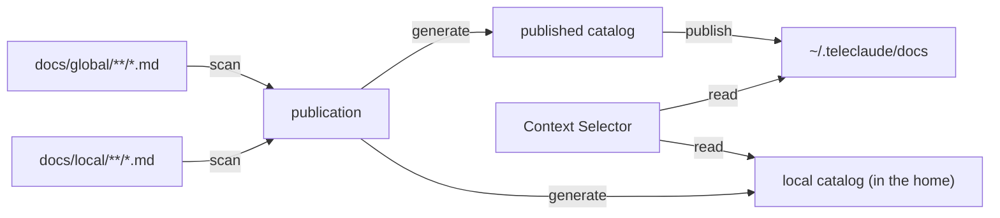
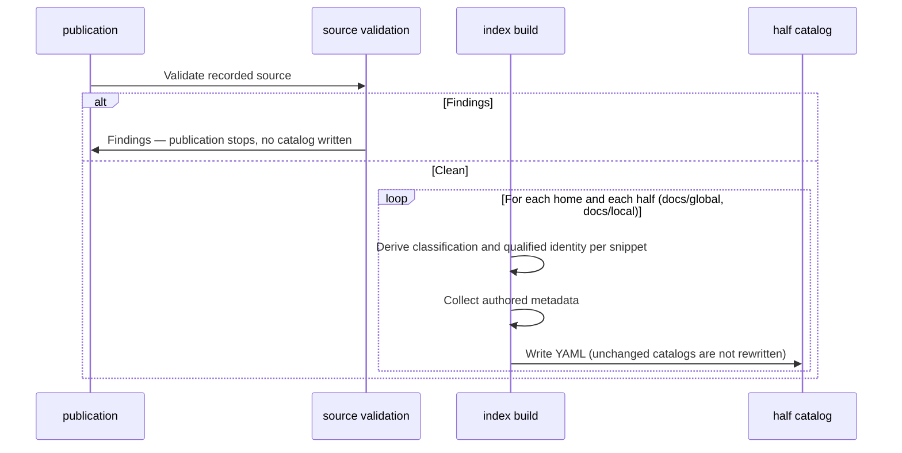

# Context Index — Design

## Purpose

- Provide a deterministic index of available docs for context selection.

- Snippet IDs must be unique.
- Classification is derived from paths, never read from authored frontmatter.

- Scan snippet files, derive classification and qualified identity from their
  paths and their home's declaration, and collect the authored metadata.
- Write one catalog per documentation half of each home: the published half's
  catalog, which publication carries into the shared corpus, and the local
  half's catalog, which stays in the home.

## Inputs/Outputs

**Inputs:**

- Markdown files in the two halves of a documentation home — `docs/global/` and
  `docs/local/` of a repository, a person's home, or a company's home
- The home's own declaration, which supplies the slug of every home-qualified identity
- Snippet paths (classification) and authored frontmatter (description,
  visibility, activation trigger, subscriptions, pending-delivery fields)

**Outputs:**

- A published catalog (`docs/global/index.yaml`) and a local catalog
  (`docs/local/index.yaml`), each an array of snippet entries: identity,
  description, type, scope, domain, path, visibility, owner, activation trigger
  or subscriptions, and the pending-delivery fields
- Local entries under their qualified identity (`projects/<slug>/…`,
  `people/<slug>/…`, `companies/<slug>/…`)
- Portable paths using `~/.teleclaude` for published docs

A half's root `baseline.md` and `baseline-progressive.md` are manifests: they
are read for baseline anchoring and never cataloged as snippets.

## Invariants

- **Validated input only**: Source validation runs before the index build, and
  a finding blocks publication, so a catalog is only ever built from source that
  passed validation.
- **Unique IDs**: Each snippet has a globally unique ID; collisions are rejected. The same relative path under both halves of a person's or company's home is such a collision.
- **Declared owner**: A home-qualified identity takes its slug from the home's declaration, never from a directory name; a home whose declaration yields no slug fails the build.
- **Local stays home**: The local catalog is never published; it is read in place by the context selector for every read set that contains its home.
- **Stable Paths**: Published docs use `~/.teleclaude/docs`; local docs use absolute or tilde-expanded paths into their home.
- **Path Normalization**: The `teleclaude-docs` git filter smudges portable `~/.teleclaude` paths into local absolute paths and cleans them back on commit. Applies to both `@` prefixed doc references and bare paths in index files.
- **Type Validation**: Snippet types must match canonical taxonomy from `teleclaude/constants.py:TAXONOMY_TYPES`.
- **Schema Compliance**: Required sections per taxonomy are enforced by resource validation's snippet schema, ahead of the build.

## Primary flows

### 1. Index Generation

### 2. Published vs Local Distinction

| Location       | Path in Index            | Usage                                                                  |
| -------------- | ------------------------ | ---------------------------------------------------------------------- |
| `docs/global/` | `~/.teleclaude/docs/...` | Published: domain snippets, a person's or company's published snippets |
| `docs/local/`  | `~/path/to/home/...`     | The home's own snippets, served in place                               |

## Failure modes

- **Validation findings**: A missing description, a missing required section, a wrong H1 type suffix, a duplicate identity, or one relative path in both halves of a tier home is a source-validation finding. Publication stops before the index build and no catalog changes.
- **Non-derivable classification**: A snippet whose path yields no classification raises; the build fails naming the file and the reason.
- **Tier snippet authoring**: A person or company snippet that lacks a description or authors a path-derived classification key fails the build naming the file.
- **Undeclared slug**: A home whose declaration yields no slug cannot mint qualified identities; the build fails naming the home.
- **Write failure**: A catalog that cannot be written fails the publication.
