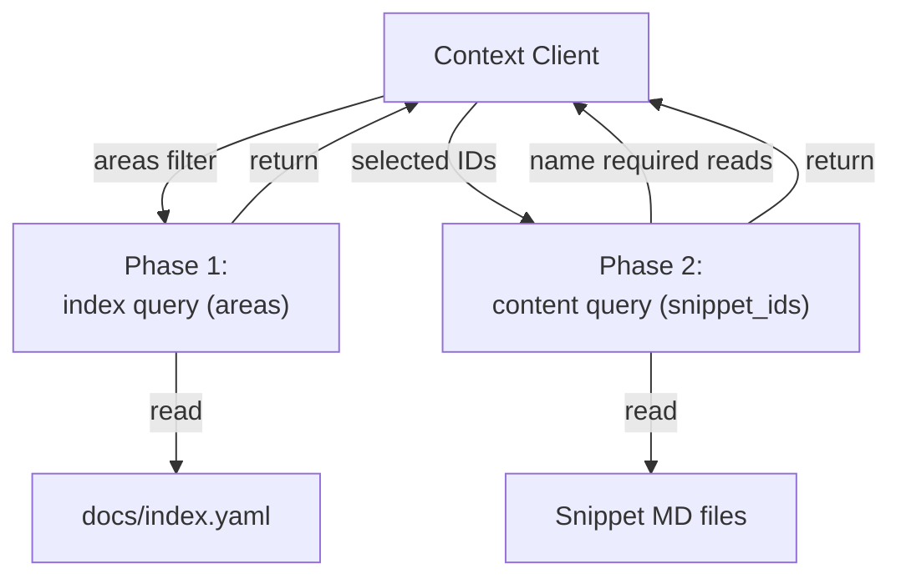
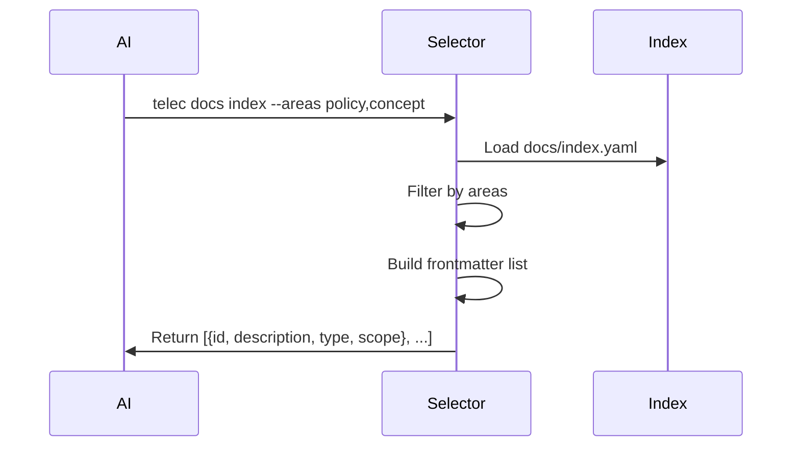
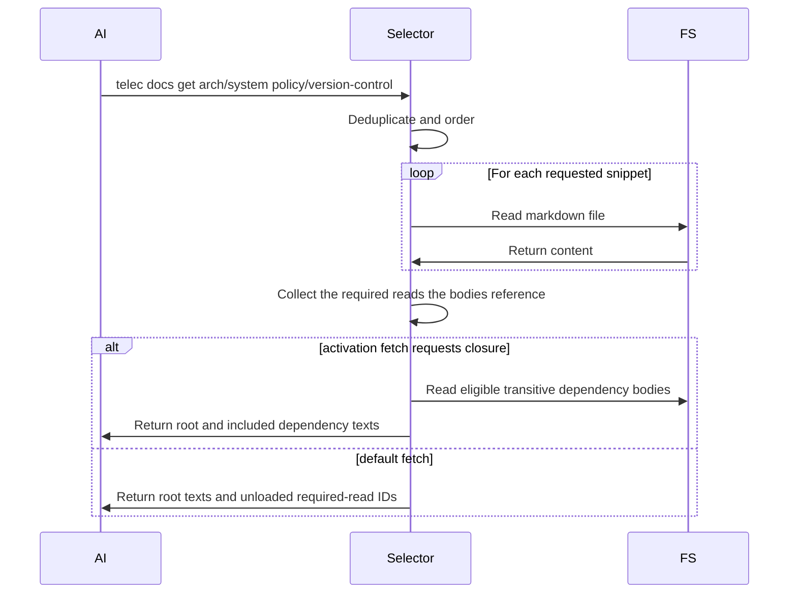

# Context Selection — Design

## Purpose

- Select relevant documentation docs for a given request.

- Selected IDs must exist in the snippet index.
- Required reads are named in the default response for an explicit follow-up.
  An activatable-procedure fetch may request the eligible transitive closure in
  one pass; that explicit activation form includes the dependency bodies.

- Build snippet metadata from docs and global docs.
- Return a filtered index (frontmatter only) when no IDs are provided.
- Accept selected snippet IDs from the caller and report the required reads their
  bodies reference.
- Order by scope priority across the four tiers.
- Persist selected IDs per session to avoid repeated context churn.

## Inputs/Outputs

**Inputs:**

- **Phase 1**: Optional `areas` array (taxonomy type filter: principle, concept, policy, procedure, design, spec)
- **Phase 2**: `snippet_ids` array of selected snippets to retrieve
- Caller session ID for context persistence
- Project working directory

**Outputs:**

- **Phase 1**: Index listing (ID, description, type, scope) - frontmatter only
- **Phase 2**: Full snippet content. The default form also reports required-read
  IDs not loaded; the explicit activation form includes the eligible transitive
  dependency bodies and names them as included.
- Ordered by scope priority across the four tiers

## Invariants

- **Discovery precedes content**: the index listing is queried first, then content
  is fetched for the IDs chosen from it.
- **Required-read expansion is explicit**: the default response names dependency
  IDs for a follow-up; only the activation form explicitly requesting closure
  includes eligible transitive dependency bodies in the same response.
- **Scope Ordering**: one deterministic order across the four tiers, given by the scope priority table.
- **Duplicate Prevention**: Each snippet ID appears exactly once in output even if required multiple times.

## Primary flows

### 1. Phase 1: Index Retrieval (Discovery)

### 2. Phase 2: Content Retrieval

#### Baseline Filtering (Optional)

By default, all snippets including baseline are shown in the phase-1 index.
`telec docs index --baseline-only` filters to baseline snippets only
(those referenced in `baseline.md` manifests). This focused view is useful for
authoring/editing baseline content.

### 3. Required Reads

By default, required reads referenced by a returned body are reported as IDs
alongside the content; following them is another content request. An explicit
activatable-procedure closure fetch instead resolves the eligible transitive
dependency set and returns those bodies in the same response under the included
header. In both forms, the caller chooses whether closure expansion occurs.

### 4. Scope Priority Ordering

| Scope   | Priority |
| ------- | -------- |
| global  | 1        |
| company | 2        |
| project | 3        |
| person  | 4        |

Within the global tier, `domain` is the secondary key. It is metadata on a global
snippet, not a scope of its own, and the ordering never treats it as one.

### 5. Caller-Scope Resolution

Source assembly is preceded by resolving the caller. The stage takes the
resolved person and organizational membership and the caller's visibility reach
from identity (`local/projects/teleclaude/spec/domain/identity`), and a project's
declared owning company from configuration, and answers two things: the depth
the caller reads any tier at, and the default read set — the tiers assembled
when the caller names none, each paired with its depth. Depth converts
visibility reach: a tier it admits is read in full. Nothing downstream re-derives
reach: assembly loads the tiers the stage named, and the include predicate
applies the depth it assigned.

The stage is the only place these inputs meet. Which tiers a caller may read in
full is identity's visibility reach; which tiers are assembled, the
public-only depth of the rest, and the person-local and `public` audience facts
stay here.

The projects a caller reaches are the projects the roster's resolution reports
for them — explicit assignments and, for a company's administrative role, every
project that company owns — taken as one answer. This stage never recomputes
coverage from a role: the roster resolves it once, and documentation reads the
result.

Reach and depth are separate answers and are never traded for one another. Reach
decides which tiers are assembled and which of their halves; depth decides how
much of an assembled half is read. The default read set is the caller's own
person tier, every company they belong to, global, and what the invocation
offers — the home it lands in (the project being worked in, or a person's home)
and the company a landed project declares as its owner — the last two met at
whatever depth the caller's relationship grants, public-only where there is
none. Every home in the set contributes both of its halves: its published
material from the deployed corpus and its local material from that home's local
catalog. The other projects a caller reaches through the roster are not in the
default set; they are read in full when worked in or named. When the invocation
lands in no home, it offers nothing of its own: the default read set is the
relationship-derived part and global.

Naming changes reach: the named half is assembled instead of the default set,
from wherever the caller stands. A home selector names that home's published
half — for a project, the published snippets of the domains it publishes as
owner. The local selector names the local half of the named home, or of the
landed home when none is named; with neither, there is no half to read and the
command is refused, naming the selectors that name a home. A snippet identity
names the half its `local/` prefix states. A kind filter keeps only the
snippets of that tier kind among what is assembled and names no home of its
own; next to the local selector, which already names one home's half, it adds
nothing. The
named half is read at the depth this stage grants the caller for it. Naming
never changes depth. A caller with no resolvable identity gains no tier from a
relationship it does not have.

A caller acting as a system principal holds no person tier and no relationship,
so its default read set is global and what the invocation offers. Its depth is
full on every tier it reaches, as a platform administrator's is, so a tier it
names is read in full.

**Depth follows visibility reach.** A person's depth on a tier is decided by
identity's visibility reach over that tier as a subject
(`local/projects/teleclaude/spec/feature/identity/data-visibility`): a tier the reach
admits is read in full. A platform administrator therefore reads every tier; a
company administrator reads their company, every project it owns, and the
platform's shared documentation in full; any other person reads their company
tiers, the projects they are assigned to or own, and their own person tier in
full, and the platform's shared documentation at public-only depth. A tier
visibility reach does not admit is read at public-only depth.

**A person's local half is owner-only.** Its depth is not decided by effective
role or `visibility`: a caller carrying that person's identity, or a system
principal, reads it in full, and every other caller, a platform or company
administrator included, has no depth on it (`general/policy/artifact-scope`).
Where that half would arrive unnamed, through the default read set of an
invocation that landed in another person's home, it is left out of the assembly.
Where the caller names it, by the local selector or by a `local/people/<slug>/…`
identity, the command is refused whether or not that person is declared, and the
refusal names the owner's local documentation as private and working in the
owner's workspace as the way in.

**Layer placement.** Identity owns resolving who is calling and publishes the
answer as one typed caller: a person carrying their slug and platform role, a
system principal, or no identity. The command edge obtains that caller once per
invocation through identity's caller query — the same query every
identity-sensitive command read uses — and hands it to this stage with the
arguments the caller supplied. The edge translates; it decides no reach. The
resolution stage decides, reading the person's organizational membership through
identity's resolution. Catalog loading executes what it decided.

A stage below the command edge that reaches outward to learn who is calling —
reading a login document, a session record, the environment, or the identity
service — has taken identity's ownership. A command edge that inspects a
relationship to choose what to load has taken the reach decision.

**Naming a tier.** One rule covers every selector that names a tier's half — a
person, a company, or a project, published or local — and every snippet identity
that names one: the named half is assembled at the depth the caller's
visibility reach grants for its tier — in full where reach admits the tier, at
what its snippets declare public where it does not. A person's local half is the one
exception, decided by ownership as stated above. Naming adds the half to what is
assembled; it grants nothing about how deeply it is read. A selector naming a
half that yields nothing at the caller's depth returns the same empty answer as
one naming a tier that does not exist, so a selector discloses nothing; the
refusal for another person's local half is the same whether or not that person
is declared, so it discloses nothing either. A direct snippet identity keeps the
retrieval contract's per-identity answer: content where the caller's depth
admits it, a withheld notice where it does not, a refusal for another person's
local identity, and an unknown-identity error where nothing exists.

Authorization therefore lives in one place — the depth the resolution stage
assigns — and no selector carries a gate of its own. Command clearance authorizes
the verb; what one argument to that verb returns is decided by the same
resolution every unselected read goes through.

### 6. Qualified Identity

Every snippet has one identity, the same from every location
(`general/spec/snippet-authoring-schema`). A home's published snippet carries the
home's kind prefix and declared slug as its first two segments —
`people/<slug>/<taxonomy>/<rest>`, `companies/<slug>/<taxonomy>/<rest>` — a home's
local snippet carries `local` before them — `local/projects/<slug>/<taxonomy>/<rest>`,
`local/people/<slug>/<taxonomy>/<rest>`, `local/companies/<slug>/<taxonomy>/<rest>`
— and a domain snippet carries its domain. The selector reads the owner and the
half from the identity itself: a home-qualified identity names the home and the
half whose catalog serves it, and assembly loads that catalog wherever the
invocation runs. Catalogs store identities in this form, so loading rewrites no
prefix, and an identity whose owner is no registered project, declared person,
or declared company is unknown — the selector never guesses an owner or a half
from an unrecognised segment.

### 7. Tier Catalog Construction

Every home keeps one catalog per documentation half. A home's published half
(`docs/global`) is cataloged by the same publication pass that builds the global
catalogs and enters the staged generation and the merged index; its local half
(`docs/local`) is cataloged in place in that home, and that local catalog is what
assembly loads whenever the home's local half is in the read set. Each catalog
carries its half's qualified identities, the local catalog's carrying the
`local/` prefix. Whether a person or company tier participates is read
from that tier's own declaration, never inferred from its location on disk.
Participation is answered per tier by the tier-permissions contract, on an axis
independent of whether the tier is an invocation context or carries project
subscriptions.

A participating tier that holds no snippets keeps empty catalogs. A catalog's
existence answers participation; its entries answer content.

A tier's published half is published like every other publisher's: it enters
the staged documentation generation and the merged index, and its catalog is
deployed beside its material whether or not it has entries. A published tier
snippet's body is read from its deployed copy, as a global snippet's is. Every
published tier catalog — the one deployed beside its material and the tier's
entries in the merged index — records paths rooted at the deployed corpus, never
at the committed snapshot it was built from; that snapshot is discarded when
publication ends, and no reader follows a path into it. A local half is served
in place: its catalog lives in its home and its bodies are read from the home's
files, as a project's local snippets are. No local material enters the deployed
corpus.

Deployed tier material shares the deployed corpus with global material, so
location inside it never decides depth: a tier snippet is read at the depth its
tier resolves to for the caller, and is never admitted as global material because
of where its copy lives. Likewise, the half a snippet lives in decides where it
is served from, never how deeply it is read, except for a person's local half,
which is owner-only.

The platform home declares no project, yet its recorded-commit publication is a
target for one contribution: the participating tiers it holds. That activation
validates and catalogs both halves of those tiers from the recorded commit,
installs each tier's local catalog in its home, and replaces the tiers'
published contribution as a unit, retaining every other publisher's; it opens no
project or global agent-artifact publication from the home. An activation for
any other publisher retains the tier contribution unchanged.

Discovery names every tier in the caller's read set with the entries it
contributes, so a participating tier that holds nothing is visible as a tier
with zero entries to a caller who may see it, and invisible to one who may not.

## Failure modes

- **Snippet Not Found**: Requested ID not in index. Returns error with missing ID list. Client must re-select.
- **File Read Error**: Snippet in index but file missing/unreadable. Skipped with warning. Partial results returned.
- **Invalid ID Format**: Malformed snippet ID. Rejected immediately with error.
- **Index Not Found**: `docs/index.yaml` missing. Returns empty result with error message. Agent cannot proceed.
- **Context Too Large**: Expanded content exceeds AI context window. No automatic truncation. Client must reduce selection.
- **Session Context Loss**: Persisted IDs not found in index after regeneration. Falls back to phase 1 discovery.

- **Unresolvable Caller**: The call carries no identity that resolves to a
  person or a system principal. No relationship-derived source enters scope at
  all — no person tier, no company, no assigned project — and what remains is
  what the invocation already offers, read at public-only depth. Absent identity
  never widens a read, and public-only is a depth rather than authority to
  assemble every tier at it.
- **Declared-but-absent tier**: A relationship names a person or company with no
  configuration present. The misconfiguration is surfaced rather than silently
  producing an empty tier, which is indistinguishable from a correctly empty one.
- **Authorization read from location**: Deriving depth from the working
  directory produces an authorization answer that changes when someone changes
  directory, which is not an authorization answer at all. The location chooses
  only which home the default read set offers.
- **Unknown owner in a qualified identity**: An identity whose home prefix and
  slug name no registered project, declared person, or declared company is
  reported as an unknown snippet ID; no other home is searched for a similar
  identity.
- **Another person's local half named**: A caller who is not that person and
  not a system principal names a person's local half, by the local selector or
  by identity. The command is refused before anything is listed or rendered,
  and the refusal names the door: the owner's local documentation is private;
  work in the owner's workspace.
- **Local selector with no home**: The local selector is given with no named
  home and the invocation landed in none. There is no local half to read; the
  command is refused, naming the selectors that name a home.

## See Also

- docs/local/adr/0106-a-homes-local-half-is-its-own-identity-namespace.md
- docs/local/adr/0107-a-persons-local-half-is-owner-only.md
