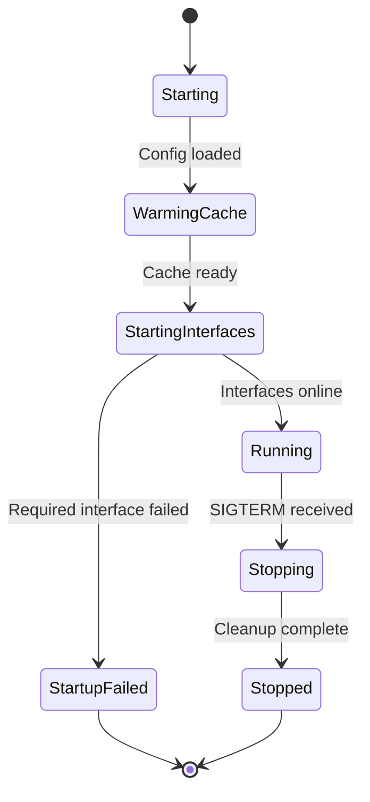
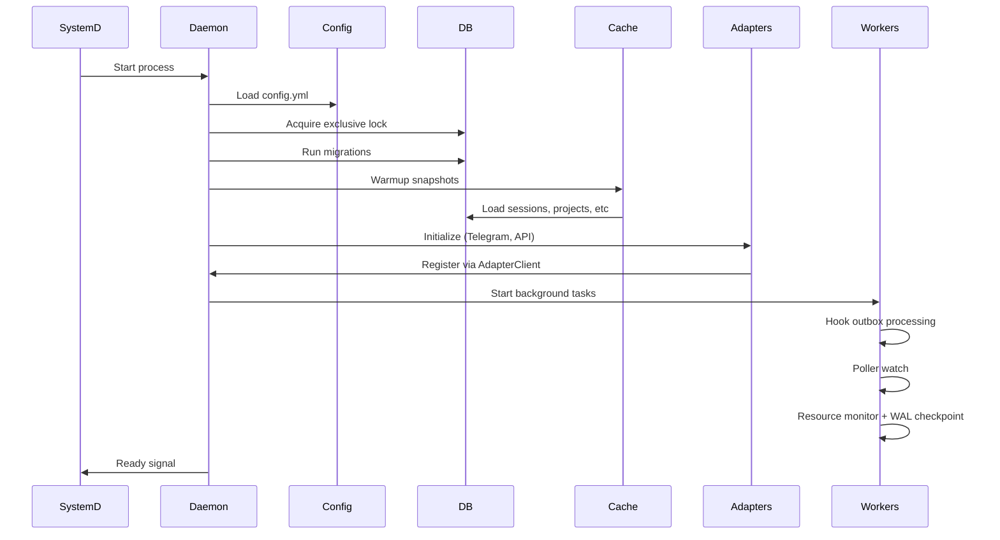
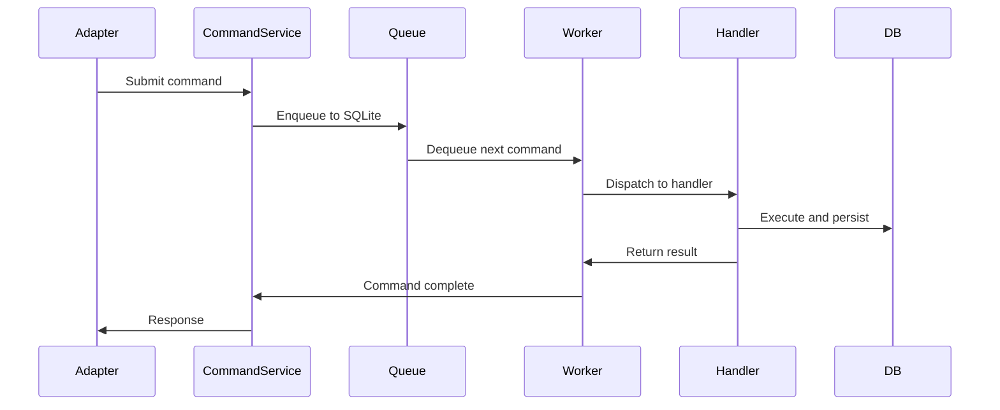
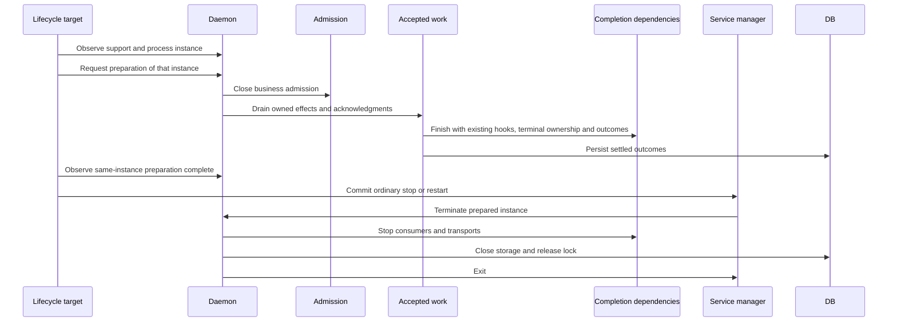

# Daemon — Design

## Required reads

- @docs/local/design/architecture/system-overview.md

## Purpose

- Coordinate adapters, command handling, tmux execution, and background tasks.
- Adapter interactions flow through `AdapterClient`.
- State is persisted in SQLite and surfaced via the cache.



## Inputs/Outputs

**Inputs:**

- Configuration file (`config.yml`, `teleclaude.yml`)
- Adapter events and inbound command objects
- SIGTERM/SIGINT for graceful shutdown
- Redis transport messages (if enabled)
- Adapter-specific inputs (Telegram bot API, API HTTP requests)
- Filesystem artifacts (session transcripts, project registries)

**Outputs:**

- Adapter initialization and registration
- Command execution via CommandService
- Tmux session orchestration
- Cache population and updates
- Background task execution (hook processing, poller-watch, monitoring, WAL maintenance)
- Graceful shutdown signals to all subsystems

## Invariants

- **Single Instance**: Only one daemon process runs per repository root (enforced by SQLite exclusive lock).
- **Cache Before Adapters**: Cache must be fully warmed before adapters start serving requests.

- **Fail-Fast Startup**: Required interface startup failures abort daemon startup instead of degrading silently.

- **Outbox Recovery**: On restart, daemon processes undelivered hooks and pending commands from outbox tables.

- **Shutdown Ownership**: One daemon-owned admission and drain boundary implements accepted-work settlement (`local/projects/teleclaude/spec/feature/agent_runtime/daemon-lifecycle`). Finite accepted work retains its task, terminal and storage ownership through durable settlement, preserving the no-interference invariant (`general/principle/trust-and-guardrails`).
- **Continuation Ownership**: Accepted operation continuations carry their existing ownership through in-process dispatch and self-HTTP. A completion is matched to its existing operation, bootstrap or input-delivery owner; ambient daemon credentials do not establish prior admission.

- **Prepared Instance**: A process stays closed to new business work after preparation completes and exits within a bounded termination grace, terminated by its lifecycle caller or, absent that, by its own ordinary shutdown. The health observation identifies protocol support, that process instance and its preparation phase; liveness alone is not preparation evidence.

- **Existing Durability Owners**: Operation receipts, startup handovers and inbound-delivery records remain the durable authorities. The drain owner tracks their live execution without creating a second durable operation ledger.

## Primary flows

### 1. Daemon Startup



### 2. Command Execution Cycle



### 3. Background Workers

<!-- planned-change:teleclaude-db-split -->

| Worker                | Interval (default) | Purpose                                                                                                            |
| --------------------- | ------------------ | ------------------------------------------------------------------------------------------------------------------ |
| Hook Outbox           | 1s                 | Process agent lifecycle hooks                                                                                      |
| Poller Watch          | 5s                 | Keep per-session output pollers aligned with tmux                                                                  |
| Resource Monitor      | 60s                | Emit runtime resource snapshots                                                                                    |
| WAL Checkpoint        | 300s               | Prevent unbounded SQLite WAL growth                                                                                |
| Launchd Watch         | 300s (optional)    | Log launchd state transitions on macOS                                                                             |
| Runtime Maintenance   | 1h                 | Prune stale sessions, scratch dirs, caches, operational rows, event runtime rows, and compact runtime SQLite files |
| Closed Session Replay | 1h                 | Re-emit `session_closed` for recently closed sessions (12h window)                                                 |

<!-- change:teleclaude-db-split -->

Each worker's cadence is set by the daemon's runtime configuration or by the worker's own loop.

| Worker                | Purpose                                                                                             |
| --------------------- | --------------------------------------------------------------------------------------------------- |
| Hook Outbox           | Process agent lifecycle hooks                                                                       |
| Poller Watch          | Keep per-session output pollers aligned with tmux                                                   |
| Resource Monitor      | Emit runtime resource snapshots                                                                     |
| WAL Checkpoint        | Fold the main database WAL back into the file without waiting on readers or blocking writers        |
| Launchd Watch         | Log launchd state transitions on macOS (optional)                                                   |
| Runtime Maintenance   | Prune stale sessions, scratch dirs, caches, operational rows and event runtime rows; never compacts |
| Closed Session Replay | Re-emit `session_closed` for recently closed sessions                                               |

<!-- /planned-change:teleclaude-db-split -->

An operator can force the same behavior on demand with:

```bash
uv run scripts/cleanup_closed_session_channels.py [--hours 12] [--dry-run]
```

The helper queries local closed sessions within the window and replays their
`session_closed` handling through the running daemon API.

### 4. Graceful Shutdown



Finite accepted work is registered before its acceptance is returned. Submission
transfers that ownership to its operation or bootstrap task; delivery retains it
through the acknowledgment of the terminal effect. Background poll loops stop
initiating work during preparation, while completion dependencies of live owners
continue. The task registry and session bootstrap's background-task set participate
in the same drain; neither set's membership alone classifies all of its tasks as
finite business work.

The preparation signal is installed before support is advertised. The host helper
reads the current process instance before signaling and immediately before the
service-manager action. Its bounded observation uses one shared runtime budget;
expiration leaves the process draining and reports incomplete preparation. A new
instance, missing capability or unreadable observation fails preparation. An
external crash between the final observation and a manager's label-addressed action
remains an abrupt-loss case.

The daemon does not depend on the host helper to finish what preparation started.
Once drained, it holds a bounded termination grace for the helper's termination;
when none arrives — the helper's observation expired, the helper crashed, or it was
never coming back — the daemon runs its ordinary shutdown and exits, and the
service manager's relaunch policy brings the service back on its installed code.

The terminal effect unit starts before its pre-effect durability mark and retains
ownership through paste, submission and durable outcome recording. Its current
owner completes an effect that has begun; replay after abrupt loss remains governed
by the existing startup and accepted-input recovery contracts.

## Failure modes

- **Config Parse Error**: Daemon exits immediately with error. Systemd restarts with exponential backoff.
- **SQLite Lock Failure**: Another daemon instance is running. Refuses to start. Indicates configuration or deployment issue.

- **Migration Failure**: Database schema incompatible. Manual intervention required. No automatic rollback.
- **Interface Startup Failure (API/Adapter)**: Daemon fails startup (fail-fast) rather than running in partial mode.

<!-- planned-change:daemon-startup-aborts-without-redis -->

- **Redis Unavailable at Startup**: Daemon fails startup (fail-fast). Redis is required by the event platform; downstream code (operations, integration, signals) emits events unconditionally and cannot tolerate a missing producer. systemd/launchd restarts with backoff until Redis returns. Adapter startup and event-producer registration complete before the API socket opens, so no `/todos/*` operation can land before the producer is registered. The event consumer — the Redis-stream event processor and the scheduler minute clock — starts only after the API socket is bound, so in-daemon pipeline stages that reach the daemon's own API over that socket never run before the socket exists. While Redis stays unreachable every relaunch fails the same way, so a Redis outage is a TeleClaude outage of the same length. A long-lived event reader whose Redis stops answering while the daemon serves ends its task; once its restart budget is spent, that end becomes the daemon's ordinary shutdown, and the relaunch then meets this startup failure. This contradicts `local/projects/teleclaude/policy/daemon-availability`.

<!-- change:daemon-startup-aborts-without-redis -->

- **Event Redis Unreachable**: The daemon starts and serves while a configured event-platform Redis does not answer (`local/projects/teleclaude/policy/daemon-availability`). Startup logs which scope's Redis did not answer and holds the event platform's recovery progress at blocked until it answers. The event producers are registered before the API socket opens either way, so no `/todos/*` operation can land before them. The event readers on a Redis that answered start after the API socket is bound, as at every start; those on a Redis that did not answer start once it answers, without a restart. A Redis that stops answering while the daemon serves does not end the daemon's tasks; how its readers wait and resume belongs to `local/projects/teleclaude/design/architecture/event-delivery`.

<!-- /planned-change:daemon-startup-aborts-without-redis -->

- **Cache Warmup Timeout**: Daemon fails to start. Indicates database corruption or resource exhaustion.
- **Unclean Shutdown (SIGKILL)**: Hooks and commands may be partially processed. Next startup recovers from outbox.

- **Worker Task Crash**: A long-lived worker is supervised (`sdlc/policy/code-quality-practices`, Error Handling and Recovery). Its supervisor logs the end and starts a replacement while the worker's restart budget lasts. A worker that cannot be replaced in place, or that exhausts its budget, escalates: the daemon runs its ordinary shutdown and the service manager relaunches it (`local/projects/teleclaude/spec/feature/agent_runtime/daemon-lifecycle`, UC-DL17).

- **Shutdown Timeout**: Cleanup takes too long; systemd may SIGKILL and leak resources.

<!-- planned:daemon-startup-aborts-without-redis -->

## See Also

- docs/local/adr/0145-a-computer-keeps-working-while-its-cluster-redis-is-unreachable.md — why the daemon starts and serves while its cluster Redis is unreachable.

<!-- /planned:daemon-startup-aborts-without-redis -->
