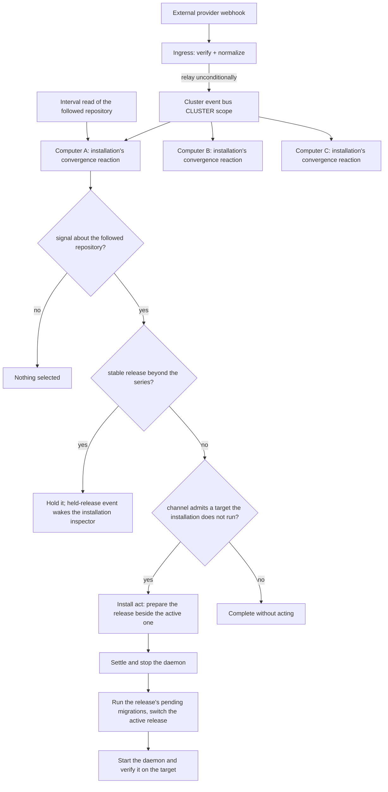

# Deployment Pipeline — Design

## Purpose

TeleClaude keeps a multi-machine fleet current automatically. The pipeline has
two responsibilities, owned by two bounded contexts on different change axes:

- **Ingress (`integration`)** — terminate external webhooks for the whole
  cluster at one public node, verify and normalize each payload, and relay it
  onto the cluster event bus unconditionally.
- **Convergence (`reconciliation`)** — every installation reacts to the
  relayed green announcements and releases of the repository it follows, reads
  that repository on an interval, and drives its own actual state toward its
  desired state: the newest revision its channel admits, installed exactly
  once, ending healthy.

The ingress decides nothing about the reaction; the reaction is
subscriber-driven, and the ingress reuses the localhost API server behind its
proxy.

### Ingress — `teleclaude/hooks/inbound.py`

The ingress serves the inbound endpoints on loopback only, behind a mandatory
same-host reverse proxy that terminates TLS, restricts source, and forwards only
the inbound path prefix. A project receives GitHub deliveries by declaring a
GitHub source in its own configuration; the ingress verifies each delivery
against that project's secret, translates it, and relays it. Webhook routes
authenticate by signature alone and inherit no loopback identity-trust. One
ingress terminates requests for every provider and every home: the ingress
contract is `local/projects/teleclaude/spec/feature/integration/single-ingress-webhook-termination`,
and per-home source declaration is
`local/projects/teleclaude/spec/feature/integration/inbound-webhook-endpoint-framework`.

### Cluster relay

A verified delivery is published on the platform event stream at cluster scope
as a platform event of its provider's type — `github.<event>` for GitHub —
emitted on the ingress, with the home that declared the source as its origin,
or none for a source the platform itself declares
(`local/projects/teleclaude/spec/feature/event-catalog/event-envelope`). Every computer reads the stream through its own
consumers. Only the ingress is publicly exposed. The relay is stateless, so a
second ingress can be added without redesign.

### Convergence — `reconciliation`

The running daemon of every installation consumes the green announcements
(`teleclaude.ci.revision.passed`) and published releases (`github.release`) of
the repository it follows, whether or not a project checkout of TeleClaude is
registered on that computer, and reads that repository on a fixed interval, so
a computer outside the cluster converges as well. A signal about any other
repository never starts it; a push is no signal.

The reaction reads the signal and the installation's channel. On a match it
selects the target the channel admits — the newest green main revision for
edge, a published release within the active release's compatibility series for
stable — and installs it through the install act
(`local/projects/teleclaude/spec/feature/reconciliation/installed-releases`):
the release is prepared beside the active one, the daemon is stopped, the
release's pending migrations run, the active-release pointer is switched and
the daemon is started and verified on the target
(`local/projects/teleclaude/design/architecture/installation`). A target the
installation already runs is not installed again. Whether the runtime then
behaves correctly is the installation inspector's assessment. A stable release
beyond the series is held instead; its held-release event activates
`sdlc/procedure/maintenance/installation/overview` on that computer, whose
held-release route carries out the release's upgrade steps and installs it
through the same act.
Channel policy and the exactly-once / healthy-or-failed contract are owned by
`local/projects/teleclaude/spec/feature/reconciliation/channel-gated-self-update`;
the context model is `local/projects/teleclaude/spec/domain/reconciliation`.

A deliberately multi-version fleet (edge ahead of stable) stays
interoperable through the fleet capability map and feature-ID gating in
`teleclaude/core/reconciliation/` — unaware nodes drop ignorable capabilities
cleanly, and removal of a shared capability waits until every live node carries
it (`local/projects/teleclaude/spec/feature/reconciliation/fleet-cross-version-interop`).

### Current implementation surface

The ingress (`teleclaude/hooks/inbound.py`) and the fleet capability map /
feature-ID registry (`teleclaude/core/reconciliation/`) are in place. The
convergence reaction is the installation's own event consumer, whose channel
evaluation lives in `teleclaude/deployment/` and which invokes reconciliation's
install act; the interval read goes through `integration`'s GitHub client.
Channel configuration is the machine configuration's `deployment` block
(`local/projects/teleclaude/spec/teleclaude-config`).

### Immutable installed source

The convergence reaction pins the admitted immutable target for its attempt;
each installed release selects exactly one revision under
`local/projects/teleclaude/spec/feature/reconciliation/release-checkout`.
The install act and publication consume the installation's identity, on every
channel alike.

## Inputs/Outputs

**Inputs:**

- External provider webhooks (GitHub release published, workflow runs, other
  provider events) arriving at the single ingress.
- The machine configuration's `deployment.channel`.
- The relayed green announcements and releases of the repository each
  installation follows, and that repository's state read on an interval.

**Outputs:**

- A verified, normalized event relayed onto the cluster event bus.
- On each computer whose channel admits the target: the target installed as the
  installation's active release through the install act, with every failure
  recorded with its reason.
- On a stable installation meeting a release beyond its series: the release
  held with its reason and one held-release event on that computer.

## Invariants

- **Single public surface.** Exactly one computer (the ingress) accepts
  external webhooks; every other computer reacts by subscription.
- **Unconditional relay.** The ingress relays every verified event regardless
  of its own channel, role, or whether it would itself act.
- **Only the followed repository converges it.** Convergence starts only from a
  green revision or release of the repository the installation follows.
- **Channel-gated convergence.** An installation converges only to a target its
  channel admits: `edge` never to a revision without every required check
  green, `stable` never automatically to a release beyond the active release's
  compatibility series.

- **Exactly-once per target version.** A target the installation already runs
  is not installed again, and a replayed event performs nothing a second time.
- **Healthy-or-failed.** A convergence is complete only when the daemon is
  running and healthy on the target; a failed step is recorded with its reason
  where the installation inspector finds it and leaves the convergence incomplete
  until it is replayed, never a silent partial state.

## Primary flows

## Failure modes

- **Ingress down.** No external events are processed while it is down; the
  cluster is not otherwise broken. Every installation still converges through
  its interval read; a second stateless ingress restores relayed signals.
- **Unverified payload.** Signature verification fails at the ingress; nothing
  is relayed and the sender receives a rejection response.
- **A computer offline misses relayed events.** A computer that was not running
  handles the events it missed while the stream still retains them; one that
  returns after its retained window has moved on does not replay what it
  missed. Its interval read of the followed repository recovers it.
- **Convergence failure.** A failed install leaves convergence incomplete with
  its pending target retained for replay; the install's own outcomes are
  recorded under
  `local/projects/teleclaude/spec/feature/reconciliation/installed-releases`,
  and the installation inspector assesses the result. Config-load failure is
  reported as the reaction's failure.
- **Breaking release held.** A stable release beyond the series stays held,
  with the installation on its active release, until the installation
  inspector's upgrade route installs it; `telec app status` names the hold.
- **Idempotent migrations.** Installation migrations are tracked; re-running
  skips already-applied steps.

## See Also

- docs/local/procedure/deploy.md — operator procedure
- docs/local/spec/feature/integration/single-ingress-webhook-termination.md
- docs/local/spec/feature/integration/event-bound-maintenance.md
- docs/local/spec/feature/reconciliation/channel-gated-self-update.md
- docs/local/spec/feature/reconciliation/fleet-cross-version-interop.md
- docs/local/spec/domain/reconciliation.md
- docs/local/adr/0028-single-lan-bound-ingress.md
- docs/local/adr/0055-proxy-fronted-ingress-reuse.md
- docs/local/adr/0111-external-events-enter-as-ordinary-platform-events.md
- docs/local/adr/0024-reconciliation-bounded-context.md
- docs/local/spec/teleclaude-config.md — config schema for deployment
