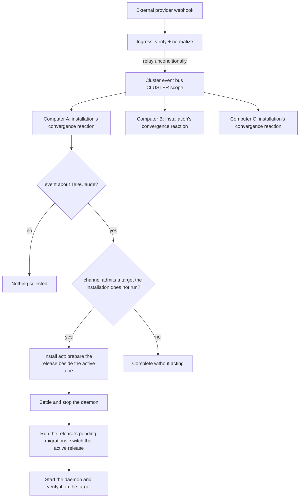

# Deployment Pipeline — Design

## Purpose

TeleClaude keeps a multi-machine fleet current automatically. The pipeline has
two responsibilities, owned by two bounded contexts on different change axes:

- **Ingress (`integration`)** — terminate external webhooks for the whole
  cluster at one public node, verify and normalize each payload, and relay it
  onto the cluster event bus unconditionally.
- **Convergence (`reconciliation`)** — every computer's installation reacts to
  the relayed pushes and releases of TeleClaude's own repository and drives its
  own actual state toward its desired state: the newest version its channel
  admits, installed exactly once, ending healthy.

The ingress decides nothing about the reaction; the reaction is
subscriber-driven. This separation is the recorded decision in ADR-0028
(single-ingress termination) and ADR-0024 (reconciliation as its own bounded
context); ADR-0055 supersedes ADR-0028's bind topology with proxy-fronted reuse
of the localhost API server.

### Ingress — `teleclaude/hooks/inbound.py`

The ingress serves the inbound endpoints on loopback only, behind a mandatory
same-host reverse proxy that terminates TLS, restricts source, and forwards only
the inbound path prefix. A project receives GitHub deliveries by declaring a
GitHub source in its own configuration; the ingress verifies each delivery
against that project's secret, translates it, and relays it. Webhook routes
authenticate by signature alone and inherit no loopback identity-trust. One
ingress terminates requests for every provider and every home. See
`docs/local/spec/feature/integration/single-ingress-webhook-termination.md` and
`docs/local/spec/feature/integration/inbound-webhook-endpoint-framework.md`.

### Cluster relay

A verified delivery is published on the platform event stream at cluster scope
as the platform event `github.<event>`, emitted on the ingress, with the
declaring project as its origin. Every computer reads the stream through its own
consumers. Only the ingress is publicly exposed. The relay is stateless, so a
second ingress can be added without redesign.

### Convergence — `reconciliation`

The running daemon of every computer's installation consumes `github.push` and
`github.release` events whose origin is TeleClaude, whether or not a project
checkout of TeleClaude is registered on that computer. An event about any other
project never starts it.

The reaction reads the event and the computer's channel policy. On a match it
selects the target the channel admits — the newest mainline for alpha, the
published release for beta and stable — and installs it through the install act
(`local/projects/teleclaude/spec/feature/reconciliation/installed-releases`):
the release is prepared beside the active one, the daemon is stopped, the
release's pending migrations run, the active-release pointer is switched and
the daemon is started and verified on the target
(`local/projects/teleclaude/design/architecture/installation`). A target the
installation already runs is not installed again. Whether the runtime then
behaves correctly is the standing integrator's judgment.
Channel policy and the exactly-once / healthy-or-failed contract are owned by
`docs/local/spec/feature/reconciliation/channel-gated-self-update.md`; the
context model is in `docs/local/spec/domain/reconciliation.md`.

A deliberately multi-version fleet (alpha ahead of beta ahead of stable) stays
interoperable through the fleet capability map and feature-ID gating in
`teleclaude/core/reconciliation/` — unaware nodes drop ignorable capabilities
cleanly, and removal of a shared capability waits until every live node carries
it. See
`docs/local/spec/feature/reconciliation/fleet-cross-version-interop.md`.

### Current implementation surface

The ingress (`teleclaude/hooks/inbound.py`) and the fleet capability map /
feature-ID registry (`teleclaude/core/reconciliation/`) are in place. The
convergence reaction is the installation's own event consumer, whose channel
evaluation lives in `teleclaude/deployment/` and which invokes reconciliation's
install act. Channel configuration is the machine configuration's `deployment`
block (`docs/local/spec/teleclaude-config.md`).

### Immutable installed source

The convergence reaction pins the admitted immutable target for its attempt;
each installed release selects exactly one revision under
`local/projects/teleclaude/spec/feature/reconciliation/release-checkout`.
Channel admission retains its current policy until its own delivery changes it.
The install act and publication consume the installation's identity, on every
channel alike.

<!-- planned:reviewed-pr-contributions -->

### Contribution and upstream release

Public contribution is the workflow handoff in
`local/projects/teleclaude/spec/feature/workflow/contribution-export` and
`local/projects/teleclaude/spec/feature/workflow/contribution-adoption`.
Its upstream integration feeds the existing immutable release pipeline.
Contribution creation, source acceptance, release publication and local adoption
remain independently observable.
<!-- /planned:reviewed-pr-contributions -->

## Inputs/Outputs

**Inputs:**

- External provider webhooks (GitHub push to `main`, GitHub release published,
  other provider events) arriving at the single ingress.

- The machine configuration's `deployment.channel` and, for stable enrollment,
  its compatibility series.

- The relayed pushes and releases of TeleClaude's own repository, consumed by
  every computer's installation.

**Outputs:**

- A verified, normalized event relayed onto the cluster event bus.
- On each computer whose channel admits the target: the target installed as the
  installation's active release through the install act, with every failure
  recorded with its reason.

## Invariants

- **Single public surface.** Exactly one computer (the ingress) accepts
  external webhooks; every other computer reacts by subscription.
- **Unconditional relay.** The ingress relays every verified event regardless
  of its own channel, role, or whether it would itself act.
- **Only the platform's own events converge it.** Convergence starts only from
  a push or release of TeleClaude's own repository.

- **Channel-gated convergence.** A computer converges only when the event
  matches its channel policy; `stable` ignores releases outside its
  compatibility series.

- **Exactly-once per target version.** A target the installation already runs
  is not installed again, and a replayed event performs nothing a second time.
- **Healthy-or-failed.** A convergence is complete only when the daemon is
  running and healthy on the target; a failed step is recorded with its reason
  where the standing integrator finds it and leaves the convergence incomplete
  until it is replayed, never a silent partial state.

## Primary flows

## Failure modes

- **Ingress down.** No external events are processed while it is down; the
  cluster is not otherwise broken. Recovery is the next release signal, a
  periodic desired-state self-check, or a second stateless ingress.
- **Unverified payload.** Signature verification fails at the ingress; nothing
  is relayed and the sender receives a rejection response.
- **A computer offline misses relayed events.** A computer that was not running
  handles the events it missed while the stream still retains them; one that
  returns after its retained window has moved on does not replay what it
  missed. Recovery is the next signal or a periodic self-check.
- **Convergence failure.** A failed install leaves convergence incomplete with
  its pending target retained for replay; the install's own outcomes are
  recorded under
  `local/projects/teleclaude/spec/feature/reconciliation/installed-releases`,
  and the standing integrator judges the result. Config-load failure is
  reported as the reaction's failure.
- **Idempotent migrations.** Installation migrations are tracked; re-running
  skips already-applied steps.

## See Also

- docs/local/procedure/deploy.md — operator procedure
- docs/local/spec/feature/integration/single-ingress-webhook-termination.md
- docs/local/spec/feature/integration/event-bound-maintenance.md
- docs/local/spec/feature/reconciliation/channel-gated-self-update.md
- docs/local/spec/feature/reconciliation/fleet-cross-version-interop.md
- docs/local/spec/domain/reconciliation.md
- docs/local/adr/0028-single-lan-bound-ingress.md
- docs/local/adr/0055-proxy-fronted-ingress-reuse.md
- docs/local/adr/0111-external-events-enter-as-ordinary-platform-events.md
- docs/local/adr/0024-reconciliation-bounded-context.md
- docs/local/spec/teleclaude-config.md — config schema for deployment
