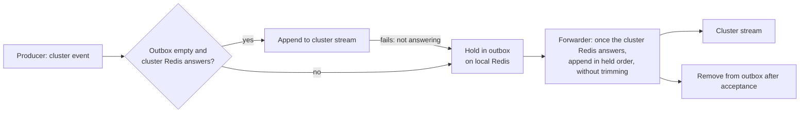

# Event Delivery — Design

## Purpose

Define the relationship between domain-event publication, independent reactions,
source materialization and runtime coordination. Ownership remains with the
producing and consuming contexts under `sdlc/policy/domain-ownership`.

## Inputs/Outputs

Producers publish declared facts through the event publication capability for
their source stream. The consumer runtime delivers them to interested reactions under
`local/projects/teleclaude/spec/feature/event-catalog/event-consumers`.
The event envelope states the producer's facts under
`local/projects/teleclaude/spec/feature/event-catalog/event-envelope`.

Commands enter their owning command or operation capability. A notification
that work is requested does not substitute for that capability's acceptance,
authorization or completion contract. Runtime-local waits use the runtime's
coordination capability under
`local/projects/teleclaude/spec/feature/agent_runtime/daemon-lifecycle`.

## Invariants

- **One reaction path:** domain-event publication appends to its source stream
  and reaction execution follows
  `local/projects/teleclaude/spec/feature/event-catalog/event-consumers`.
  Source-owned local cache reconciliation is a separate owner capability under
  `local/projects/teleclaude/design/architecture/cache`; publication does not
  invoke a general in-process subscriber path.
- **One owner per effect:** command execution, runtime coordination and event
  reactions retain their distinct completion boundaries. An awaited owner
  operation completes at that operation's boundary rather than at publication
  of a notification about it.
- **Ordered reaction, current source:** consumer progress orders that
  consumer's handling. Source materialization consumes current authoritative
  state under `local/projects/teleclaude/design/architecture/cache`; stream
  arrival order is not a database revision.

<!-- planned-change:cluster-redis-outage-store-and-forward -->

- **Producer completion:** successful publication establishes stream acceptance,
  not completion of every reaction. A source commit and a stream append are
  separate effects unless the source owner's contract supplies a durable
  handover. Publication failure stays observable and does not manufacture a
  rollback or successful delivery.

<!-- change:cluster-redis-outage-store-and-forward -->

- **Producer completion:** successful publication establishes stream
  acceptance, or, for a cluster event its computer holds, acceptance into that
  computer's outbox; it never establishes completion of every reaction. A source
  commit and a stream append are separate effects unless the source owner's
  contract supplies a durable handover. Publication failure stays observable and
  does not manufacture a rollback or successful delivery.
- **Held events keep their order:** a cluster event a computer published while
  it held earlier ones reaches the cluster stream after all of them.

<!-- /planned-change:cluster-redis-outage-store-and-forward -->

- **Each scope its own Redis:** every event type states its scope, local by
  default and cluster when a consumer on another computer acts on it.
  Publication appends an event to the Redis of its scope: the computer's own
  local Redis, or the shared cluster Redis. A consumer reads from the Redis of
  every scope its event types belong to, so on a computer with its local Redis
  an event produced and consumed on that computer never crosses the network; a
  computer whose local Redis is not set up carries its local events on the
  cluster Redis.
- **Compatibility at the boundary:** required earlier wire representations are
  translated at transport boundaries under
  `local/projects/teleclaude/spec/feature/reconciliation/fleet-cross-version-interop`.
  The earlier internal wire and its named capability gate are defined below.
  Translation retains occurrence identity, source authority and recipient reach.
- **Preserved exposure:** a domain notification retains its source's payload
  reach, notification visibility, procedure-activation meaning and retention
  contract. Moving a control signal into an event does not grant a new reader
  access to private activity, message bodies or error details.

## Primary flows

### Domain reactions

The source owner commits its change and publishes the declared fact through
its emission contract. Each interested reaction consumes through the existing
independent-consumer runtime. Its source selection, retry and duplicate handling
follow the event-consumer contract; its effects follow the consuming owner.
Adapter reactions, operation outcomes, activity, voice state,
project changes and error reporting use this same relationship when they are
domain notifications.

Existing declarations represent the same fact wherever it is produced;
compatibility carriers do not create a second lifecycle occurrence. Current
consumers execute through their bound consumer path throughout wire coexistence.

### Local session projection

The daemon's session-source change boundary attempts current-source cache
reconciliation before publishing its domain notification, under
`local/projects/teleclaude/design/architecture/cache`. The live materializer
consumer recovers from current source state before retiring its historical
delivery position. Source projection and notification consumption remain
separate completion boundaries under `sdlc/policy/domain-ownership`.

### Source-stream exposure

Public platform facts retain the platform stream and its existing consumers.
Internal runtime notifications retain the stream owned by
`INTERNAL_EVENT_STREAM`, with typed decoding and consumer-owned live or retained delivery
on the same delivery runtime. This stream boundary preserves the existing
notification, procedure-activation, maintenance and correlation inputs under
`local/projects/teleclaude/spec/feature/event-catalog/event-envelope`.

The two sources share delivery mechanics, not audiences. Internal notifications
do not enter public automation through translation. Native facts retain their
truthful source, subject and origin; earlier records retain the limits of the
facts they carried. Source-stream trimming and the existing dead-letter contract
remain authoritative; the transport creates no additional payload archive.

Runtime typing, activity, lifecycle feedback, error feedback and operation
toasts are live presentation. Session cache, adapter metadata, availability,
voice focus and terminal housekeeping recover from their owning current state
before replacing historical delivery. Legacy command carriers retain ordered
delivery until handed to their command owner; public occurrence consumers are
unchanged. The delivery distinction belongs to each reaction under
`local/projects/teleclaude/spec/feature/event-catalog/event-consumers`, not to a
producer's assessment of an event's importance.

Readiness and no-composer evidence remain runtime-owned operations. Explicit
voice focus completes through its command-owned voice continuation. Local
project-cache changes use the existing cache-change capability. These operations
retain their local payload reach and completion boundaries under
`local/projects/teleclaude/spec/feature/agent_runtime/daemon-lifecycle`.

### Scopes and their Redis

Every computer, the cluster host included, runs a local Redis of TeleClaude's
own: a Redis server process with its configuration and data in the
platform home, listening only on a Unix socket only the TeleClaude user can
open, with its TCP port and default user off and one ACL user whose password
lives in the machine environment. A unit the installation owns keeps it running,
and stopping the daemon leaves it running. It never touches another Redis on
the computer; the block an earlier installer added to the operating system's
Redis configuration is removed. Setup has two steps: while the
previous release serves, the new release installs the Redis server binary when
it is missing, disabling the service the operating system's package added,
whether it is running or only enabled, and checks what the stopped window needs; in the stopped window it
writes the configuration and the unit, starts the instance and verifies it with
its ACL user before it writes the variables that make the platform use it,
never installing and never prompting. A local Redis the operator configured
that answers is kept.

When the local Redis cannot be set up, neither step fails the install: the
install log names the reason and what resolves it, a managed local socket that
no longer answers is withdrawn, and the computer keeps its local events on the
cluster Redis. A computer whose local Redis is not configured carries its local
events on the cluster Redis, and its event platform logs that at startup.

The cluster Redis is shared by the computers of one cluster; it also carries
the cross-computer transport of
`local/projects/teleclaude/design/architecture/redis-transport`. A lone
computer's cluster settings name its own local Redis, and when both
scopes name the same Redis the event platform uses one client for both, so
every stream is read once. Without a cluster Redis URL the platform refuses to
start, naming the setting.

Both Redis instances hold the platform stream and the stream owned by
`INTERNAL_EVENT_STREAM`; an entry is on exactly one of them. The cluster types
are those a consumer on another computer acts on: relayed ingress events, the
revision and release facts installation reaction admits, the session status,
agent activity and error notifications that views of another computer's
sessions show, and the earlier internal compatibility ingress. Every other type
is local. The set of cluster types has one owner in code, and a new
cross-computer consumer changes it in the same change.

A relayed event is always cluster. A type outside every namespace the platform
declares is a relayed type, and a platform type the catalog no longer declares
stays local. A consumer whose interest names only local types reads the local
Redis; one naming only cluster types reads the cluster Redis; one taking any
type reads both and keeps separate progress on each, while its reaction still
handles one event at a time. A retained consumer that reads only local events
but once read the cluster Redis first handles every entry its group there still
owes, in order, and then retires that group, before it reads its local Redis;
its local position is taken before producers run, so nothing published
meanwhile is skipped. Own-computer filtering applies to what each Redis
delivers. The live consumers of a stream on one Redis share one read of it, so a
live entry crosses the network once per computer, not once per consumer. Each
live consumer handles what that read hands it in its own task, from a bounded
backlog: a consumer that falls behind it drops the batches it cannot hold and
recovers its current source before its next one, and delays no other consumer.
A socket timeout shorter than the idle read's block is refused at configuration
load. A consumer that takes any type from every computer, such as
event-bound maintenance, receives another computer's events only when they are
cluster events.

<!-- planned:cluster-redis-outage-store-and-forward -->

### Held cluster events

A computer with its own local Redis holds the cluster events it cannot hand to
the cluster Redis, in one outbox on that local Redis. Publication puts a cluster
event in the outbox instead of on its stream while the outbox still holds an
event, while the record of the cluster Redis says it does not answer, or when
its append fails because the cluster Redis does not answer. A held entry is the
event exactly as it would have been appended, with the stream it is bound for
and, for a relayed event, its claim. Every process that publishes holds the same
way — the daemon, the webhook receiver and short-lived command-line processes;
one without the daemon's record learns that the cluster Redis is away from its
own failed append. Local events never enter the outbox.

The outbox is the only copy of what it holds. Its entries leave it only by being
forwarded, never by trimming. On the local Redis the installation manages, a
hold is acknowledged to its producer only once that Redis has written it to disk
under its append-only persistence (declared by the installation's local Redis
configuration), so a held event survives a restart or crash of the daemon or of
that Redis; a hold it cannot confirm is a publication failure. A local Redis the
operator configured is never reconfigured: a hold on it is acknowledged once it
confirms the hold on disk where it can, and otherwise once written, kept as
durably as that Redis's own persistence keeps it, which the event platform names
at startup. A computer whose local events share the cluster Redis has no
outbox: there a cluster event that cannot be appended fails at its producer.

The daemon's forwarder empties the outbox once the record says the cluster
Redis answers. It appends the held events to their streams in the order they
were held and removes each from the outbox only once the cluster Redis has
accepted it, so the outbox stays non-empty until the last held event is on its
stream and every event published meanwhile queues behind the held ones. A held
relayed event is claimed in the same atomic step as its forwarded append, as at
publication; one whose claim another receipt of the same delivery already took
leaves the outbox without being appended.

The cluster streams keep an entry while it is younger than their retention age
or among their newest entries up to the count they keep today: a computer of
this release removes only an entry that is both older and beyond that count,
and a forwarded append removes nothing. A backlog forwarded at once therefore pushes no entry out of a stream,
and a retained consumer that reads within the retention age handles every
entry, forwarded or not, however large the backlog was.

<!-- /planned:cluster-redis-outage-store-and-forward -->

### Earlier internal wire interoperability

The compatibility surface is the earlier `InternalEventEnvelope` representation
on the stream owned by `INTERNAL_EVENT_STREAM`. Current consumers decode earlier
entries directly through the transport codec. A source append carries canonical
attributes beside any earlier representation required by peers; the general emitter's
local dispatch and subscriber registry are not compatibility surfaces.

The feature-ID registry owns the domain-event-delivery capability named
`DOMAIN_EVENT_DELIVERY_FEATURE_ID`, marked `MUST_NEGOTIATE`. A node advertises
this capability when it supports the migrated domain notifications through
platform consumers and preserves occurrence identity across the canonical and
earlier wire representations. Publishing a pending contract does not advertise
implementation support.

Earlier wire handling remains available while the live fleet requires it.
Its withdrawal uses the existing fleet capability map's contraction answer for
`DOMAIN_EVENT_DELIVERY_FEATURE_ID`: every live node, including the slowest
channel, advertises that capability. A missing map, an empty live set or a live
node lacking the advertisement leaves withdrawal closed. Release numbers alone
do not open it. This applies the retirement contract in
`local/projects/teleclaude/spec/feature/reconciliation/fleet-cross-version-interop`.

The adapter carries the same occurrence identity across representations and
does not append a translated copy to the platform stream. A current consumer
has one effective reaction path for that occurrence. Wire compatibility does
not preserve the earlier general-purpose event execution machinery, and the
separate peer cache replication protocol retains its existing contract.
Withdrawal retires the earlier representation, while the internal source stream
retains its exposure boundary.
Retained earlier entries remain decodable while any consumer still owes their
handling; fleet capability alone does not discard pending work.

### Runtime and command coordination

Launch readiness and awaited hook processing follow the runtime coordination
contract in `local/projects/teleclaude/spec/feature/agent_runtime/daemon-lifecycle`.
Command intents invoke the established command or operation owner. Local
coordination does not acquire a second event catalog, general subscriber API
or notification delivery policy.

A command continuation that needs later notification processing executes under
the command or operation owner's lifecycle; it does not occupy the ordered
reaction whose progress that continuation needs. Accepted work retains its
existing receipt and completion contract.

### Startup handover

Consumer progress is established before the source activity it must observe.
Handler execution that calls the daemon's request surface begins after that
surface is bound. Source seeding and live delivery meet at an explicit coverage
handover under
`local/projects/teleclaude/spec/feature/agent_runtime/daemon-lifecycle`.

### Cache replication and UI delivery

Peer cache replication and bootstrap retain their source and transport contract
under `local/projects/teleclaude/design/architecture/cache`. Viewer eligibility
and connection delivery remain with
`local/projects/teleclaude/design/architecture/api-server`. Domain-event
consumer order supplies neither a peer snapshot watermark nor a stronger
ordering guarantee for these separate transports.

## Failure modes

- Error-reporting failure follows its consumer's bounded failure handling and
  remains visible in structured logs; it does not create an unbounded chain of
  reports about the reporting failure.
- A publication failure after a source commit leaves reconciliation with the
  source owner. A logged exception is not evidence that a reaction completed.
- A newly established reader position can omit earlier events. Startup
  readiness includes the source-snapshot handover, not just task scheduling.
- Runtime shutdown or failed startup settles local waiters at the runtime
  boundary. Pending provider metadata cannot determine session finality.
- Earlier peers retain their declared interoperability limits. Adapting their
  envelopes does not establish source ordering absent from their records.

<!-- planned-change:cluster-redis-outage-store-and-forward -->

- A Redis that stops answering does not end the readers on it. Each Redis has
  one record of whether it answers, whose loss and return are logged once each.
  A retained consumer's reader waits on that record and then resumes from its
  group, recovering its pending entries in order before it reads new ones. A
  live consumer keeps the recovery its own contract in
  `local/projects/teleclaude/spec/feature/event-catalog/event-consumers` states
  for a connection failure. Reaction failures stay contained as that contract
  states; only a failure other than the Redis connection that escapes a
  reader's run ends that run under its supervisor.

<!-- change:cluster-redis-outage-store-and-forward -->

- A Redis that stops answering does not end the readers on it. Each Redis has
  one record of whether it answers and, while it does not, since when, whose
  loss and return are logged once each. Since is the moment the daemon first
  found that Redis not answering after last finding it answering; the record
  keeps that moment on disk until it observes the Redis answer again, so a
  restart during an outage reports the same since. The cluster Redis's record also takes
  the losses the cross-computer transport meets on it
  (`local/projects/teleclaude/design/architecture/redis-transport`), so the
  event platform, the transport and the readiness answer read one record. A
  retained consumer's reader waits on that record and then resumes from its
  group, recovering its pending entries in order before it reads new ones. A
  live consumer keeps the recovery its own contract in
  `local/projects/teleclaude/spec/feature/event-catalog/event-consumers` states
  for a connection failure. Reaction failures stay contained as that contract
  states; only a failure other than the Redis connection that escapes a
  reader's run ends that run under its supervisor.

<!-- /planned-change:cluster-redis-outage-store-and-forward -->

- A Redis that did not answer at startup has the positions of the readers on it
  taken once it answers. A retained consumer whose group already exists resumes
  from it; one whose group is new starts at that moment, so it omits what that
  Redis took in before.

<!-- planned:cluster-redis-outage-store-and-forward -->

- A crash between a forwarded append and its removal from the outbox appends
  that event again. The event keeps its id, so a retained consumer is not handed
  it twice
  (`local/projects/teleclaude/spec/feature/event-catalog/event-consumers`), and
  a relayed event's claim leaves the repeat unappended.
- A process without the daemon's record waits for its append to the cluster
  Redis to fail, within the cluster client's socket timeout, before it holds the
  event.
- The outbox has no count bound: it grows with the length of the outage and the
  rate of cluster events, within the local Redis's memory. A hold the local
  Redis refuses is a publication failure.
- While this computer holds events, its own consumers of the cluster stream
  receive them only once they are forwarded.
- The cluster Redis holds what the fleet published within the retention age,
  forwarded backlogs included, so its memory grows with the publication rate
  and with the backlogs forwarded inside that age.
- While a computer of an earlier release still trims the cluster streams by
  count, its appends can trim a forwarded backlog before a consumer reads it.
- A daemon that starts while a Redis is away, with no earlier loss on record,
  reports it away since its own start.

<!-- /planned:cluster-redis-outage-store-and-forward -->

## See Also

- docs/local/adr/0116-each-reaction-to-a-platform-event-is-an-independent-consumer.md
- docs/local/adr/0139-each-event-scope-has-its-own-redis.md — why each event scope has its own Redis.
- docs/local/adr/0141-a-local-redis-that-cannot-be-set-up-never-fails-the-install.md — why setup prepares while serving, applies in the stopped window, and never fails the install.
- docs/local/adr/0143-teleclaude-runs-its-own-local-redis-on-every-computer.md — why the local Redis is TeleClaude's own instance on every computer, the cluster host included.
- docs/local/adr/0144-a-fleets-cluster-redis-is-provided-or-provisioned-on-its-master.md — why a lone computer's cluster Redis is its local Redis.

- docs/local/adr/0145-a-computer-keeps-working-while-its-cluster-redis-is-unreachable.md — why a computer starts and serves while its cluster Redis is unreachable.

- docs/local/design/architecture/cache.md
- docs/local/design/architecture/api-server.md
