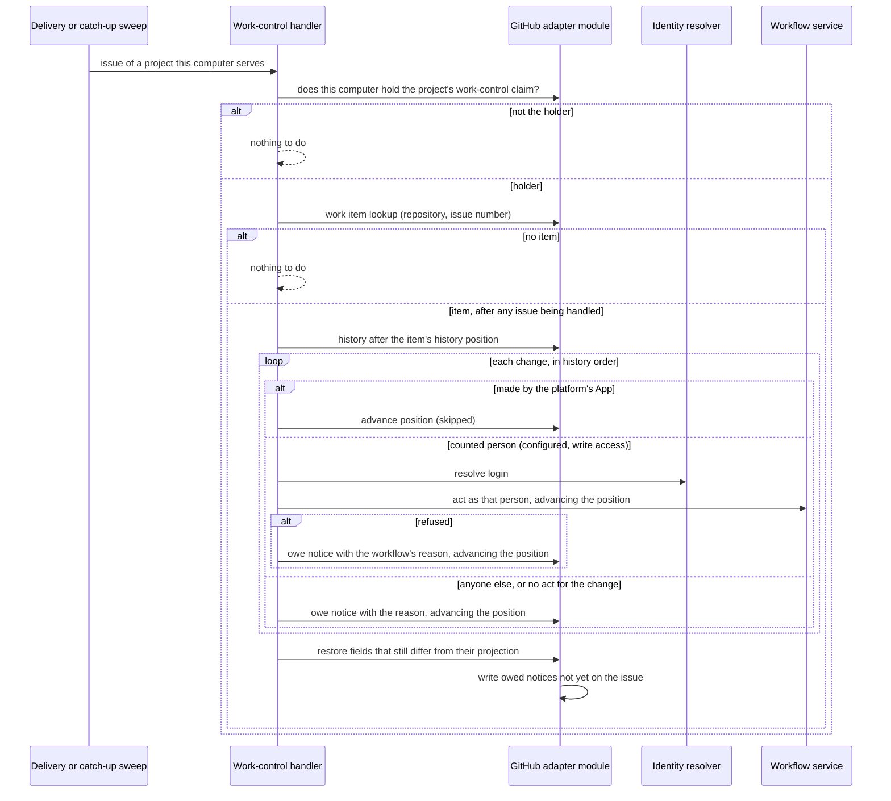

# GitHub Work Control — Design

## Purpose

Carry the behavior of
`local/projects/teleclaude/spec/feature/integration/github-work-control`:
turn a person's change to the fields the platform reflects on an item's issue
into the workflow act it stands for, and put back every change that does not
become an accepted act.

Each decision has one owner; this design owns only how they compose.

| Decision                                                                    | Owner                              | Contract                                                                                                                 |
| --------------------------------------------------------------------------- | ---------------------------------- | ------------------------------------------------------------------------------------------------------------------------ |
| Which GitHub field change stands for which act; whose changes count         | `integration`                      | `local/projects/teleclaude/spec/feature/integration/github-work-control`                                                 |
| Which person a GitHub login is                                              | `identity`                         | `local/projects/teleclaude/spec/feature/identity/human-identity-resolution`                                              |
| Whether an act is valid, and its effect                                     | `workflow`                         | `local/projects/teleclaude/spec/domain/workflow` and the feature specs of each act                                       |
| What the issue's fields should hold; reading, restoring and commenting them | `workflow` (GitHub adapter module) | `local/projects/teleclaude/design/architecture/workflow-store` (Issue history and field read, Field restore, Item title) |
| Receiving GitHub deliveries on every computer                               | `integration`                      | `local/projects/teleclaude/spec/feature/integration/github-webhook-normalization`, hook dispatch                         |
| Which one computer handles a project's changes                              | `workflow` (GitHub adapter module) | `local/projects/teleclaude/design/architecture/workflow-store` (Work-control claim)                                      |
| Each change's disposition committed once with the history position          | `workflow` (GitHub adapter module) | `local/projects/teleclaude/design/architecture/workflow-store` (History position, Put-back notices)                      |

The work-control handler is an integration edge: it translates a field change
into a typed workflow request, as the TUI translates a key press, and decides
nothing the workflow or the store decides.

## Inputs/Outputs

**Inputs**

- GitHub deliveries of the `issues` (title edited, labeled, unlabeled, closed,
  reopened, typed, untyped), `sub_issues` and `issue_dependencies` events,
  relayed to every computer and dispatched to the handler by a built-in hook
  contract beside comment routing's. A delivery names the issue; it only
  triggers handling of that issue and is never itself the change acted on.
- The catch-up sweep, run after each refresh of the project by the computer
  holding its work-control claim: the issues the platform App opened that
  GitHub reports updated since that computer's last sweep of the project.
- For one issue: the store's work item lookup; the issue's **history** after
  the item's history position — every change to a reflected field, in the
  order GitHub recorded it, each with its account, previous and new value;
  the issue's current fields beside their projected values; the repository
  permission of each acting account, read through the project's App; and the
  identity resolver's answer for each login.

**Outputs**

- For each change in the history, in order, one disposition committed with the
  item's next history position:
  - taken: the workflow request it stands for, through the same workflow
    service and validated update facade the TUI's routes call, with the
    person's principal as caller and GitHub as entry point;
  - put back: a put-back notice owed in the record, naming the change and the
    reason;
  - skipped: a change the platform's own App made.
- After the changes are disposed of, a restore of every reflected field whose
  current value still differs from its projected one, through the store.
- Structured logs at each disposition: taken, put back with reason, skipped as
  the platform's own write, no item, not the claim holder.

## Invariants

- **One handler per project, never handed over by time.** The project's
  work-control claim names the one computer that handles its issues; every
  other computer receiving a delivery does nothing with it. The claim has no
  expiry: it passes only when its holder releases it, or when an operator
  releases the claim of a computer that no longer serves the project. No
  computer therefore begins handling while another may still have a GitHub
  write in flight, except through that deliberate operator act. GitHub offers
  no conditional comment write, so a handover triggered by elapsed time could
  not exclude a former holder's late write; the claim avoids such a handover
  rather than repairing its aftermath.
- **One issue at a time.** The holder handles a project's issues one at a time,
  each to the end of its history; a delivery for an issue being handled is
  taken up after it, so a change that arrives meanwhile is disposed of in its
  turn.
- **Each change, in order.** Every change GitHub records to a reflected field
  of an item's issue receives exactly one disposition, in the order of the
  issue's history, whatever the order, number or absence of deliveries. A
  change superseded on GitHub before it is handled is still disposed of —
  taken, then followed by the later one, or put back with its notice.
- **One commit point per disposition.** The history position advances in the
  same record revision that commits the disposition: the act it leads to, or
  the owed notice, or nothing for a skipped change. The holder is the only
  computer advancing positions, and it re-reads the position from the record
  before each disposition, so progress only moves forward.
- **History, not current values, carries attribution.** A change is taken only
  when its own history entry names a person whose changes count at the time
  it is handled. A field that differs from its projection with no change in the
  history to account for it is restored, and its notice says no change by a
  person who may change the work was found.
- **A platform write never hides a person's change.** A reflection the App
  writes after a person's change — an owed write repaired by refresh on any
  computer — is a later history entry, skipped in its turn; the person's change
  before it is still disposed of, and the final restore writes the value the
  dispositions leave.
- **Designated fields only.** The issue number, the issue numbers of a
  sub-issue or blocked-by relation, labels, state and state reason, issue type
  and title value are the only inputs; no text is interpreted to choose an
  item or an act.
- **The workflow decides.** A refusal of the act is the workflow's own outcome
  and its reason, unchanged, is the notice's reason. A failure that is not a
  refusal — a write conflict, an unreachable store, a failed permission or
  history read, a reply GitHub did not deliver — commits no disposition and
  leaves the change for the next handling.
- **One notice per put-back.** A notice is written from the record as a
  reflection, its envelope naming the history entry it answers, and only by the
  claim holder, which first looks for a notice the App already wrote for that
  entry; a lost reply or an interrupted write therefore never posts it twice.
- **Open act table.** The mapping from field change to act is one table the
  handler reads; a later delivery adds a row for another field or label
  without changing admission, history handling or put-back.

## Primary flows

### Handling one issue

### Claiming and releasing

At each refresh, a computer serving the project reads the work-control claim
from the ledger issue. When no claim holds, it appends its own; every computer
reads the same comment order, so all agree which claim holds. A holder that
stops serving the project releases the claim after its last write's outcome is
on GitHub, and the next serving computer to refresh claims. An operator
releases the claim of a computer that cannot release it; the release refuses
while that computer reports itself online.

### Catch-up

After each refresh of the project, the claim holder lists the platform App's
issues GitHub reports updated since its last sweep of that project and handles
each through the same flow. Its sweep mark only saves work: the history
position in the record decides what is still to be handled, so a sweep that
runs late or twice disposes of nothing twice.

## Failure modes

- **The claim holder is not running.** Nothing is handled meanwhile; the issue
  shows the person's change. When it runs again it disposes of every change
  since each item's history position. Other serving computers do not take
  over.
- **The claim holder no longer serves the project and cannot release.** Nothing
  is handled until an operator releases its claim. A write the departed
  computer still had in flight can then coincide with the new holder's first
  handling of the same change — the consequence the operator's release
  accepts, the same limit the work record states for two computers writing one
  item at once.
- **Two computers claim at once.** Both claims are on the ledger issue; the one
  it orders first holds, and the other computer finds it does not hold.
- **A restore or notice write fails, or its reply is lost.** It is owed and
  written by the next refresh like any reflection; a notice already on the
  issue for its history entry is recognized and not written again.
- **A permission or history read fails.** No disposition is committed; the
  change waits for the next handling.
- **A history entry the module cannot read as a change of a reflected field.**
  It is skipped; if its field still differs afterwards, the final restore puts
  it back with the notice for an unaccounted change.
