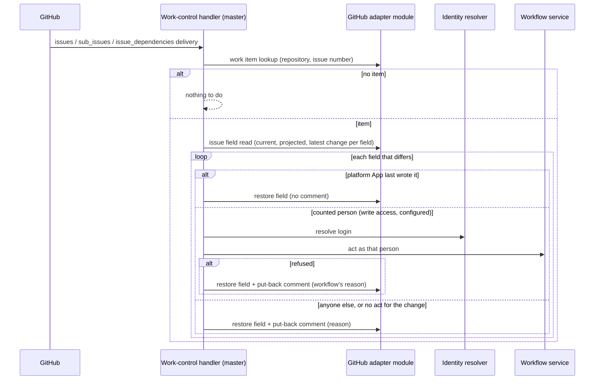

# GitHub Work Control — Design

## Purpose

Carry the behavior of
`local/projects/teleclaude/spec/feature/integration/github-work-control`:
turn a person's change to the fields the platform reflects on an item's issue
into the workflow act it stands for, and put back every change that does not
become an accepted act.

Each decision has one owner; this design owns only how they compose.

| Decision                                                                    | Owner                              | Contract                                                                                                      |
| --------------------------------------------------------------------------- | ---------------------------------- | ------------------------------------------------------------------------------------------------------------- |
| Which GitHub field change stands for which act; whose changes count         | `integration`                      | `local/projects/teleclaude/spec/feature/integration/github-work-control`                                      |
| Which person a GitHub login is                                              | `identity`                         | `local/projects/teleclaude/spec/feature/identity/human-identity-resolution`                                   |
| Whether an act is valid, and its effect                                     | `workflow`                         | `local/projects/teleclaude/spec/domain/workflow` and the feature specs of each act                            |
| What the issue's fields should hold; reading, restoring and commenting them | `workflow` (GitHub adapter module) | `local/projects/teleclaude/design/architecture/workflow-store` (Issue field reads, Field restore, Item title) |
| Receiving GitHub deliveries on every computer                               | `integration`                      | `local/projects/teleclaude/spec/feature/integration/github-webhook-normalization`, hook dispatch              |

The work-control handler is an integration edge: it translates a field change
into a typed workflow request, as the TUI translates a key press, and decides
nothing the workflow or the store decides.

## Inputs/Outputs

**Inputs**

- GitHub deliveries of the `issues` (title edited, labeled, unlabeled, closed,
  reopened, typed, untyped), `sub_issues` and `issue_dependencies` events,
  relayed to every computer and dispatched to the handler by a built-in hook
  contract beside comment routing's. The delivery names the issue and the
  sender; it is a trigger, never the value acted on.
- The catch-up sweep on the fleet's master
  (`local/projects/teleclaude/spec/teleclaude-config`, `computer.is_master`),
  run after each refresh of a GitHub-backed project it serves: the issues the
  platform App opened whose update time is newer than the sweep's last mark.
- For one issue: the store's work item lookup, its issue field read (current
  values on GitHub, the projected values, and the latest attributed change to
  each field), the sender's repository permission read through the project's
  App, and the identity resolver's answer for the login.

**Outputs**

- One workflow request per accepted change, taken through the same workflow
  service and validated update facade the TUI's routes call, with the
  person's principal as caller and GitHub as entry point. The workflow's own
  events and reflections follow from it unchanged.
- For each change that does not count: one field restore through the store,
  which writes the projected value and appends the put-back comment the work
  record specifies with its reason.
- Structured logs at each decision: taken, put back with reason, skipped as
  the platform's own write, no item.

## Invariants

- **Only the master acts.** Every computer receives the deliveries; only the
  fleet's master handles them, and only for projects it serves. One handler per
  fleet gives one act and one comment per change without a cross-computer
  claim, the same choice the work-item conversation makes for its poster.
- **Current state, not the delivery.** The handler reconciles the issue's
  current fields against the projection. A delivery GitHub repeats or reorders
  finds nothing left to do once the issue matches; a stale delivery never
  applies a value the issue no longer shows.
- **One issue at a time.** Reconciliation of one issue is serialized on the
  master, so a delivery and the sweep never act on the same issue at once.
- **Attribution decides.** A field that differs is taken only when its latest
  change is attributed to a person whose changes count; a change with no
  attributable actor counts for no one and is put back. A field the
  platform's own App last wrote is a reflection still owed, restored without
  a comment.
- **Owed reflections first.** An item with owed reflections has them written
  before it is reconciled, so a failed platform write is never mistaken for a
  person's change.
- **Designated fields only.** The issue number, the issue numbers of a
  sub-issue or blocked-by relation, labels, state and state reason, issue type
  and title value are the only inputs; no text is interpreted to choose an
  item or an act.
- **The workflow decides.** A refusal of the act is the workflow's own
  outcome and its reason, unchanged, is the put-back comment's reason. A
  failure that is not a refusal — a write conflict, an unreachable store —
  puts nothing back and leaves the issue for the next sweep.
- **Open act table.** The mapping from field change to act is one table the
  handler reads; a later delivery adds a row for another field or label
  without changing admission, attribution or put-back.

## Primary flows

### A person changes an issue

### Catch-up

After each refresh of a project it serves, the master lists the platform
App's issues updated since its last mark and reconciles each through the same
flow, attributing every differing field from the issue's history. The mark
advances only past issues it reconciled, so an interrupted sweep resumes
where it stopped.

## Failure modes

- **The master is down or does not serve the project.** Nothing is taken or put
  back meanwhile; the issue shows the person's change. The first sweep after
  the master serves the project again reconciles it.
- **A restore or comment write fails.** The restore is owed like any
  reflection and written by the next refresh, regardless of the field's last
  written digest; the comment is owed with it.
- **The permission read fails.** The change is neither taken nor put back; the
  issue stays as it is and the next sweep retries it.
- **Two changes to one field before the handler runs.** Only the latest is
  reconciled; the earlier one is superseded on GitHub as it would be in the
  TUI.
- **A workflow write conflicts with another computer's.** The workflow
  refuses with that cause and the store refreshes the item
  (`local/projects/teleclaude/design/architecture/workflow-store`, Conflict
  check); the next sweep reconciles the issue against the refreshed record.
