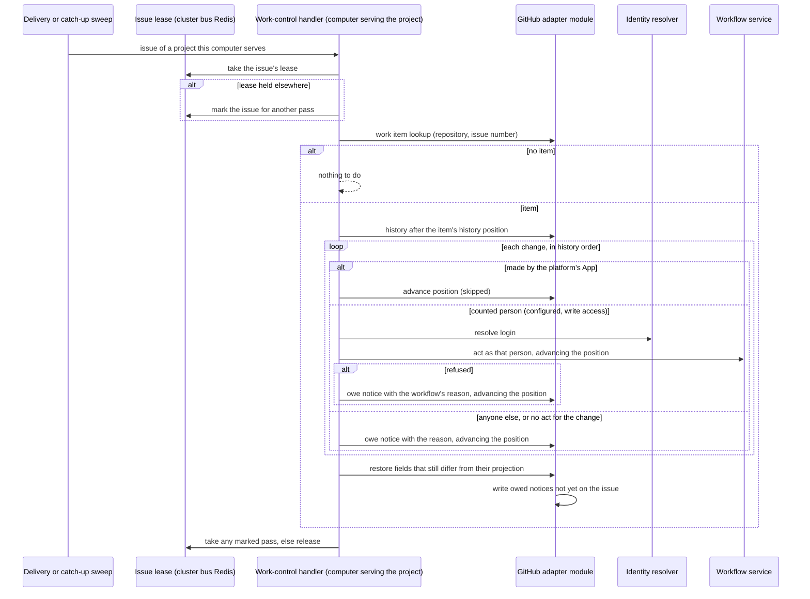

# GitHub Work Control — Design

## Purpose

Carry the behavior of
`local/projects/teleclaude/spec/feature/integration/github-work-control`:
turn a person's change to the fields the platform reflects on an item's issue
into the workflow act it stands for, and put back every change that does not
become an accepted act.

Each decision has one owner; this design owns only how they compose.

| Decision                                                                           | Owner                              | Contract                                                                                                                   |
| ---------------------------------------------------------------------------------- | ---------------------------------- | -------------------------------------------------------------------------------------------------------------------------- |
| Which GitHub field change stands for which act; whose changes count                | `integration`                      | `local/projects/teleclaude/spec/feature/integration/github-work-control`                                                   |
| Which person a GitHub login is                                                     | `identity`                         | `local/projects/teleclaude/spec/feature/identity/human-identity-resolution`                                                |
| Whether an act is valid, and its effect                                            | `workflow`                         | `local/projects/teleclaude/spec/domain/workflow` and the feature specs of each act                                         |
| What the issue's fields should hold; reading, restoring and commenting them        | `workflow` (GitHub adapter module) | `local/projects/teleclaude/design/architecture/workflow-store` (Issue history and field read, Field restore, Item title)   |
| Receiving GitHub deliveries on every computer                                      | `integration`                      | `local/projects/teleclaude/spec/feature/integration/github-webhook-normalization`, hook dispatch                           |
| One handler per issue at a time, and a re-pass for a change that arrives meanwhile | `integration`                      | The issue lease in the cluster bus Redis (`local/projects/teleclaude/adr/0032-cluster-bus-redis-serves-local-and-cluster`) |
| Each change's disposition committed once with the history position                 | `workflow` (GitHub adapter module) | `local/projects/teleclaude/design/architecture/workflow-store` (History position, Put-back notices)                        |

The work-control handler is an integration edge: it translates a field change
into a typed workflow request, as the TUI translates a key press, and decides
nothing the workflow or the store decides.

## Inputs/Outputs

**Inputs**

- GitHub deliveries of the `issues` (title edited, labeled, unlabeled, closed,
  reopened, typed, untyped), `sub_issues` and `issue_dependencies` events,
  relayed to every computer and dispatched to the handler by a built-in hook
  contract beside comment routing's. A delivery names the issue; it only
  triggers handling of that issue and is never itself the change acted on.
- The catch-up sweep, run on every computer after each refresh of a
  GitHub-backed project it serves: the issues the platform App opened that
  GitHub reports updated since that computer's last sweep of the project.
- For one issue: the store's work item lookup; the issue's **history** after
  the item's history position — every change to a reflected field, in the
  order GitHub recorded it, each with its account, previous and new value;
  the issue's current fields beside their projected values; the repository
  permission of each acting account, read through the project's App; and the
  identity resolver's answer for each login.

**Outputs**

- For each change in the history, in order, one disposition committed with the
  item's next history position:
  - taken: the workflow request it stands for, through the same workflow
    service and validated update facade the TUI's routes call, with the
    person's principal as caller and GitHub as entry point;
  - put back: a put-back notice owed in the record, naming the change and the
    reason;
  - skipped: a change the platform's own App made.
- After the changes are disposed of, a restore of every reflected field whose
  current value still differs from its projected one, through the store.
- Structured logs at each disposition: taken, put back with reason, skipped as
  the platform's own write, no item.

## Invariants

- **Each change, in order.** Every change GitHub records to a reflected field
  of an item's issue receives exactly one disposition, in the order of the
  issue's history, whatever the order, number or absence of deliveries. A
  change superseded on GitHub before it is handled is still disposed of —
  taken, then followed by the later one, or put back with its notice.
- **One handler per issue.** Any computer serving the project may handle an
  issue, but only while it holds that issue's lease in the fleet's one cluster
  bus Redis: set only when absent, expiring, renewed while the work lasts, and
  released only by its holder. The store's conflict check reads and writes in
  separate requests and cannot arbitrate two writers; the lease does.
- **A former holder's write ends before the lease passes.** A holder starts a
  GitHub write only while the lease's remaining time exceeds its own request
  timeout plus GitHub's documented server-side processing limit, beyond which
  GitHub terminates a REST request
  (docs.github.com, "Troubleshooting the REST API", Timeouts); otherwise it
  renews first or stops. A write it started has therefore been processed or
  terminated by GitHub before the lease can expire.
- **Progress never moves backwards.** Each acquisition of an issue's lease
  draws the next fencing token from a counter beside it in the cluster bus
  Redis, and every record write carries its writer's token. The record version
  the store adopts is the newest one in the record comment's edit history
  carrying the highest token; a later edit carrying a lower token is a stale
  write and is replaced by restoring that version, the recovery the store
  already applies to an edit it did not write. Should a former holder's write
  land late despite the limit above, it can neither lower the history position
  nor undo a later disposition.
- **No change is left behind by a held lease.** A computer that finds the lease
  held marks the issue for another pass and leaves it; before releasing, the
  holder takes every pass marked during its work, re-reading the history each
  time, so a change that arrives while another computer handles the issue is
  disposed of by that computer.
- **One commit point per disposition.** Under the lease, the history position
  advances in the same record revision that commits the disposition: the act
  it leads to, or the owed notice, or nothing for a skipped change. The
  position is re-read from the record before each disposition, so a handler
  never disposes of a change the position has already passed.
- **History, not current values, carries attribution.** A change is taken only
  when its own history entry names a person whose changes count at the time
  it is handled. A field that differs from its projection with no change in the
  history to account for it is restored, and its notice says no change by a
  person who may change the work was found.
- **A platform write never hides a person's change.** A reflection the App
  writes after a person's change — an owed write repaired by refresh on any
  computer — is a later history entry, skipped in its turn; the person's change
  before it is still disposed of, and the final restore writes the value the
  dispositions leave.
- **Designated fields only.** The issue number, the issue numbers of a
  sub-issue or blocked-by relation, labels, state and state reason, issue type
  and title value are the only inputs; no text is interpreted to choose an
  item or an act.
- **The workflow decides.** A refusal of the act is the workflow's own outcome
  and its reason, unchanged, is the notice's reason. A failure that is not a
  refusal — a write conflict, an unreachable store, a failed permission or
  history read — commits no disposition and leaves the change for the next
  handling.
- **One notice per put-back.** A notice is written from the record as a
  reflection, its envelope naming the history entry it answers, and only by the
  holder of the issue's lease, which first looks for a notice the App already
  wrote for that entry; a lost reply or an interrupted write therefore never
  posts it twice, and two computers never write it at once. Should a late
  write still leave two notices for one entry, the next holder deletes every
  one but the earliest.
- **Open act table.** The mapping from field change to act is one table the
  handler reads; a later delivery adds a row for another field or label
  without changing admission, history handling or put-back.

## Primary flows

### Handling one issue

A record write refused at any advance refreshes the item and resumes from the
position the record now holds.

### Catch-up

After each refresh of a project it serves, a computer lists the platform App's
issues GitHub reports updated since its last sweep of that project and handles
each through the same flow. Its sweep mark is its own bookkeeping and only
saves work: the history position in the record decides what is still to be
handled, so a computer that sweeps late or twice disposes of nothing twice.

## Failure modes

- **No computer serving the project is running.** Nothing is handled
  meanwhile; the issue shows the person's change. The first handling after a
  serving computer starts disposes of every change since the item's history
  position.
- **A restore or notice write fails, or its reply is lost.** It is owed and
  written by the next refresh like any reflection; a notice already on the
  issue for its history entry is recognized and not written again.
- **A permission or history read fails.** No disposition is committed; the
  change waits for the next handling.
- **The cluster bus Redis is unreachable.** No computer takes a lease, so
  nothing is handled; the first handling after it is reachable again disposes
  of every change since each item's history position.
- **A lease cannot be renewed.** The holder stops before its next GitHub
  write; what it committed stands and the next holder continues from the
  position the record holds. A write whose outcome it never learned is, by the
  start rule, processed or terminated before the next holder can begin.
- **GitHub processes a write later than its documented limit**, or changes that
  limit. The fencing token keeps the record's position and dispositions from
  regressing, and a duplicated notice is removed by the next holder. The
  workflow events of a disposition that a late write and the next holder both
  committed can then be emitted by both computers; the record's state is the
  same either way.
- **A holder stops without releasing.** The lease expires and the next
  delivery, sweep or marked pass takes it.
- **A history entry the module cannot read as a change of a reflected field.**
  It is skipped; if its field still differs afterwards, the final restore puts
  it back with the notice for an unaccounted change.
