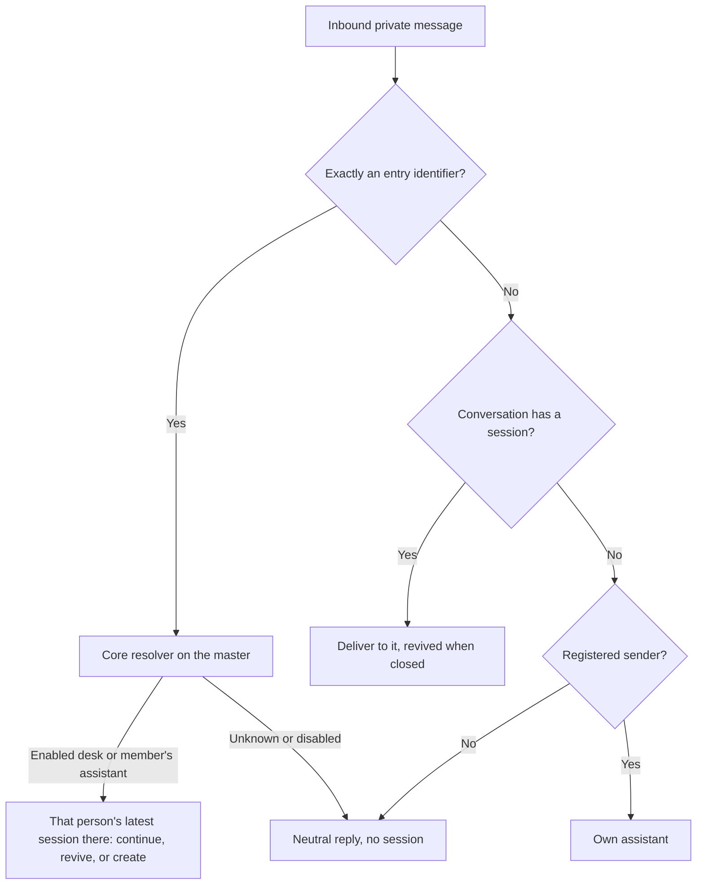
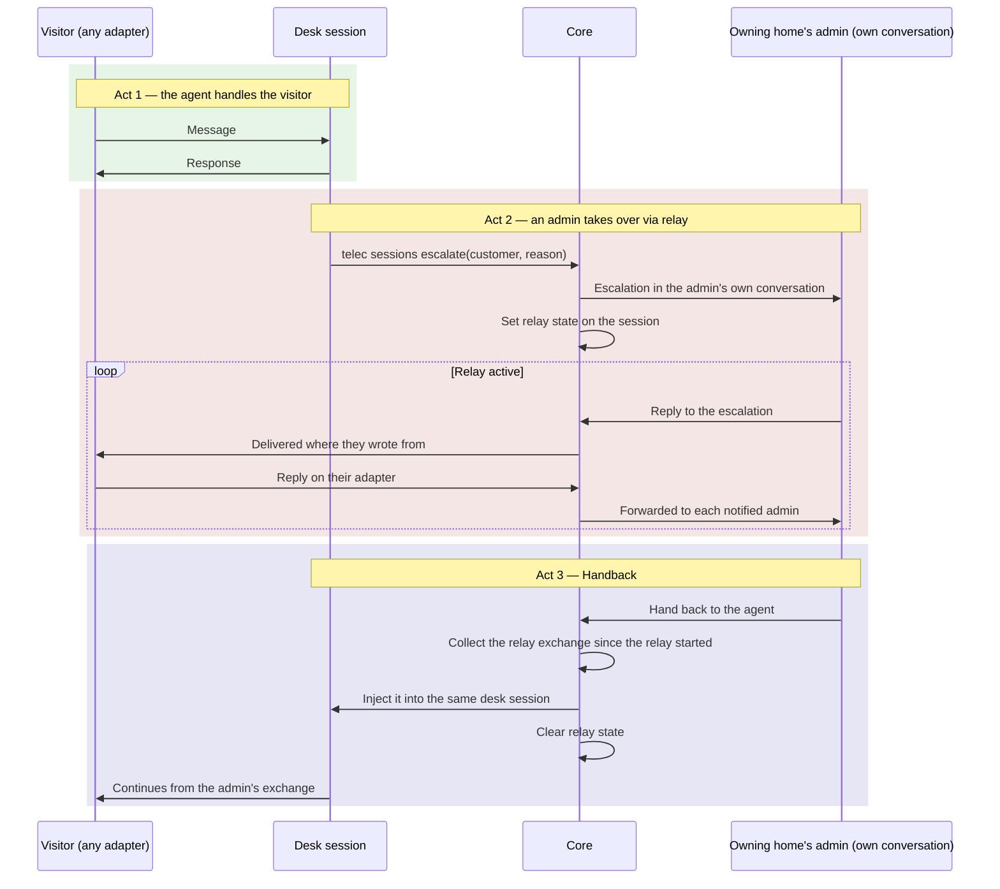
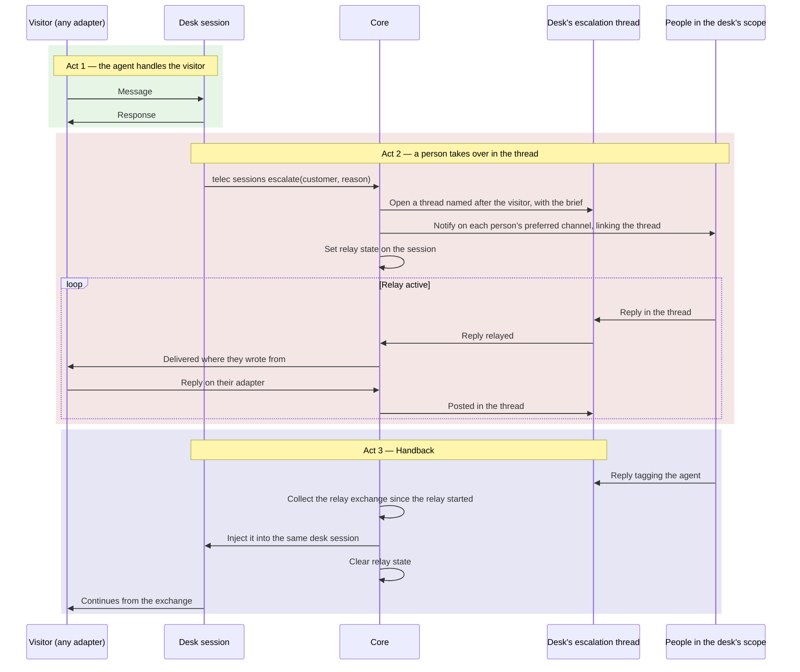
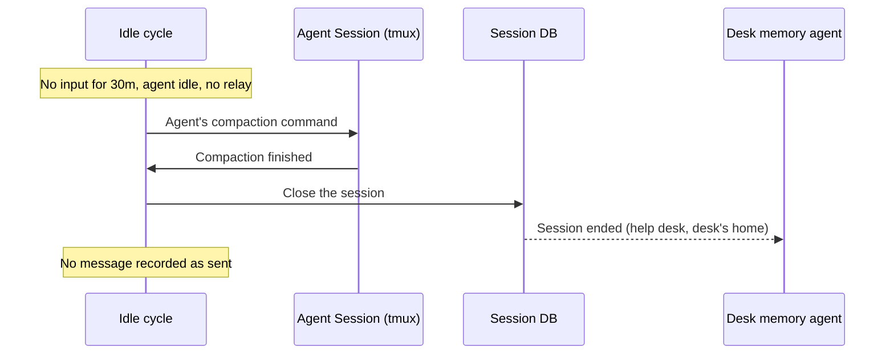
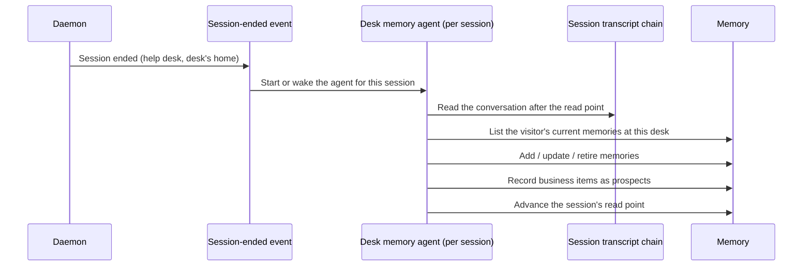
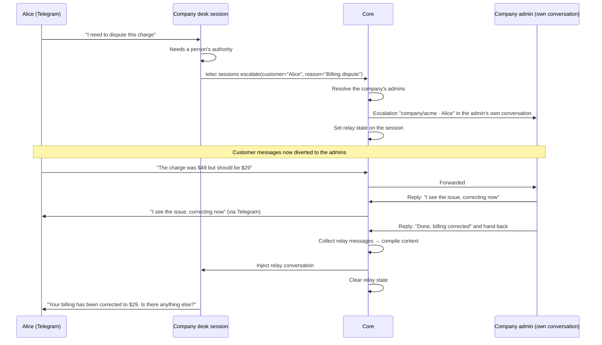
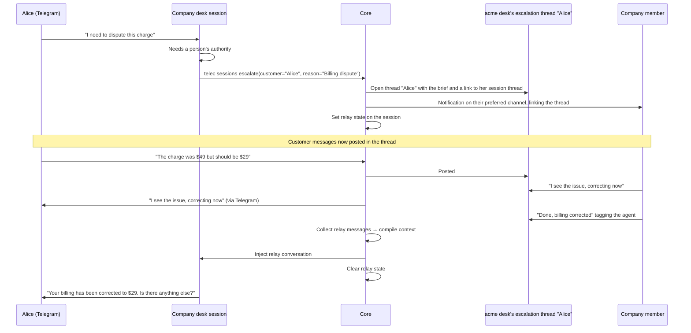
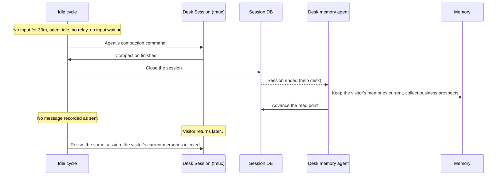
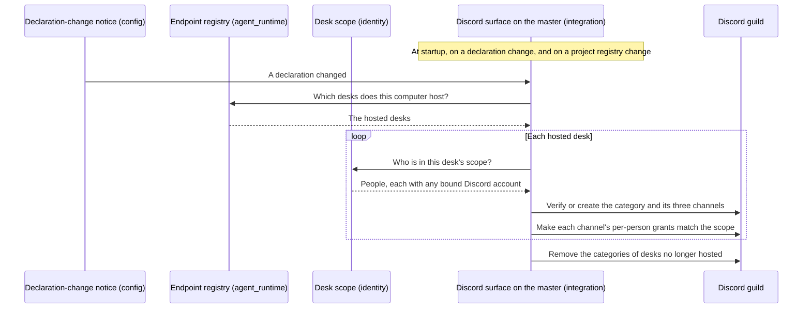
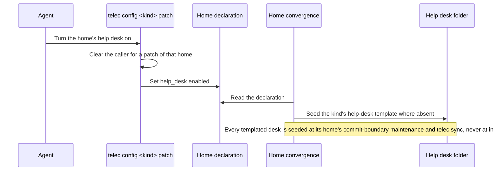

# Help Desk Platform — Design

## Required reads

@docs/local/design/architecture/memory-system.md
@docs/local/design/architecture/session-lifecycle.md
@docs/local/design/architecture/context-selection.md
@docs/local/design/architecture/redis-transport.md
@docs/local/design/architecture/adapter-client.md
@docs/local/design/architecture/ui-adapter.md

## Purpose

Let AI agents answer the people a home does not otherwise serve, through the public-facing adapters (Telegram, WhatsApp), with per-visitor memory continuity, escalation to the people accountable for that home, and extraction of business intelligence from the interactions — all within a help-desk folder of the home that owns it, scaffolded from TeleClaude's help-desk templates. Discord is never a visitor's surface: it serves the operator plane only.

The platform operates on two planes.

**Visitor plane.** A visitor reaches a help desk through a conversation adapter by entering with the desk's entry identifier. Desks run only on the mesh master. The desk's agent answers from the documentation the visitor may read.

<!-- planned-change:help-desk-escalation-in-desk -->

**Operator plane.** Escalations reach the admins of the owning home in their own conversations with the platform, and their replies relay back to the visitor. The shared Discord guild is the platform desk's admin surface only.

<!-- change:help-desk-escalation-in-desk -->

**Operator plane.** Each desk has its own Discord category, visible only to the desk's scope. An escalation notifies everyone in that scope and opens a thread in the desk's escalations forum, where the person who answers talks to the visitor through the relay.

<!-- /planned-change:help-desk-escalation-in-desk -->

## Inputs/Outputs

**Inputs:**

<!-- planned-change:help-desk-escalation-in-desk -->

- Visitor messages via the conversation adapters that carry desk entry (`local/projects/teleclaude/spec/feature/agent_runtime/conversation-entry`)
- An entry identifier: a desk's `hd-<kind>-<slug>`, naming the desk by kind and slug
- Each home's help-desk declaration (`help_desk.enabled`) in its `teleclaude.yml`
- Identity from the person registry and per-person credential bindings, or the customer fallback for an unregistered sender
- The desk's `AGENTS.master.md`, its home's own source, compiled into the desk's `AGENTS.md`
- Documentation via `telec docs index` + `telec docs get`, at the visitor's depth
- Admin replies to an escalation, in the admin's own conversation (during a relay)

<!-- change:help-desk-escalation-in-desk -->

- Visitor messages via the conversation adapters that carry desk entry (`local/projects/teleclaude/spec/feature/agent_runtime/conversation-entry`)
- An entry identifier: a desk's `hd-<kind>-<slug>`, naming the desk by kind and slug
- Each home's help-desk declaration (`help_desk.enabled`) in its `teleclaude.yml`
- Identity from the person registry and per-person credential bindings, or the customer fallback for an unregistered sender
- The desk's `AGENTS.master.md`, its home's own source, compiled into the desk's `AGENTS.md`
- Documentation via `telec docs index` + `telec docs get`, at the visitor's depth
- Replies in a desk's escalation thread from people in the desk's scope (during a relay)

<!-- /planned-change:help-desk-escalation-in-desk -->

**Outputs:**

<!-- planned-change:help-desk-escalation-in-desk -->

- AI-handled help-desk conversations with memory continuity
- Identity-scoped personal memories (per-visitor observation history)
- The fixed neutral reply for a conversation that reaches no desk
- Escalation notifications to the admins of the home that owns the desk
- Relayed admin replies delivered to the visitor on their own adapter

<!-- change:help-desk-escalation-in-desk -->

- AI-handled help-desk conversations with memory continuity
- Identity-scoped personal memories (per-visitor observation history)
- The fixed neutral reply for a conversation that reaches no desk
- Escalation threads in the desk's escalations forum, and notifications linking them to everyone in the desk's scope
- Relayed replies delivered to the visitor on their own adapter

<!-- /planned-change:help-desk-escalation-in-desk -->

- Business items from desk conversations (requests, complaints, confusion, sentiment, mentions of alternatives), collected as prospects for the home that owns the desk

### Architecture

#### Help desks

Two kinds exist:

| Kind    | Home           | Serves                            | Entry               |
| ------- | -------------- | --------------------------------- | ------------------- |
| Company | a company home | that company's external customers | `hd-company-<slug>` |
| Project | a project      | that project's external customers | `hd-project-<slug>` |

The TeleClaude project's desk is an ordinary project desk. A home runs a desk only when its `teleclaude.yml` sets `help_desk.enabled` (`local/projects/teleclaude/spec/teleclaude-config`); enabling and scaffolding are described under Help Desk Scaffolding below. A project's enabled desk also requires the `agents` capability on that project (`local/projects/teleclaude/spec/feature/config/kind-addressed-configuration`). The concepts are `general/concept/help-desk/overview` and its per-kind siblings.

Desks run only on the mesh master, which hosts every enabled desk whose home it holds. A repository is often checked out on several computers, so its declaration is the same everywhere; hosting on one computer gives each desk exactly one host. A desk whose home is not on the master is not hosted.

The help desk is a folder of the home that owns it, never a repository of its own: a company's is `help-desk/` in its company home, and a project's is `help-desk/` in the project's repository. The folder holds the operator brain, which its home's history records, and no documentation of its own; a desk session writes nothing into it.

```
<home>/help-desk/
├── AGENTS.master.md                      # operator brain, seeded from its kind's help-desk template, then the home's own
├── .gitignore                            # ignores everything else the folder holds
```

#### Entry and routing

Entry is owned by the core, in `local/projects/teleclaude/spec/feature/agent_runtime/conversation-entry`. In outline:

- An **endpoint** is a routable destination: a person's assistant in their home, or a company's or project's help desk. Its **entry identifier** is the member's invitation token or the desk's `hd-<kind>-<slug>`. One core resolver turns an identifier into the endpoint's working folder.
- A **conversation** is one adapter's private channel with one person. Every session carries the adapter's origin metadata and the endpoint it was created at. On a per-computer adapter (Telegram) that computer decides alone, and a desk identifier reaches a desk only on the master's bot; on adapters whose messages reach every computer (Discord DM, WhatsApp) the mesh master alone decides and keeps each conversation's binding in a durable record, and no other computer handles those messages. Discord carries no desk entry, and a Discord conversation is never bound to a desk session. Adapters only recognise and carry the identifier; they keep no routing rules.
- **Routing** is by what the person sent, and nothing else. A desk identifier reaches that person's latest session at the desk — an open one continues, a closed one is revived, none means a new one — and it becomes the conversation's session; an invitation token binds the account and reaches the person's own assistant the same way. A message without an identifier goes to the conversation's session, revived when closed; with no session, a registered person reaches their own assistant. Entering elsewhere leaves the earlier session as it is, and a later entry at its endpoint continues it. No role detour, no last-desk lookup and no default endpoint exist.
- A **miss** — an identifier that resolves to nothing, or a person who is not registered and has no session — gets one fixed neutral reply and no session, identical in every case, naming no organisation, at most once per conversation per cooldown window.
- **Unavailability**: with the master down nothing routes on the adapters that reach every computer: every inbound message gets a temporarily-unavailable reply, at most once per conversation within a cooldown window, from the lowest-named live computer running the adapter, and conversations resume from the master's durable record when it returns. A session the master cannot start or revive in time leaves the binding unchanged and gets the neutral reply.
- The per-adapter entry links come from `telec config company help-desk-links <slug>` and `telec config project help-desk-links <slug>`, run on the master, one for each adapter that carries desk entry.



#### Session placement

A session whose role is below member and that carries no system role runs only inside an enabled help desk on the master: a customer's at the desk the conversation's session belongs to. A request naming no enabled desk is refused; nothing is silently redirected (`local/projects/teleclaude/spec/feature/agent_runtime/session-lifecycle`). A desk entry is a door that places a person below their effective role (`local/projects/teleclaude/design/architecture/scoped-roles`), which is how a registered person who follows a desk link lands in that desk.

**Identity key format:** a registered person is keyed as that person — `person:{slug}` — whichever adapter they write from; anyone else is keyed by the platform identity they write from — `{platform}:{platform_user_id}`, e.g. `discord:999001`, `telegram:12345678`, `whatsapp:31612345678`. Identity derives the key from the session at the moment it is needed, both when memories are saved and when they are injected; it is not stored as a denormalized column on the session, and the memory system receives it as an opaque string.

#### Tool access for help-desk visitors

A help-desk session below admin is confined to its desk: below member by its recorded role (`local/projects/teleclaude/spec/feature/agent_runtime/session-lifecycle` UC-SL48), and a member who entered the desk by the endpoint it was created at (`local/projects/teleclaude/spec/feature/agent_runtime/conversation-entry` UC-CE22):

- It reads files only inside its desk folder and its own session's uploads, never another session's uploads.
- It runs only the desk commands its recorded role admits, which the CLI surface declares (`local/projects/teleclaude/design/cli-authorization-matrix`): for a customer `telec version`, `telec docs index`, `telec docs get`, `telec auth whoami` and `telec sessions escalate`.
- No documentation corpus is mounted for it; it reads documentation only through `telec docs` at its own depth and through its desk master.
- Its agent is chosen by availability from the dispatch order for desk sessions (`local/projects/teleclaude/design/architecture/agent-dispatch`), like every other session kind; that order holds only agents that carry a desk confinement profile and declare a compaction command. When no agent in it is available, no session is created and the visitor receives the neutral reply.

#### Documentation reach

A desk agent reads documentation at its visitor's depth (`local/projects/teleclaude/spec/feature/context/doc-selection-policy`). A customer holds no relationship to the home, so a project desk offers that project's public snippets, a company desk the public snippets of the company and every project it owns, and both the public shared documentation, the help-desk documentation among it. Snippets declare `visibility: public` to be served there. A desk's master inlines no internal documentation of its home.

### Help Desk Scaffolding

A home's declaration says whether it keeps a help desk, and how that field is set and the desk scaffolded is owned by `local/projects/teleclaude/spec/feature/config/kind-addressed-configuration`. The company and project kinds each have a template in the TeleClaude repository — `templates/help-desk-company/` and `templates/help-desk-project/` — carrying that kind's operator brain, seeded once, and the desk's ignore declaration.

- A company help desk is a folder inside the TeleClaude home. The platform home's configuration-aware convergence seeds it at commit-boundary maintenance and through `telec sync` while its company enables it; machine installation seeds no desk (`local/projects/teleclaude/spec/feature/reconciliation/home-template-materialization`, `local/projects/teleclaude/spec/feature/reconciliation/project-plumbing-convergence`).
- A project help desk lives in the project's repository. The project's own convergence seeds it at commit-boundary maintenance and through `telec sync` whenever the project's declaration enables it.
- Seeding writes an operator brain only while it is absent. An existing one is never rewritten, and its home's history records it like any other source.
- A desk whose home stops enabling it keeps its folder and is no longer hosted.
- Scaffolding initializes no repository, runs no project initialization, and makes no commit of its own.

- A help desk's master requires only documentation every reader of that desk may read, never its home's local documentation (`general/policy/agent-artifact-governance`).

### Knowledge Authoring Command

A global command (`agents/global/commands/general/author-knowledge.md`) that helps users offload organizational knowledge into structured documentation through conversation. Available in all projects, not specific to help desks.

The command activates a Knowledge Author role that:

1. Asks the user what area of their organization or project they want to document
2. Listens for documentable knowledge: facts, policies, procedures, FAQ
3. Determines the taxonomy type (spec, policy, procedure, etc.), the snippet's visibility, and its storage location:
   - `docs/global/` — knowledge the home publishes
   - `docs/local/` — the home's own documentation
4. Authors doc snippets following the snippet authoring schema
5. Commits each batch; commit-boundary publication deploys the artifacts

The command reads the doc-snippet-authoring procedure and snippet-authoring-schema spec as required reads, so it always follows the correct structure and taxonomy. A snippet a help desk should serve declares `visibility: public`.

### Escalation Tool

<!-- planned-change:help-desk-escalation-in-desk -->

`telec sessions escalate` is how a desk agent asks for a person (`local/projects/teleclaude/spec/feature/agent_runtime/help-desk-escalation`). It is accepted from a session running in a help desk and refused elsewhere; admins are its target and never escalate.

<!-- change:help-desk-escalation-in-desk -->

`telec sessions escalate` is how a desk agent asks for a person (`local/projects/teleclaude/spec/feature/agent_runtime/help-desk-escalation`). It is accepted from a session running in a help desk and refused elsewhere.

<!-- /planned-change:help-desk-escalation-in-desk -->

**Parameters:**

- `--customer` (required) — the name the visitor gave
- `--reason` (required) — why a person is needed
- `--summary` (optional) — what has been established so far

**Behavior:**

<!-- planned-change:help-desk-escalation-in-desk -->

1. Resolves the admins of the home that owns the desk: a company desk's company admins; a project desk's owning company admins, or its owning person; the platform's admins for the platform desk, for an ownerless project, or when no owning admin is reachable.
2. Sends each resolved admin the escalation in their own conversation with the platform, on their preferred channel, naming the desk, the visitor and the channel they wrote from, the reason and the summary.
3. For the platform desk only, also opens a thread in the shared Discord guild's escalation forum.
4. Sets the session's relay state.
5. Returns confirmation to the agent.

<!-- change:help-desk-escalation-in-desk -->

1. Resolves the desk's scope: a company desk's company members and admins; a project desk's owning company members and admins, or its owning person; and the platform's admins for every desk.
2. Opens a thread named after the visitor in the desk's escalations forum, whose first message is the agent's brief: the desk, the visitor and the channel they wrote from, the reason, the summary, and a link to the visitor's thread in the desk's customer-sessions forum.
3. Notifies each person in scope on their preferred channel with a link to that thread.
4. Sets the session's relay state.
5. Returns confirmation to the agent.

<!-- /planned-change:help-desk-escalation-in-desk -->

The desk agent follows `general/procedure/help-desk/escalation`, which its master requires through `general/procedure/help-desk/overview`.

### Admin Relay

<!-- planned-change:help-desk-escalation-in-desk -->

When an agent escalates, the core relays between the visitor and the notified admins — bypassing the AI session.



<!-- change:help-desk-escalation-in-desk -->

When an agent escalates, the core relays between the visitor and the desk's escalation thread — bypassing the AI session.



<!-- /planned-change:help-desk-escalation-in-desk -->

**Session state fields:**

<!-- planned-change:help-desk-escalation-in-desk -->

- `relay_status` — `NULL` (normal) or `"active"` (relay mode)
- the relay's admin side — where each notified admin's part of the relay lives
- `relay_started_at` — timestamp of relay activation (message collection boundary)

<!-- change:help-desk-escalation-in-desk -->

- `relay_status` — `NULL` (normal) or `"active"` (relay mode)
- the relay's thread — the desk's escalation thread for this relay
- `relay_started_at` — timestamp of relay activation (message collection boundary)

<!-- /planned-change:help-desk-escalation-in-desk -->

**Discord surface (per desk):** every hosted desk has its own category, `Help Desk - <kind>-<slug>`, with a `customer-sessions` forum mirroring each of its sessions, an `escalations` forum for its escalation threads, and a `team-chat` channel, all visible only to the desk's scope through per-person permission overwrites (`local/projects/teleclaude/spec/feature/integration/discord-admin-reflection-state`). No desk session or escalation appears in any other forum of the guild.

**Message routing diversion:**

<!-- planned-change:help-desk-escalation-in-desk -->

The diversion runs in the core inbound path, for every adapter:

1. The visitor sends a message on any adapter
2. The session is found through the conversation's binding
3. With the relay active, the core does not deliver the message to the agent
4. It forwards the message to each notified admin's side of the relay
5. The agent session is paused for the duration of the relay

An admin answers by replying to any relay message they received; the reply is delivered to the visitor through the visitor's originating adapter and never enters the agent session. An admin whose preferred channel cannot carry a reply, such as email, is notified but cannot answer through the relay.

**Handback:** an admin hands the conversation back by tagging the agent in a reply (or in the platform desk's forum thread). The core collects the exchange since `relay_started_at` (or since the previous handback) into a structured context block naming the admin and the visitor for each message, injects it into the same desk session through the normal message pipeline (`process_message`), which validates session liveness and enqueues durable delivery, and clears the relay state. The visitor's messages resume routing to the agent, and its first response continues from the admin exchange.

<!-- change:help-desk-escalation-in-desk -->

The diversion runs in the core inbound path, for every adapter:

1. The visitor sends a message on any adapter
2. The session is found through the conversation's binding
3. With the relay active, the core does not deliver the message to the agent
4. It posts the message in the desk's escalation thread
5. The agent session is paused for the duration of the relay

A person in the desk's scope answers by replying in the thread; the reply is delivered to the visitor through the visitor's originating adapter and never enters the agent session. Only the escalating agent and the people answering speak in the thread.

**Handback:** a person hands the conversation back by tagging the agent in a reply in the thread. The core collects the exchange since `relay_started_at` (or since the previous handback) into a structured context block naming the person and the visitor for each message, injects it into the same desk session through the normal message pipeline (`process_message`), which validates session liveness and enqueues durable delivery, and clears the relay state. The visitor's messages resume routing to the agent, and its first response continues from the exchange.

<!-- /planned-change:help-desk-escalation-in-desk -->

**Relay lifecycle:**

- Relay state persists for the lifetime of the session (7d max)
- Multiple escalation/handback cycles can occur within one session
- Each handback collects only messages since the previous handback (or relay start)
- When the session dies (7d sweep), its relay state dies with it

### Customer-Facing Agent Behavior

A desk session's agent comes from the dispatch order for desk sessions (Tool access for help-desk visitors, above); no desk chooses its own agent or model.

The desk's master and the help-desk procedure (`general/procedure/help-desk/overview`) define the agent's behavior:

- **Greeting and rapport**: Warm, professional opening that acknowledges returning visitors by name (via injected personal memories)
- **Active listening**: Confirm understanding before acting, summarize the visitor's intent
- **Knowledge navigation**: Use `telec docs index` + `telec docs get` to answer from the documentation the visitor may read
- **Transparency**: Clearly communicate what the agent can and cannot do; never fabricate answers
- **Escalation judgment**: Recognize when the documentation cannot answer, when the visitor asks for a person, or when the topic needs authority (billing, security, legal)
- **Conversation closure**: Summarize what was accomplished, confirm next steps, invite further questions
- **Tone adaptation**: Match the visitor's communication style (formal/casual) as detected via personal memories

### Identity-Scoped Memory

The memory system gains a second scoping axis. The `project` field remains the namespace. The `identity_key` field optionally scopes memories to one person.

Every desk has a memory namespace of its own, derived from the desk's identity (its kind and its home's slug), never from its folder name: every desk folder carries the same name, so a folder-derived namespace would merge every desk's memories into one.

| Record                                 | Namespace (`project`)       | `identity_key`         | Subject                                                    | State              | Reaches                                                             |
| -------------------------------------- | --------------------------- | ---------------------- | ---------------------------------------------------------- | ------------------ | ------------------------------------------------------------------- |
| Memory about a registered visitor      | the desk's                  | `person:{slug}`        | that person                                                | current or retired | that person's sessions at that desk; their own reach elsewhere      |
| Memory about an unregistered visitor   | the desk's                  | `{platform}:{user_id}` | the desk's home, recorded under the visitor's own identity | current or retired | that visitor's sessions at that desk; the people who reach the home |
| Business item from a desk conversation | the home that owns the desk | `NULL`                 | the desk's home                                            | prospect           | nothing until aggregated                                            |

Memories are kept current by memory agents (`local/projects/teleclaude/spec/feature/memory/memory-curation`): retired memories and prospects never reach startup context or search.

**Context injection at SessionStart.** For a desk session, the hook receiver asks memory for the desk's namespace, narrowed to the visitor's identity key, under the reach identity resolves for the session's visitor (`local/projects/teleclaude/spec/feature/identity/data-visibility` UC-DV14 for an unregistered visitor). The session therefore starts with the current memories about that visitor at that desk and with nothing recorded about anyone else or at any other desk. A session that is not at a desk keeps its namespace from its working folder.

**API changes:**

- `POST /api/memory/save` — add optional `identity_key` field
- `GET /api/memory/search` — add optional `identity_key` query param
- No `identity_key` → saved/queried as project-level memory (NULL)

### Customer Session Lifecycle

A desk session is closed only to spare resources while its visitor is away, never to end the conversation. After 30 minutes without visitor input, the daemon compacts its context and closes it. Its end wakes the desk's memory agent, which keeps the memories about that visitor current. The visitor's next message, or their re-entry at the desk, revives the same session with those memories injected (`local/projects/teleclaude/spec/feature/agent_runtime/conversation-continuity`).

**Idle cycle.** The daemon's idle cycle visits conversation sessions — desk sessions and a person's own assistant sessions, never agents the platform started for a procedure — periodically, well within the 30-minute threshold. A session whose agent is idle, which has had no input for 30 minutes, which carries no active escalation relay and has no input waiting, goes through:

1. Compaction of the agent's context through the agent's own compaction command, awaited until the agent's own end-of-compaction signal (both declared per agent; a session running an agent that declares neither is not idle-closed)
2. Closing the session, once compaction completed and no input arrived meanwhile
3. None of it is recorded as a message sent into the session — it is invisible to the visitor

A step that fails or does not finish leaves the session open and is retried on the next pass. Extraction is not part of the cycle: it follows the close (Post-Session Memory Extraction), and compaction loses nothing it needs, because the agent's native transcript keeps every entry from before a compaction.



**Session resumption.** When a visitor returns through the same conversation (the same Telegram chat or WhatsApp number), or re-enters the desk with its identifier, the conversation's session at that desk continues, revived when it was closed; no new session is created. The agent has: (a) compacted conversation history, (b) injected personal memories from the most recent extraction, (c) access to `telec docs index` + `telec docs get` at the visitor's depth.

**Bookkeeping.** A `last_memory_extraction_at` timestamp on the session record is the session's read point: the newest conversation entry its memory agent has read. The agent reads only the conversation after it and advances it last, after its memory changes are made, so a session that ends again is read from where its memory agent stopped.

**Session state fields (additions):**

- `last_memory_extraction_at` — timestamp of last successful extraction (high-water mark)

<!-- planned-change:help-desk-escalation-in-desk -->

- `relay_status` — `NULL` or `"active"` (admin relay mode)
- the relay's admin side — where each notified admin's part of the relay lives
- `relay_started_at` — timestamp of current relay activation

<!-- change:help-desk-escalation-in-desk -->

- `relay_status` — `NULL` or `"active"` (relay mode)
- the relay's thread — the desk's escalation thread for this relay
- `relay_started_at` — timestamp of current relay activation

<!-- /planned-change:help-desk-escalation-in-desk -->

### Post-Session Memory Extraction

Memory extraction follows a conversation session's end. The session-ended event names the session, its home, and that it was a help-desk session; it wakes the desk memory procedure in the home that owns the desk. That procedure's agent is bound to the session: one memory agent per desk session, and the same agent is brought back when that session ends again after a revival. A person's own assistant sessions wake the person-memory procedure in their home, whose single standing agent keeps that person's memories. Both are procedure agents (`local/projects/teleclaude/design/architecture/procedure-activation`); no direct model API call is made.

The desk memory agent, given the ended session:

1. Reads the session's own conversation after its read point — every transcript the session has carried, entries from before any compaction included
2. Lists the current memories about that visitor at that desk
3. Adds, updates and retires memories so they hold what is true now, never a near-duplicate of one that exists
4. Records the business items the conversation showed as prospects for the home that owns the desk
5. Advances the session's read point



**What the agent keeps** (its judgment, per its procedure):

1. **About the visitor** — what to remember about THIS person: preferences, context, communication style, open questions, relationship history
2. **Business items** — what the conversation shows the home: feature requests, complaints, confusion, sentiment, competitive mentions; collected as prospects for later aggregation, never used as they are

Neither records project knowledge or decisions (`local/projects/teleclaude/spec/domain/memory`). Namespaces, keys and subjects follow Identity-Scoped Memory.

### Business Insights

What desk conversations show about the business — requests for what does not exist, complaints, recurring confusion, sentiment, mentions of alternatives — is not synthesized by any scheduled job. Turning collected business items into durable knowledge for the home that owns the desk, and where that knowledge lands, is not designed yet.

### Desk master (`AGENTS.master.md`)

Each desk's `AGENTS.master.md` is its home's own source, seeded from its kind's help-desk template, and compiles into `AGENTS.md` through the standard artifact pipeline. It stays a thin wrapper:

1. **Identity**: the help-desk agent of this desk, not a generic assistant.
2. **Required reads**: the desk kind's concept (`general/concept/help-desk/<kind>`) and the help-desk procedure (`general/procedure/help-desk/overview`, which requires the escalation procedure). A company or project desk's master requires none of its home's internal documentation, so nothing internal reaches a customer-facing agent's context.
3. **Knowledge access**: everything else comes from `telec docs index` + `telec docs get` at the visitor's depth.
4. **Memory awareness**: personal memories (identity-scoped) provide visitor continuity.
5. **Observer interests** (for dual-observer prompts):
   - Personal: the visitor's name, company, role, preferences, communication style, open questions, relationship history
   - Business: feature requests, complaints, confusion points, sentiment, competitive mentions, pricing discussions

## Invariants

1. **Single memory store**: Identity-scoped memories live in the same `memory_observations` table. No separate tables or databases per identity.

2. **NULL means shared**: `identity_key IS NULL` means the memory belongs to the project, visible to all sessions in that project. This is the default behavior, preserving backward compatibility.

3. **Identity key is opaque**: The memory system does not parse identity keys. It stores and matches them as strings. Format convention is `{platform}:{platform_user_id}` but the store doesn't enforce this.

4. **Identity key is derived**: The `identity_key` is derived from origin metadata at query time, not stored as a denormalized column on the session.

5. **Compaction keeps the conversation readable**: compaction shortens the agent's context, not its native transcript, which keeps every entry from before a compaction; memory extraction reads that transcript after the session ended, so compaction never takes anything extraction needs.

6. **Help desks are folders of their homes**: A help desk is never a repository of its own. Scaffolding is idempotent: the operator brain is seeded only while absent, the ignore declaration converges to its kind's template, and nothing the template does not carry is touched.

7. **A desk exists only where its home enables it**: no machine-wide desk location exists. A desk's folder follows from its home, and a home without `help_desk.enabled` has no desk.

8. **Extraction resumes from its read point**: a memory agent reads only the conversation after the session's read point and advances it after its memory changes, so no stretch of a conversation is read twice; memories are kept current, not accumulated. Durable state lives in the database, not in the agent.

9. **Entry names an endpoint exactly**: an identifier either resolves to an endpoint the receiving computer can serve, or the person gets the neutral reply. No identifier is interpreted as a nearby one, and no miss reveals which organisations exist.

10. **Closing spares resources, never the conversation**: a desk session closes after 30 minutes without visitor input, only after its context was compacted; its memory agent keeps the visitor's memories current from the closed conversation, and any later message or re-entry revives the same session with those memories injected.

11. **Relay is session-scoped**: The admin relay is a state of the session, not a separate entity. When the session dies (7d sweep), the relay state dies with it.

<!-- planned-change:help-desk-escalation-in-desk -->

13. **Relay diverts, not duplicates**: When relay is active, visitor messages go to the notified admins ONLY, not to both relay and agent, whichever adapter they use. The agent session is fully paused during relay.

<!-- change:help-desk-escalation-in-desk -->

13. **Relay diverts, not duplicates**: When relay is active, visitor messages go to the escalation thread ONLY, not to both thread and agent, whichever adapter they use. The agent session is fully paused during relay.

<!-- /planned-change:help-desk-escalation-in-desk -->

14. **Handback collects incrementally**: Each handback collects messages since the previous handback (or since relay activation). Multiple escalation/handback cycles within one session each get a clean context window.

<!-- planned-change:help-desk-escalation-in-desk -->

15. **Escalation is a help-desk act aimed at the owning home**: `telec sessions escalate` is accepted only from a session in a help desk, and it reaches the admins of the home that owns that desk, falling back to the platform's admins only when none of them is reachable.

<!-- change:help-desk-escalation-in-desk -->

15. **Escalation is a help-desk act aimed at the desk's scope**: `telec sessions escalate` is accepted only from a session in a help desk; it opens a thread in that desk's escalations forum and notifies everyone in the desk's scope.

<!-- /planned-change:help-desk-escalation-in-desk -->

16. **One binding per conversation**: a conversation reaches its session — on a per-computer adapter found by origin metadata, elsewhere through the mesh master's durable record; an entry makes the person's own session at its endpoint the conversation's session, continuing or reviving it, so the latest entry wins.

17. **One authority per conversation, one host per desk**: a conversation on a per-computer bot is decided by that computer; where every computer receives inbound messages, the mesh master alone decides. Every desk runs on the master. Without the master nothing routes on the shared adapters; the only answer is the temporarily-unavailable reply.

18. **Each desk is seen only by its scope**: a desk's sessions and escalations appear only in that desk's own Discord category, visible only to the desk's scope through per-person overwrites; no shared surface carries them.

19. **Customers read public documentation only**: a customer's desk agent reads its desk's reach at public depth, and no desk master inlines its home's internal documentation.

## Primary Flows

### Customer Returns to a Desk

```mermaid
sequenceDiagram
    participant Customer as Alice (WhatsApp)
    participant Adapter as WhatsApp handler
    participant Master as Mesh master
    participant Hook as Hook Receiver
    participant Memory as Memory Store
    participant Agent as Desk agent

    Customer->>Adapter: Message (no identifier)
    Adapter->>Master: Route the conversation
    Master->>Master: Binding: acme-shop's project desk; its session is closed
    Master->>Master: Revive that session in the desk's folder

    Note over Hook: SessionStart fires
    Hook->>Memory: generate_context(identity_key=whatsapp:31612345678)
    Memory->>Hook: Desk memories + Alice's personal memories
    Hook->>Agent: Inject context into session

    Agent->>Customer: Personalized response from the project's public docs
```

### Escalation and Admin Relay

<!-- planned-change:help-desk-escalation-in-desk -->



<!-- change:help-desk-escalation-in-desk -->



<!-- /planned-change:help-desk-escalation-in-desk -->

### Idle Compaction Cycle



### Desk Category Reconciliation



Every pass reads the current desks and scopes in full, so changes that arrive
during a pass are absorbed by one more pass. Overwrites are compared with what
the scope requires and edited only where they differ. A desk's grants are
exactly its scope's people who have a bound Discord account and are in the
guild; every other person's grant is removed. Desk scope, hosting and bindings
are trusted as their owners answer them, and an error from any of them, or from
Discord, fails the pass with that error and is not worked around
(`sdlc/principle/design-fundamentals`, fail fast). The next pass reconciles
from the state as it then is
(`local/projects/teleclaude/spec/feature/integration/discord-admin-reflection-state`).

### Help Desk Scaffolding



## Failure Modes

| Scenario                                                                                    | Behavior                                                       | Recovery                                                                                                                                             |
| ------------------------------------------------------------------------------------------- | -------------------------------------------------------------- | ---------------------------------------------------------------------------------------------------------------------------------------------------- |
| Identity resolution fails for known user                                                    | Falls back to `customer` role, no identity_key                 | Personal memories not injected; the agent handles without context                                                                                    |
| Unregistered sender with no session and no identifier, unknown identifier, or disabled desk | One neutral reply, no session                                  | The visitor uses a working desk link                                                                                                                 |
| A desk identifier sent to a computer's own bot when that computer is not the master         | Neutral reply                                                  | Desk links are rendered on the master, naming its bot                                                                                                |
| The entered desk's home is not on the master                                                | Neutral reply, no session                                      | Make the desk's home present on the master                                                                                                           |
| A restricted session names no enabled desk                                                  | Session creation is refused                                    | The core resolves an endpoint first or sends the neutral reply                                                                                       |
| A memory agent fails or stops                                                               | Its memory changes so far stay; the read point is not advanced | The session's next end, or a later activation for it, reads from the same point; the agent compares with current memories, so nothing is added twice |
| Compaction does not finish                                                                  | The session stays open, not compacted                          | A later pass retries; the session is never closed uncompacted                                                                                        |
| Memory injection exceeds context window                                                     | Truncated by recency (existing behavior)                       | Most recent memories prioritized                                                                                                                     |
| Session transcript unavailable to the memory agent                                          | Nothing read; read point not advanced                          | A later activation for the session retries                                                                                                           |

**Escalation failure modes:**

<!-- planned-change:help-desk-escalation-in-desk -->

| Scenario                                                 | Behavior                                                                 | Recovery                                                                                |
| -------------------------------------------------------- | ------------------------------------------------------------------------ | --------------------------------------------------------------------------------------- |
| No admin can be notified                                 | Tool returns error to the agent                                          | The agent tells the visitor the escalation failed and keeps helping                     |
| No owning admin reachable                                | The platform's admins are notified                                       | The escalation still names the desk it came from                                        |
| Relay message delivery fails to the visitor's adapter    | The reply is not delivered; the failure is logged, the admin is not told | Operators find the session in the log; the admin can send the reply again               |
| Handback missed                                          | Relay stays active, agent stays paused                                   | An admin replies again tagging the agent                                                |
| Multiple admins reply                                    | All replies forwarded to the visitor                                     | A reply is not copied to the other admins' conversations, so admins coordinate directly |
| Visitor messages during relay when their adapter is down | Messages queued or lost depending on platform                            | The admin sees a gap and can ask the visitor to repeat                                  |

<!-- change:help-desk-escalation-in-desk -->

| Scenario                                                                              | Behavior                                                          | Recovery                                                            |
| ------------------------------------------------------------------------------------- | ----------------------------------------------------------------- | ------------------------------------------------------------------- |
| No one in the desk's scope can be notified, or the escalation thread cannot be opened | Tool returns error to the agent                                   | The agent tells the visitor the escalation failed and keeps helping |
| Relay message delivery fails to the visitor's adapter                                 | The reply is not delivered; the failure is reported in the thread | The person answering can send the reply again                       |
| Handback missed                                                                       | Relay stays active, agent stays paused                            | A person replies again in the thread tagging the agent              |
| Several people reply in the thread                                                    | All replies reach the visitor                                     | Everyone in scope reads the same thread, so they coordinate there   |
| Visitor messages during relay when their adapter is down                              | Messages queued or lost depending on platform                     | The person answering sees a gap and can ask the visitor to repeat   |

<!-- /planned-change:help-desk-escalation-in-desk -->

**Discord desk surface failure modes:**

| Scenario                                                               | Behavior                                                                | Recovery                                                                                            |
| ---------------------------------------------------------------------- | ----------------------------------------------------------------------- | --------------------------------------------------------------------------------------------------- |
| A declaration, a binding or a Discord call fails during a pass         | The pass stops with that error, which is logged                         | The cause is repaired; the next declaration change or restart reconciles                            |
| A person in scope has no bound Discord account, or is not in the guild | They are given no grant and see no desk                                 | They bind their account or join the guild; the next pass grants them                                |
| A desk's customer-sessions forum is not yet provisioned                | The desk's session gets no thread, and is never placed in another forum | The next pass provisions the forum; the session's thread follows when the session is next reflected |

## See Also

- docs/local/design/architecture/outbox.md — Durable outbox for hook event delivery
- docs/local/design/architecture/jobs-runner.md — Scheduled job runner architecture
- docs/local/spec/teleclaude-config.md — Configuration schema

- docs/local/spec/feature/agent_runtime/conversation-entry.md — Endpoints, entry identifiers, routing by what a person sent, neutral reply, master hosting

- docs/local/spec/feature/agent_runtime/help-desk-escalation.md — Escalation recipients and relay
- docs/global/general/spec/tools/telec-cli.md — Telec command surface for session and orchestration flows
