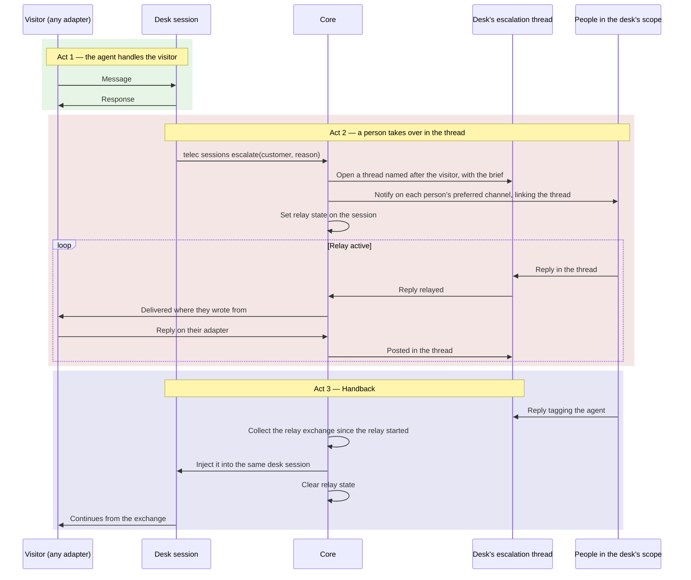
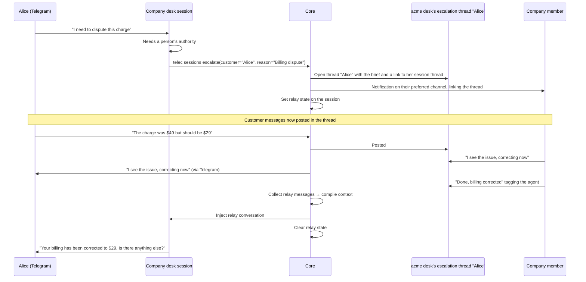
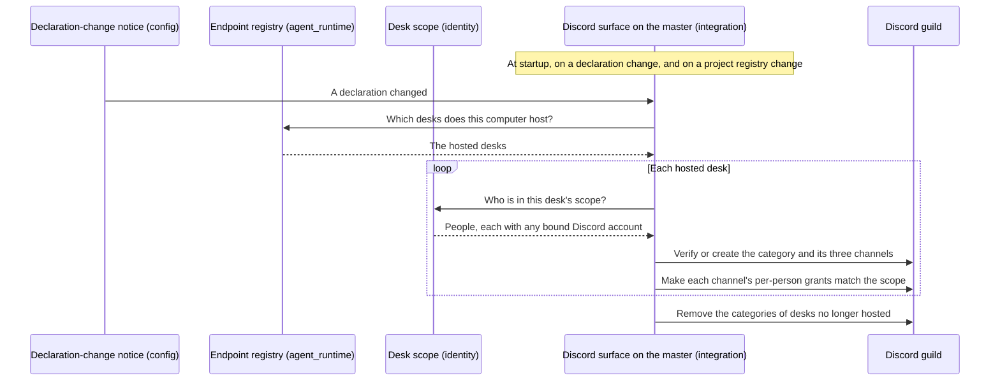
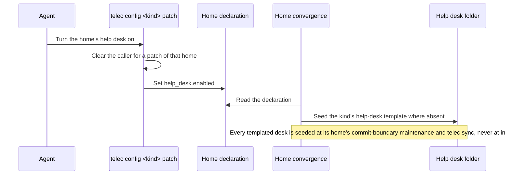

# Help Desk Platform — Design

## Required reads

@docs/local/design/architecture/memory-system.md
@docs/local/design/architecture/session-lifecycle.md
@docs/local/design/architecture/context-selection.md
@docs/local/design/architecture/redis-transport.md
@docs/local/design/architecture/adapter-client.md
@docs/local/design/architecture/ui-adapter.md

## Purpose

Let AI agents answer the people a home does not otherwise serve, through the public-facing adapters (Telegram, WhatsApp), with per-visitor memory continuity, escalation to the people accountable for that home, and extraction of business intelligence from the interactions — all within a help-desk folder of the home that owns it, scaffolded from TeleClaude's help-desk templates. Discord is never a visitor's surface: it serves the operator plane only.

The platform operates on two planes.

**Visitor plane.** A visitor reaches a help desk through a conversation adapter by entering with the desk's entry identifier. Desks run only on the mesh master. The desk's agent answers from the documentation the visitor may read.

**Operator plane.** Each desk has its own Discord category, visible only to the desk's scope. An escalation notifies everyone in that scope and opens a thread in the desk's escalations forum, where the person who answers talks to the visitor through the relay.

## Inputs/Outputs

**Inputs:**

- Visitor messages via the conversation adapters that carry desk entry (`local/projects/teleclaude/spec/feature/agent_runtime/conversation-entry`)
- An entry identifier: a desk's `hd-<kind>-<slug>`, naming the desk by kind and slug
- Each home's help-desk declaration (`help_desk.enabled`) in its `teleclaude.yml`
- Identity from the person registry and per-person credential bindings, or the customer fallback for an unregistered sender
- The desk's `AGENTS.master.md`, its home's own source, compiled into the desk's `AGENTS.md`
- Documentation via `telec docs index` + `telec docs get`, at the visitor's depth
- Replies in a desk's escalation thread from people in the desk's scope (during a relay)

**Outputs:**

- AI-handled help-desk conversations with memory continuity
- Identity-scoped personal memories (per-visitor observation history)
- The fixed neutral reply for a conversation that reaches no desk
- Escalation threads in the desk's escalations forum, and notifications linking them to everyone in the desk's scope
- Relayed replies delivered to the visitor on their own adapter

- Business items from desk conversations (requests, complaints, confusion, sentiment, mentions of alternatives), collected as prospects for the home that owns the desk

### Architecture

#### Help desks

Two kinds exist:

| Kind    | Home           | Serves                            | Entry               |
| ------- | -------------- | --------------------------------- | ------------------- |
| Company | a company home | that company's external customers | `hd-company-<slug>` |
| Project | a project      | that project's external customers | `hd-project-<slug>` |

The TeleClaude project's desk is an ordinary project desk. A home runs a desk only when its `teleclaude.yml` sets `help_desk.enabled` (`local/projects/teleclaude/spec/teleclaude-config`); enabling and scaffolding are described under Help Desk Scaffolding below. A project's enabled desk also requires the `agents` capability on that project (`local/projects/teleclaude/spec/feature/config/kind-addressed-configuration`). The concepts are `general/concept/help-desk/overview` and its per-kind siblings.

Desks run only on the mesh master, which hosts every enabled desk whose home it holds. A repository is often checked out on several computers, so its declaration is the same everywhere; hosting on one computer gives each desk exactly one host. A desk whose home is not on the master is not hosted.

The help desk is a folder of the home that owns it, never a repository of its own: a company's is `help-desk/` in its company home, and a project's is `help-desk/` in the project's repository. The folder holds the operator brain, which its home's history records, and no documentation of its own; a desk session writes nothing into it.

```
<home>/help-desk/
├── AGENTS.master.md                      # operator brain, seeded from its kind's help-desk template, then the home's own
├── .gitignore                            # ignores everything else the folder holds
```

#### Entry and routing

The core owns endpoints, designated-channel routing, master ownership and
unavailability under
`local/projects/teleclaude/spec/feature/agent_runtime/conversation-entry`.
Integration carries provider input and channel designation into that boundary;
identity supplies the registered person or visitor binding. Their composition
reaches the retained session and its endpoint without an adapter selecting a
working folder or becoming an alternative conversation owner
(`sdlc/principle/design-fundamentals`).

Desk entry links are rendered through the help-desk link commands on their
master owner. Person invitations use
`local/projects/teleclaude/spec/feature/config/person-invitations`; both point
at the canonical public providers.

#### Session placement

A session whose role is below member and that carries no system role runs only inside an enabled help desk on the master: a customer's at the desk the conversation's session belongs to. A request naming no enabled desk is refused; nothing is silently redirected (`local/projects/teleclaude/spec/feature/agent_runtime/session-lifecycle`). A desk entry is a door that places a person below their effective role (`local/projects/teleclaude/design/architecture/scoped-roles`), which is how a registered person who follows a desk link lands in that desk.

**Identity key format:** a registered person is keyed as that person — `person:{slug}` — whichever adapter they write from; anyone else is keyed by the platform identity they write from — `{platform}:{platform_user_id}`, e.g. `discord:999001`, `telegram:12345678`, `whatsapp:31612345678`. Identity derives the key from the session at the moment it is needed, both when memories are saved and when they are injected; it is not stored as a denormalized column on the session, and the memory system receives it as an opaque string.

#### Tool access for help-desk visitors

A help-desk session below admin is confined to its desk: below member by its recorded role (`local/projects/teleclaude/spec/feature/agent_runtime/session-lifecycle` UC-SL48), and a member who entered the desk by the endpoint it was created at (`local/projects/teleclaude/spec/feature/agent_runtime/conversation-entry` UC-CE22):

- It reads files only inside its desk folder and its own session's uploads, never another session's uploads.
- It runs only the desk commands its recorded role admits, which the CLI surface declares (`local/projects/teleclaude/design/cli-authorization-matrix`): for a customer `telec version`, `telec docs index`, `telec docs get`, `telec auth whoami` and `telec sessions escalate`.
- No documentation corpus is mounted for it; it reads documentation only through `telec docs` at its own depth and through its desk master.
- Its agent is chosen by availability from the dispatch order for desk sessions (`local/projects/teleclaude/design/architecture/agent-dispatch`), like every other session kind; that order holds only agents that carry a desk confinement profile and declare a compaction command. When no agent in it is available, no session is created and the visitor receives the neutral reply.

#### Documentation reach

A desk agent reads documentation at its visitor's depth (`local/projects/teleclaude/spec/feature/context/doc-selection-policy`). A customer holds no relationship to the home, so a project desk offers that project's public snippets, a company desk the public snippets of the company and every project it owns, and both the public shared documentation, the help-desk documentation among it. Snippets declare `visibility: public` to be served there. A desk's master inlines no internal documentation of its home.

### Help Desk Scaffolding

A home's declaration says whether it keeps a help desk, and how that field is set and the desk scaffolded is owned by `local/projects/teleclaude/spec/feature/config/kind-addressed-configuration`. The company and project kinds each have a template in the TeleClaude repository — `templates/help-desk-company/` and `templates/help-desk-project/` — carrying that kind's operator brain, seeded once, and the desk's ignore declaration.

- A company help desk is a folder inside the TeleClaude home. The platform home's configuration-aware convergence seeds it at commit-boundary maintenance and through `telec sync` while its company enables it; machine installation seeds no desk (`local/projects/teleclaude/spec/feature/reconciliation/home-template-materialization`, `local/projects/teleclaude/spec/feature/reconciliation/project-plumbing-convergence`).
- A project help desk lives in the project's repository. The project's own convergence seeds it at commit-boundary maintenance and through `telec sync` whenever the project's declaration enables it.
- Seeding writes an operator brain only while it is absent. An existing one is never rewritten, and its home's history records it like any other source.
- A desk whose home stops enabling it keeps its folder and is no longer hosted.
- Scaffolding initializes no repository, runs no project initialization, and makes no commit of its own.

- A help desk's master requires only documentation every reader of that desk may read, never its home's local documentation (`general/policy/agent-artifact-governance`).

### Knowledge Authoring Command

A global command (`agents/global/commands/general/author-knowledge.md`) that helps users offload organizational knowledge into structured documentation through conversation. Available in all projects, not specific to help desks.

The command activates a Knowledge Author role that:

1. Asks the user what area of their organization or project they want to document
2. Listens for documentable knowledge: facts, policies, procedures, FAQ
3. Determines the taxonomy type (spec, policy, procedure, etc.), the snippet's visibility, and its storage location:
   - `docs/global/` — knowledge the home publishes
   - `docs/local/` — the home's own documentation
4. Authors doc snippets following the snippet authoring schema
5. Commits each batch; commit-boundary publication deploys the artifacts

The command reads the doc-snippet-authoring procedure and snippet-authoring-schema spec as required reads, so it always follows the correct structure and taxonomy. A snippet a help desk should serve declares `visibility: public`.

### Escalation Tool

`telec sessions escalate` is how a desk agent asks for a person (`local/projects/teleclaude/spec/feature/agent_runtime/help-desk-escalation`). It is accepted from a session running in a help desk and refused elsewhere.

**Parameters:**

- `--customer` (required) — the name the visitor gave
- `--reason` (required) — why a person is needed
- `--summary` (optional) — what has been established so far

**Behavior:**

1. Resolves the desk's scope: a company desk's company members and admins; a project desk's owning company members and admins, or its owning person; and the platform's admins for every desk.
2. Opens a thread named after the visitor in the desk's escalations forum, whose first message is the agent's brief: the desk, the visitor and the channel they wrote from, the reason, the summary, and a link to the visitor's thread in the desk's customer-sessions forum.
3. Notifies each person in scope on their preferred channel with a link to that thread.
4. Sets the session's relay state.
5. Returns confirmation to the agent.

The desk agent follows `general/procedure/help-desk/escalation`, which its master requires through `general/procedure/help-desk/overview`.

### Admin Relay

When an agent escalates, the core relays between the visitor and the desk's escalation thread — bypassing the AI session.



**Session state fields:**

- `relay_status` — `NULL` (normal) or `"active"` (relay mode)
- the relay's thread — the desk's escalation thread for this relay
- `relay_started_at` — timestamp of relay activation (message collection boundary)

**Discord surface (per desk):** every hosted desk has its own category, `Help Desk - <kind>-<slug>`, with a `customer-sessions` forum mirroring each of its sessions, an `escalations` forum for its escalation threads, and a `team-chat` channel, all visible only to the desk's scope through per-person permission overwrites (`local/projects/teleclaude/spec/feature/integration/discord-admin-reflection-state`). No desk session or escalation appears in any other forum of the guild.

**Message routing diversion:**

The diversion runs in the core inbound path, for every adapter:

1. The visitor sends a message on any adapter
2. The session is found through the conversation's binding
3. With the relay active, the core does not deliver the message to the agent
4. It posts the message in the desk's escalation thread
5. The agent session is paused for the duration of the relay

A person in the desk's scope answers by replying in the thread; the reply is delivered to the visitor through the visitor's originating adapter and never enters the agent session. Only the escalating agent and the people answering speak in the thread.

**Handback:** a person hands the conversation back by tagging the agent in a reply in the thread. The core collects the exchange since `relay_started_at` (or since the previous handback) into a structured context block naming the person and the visitor for each message, injects it into the same desk session through the normal message pipeline (`process_message`), which validates session liveness and enqueues durable delivery, and clears the relay state. The visitor's messages resume routing to the agent, and its first response continues from the exchange.

**Relay lifecycle:**

- Multiple escalation and handback cycles can occur within one conversation.
- Each handback collects messages after its preceding handback or relay start.
- Closing settles the active relay while retaining the conversation record.

### Customer-Facing Agent Behavior

A desk session's agent comes from the dispatch order for desk sessions (Tool access for help-desk visitors, above); no desk chooses its own agent or model.

The desk's master and the help-desk procedure (`general/procedure/help-desk/overview`) define the agent's behavior:

- **Greeting and rapport**: Warm, professional opening that acknowledges returning visitors by name (via injected personal memories)
- **Active listening**: Confirm understanding before acting, summarize the visitor's intent
- **Knowledge navigation**: Use `telec docs index` + `telec docs get` to answer from the documentation the visitor may read
- **Transparency**: Clearly communicate what the agent can and cannot do; never fabricate answers
- **Escalation judgment**: Recognize when the documentation cannot answer, when the visitor asks for a person, or when the topic needs authority (billing, security, legal)
- **Conversation closure**: Summarize what was accomplished, confirm next steps, invite further questions
- **Tone adaptation**: Match the visitor's communication style (formal/casual) as detected via personal memories

### Identity-Scoped Memory

The memory system gains a second scoping axis. The `project` field remains the namespace. The `identity_key` field optionally scopes memories to one person.

Every desk has a memory namespace of its own, derived from the desk's identity (its kind and its home's slug), never from its folder name: every desk folder carries the same name, so a folder-derived namespace would merge every desk's memories into one.

| Record                                 | Namespace (`project`)       | `identity_key`         | Subject                                                    | State              | Reaches                                                             |
| -------------------------------------- | --------------------------- | ---------------------- | ---------------------------------------------------------- | ------------------ | ------------------------------------------------------------------- |
| Memory about a registered visitor      | the desk's                  | `person:{slug}`        | that person                                                | current or retired | that person's sessions at that desk; their own reach elsewhere      |
| Memory about an unregistered visitor   | the desk's                  | `{platform}:{user_id}` | the desk's home, recorded under the visitor's own identity | current or retired | that visitor's sessions at that desk; the people who reach the home |
| Business item from a desk conversation | the home that owns the desk | `NULL`                 | the desk's home                                            | prospect           | nothing until aggregated                                            |

Memories are kept current by memory agents (`local/projects/teleclaude/spec/feature/memory/memory-curation`): retired memories and prospects never reach startup context or search.

**Context injection at SessionStart.** For a desk session, the hook receiver asks memory for the desk's namespace, narrowed to the visitor's identity key, under the reach identity resolves for the session's visitor (`local/projects/teleclaude/spec/feature/identity/data-visibility` UC-DV14 for an unregistered visitor). The session therefore starts with the current memories about that visitor at that desk and with nothing recorded about anyone else or at any other desk. A session that is not at a desk keeps its namespace from its working folder.

**API changes:**

- `POST /api/memory/save` — add optional `identity_key` field
- `GET /api/memory/search` — add optional `identity_key` query param
- No `identity_key` → saved/queried as project-level memory (NULL)

### Customer Session Lifecycle

The adapter conversation retains its TeleClaude session and recorded native
lineage. Idle maintenance uses the delivered interruptible compaction launch;
confirmed completion closes the runtime immediately. Returning input resumes
the same conversation under the existing confinement and queueing contracts
(`local/projects/teleclaude/spec/feature/agent_runtime/conversation-continuity`).

Closing releases execution resources while retaining identity and history.
Removal is a soft deletion under
`local/projects/teleclaude/spec/feature/agent_runtime/session-cleanup-and-reaping`.
The mirror is the session-owned conversational projection; the extraction
checkpoint belongs to that source rather than to the visitor's identity.

### Post-Session Memory Extraction

The desk's eligible closure requests readiness of its conversation mirror.
After coverage is confirmed, memory releases a bounded extraction to the desk's
visitor-scoped procedure agent. The pipeline ownership and event relationships
are `local/projects/teleclaude/design/architecture/conversation-memory-pipeline`.

The specialized desk procedure reads the prepared conversational extract,
updates memories within the visitor and desk scope, records business prospects
for the desk owner, and explicitly completes source progress. Unfinished work
remains available for later handling. Multiple source conversations for the
same visitor and desk are serialized through the same responsibility.

The person-home procedure serves personal memories across that person's PA
conversations. These specialized briefs share memory judgment rather than a
session-id-based executable workflow
(`local/projects/teleclaude/spec/feature/memory/memory-curation`).

### Business Insights

What desk conversations show about the business — requests for what does not exist, complaints, recurring confusion, sentiment, mentions of alternatives — is not synthesized by any scheduled job. Turning collected business items into durable knowledge for the home that owns the desk, and where that knowledge lands, is not designed yet.

### Desk master (`AGENTS.master.md`)

Each desk's `AGENTS.master.md` is its home's own source, seeded from its kind's help-desk template, and compiles into `AGENTS.md` through the standard artifact pipeline. It stays a thin wrapper:

1. **Identity**: the help-desk agent of this desk, not a generic assistant.
2. **Required reads**: the desk kind's concept (`general/concept/help-desk/<kind>`) and the help-desk procedure (`general/procedure/help-desk/overview`, which requires the escalation procedure). A company or project desk's master requires none of its home's internal documentation, so nothing internal reaches a customer-facing agent's context.
3. **Knowledge access**: everything else comes from `telec docs index` + `telec docs get` at the visitor's depth.
4. **Memory awareness**: personal memories (identity-scoped) provide visitor continuity.
5. **Observer interests** (for dual-observer prompts):
   - Personal: the visitor's name, company, role, preferences, communication style, open questions, relationship history
   - Business: feature requests, complaints, confusion points, sentiment, competitive mentions, pricing discussions

## Invariants

1. **Single memory store**: Identity-scoped memories live in the same `memory_observations` table. No separate tables or databases per identity.

2. **NULL means shared**: `identity_key IS NULL` means the memory belongs to the project, visible to all sessions in that project. This is the default behavior, preserving backward compatibility.

3. **Identity key is opaque**: The memory system does not parse identity keys. It stores and matches them as strings. Format convention is `{platform}:{platform_user_id}` but the store doesn't enforce this.

4. **Identity key is derived**: The `identity_key` is derived from origin metadata at query time, not stored as a denormalized column on the session.

5. **Compaction keeps the conversation readable**: the session-owned mirror retains the conversational lineage independently of the agent's compacted working context. Memory extraction reads the mirror's prepared source revision (`local/projects/teleclaude/spec/feature/session_mirrors/mirror-identity-enrichment`).

6. **Help desks are folders of their homes**: A help desk is never a repository of its own. Scaffolding is idempotent: the operator brain is seeded only while absent, the ignore declaration converges to its kind's template, and nothing the template does not carry is touched.

7. **A desk exists only where its home enables it**: no machine-wide desk location exists. A desk's folder follows from its home, and a home without `help_desk.enabled` has no desk.

8. **Extraction has source-owned progress**: the memory worker reads the unprocessed stretch of the session-owned mirror and completes progress after applying its changes. Progress and failure recovery follow `local/projects/teleclaude/spec/feature/memory/memory-curation`.

9. **Entry is runtime-owned**: integration supplies entry facts to the endpoint resolver under `local/projects/teleclaude/spec/feature/agent_runtime/conversation-entry`.

10. **Closing spares resources, never the conversation**: confirmed idle compaction closes the runtime, and mirror readiness releases memory extraction. Returning input continues the same conversation (`local/projects/teleclaude/spec/feature/agent_runtime/conversation-continuity`).

11. **Relay is session-scoped**: closing settles the active relay through the session lifecycle while the conversation record and its history remain retained.

12. **Relay diverts, not duplicates**: When relay is active, visitor messages go to the escalation thread ONLY, not to both thread and agent, whichever adapter they use. The agent session is fully paused during relay.

13. **Handback collects incrementally**: Each handback collects messages since the previous handback (or since relay activation). Multiple escalation/handback cycles within one session each get a clean context window.

14. **Escalation is a help-desk act aimed at the desk's scope**: `telec sessions escalate` is accepted only from a session in a help desk; it opens a thread in that desk's escalations forum and notifies everyone in the desk's scope.

15. **Bindings compose with identity**: the runtime owns the conversation binding while identity owns the person or visitor it serves (`local/projects/teleclaude/spec/feature/agent_runtime/conversation-entry`).

16. **Hosting follows entry ownership**: conversation ownership, desk hosting and unavailable-owner behavior come from `local/projects/teleclaude/spec/feature/agent_runtime/conversation-entry`.

17. **Each desk is seen only by its scope**: a desk's sessions and escalations appear only in that desk's own Discord category, visible only to the desk's scope through per-person overwrites; no shared surface carries them.

18. **Customers read public documentation only**: a customer's desk agent reads its desk's reach at public depth, and no desk master inlines its home's internal documentation.

## Primary Flows

### Customer Returns to a Desk

```mermaid
sequenceDiagram
    participant Customer as Alice (WhatsApp)
    participant Adapter as WhatsApp handler
    participant Master as Mesh master
    participant Hook as Hook Receiver
    participant Memory as Memory Store
    participant Agent as Desk agent

    Customer->>Adapter: Message (no identifier)
    Adapter->>Master: Route the conversation
    Master->>Master: Binding: acme-shop's project desk; its session is closed
    Master->>Master: Revive that session in the desk's folder

    Note over Hook: SessionStart fires
    Hook->>Memory: generate_context(identity_key=whatsapp:31612345678)
    Memory->>Hook: Desk memories + Alice's personal memories
    Hook->>Agent: Inject context into session

    Agent->>Customer: Personalized response from the project's public docs
```

### Escalation and Admin Relay



### Idle Compaction Cycle

The runtime's confirmed compaction completion proceeds directly to closure.
Closure and mirror readiness then release memory extraction through
`local/projects/teleclaude/design/architecture/conversation-memory-pipeline`.
A returning visitor takes precedence over unfinished maintenance through the
existing compaction cancellation and resumption contract.

### Desk Category Reconciliation



Every pass reads the current desks and scopes in full, so changes that arrive
during a pass are absorbed by one more pass. Overwrites are compared with what
the scope requires and edited only where they differ. A desk's grants are
exactly its scope's people who have a bound Discord account and are in the
guild; every other person's grant is removed. Desk scope, hosting and bindings
are trusted as their owners answer them, and an error from any of them, or from
Discord, fails the pass with that error and is not worked around
(`sdlc/principle/design-fundamentals`, fail fast). The next pass reconciles
from the state as it then is
(`local/projects/teleclaude/spec/feature/integration/discord-admin-reflection-state`).

### Help Desk Scaffolding



## Failure Modes

| Scenario                                                                                    | Behavior                                                      | Recovery                                                                                                 |
| ------------------------------------------------------------------------------------------- | ------------------------------------------------------------- | -------------------------------------------------------------------------------------------------------- |
| Identity resolution fails for known user                                                    | Falls back to `customer` role, no identity_key                | Personal memories not injected; the agent handles without context                                        |
| Unregistered sender with no session and no identifier, unknown identifier, or disabled desk | One neutral reply, no session                                 | The visitor uses a working desk link                                                                     |
| The entered desk's home is not on the master                                                | Neutral reply, no session                                     | Make the desk's home present on the master                                                               |
| A restricted session names no enabled desk                                                  | Session creation is refused                                   | The core resolves an endpoint first or sends the neutral reply                                           |
| A memory agent fails or stops                                                               | Completed writes remain; extraction progress stays unfinished | A later handling reads the pending mirror stretch and compares with current records before completing it |
| Compaction does not finish                                                                  | The session stays open, not compacted                         | A later pass retries; the session is never closed uncompacted                                            |
| Memory injection exceeds context window                                                     | Truncated by recency (existing behavior)                      | Most recent memories prioritized                                                                         |
| Conversation mirror coverage is not ready                                                   | Extraction remains pending with its source coverage           | Successful mirror refresh or reconciliation releases the captured extraction once coverage is ready      |

**Escalation failure modes:**

| Scenario                                                                              | Behavior                                                          | Recovery                                                            |
| ------------------------------------------------------------------------------------- | ----------------------------------------------------------------- | ------------------------------------------------------------------- |
| No one in the desk's scope can be notified, or the escalation thread cannot be opened | Tool returns error to the agent                                   | The agent tells the visitor the escalation failed and keeps helping |
| Relay message delivery fails to the visitor's adapter                                 | The reply is not delivered; the failure is reported in the thread | The person answering can send the reply again                       |
| Handback missed                                                                       | Relay stays active, agent stays paused                            | A person replies again in the thread tagging the agent              |
| Several people reply in the thread                                                    | All replies reach the visitor                                     | Everyone in scope reads the same thread, so they coordinate there   |
| Visitor messages during relay when their adapter is down                              | Messages queued or lost depending on platform                     | The person answering sees a gap and can ask the visitor to repeat   |

**Discord desk surface failure modes:**

| Scenario                                                               | Behavior                                                                | Recovery                                                                                            |
| ---------------------------------------------------------------------- | ----------------------------------------------------------------------- | --------------------------------------------------------------------------------------------------- |
| A declaration, a binding or a Discord call fails during a pass         | The pass stops with that error, which is logged                         | The cause is repaired; the next declaration change or restart reconciles                            |
| A person in scope has no bound Discord account, or is not in the guild | They are given no grant and see no desk                                 | They bind their account or join the guild; the next pass grants them                                |
| A desk's customer-sessions forum is not yet provisioned                | The desk's session gets no thread, and is never placed in another forum | The next pass provisions the forum; the session's thread follows when the session is next reflected |

## See Also

- docs/local/design/architecture/outbox.md — Durable outbox for hook event delivery
- docs/local/design/architecture/jobs-runner.md — Scheduled job runner architecture
- docs/local/spec/teleclaude-config.md — Configuration schema

- docs/local/spec/feature/agent_runtime/conversation-entry.md — Endpoints, entry identifiers, routing by what a person sent, neutral reply, master hosting

- docs/local/spec/feature/agent_runtime/help-desk-escalation.md — Escalation recipients and relay
- docs/global/general/spec/tools/telec-cli.md — Telec command surface for session and orchestration flows
