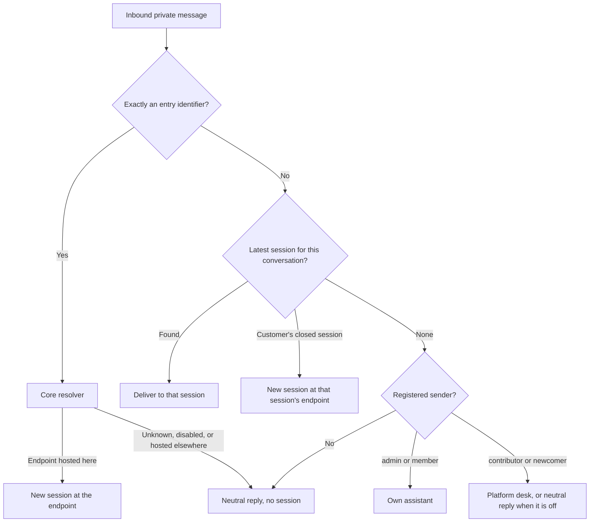
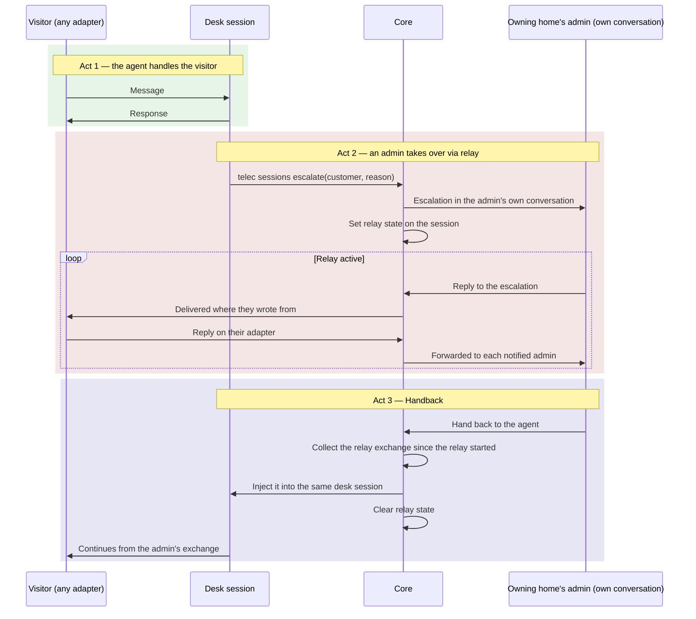
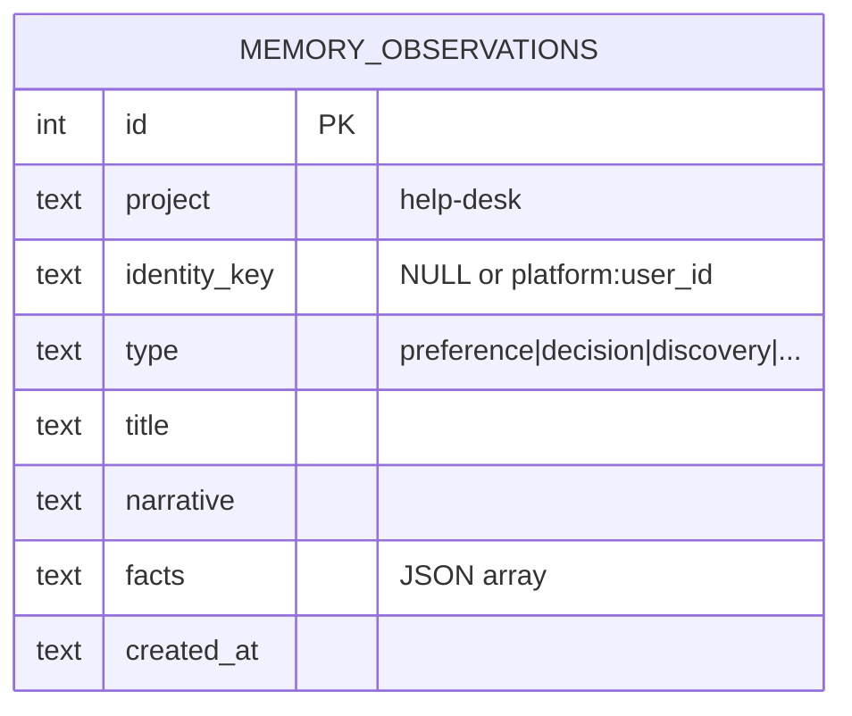
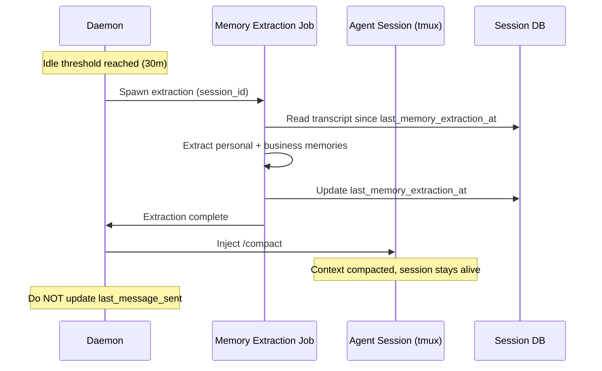
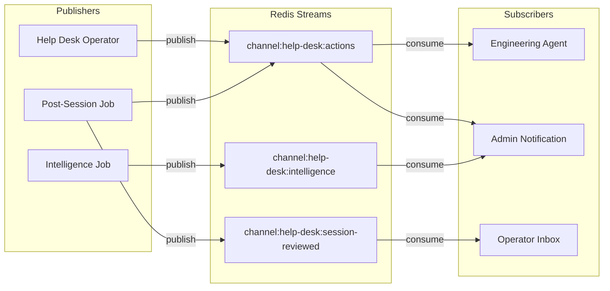
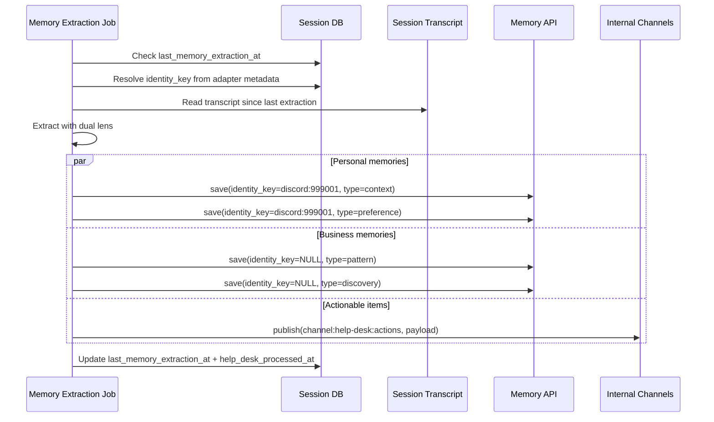
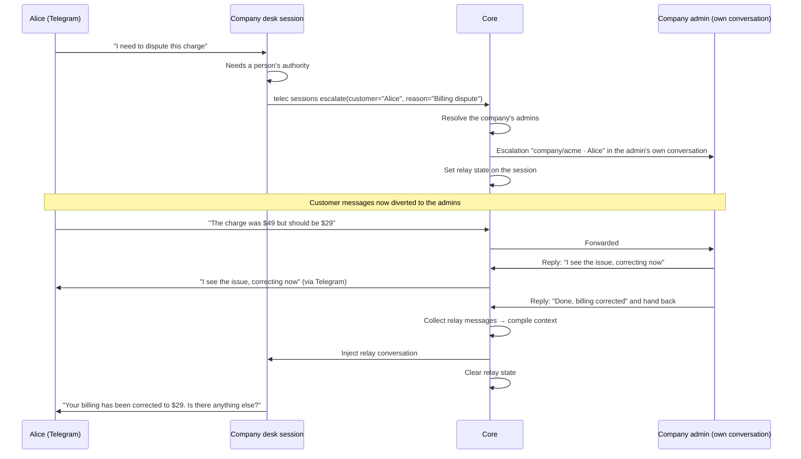
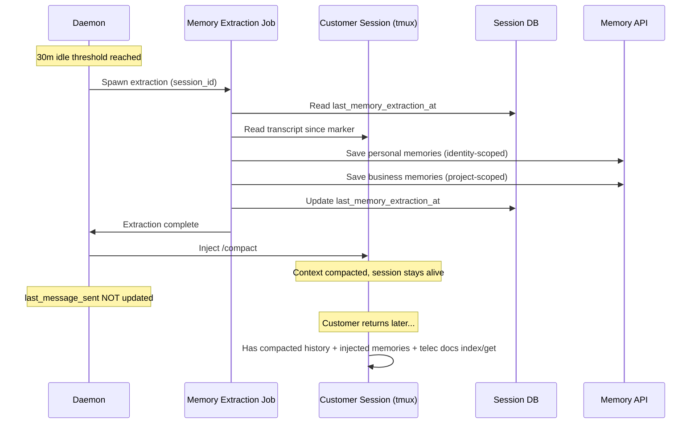
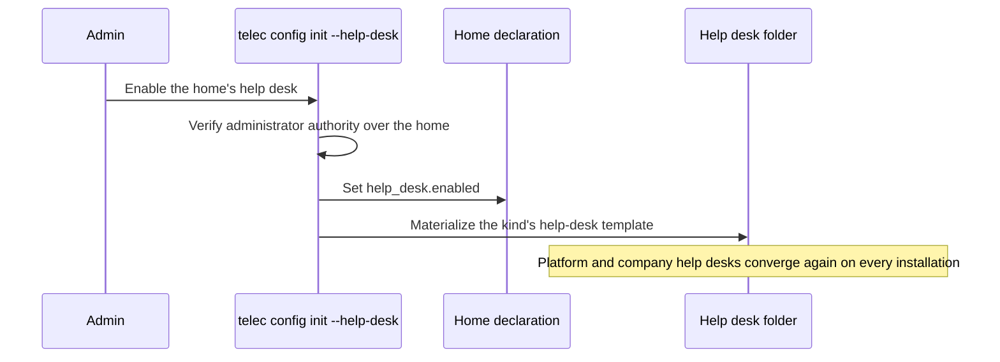
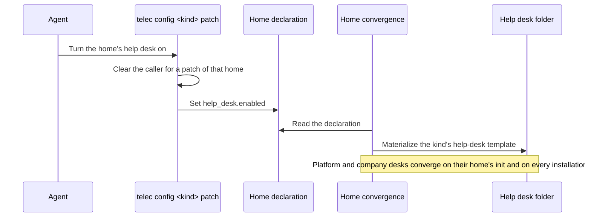

# Help Desk Platform — Design

## Required reads

@docs/local/design/architecture/memory-system.md
@docs/local/design/architecture/session-lifecycle.md
@docs/local/design/architecture/context-selection.md
@docs/local/design/architecture/redis-transport.md
@docs/local/design/architecture/adapter-client.md
@docs/local/design/architecture/ui-adapter.md

## Purpose

Let AI agents answer the people a home does not otherwise serve, through the public-facing adapters (Telegram, Discord, WhatsApp), with per-visitor memory continuity, escalation to the people accountable for that home, and extraction of business intelligence from the interactions — all within a help-desk folder of the home that owns it, scaffolded from TeleClaude's help-desk templates.

The platform operates on two planes:

1. **Visitor plane**: A visitor reaches a help desk through a conversation adapter. A company or project desk is entered with its entry identifier; the platform desk is reached by role. The desk's agent answers from the documentation the visitor may read.
2. **Operator plane**: Escalations reach the admins of the owning home in their own conversations with the platform, and their replies relay back to the visitor. The shared Discord guild is the platform desk's admin surface only.

## Inputs/Outputs

**Inputs:**

- Visitor messages via conversation adapters (Telegram private chats, Discord direct messages, WhatsApp)
- An entry identifier: a desk's `hd-<kind>-<slug>`, naming the desk by kind and slug
- Each home's help-desk declaration (`help_desk.enabled`) in its `teleclaude.yml`
- Identity from the person registry and per-person credential bindings, or the customer fallback for an unregistered sender
- The desk's `AGENTS.master.md`, compiled from its kind's help-desk template
- Documentation via `telec docs index` + `telec docs get`, at the visitor's depth
- Admin replies to an escalation, in the admin's own conversation (during a relay)

**Outputs:**

- AI-handled help-desk conversations with memory continuity
- Identity-scoped personal memories (per-visitor observation history)
- Project-scoped business memories (aggregate patterns, complaints, insights)
- Actionable items published to internal channels (follow-ups, escalations, feature requests)
- The fixed neutral reply for a conversation that reaches no desk
- Escalation notifications to the admins of the home that owns the desk
- Relayed admin replies delivered to the visitor on their own adapter

### Architecture

#### Help desks

Three kinds exist:

| Kind     | Home                | Serves                            | Entry                  |
| -------- | ------------------- | --------------------------------- | ---------------------- |
| Platform | the TeleClaude home | contributors and newcomers        | by role; no identifier |
| Company  | a company home      | that company's external customers | `hd-company-<slug>`    |
| Project  | a project           | that project's external customers | `hd-project-<slug>`    |

A home runs a desk only when its `teleclaude.yml` sets `help_desk.enabled` (`local/projects/teleclaude/spec/teleclaude-config`); enabling and scaffolding are described under Help Desk Scaffolding below. The concepts are `general/concept/help-desk/overview` and its per-kind siblings.

The help desk is a folder of the home that owns it, never a repository of its own: the platform help desk is `help-desk/` in the TeleClaude home, a company's is `help-desk/` in its company home, and a project's is `help-desk/` in the project's repository. The folder holds the operator brain and the runtime artifacts its sessions produce, and no documentation of its own.

```
<home>/help-desk/
├── AGENTS.master.md                      # operator brain, the rendering of its kind's help-desk template
├── .gitignore                            # ignore everything except the one AGENTS.master.md file
```

#### Entry and routing

Entry is owned by the core, in `local/projects/teleclaude/spec/feature/agent_runtime/conversation-entry`. In outline:

- An **endpoint** is a routable destination: a person's assistant in their home, or a home's help desk. Its **entry identifier** is the member's invitation token or the desk's `hd-<kind>-<slug>`. One core resolver turns an identifier into the endpoint's working folder and hosting computer; the platform desk has no identifier.
- A **conversation** is one adapter's private channel with one person. Every session carries the adapter's origin metadata and the endpoint it was created at. On a per-computer adapter (Telegram) the session is the binding; on adapters whose messages reach every computer (Discord DM, WhatsApp) the mesh master alone decides and keeps each conversation's binding in a durable record, because a session lives only on its host. Adapters only recognise and carry the identifier; they keep no routing rules.
- An **entry** creates a new session at the resolved endpoint and supersedes the conversation's earlier sessions: a superseded desk session ends, a superseded assistant session keeps running without the conversation. A miss supersedes nothing. A message without an identifier goes to the conversation's latest session — the most recently created one not superseded, open in any state — found through the conversation's binding, so the latest entry wins. For customers the binding outlives closed sessions, so a returning customer lands at the desk they last used; a registered member or admin without an open session reaches their own assistant, a contributor or newcomer the platform desk.
- A **miss** — an identifier that resolves to nothing here, or an unregistered person without any session — gets one fixed neutral reply and no session, identical in every case, naming no organisation, at most once per conversation per cooldown window.
- **Hosting**: where every computer receives inbound messages (Discord, WhatsApp), the mesh master decides every entry and supersession, creates the session on the endpoint's hosting computer and forwards later messages, files and voice to it. A company or project desk is hosted by a computer announcing it to the cluster; assistants and the platform desk reached there are hosted by the master, which sends the neutral reply. With the master down nothing routes on these adapters: every inbound message gets a temporarily-unavailable reply, at most once per conversation within a cooldown window, from the lowest-named live computer running the adapter, no session starts, and conversations resume from the master's durable record when it returns. A session the master cannot create on its host in time makes no binding: the neutral reply, and the earlier binding stays. A per-computer bot (Telegram) decides alone, and its link names the hosting computer's bot.
- The per-adapter entry links come from `telec config company help-desk-links <slug>` and `telec config project help-desk-links <slug>`, run on a hosting computer.



#### Session placement

A session whose role is below member and that carries no system role runs only inside an enabled help desk: a customer's at the desk its entry resolved to, or for a returning customer the desk of their latest session; a contributor's or newcomer's in the platform desk. A request naming no enabled desk is refused; nothing is silently redirected (`local/projects/teleclaude/spec/feature/agent_runtime/session-lifecycle`). A desk entry is a door that places a person below their effective role (`local/projects/teleclaude/design/architecture/scoped-roles`), which is how a registered person who follows a desk link lands in that desk.

**Identity key format:** `{platform}:{platform_user_id}` — e.g., `discord:999001`, `telegram:12345678`, `whatsapp:31612345678`. It is derived from the session's origin metadata at query time, not stored as a denormalized column on the session, and the memory system receives it as an opaque string.

#### Tool access for help-desk visitors

A help-desk session below admin is confined to its desk: below member by its recorded role (`local/projects/teleclaude/spec/feature/agent_runtime/session-lifecycle` UC-SL48), and a member who entered the desk by the endpoint it was created at (`local/projects/teleclaude/spec/feature/agent_runtime/conversation-entry` UC-CE22):

- It reads files only inside its desk folder and its own session's uploads, never another session's uploads.
- It runs only the desk commands its recorded role admits, which the CLI surface declares (`local/projects/teleclaude/design/cli-authorization-matrix`): for a customer `telec version`, `telec docs index`, `telec docs get`, `telec auth whoami` and `telec sessions escalate`.
- No documentation corpus is mounted for it; it reads documentation only through `telec docs` at its own depth and through its desk master.
- Its agent is chosen by availability from the dispatch order for desk sessions (`local/projects/teleclaude/design/architecture/agent-dispatch`), like every other session kind; that order holds only agents that carry a desk confinement profile. When no agent in it is available, no session is created and the visitor receives the neutral reply.

#### Documentation reach

A desk agent reads documentation at its visitor's depth (`local/projects/teleclaude/spec/feature/context/doc-selection-policy`). A customer holds no relationship to the home, so a project desk offers that project's public snippets, a company desk the public snippets of the company and every project it owns, and both the public shared documentation, the help-desk documentation among it. Snippets declare `visibility: public` to be served there. A desk's master inlines no internal documentation of its home.

### Help Desk Scaffolding

<!-- planned-change:config-clearance-drops-field-gates -->

`telec config <kind> init --help-desk` enables a home's help desk and scaffolds it; it requires administrator authority over the home (`local/projects/teleclaude/spec/feature/config/kind-addressed-configuration`). Each kind has its own template in the TeleClaude repository — `templates/help-desk-platform/`, `templates/help-desk-company/`, and `templates/help-desk-project/` — carrying that kind's operator brain; the project template also carries the ignore declaration for the runtime directories.
<!-- change:config-clearance-drops-field-gates -->

A home's declaration says whether it keeps a help desk, and how that field is set and the desk scaffolded is owned by `local/projects/teleclaude/spec/feature/config/kind-addressed-configuration`. Each kind has its own template in the TeleClaude repository — `templates/help-desk-platform/`, `templates/help-desk-company/`, and `templates/help-desk-project/` — carrying that kind's operator brain; the project template also carries the ignore declaration for the runtime directories.
<!-- /planned-change:config-clearance-drops-field-gates -->

- The platform and company help desks are folders inside the TeleClaude home, so every machine installation converges them while their home enables them (`local/projects/teleclaude/spec/feature/reconciliation/home-template-materialization`).
- A project help desk lives in the project's working tree, so only the project's `init --help-desk` converges it, and the project commits the result.
- Scaffolding initializes no repository, runs no project initialization, and makes no commit of its own.
- A help desk's master requires only documentation every reader of that desk may read, never its home's local documentation (`general/policy/agent-artifact-governance`).

### Knowledge Authoring Command

A global command (`agents/global/commands/general/author-knowledge.md`) that helps users offload organizational knowledge into structured documentation through conversation. Available in all projects, not specific to help desks.

The command activates a Knowledge Author role that:

1. Asks the user what area of their organization or project they want to document
2. Listens for documentable knowledge: facts, policies, procedures, FAQ
3. Determines the taxonomy type (spec, policy, procedure, etc.), the snippet's visibility, and its storage location:
   - `docs/global/` — knowledge the home publishes
   - `docs/local/` — the home's own documentation
4. Authors doc snippets following the snippet authoring schema
5. Commits each batch; commit-boundary publication deploys the artifacts

The command reads the doc-snippet-authoring procedure and snippet-authoring-schema spec as required reads, so it always follows the correct structure and taxonomy. A snippet a help desk should serve declares `visibility: public`.

### Escalation Tool

`telec sessions escalate` is how a desk agent asks for a person (`local/projects/teleclaude/spec/feature/agent_runtime/help-desk-escalation`). It is accepted from a session running in a help desk and refused elsewhere; admins are its target and never escalate.

**Parameters:**

- `--customer` (required) — the name the visitor gave
- `--reason` (required) — why a person is needed
- `--summary` (optional) — what has been established so far

**Behavior:**

1. Resolves the admins of the home that owns the desk: a company desk's company admins; a project desk's owning company admins, or its owning person; the platform's admins for the platform desk, for an ownerless project, or when no owning admin is reachable.
2. Sends each resolved admin the escalation in their own conversation with the platform, on their preferred channel, naming the desk, the visitor and the channel they wrote from, the reason and the summary.
3. For the platform desk only, also opens a thread in the shared Discord guild's escalation forum.
4. Sets the session's relay state.
5. Returns confirmation to the agent.

The desk agent follows `general/procedure/help-desk/escalation`, which its master requires through `general/procedure/help-desk/overview`.

### Admin Relay

When an agent escalates, the core relays between the visitor and the notified admins — bypassing the AI session.



**Session state fields:**

- `relay_status` — `NULL` (normal) or `"active"` (relay mode)
- the relay's admin side — where each notified admin's part of the relay lives
- `relay_started_at` — timestamp of relay activation (message collection boundary)

**Discord configuration (platform desk only):**

- `DISCORD_HELP_DESK_CHANNEL_ID` — forum reflecting platform help-desk sessions for platform admins; not an entry point
- `DISCORD_ESCALATION_CHANNEL_ID` — forum following platform help-desk escalations

Company and project desk sessions and their escalations appear in no forum of the shared guild, the forum of the project that holds a desk included, so no tenant's customer conversation is visible to another.

**Message routing diversion:**

The diversion runs in the core inbound path, for every adapter:

1. The visitor sends a message on any adapter
2. The session is found through the conversation's binding
3. With the relay active, the core does not deliver the message to the agent
4. It forwards the message to each notified admin's side of the relay
5. The agent session is paused for the duration of the relay

An admin answers by replying to any relay message they received; the reply is delivered to the visitor through the visitor's originating adapter and never enters the agent session. An admin whose preferred channel cannot carry a reply, such as email, is notified but cannot answer through the relay.

**Handback:** an admin hands the conversation back by tagging the agent in a reply (or in the platform desk's forum thread). The core collects the exchange since `relay_started_at` (or since the previous handback) into a structured context block naming the admin and the visitor for each message, injects it into the same desk session through the normal message pipeline (`process_message`), which validates session liveness and enqueues durable delivery, and clears the relay state. The visitor's messages resume routing to the agent, and its first response continues from the admin exchange.

**Relay lifecycle:**

- Relay state persists for the lifetime of the session (7d max)
- Multiple escalation/handback cycles can occur within one session
- Each handback collects only messages since the previous handback (or relay start)
- When the session dies (7d sweep), its relay state dies with it

### Customer-Facing Agent Behavior

A desk session's agent comes from the dispatch order for desk sessions (Tool access for help-desk visitors, above); no desk chooses its own agent or model.

The desk's master and the help-desk procedure (`general/procedure/help-desk/overview`) define the agent's behavior:

- **Greeting and rapport**: Warm, professional opening that acknowledges returning visitors by name (via injected personal memories)
- **Active listening**: Confirm understanding before acting, summarize the visitor's intent
- **Knowledge navigation**: Use `telec docs index` + `telec docs get` to answer from the documentation the visitor may read
- **Transparency**: Clearly communicate what the agent can and cannot do; never fabricate answers
- **Escalation judgment**: Recognize when the documentation cannot answer, when the visitor asks for a person, or when the topic needs authority (billing, security, legal)
- **Conversation closure**: Summarize what was accomplished, confirm next steps, invite further questions
- **Tone adaptation**: Match the visitor's communication style (formal/casual) as detected via personal memories

### Identity-Scoped Memory

The memory system gains a second scoping axis. The `project` field remains (operator-level namespace). A new `identity_key` field optionally scopes memories to a specific person.



**Query semantics:**

| Query                                            | Returns                                   |
| ------------------------------------------------ | ----------------------------------------- |
| `project=help-desk, identity_key=NULL`           | Operator's general/business memories only |
| `project=help-desk, identity_key=discord:999001` | Alice's personal memories only            |
| `project=help-desk` (no identity filter)         | All memories for the help desk            |

**Context injection at SessionStart:**

```sql
-- Inject both operator knowledge and customer-specific memories
WHERE project = :project
  AND (identity_key IS NULL OR identity_key = :identity_key)
ORDER BY created_at_epoch DESC
LIMIT 50
```

The hook receiver resolves the session's identity (from adapter metadata via the derivation path) and passes the `identity_key` to `generate_context_sync`. If no identity is available, only project-level memories are injected.

**API changes:**

- `POST /api/memory/save` — add optional `identity_key` field
- `GET /api/memory/search` — add optional `identity_key` query param
- No `identity_key` → saved/queried as project-level memory (NULL)

### Customer Session Lifecycle

Customer sessions have a distinct lifecycle from admin sessions. They stay alive indefinitely — there is no idle timeout that kills a customer session. The 7d inactivity sweep is the only natural death.

**Idle compaction sequence.** After a configurable idle threshold (e.g., 30 minutes of no customer input), the daemon:

1. Runs memory extraction on the recent conversation (same job as post-session processing)
2. Injects `/compact` into the tmux pane
3. Does NOT update `last_message_sent` — this is invisible to the customer

This keeps the session file lean without losing context. The agent retains compacted history plus injected memories on the next customer message.



**Session resumption.** When a customer returns through the same conversation (the same Telegram chat, Discord direct message or WhatsApp number), the adapter routes to the conversation's latest session, or starts a new one at that session's desk when it has closed. The agent has: (a) compacted conversation history, (b) injected personal memories from the most recent extraction, (c) access to `telec docs index` + `telec docs get` at the customer's depth.

**Bookkeeping.** A `last_memory_extraction_at` timestamp on the session record tracks the high-water mark. The extraction job processes only new conversation since this marker. This makes both idle-triggered and cron-triggered extraction idempotent.

**Session state fields (additions):**

- `last_memory_extraction_at` — timestamp of last successful extraction (high-water mark)
- `help_desk_processed_at` — timestamp of final post-mortem processing
- `relay_status` — `NULL` or `"active"` (admin relay mode)
- the relay's admin side — where each notified admin's part of the relay lives
- `relay_started_at` — timestamp of current relay activation

### Internal Channels (Pub/Sub)

Agents need a way to publish structured output without knowing who consumes it. Internal channels provide this: named Redis Streams where agents publish and subscribers eventually process.



**Channel naming:** `channel:{project}:{topic}` — e.g., `channel:help-desk:actions`, `channel:engineering:bug-reports`.

**Publishing:** Agents publish via a TeleClaude tool (`telec channels publish`) or HTTP API (`POST /api/channels/{name}/publish`). The agent doesn't need to know who subscribes — it folds the mail, puts it in the pipe, and moves on.

**Subscribing:** Configured per-project in `teleclaude.yml`. Each subscription maps a channel pattern to an agent command that processes incoming messages:

```yaml
# In teleclaude.yml
channels:
  subscriptions:
    - channel: 'channel:help-desk:actions'
      filter:
        action_type: [escalation, churn_signal]
      target:
        notification: admin_telegram
    - channel: 'channel:help-desk:actions'
      filter:
        action_type: [bug_report]
      target:
        project: teleclaude
        command: /process-bug-report
    - channel: 'channel:help-desk:actions'
      filter:
        action_type: [feature_request]
      target:
        project: teleclaude
        command: /process-feature-request
    - channel: 'channel:help-desk:session-reviewed'
      target:
        project: help-desk
        command: /process-session-review
```

**Consumer worker:** A daemon background task polls subscribed channels using Redis consumer groups. When a message arrives, it either:

1. Routes to a notification channel (existing notification infrastructure)
2. Spawns an agent in the target project with the message as input

**Redis consumer groups** give us:

- Exactly-once processing across multiple computers subscribing to the same channel
- Unacknowledged messages get redelivered (durability on agent death)
- Multiple consumers can load-balance within a group
- Pending message inspection for debugging stuck deliveries

**Cross-computer routing:** Redis Streams are inherently cross-computer. An agent on the raspi publishes to `channel:help-desk:actions`; the macbook's consumer picks it up. No extra plumbing needed beyond the existing Redis connection.

**Tool surface:**

```
telec channels publish(channel, payload)    # Publish a message to a channel
telec channels list()              # List available channels and their subscribers
```

The publish tool is available to all agents. Channel creation is implicit — publishing to a non-existent channel creates it.

### Post-Session Memory Extraction

A single idempotent job extracts memories from help desk sessions. It is one job with two invocation paths:

**Primary path (idle-triggered):** The daemon detects idle → spawns the extraction job → job processes the session transcript since `last_memory_extraction_at` → updates the marker → daemon injects `/compact`. Memory extraction MUST complete BEFORE compaction — compaction destroys the raw conversation the extractor reads.

**Fallback path (cron sweep):** Runs every 30 minutes. Finds help-desk sessions where either: `lifecycle_status = 'stopped'` and `help_desk_processed_at IS NULL`, or active sessions whose `last_memory_extraction_at` is stale relative to `last_activity_at`. Processes them identically.

The job doesn't know or care which path invoked it. It receives a session_id, reads the transcript from the last extraction marker onward, and extracts through a dual lens:



**Dual extraction lens:**

1. **Personal memories** (identity-scoped) — what to remember about THIS person: preferences, context, communication style, open questions, relationship history
2. **Business memories** (project-scoped) — what is interesting for US: feature requests, complaints, confusion patterns, sentiment, competitive mentions
3. **Actionable items** — published to internal channels for routing to subscribers

**Job configuration** (in `teleclaude.yml` jobs section):

```yaml
jobs:
  help-desk-session-review:
    schedule: hourly
    preferred_hour: 0
    job: help-desk-session-review
    agent: claude
    thinking_mode: fast
    # Sweep: picks up unprocessed/stale sessions
```

### Action Taxonomy

Actionable items extracted from customer interactions follow a CRM-inspired vocabulary. Each action type maps to a channel topic.

| Action Type       | Description                                                 | Channel Topic                        |
| ----------------- | ----------------------------------------------------------- | ------------------------------------ |
| `follow_up`       | Promise or commitment made to customer                      | `channel:help-desk:follow-ups`       |
| `escalation`      | Needs human judgment or authority                           | `channel:help-desk:escalations`      |
| `feature_request` | Customer wants functionality that doesn't exist             | `channel:help-desk:feature-requests` |
| `bug_report`      | Something is broken or behaving unexpectedly                | `channel:help-desk:bug-reports`      |
| `knowledge_gap`   | Question could not be answered — docs missing               | `channel:help-desk:knowledge-gaps`   |
| `promise`         | Explicit commitment with deadline                           | `channel:help-desk:promises`         |
| `churn_signal`    | Customer expressing frustration or considering alternatives | `channel:help-desk:churn-signals`    |
| `praise`          | Positive feedback or satisfaction signal                    | `channel:help-desk:praise`           |

Actions are simultaneously:

1. **Saved to memory** — so the operator and intelligence job can query them
2. **Published to channels** — so subscribers process them asynchronously

Action payload published to channels:

```json
{
  "action_type": "feature_request",
  "priority": "medium",
  "session_id": "abc-123",
  "identity_key": "discord:999001",
  "customer_name": "Alice",
  "title": "Feature request: dark mode",
  "summary": "Third customer to request dark mode this month",
  "context": "Customer was asking about UI customization options"
}
```

Subscribers decide what to do with each action: notify an admin, create a todo, spawn an agent in another project, or just accumulate for reporting.

### Idle-Time Intelligence Job

A separate scheduled job runs periodically to perform aggregate analysis across all processed sessions:

```yaml
jobs:
  help-desk-intelligence:
    schedule: daily
    preferred_hour: 6
    job: help-desk-intelligence
    agent: claude
    thinking_mode: med
```

This job:

1. Queries recent business memories and actions across all customers
2. Detects patterns: recurring complaints, trending topics, sentiment shifts
3. Generates a daily intelligence digest
4. Saves synthesis as project-level memory observations
5. Publishes significant patterns to `channel:help-desk:intelligence`

### Desk master (`AGENTS.master.md`)

Each desk's `AGENTS.master.md` comes from its kind's help-desk template and compiles into `AGENTS.md` through the standard artifact pipeline. It stays a thin wrapper:

1. **Identity**: the help-desk agent of this desk, not a generic assistant.
2. **Required reads**: the desk kind's concept (`general/concept/help-desk/<kind>`) and the help-desk procedure (`general/procedure/help-desk/overview`, which requires the escalation procedure). A company or project desk's master requires none of its home's internal documentation, so nothing internal reaches a customer-facing agent's context.
3. **Knowledge access**: everything else comes from `telec docs index` + `telec docs get` at the visitor's depth.
4. **Memory awareness**: personal memories (identity-scoped) provide visitor continuity.
5. **Observer interests** (for dual-observer prompts):
   - Personal: the visitor's name, company, role, preferences, communication style, open questions, relationship history
   - Business: feature requests, complaints, confusion points, sentiment, competitive mentions, pricing discussions

## Invariants

1. **Single memory store**: Identity-scoped memories live in the same `memory_observations` table. No separate tables or databases per identity.

2. **NULL means shared**: `identity_key IS NULL` means the memory belongs to the project, visible to all sessions in that project. This is the default behavior, preserving backward compatibility.

3. **Identity key is opaque**: The memory system does not parse identity keys. It stores and matches them as strings. Format convention is `{platform}:{platform_user_id}` but the store doesn't enforce this.

4. **Identity key is derived**: The `identity_key` is derived from origin metadata at query time, not stored as a denormalized column on the session.

5. **Extract before compact**: Memory extraction MUST complete before compaction is injected. Compaction destroys the raw conversation that the extractor reads. The sequence is always: extract → compact, never the reverse.

6. **Channels are durable**: Internal channels use Redis Streams with consumer groups. Messages survive consumer downtime and agent death. Unacknowledged messages are redelivered.

7. **Help desks are folders of their homes**: A help desk is never a repository of its own. Scaffolding is idempotent: each templated file converges to its kind's template, a create-once file is written only while absent, and nothing the template does not carry is touched.

8. **A desk exists only where its home enables it**: no machine-wide desk location exists. A desk's folder follows from its home, and a home without `help_desk.enabled` has no desk.

9. **Jobs are idempotent**: Memory extraction can be re-run safely. The `last_memory_extraction_at` marker ensures only new conversation is processed. Premature agent death, glitches, or periodic re-runs never produce duplicate actions or memories. The job runner treats agents as ephemeral — durable state lives in the database, not in the agent.

10. **Entry names an endpoint exactly**: an identifier either resolves to an endpoint the receiving computer can serve, or the person gets the neutral reply. No identifier is interpreted as a nearby one, and no miss reveals which organisations exist.

11. **Customer sessions stay alive**: No idle timeout kills a customer session. Only the 7d inactivity sweep ends sessions. Idle compaction keeps sessions lean without terminating them.

12. **Relay is session-scoped**: The admin relay is a state of the session, not a separate entity. When the session dies (7d sweep), the relay state dies with it.

13. **Relay diverts, not duplicates**: When relay is active, visitor messages go to the notified admins ONLY, not to both relay and agent, whichever adapter they use. The agent session is fully paused during relay.

14. **Handback collects incrementally**: Each handback collects messages since the previous handback (or since relay activation). Multiple escalation/handback cycles within one session each get a clean context window.

15. **Escalation is a help-desk act aimed at the owning home**: `telec sessions escalate` is accepted only from a session in a help desk, and it reaches the admins of the home that owns that desk, falling back to the platform's admins only when none of them is reachable.

16. **One binding per conversation**: a conversation reaches its latest session — on a per-computer adapter found by origin metadata, elsewhere through the mesh master's durable record; each entry creates a new session at its endpoint, so the latest entry wins.

17. **One authority per conversation**: a conversation on a per-computer bot is decided by that computer; where every computer receives inbound messages, the mesh master alone decides, and the session runs on its endpoint's host. Without the master nothing routes there; the only answer is the temporarily-unavailable reply.

18. **No cross-tenant surface**: company and project desk sessions and their escalations appear on no shared surface; the shared Discord guild serves the platform desk only.

19. **Customers read public documentation only**: a customer's desk agent reads its desk's reach at public depth, and no desk master inlines its home's internal documentation.

## Primary Flows

### Customer Returns to a Desk

```mermaid
sequenceDiagram
    participant Customer as Alice (WhatsApp)
    participant Adapter as WhatsApp handler
    participant Master as Mesh master
    participant CMD as Host command handlers
    participant Hook as Hook Receiver
    participant Memory as Memory Store
    participant Agent as Desk agent

    Customer->>Adapter: Message (no identifier)
    Adapter->>Master: Route the conversation
    Master->>Master: Binding: acme-shop's project desk; latest session closed
    Master->>CMD: Remote session start (origin=whatsapp, endpoint=acme-shop project desk)
    CMD->>CMD: Place the session in that desk's folder, endpoint stamped

    Note over Hook: SessionStart fires
    Hook->>Memory: generate_context(identity_key=whatsapp:31612345678)
    Memory->>Hook: Desk memories + Alice's personal memories
    Hook->>Agent: Inject context into session

    Agent->>Customer: Personalized response from the project's public docs
```

### Escalation and Admin Relay



### Idle Compaction Cycle



### Help Desk Scaffolding

<!-- planned-change:config-clearance-drops-field-gates -->



<!-- change:config-clearance-drops-field-gates -->



<!-- /planned-change:config-clearance-drops-field-gates -->

## Failure Modes

| Scenario                                                                                    | Behavior                                                                 | Recovery                                                                                |
| ------------------------------------------------------------------------------------------- | ------------------------------------------------------------------------ | --------------------------------------------------------------------------------------- |
| Identity resolution fails for known user                                                    | Falls back to `customer` role, no identity_key                           | Personal memories not injected; the agent handles without context                       |
| Unregistered sender with no session and no identifier, unknown identifier, or disabled desk | One neutral reply, no session                                            | The visitor uses a working desk link                                                    |
| Identifier for a desk this bot's computer does not host                                     | Neutral reply                                                            | Links are rendered on a hosting computer, naming its bot                                |
| No computer hosts the entered desk                                                          | Neutral reply, no session                                                | Enable the desk on a computer holding its home                                          |
| A restricted session names no enabled desk                                                  | Session creation is refused                                              | The core resolves an endpoint first or sends the neutral reply                          |
| Memory extraction dies mid-processing                                                       | Partial extraction; marker not updated                                   | Next idle trigger or cron sweep reprocesses from last marker                            |
| Compaction injected before extraction                                                       | Cannot happen — extraction must complete first                           | Daemon enforces sequencing; if extraction fails, compaction is skipped                  |
| Memory injection exceeds context window                                                     | Truncated by recency (existing behavior)                                 | Most recent memories prioritized                                                        |
| Channel publish fails (Redis down)                                                          | Agent gets error from publish tool                                       | Agent can retry or log locally; sweep job catches missed sessions                       |
| Channel consumer dies mid-processing                                                        | Message unacknowledged in consumer group                                 | Redis redelivers to next available consumer                                             |
| Intelligence job finds no new data                                                          | Exits cleanly, no digest generated                                       | Normal; no action needed                                                                |
| Session transcript unavailable at job time                                                  | Job skips session, logs warning                                          | Sweep re-run on next schedule; transcript may become available                          |
| Redis unavailable                                                                           | Channels non-functional; memory still works (SQLite)                     | Local operations and memory continue; channel delivery resumes when Redis reconnects    |
| No admin can be notified                                                                    | Tool returns error to the agent                                          | The agent tells the visitor the escalation failed and keeps helping                     |
| No owning admin reachable                                                                   | The platform's admins are notified                                       | The escalation still names the desk it came from                                        |
| Relay message delivery fails to the visitor's adapter                                       | The reply is not delivered; the failure is logged, the admin is not told | Operators find the session in the log; the admin can send the reply again               |
| Handback missed                                                                             | Relay stays active, agent stays paused                                   | An admin replies again tagging the agent                                                |
| Multiple admins reply                                                                       | All replies forwarded to the visitor                                     | A reply is not copied to the other admins' conversations, so admins coordinate directly |
| Visitor messages during relay when their adapter is down                                    | Messages queued or lost depending on platform                            | The admin sees a gap and can ask the visitor to repeat                                  |

## See Also

- docs/local/design/architecture/outbox.md — Durable outbox for hook event delivery
- docs/local/design/architecture/jobs-runner.md — Scheduled job runner architecture
- docs/local/spec/teleclaude-config.md — Configuration schema
- docs/local/spec/feature/agent_runtime/conversation-entry.md — Endpoints, entry identifiers, latest-session routing, neutral reply, hosting computer
- docs/local/spec/feature/agent_runtime/help-desk-escalation.md — Escalation recipients and relay
- docs/global/general/spec/tools/telec-cli.md — Telec command surface for session and orchestration flows
