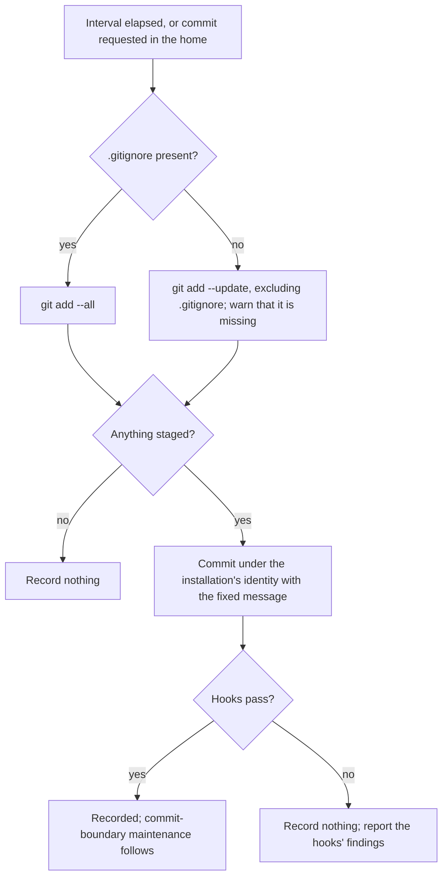

# Home Repository — Design

## Required reads

- @docs/local/spec/feature/reconciliation/home-repository.md

## Purpose

Realize the home's local history with git's own mechanics and one recorder. The
home's `.gitignore` is the only rule about what the history holds, and the home
snapshot is the only writer of that history. Both are owned by the
reconciliation context; the commit surface and the configuration writers own
nothing of it.

## Inputs/Outputs

| Input                        | Owner                               | Role                                                                        |
| ---------------------------- | ----------------------------------- | --------------------------------------------------------------------------- |
| The home's `.gitignore`      | reconciliation (home template)      | Admits the paths the history holds; written by installation and maintenance |
| The home's working tree      | its writers                         | What a snapshot records                                                     |
| The snapshot job             | reconciliation                      | Runs a snapshot at a fixed interval through the declarative job model       |
| A commit request in the home | agent_runtime (`telec repo commit`) | Runs a snapshot at once and reports its outcome                             |

| Output                     | Consumer                                                                       |
| -------------------------- | ------------------------------------------------------------------------------ |
| A snapshot commit, or none | The home's history                                                             |
| The snapshot outcome       | The structured log; the requester of an on-demand snapshot                     |
| A main-branch commit event | The home's commit-boundary maintenance, which publishes recorded documentation |

## Invariants

1. **The `.gitignore` is the boundary.** Git evaluates the home's live
   `.gitignore`; nothing evaluates the template or any copy of it a second time.
   The template is the file's only source, written into the home by
   installation and commit-boundary maintenance.
2. **One recorder.** Only the snapshot commits in the home. A commit requested
   through `telec repo commit` in the home runs the snapshot rather than a
   scoped commit, and configuration writers and migrations commit nothing there.
3. **A snapshot records everything admitted, or nothing.** It stages all
   admitted changes — additions, modifications and removals — and commits them
   in one commit under the installation's identity with a fixed message, or
   records nothing.
4. **The home's hooks still judge.** The snapshot commits through the home's
   installed commit hooks like any other commit.
5. **Git's own lock serializes.** The snapshot adds no lock of its own; git's
   index lock keeps it from interleaving with another commit.

## Primary flows

Without its `.gitignore` the home admits nothing new, so the snapshot stages
only changes to tracked material. It leaves the tracked `.gitignore` itself out
of that staging, so the missing file is restored by the next installation or
maintenance run instead of being recorded as removed.

## Failure modes

- **Hooks refuse.** A snapshot whose recorded content fails the home's hooks
  records nothing and reports the findings; the changes wait for the next
  snapshot. Until the content passes, every snapshot reports the same refusal.
- **Index locked.** A snapshot that finds git's index lock held records nothing
  that time; the next snapshot records the changes.
- **`.gitignore` missing.** Reported as a warning on every snapshot until the
  file is written again. A recurring warning means something removes the file.
- **Machine lost between snapshots.** Changes since the last snapshot are lost;
  the history has no remote.

## See Also

- docs/local/spec/domain/reconciliation.md — the context that owns the home's history.
- ~/.teleclaude/docs/general/design/configuration-tiers.md — how the home root is found, and why git plays no part in finding configuration.
- docs/local/spec/feature/agent_runtime/sealed-commit.md — the commit surface that runs the snapshot for a commit requested in the home.
