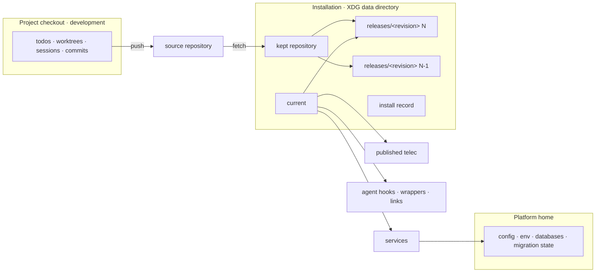

# Installation — Design

## Purpose

Give every change that touches how the platform is put on a machine, started,
updated or operated one account of where things live and how a revision becomes
live. Three places take part and none stands in for another:

- **The project** — a development checkout of the platform's repository, where
  todos, worktrees, sessions and commits live. It is registered like any other
  project and changes nothing live.
- **The installation** — what runs. Its rules — releases, the install act and
  rollback — are owned by reconciliation
  (`local/projects/teleclaude/spec/feature/reconciliation/installed-releases`,
  `local/projects/teleclaude/spec/domain/reconciliation`).
- **The platform home** — the configuration and state every installed release
  reads (`TELECLAUDE_HOME`).

This design owns the relationship between them: which live surface points where,
which state lives outside the code, and how the install act composes the
contracts of the contexts it crosses. It owns none of their rules.

## Inputs/Outputs

**Inputs**

- The source: the repository the installation was installed from, kept in the
  installation as one repository whose remote is that source.
- A target revision: named by the caller, or resolved by the installation's
  channel
  (`local/projects/teleclaude/spec/feature/reconciliation/channel-gated-self-update`).
- The platform home's configuration and state, including the migration state
  each migration system keeps there.

**Outputs**

- The installation, under the XDG data directory in the platform's own folder:
  the kept repository, one release per installed revision, the active-release
  pointer `current`, and the install record.
- Live surfaces bound to `current`: the service definitions, the published
  `telec`, the agent hook commands, the home-level wrappers, shell setup and
  shared-script links, and every path the runtime composes for a session.
- The install record: the active and previous release, whether state has
  migrated since the active release became active and which stores were
  changed or are unknown, and the
  outcome of the most recent act with its reason.



## Invariants

- **Nothing live names a release.** Every live surface and every path the
  runtime composes for a session addresses the active release through
  `current`, never through a release folder. Switching `current` therefore
  rewrites no service definition, hook command or link, and a release that is
  pruned breaks nothing that runs.
- **Runtime state lives outside every release.** The machine environment file,
  the daemon's process record, the install record and every store a migration
  changes live in the platform home or the installation root, never inside a
  release. A release holds code and the environment built from it, and nothing
  any other release needs.
- **The installation is never a project.** It is never registered, never
  discovered as a home, and never the working directory of an agent session.
  Runtime code that needs "the platform's project" resolves it through the
  project registry; work addressed to the platform itself runs in the platform
  home (`local/projects/teleclaude/spec/domain/agent_runtime`). Project-declared
  jobs and help desks stay with the project checkout that declares them.
- **A release is a full build, not a development tree.** A release worktree
  receives its complete environment and build; nothing treats it as a slug
  worktree, a linked development checkout or an owning-checkout lookup, and
  nothing commits in it.
- **The install act is the only path to live.** The bootstrap, the channel
  reaction, `telec app install` and the move off a project checkout all reach
  the live platform through it; a commit in any project reaches nothing live
  (`local/projects/teleclaude/spec/feature/integration/post-commit-maintenance`).
- **The installation reacts for itself.** The channel reaction to the source's
  pushes and releases is the installation's own, served by the running daemon;
  it does not depend on a project checkout being registered on the machine.
- **Lifecycle guarantees are unchanged.** `telec app` start, stop, restart and
  status carry the guarantees of
  `local/projects/teleclaude/policy/daemon-availability` and
  `local/projects/teleclaude/spec/feature/agent_runtime/daemon-lifecycle`;
  only what they address changes.

## Primary flows

### Install act

The act is reconciliation's; each step consumes the owning context's contract
and restates none of it.

```mermaid
sequenceDiagram
  participant Caller as bootstrap / channel reaction / telec app install
  participant Rec as reconciliation (install act)
  participant Rel as new release
  participant Life as daemon lifecycle
  participant Home as platform home
  Caller->>Rec: install(target)
  Rec->>Rec: refuse when target is older than the active release
  Rec->>Rel: fetch, add worktree at target, build environment (daemon serving)
  Rec->>Life: stop (preparation settles accepted work)
  Rec->>Rel: run ledger migrations, then open every store the daemon opens
  Rel-->>Rec: each owner: beginning / changed, unchanged or unknown
  Rel->>Home: migrate stores
  Rec->>Rec: switch current
  Rec->>Life: start; verify the daemon serves the new revision
  Rec->>Rec: record outcome and whether migrations ran, prune older releases
  Rec->>Rel: publish documentation and schemas from the installed commit
```

- **Prepare while serving.** Fetching, adding the release worktree and building
  its environment happen while the daemon keeps serving on the active release.
- **Migrate inside a stopped window, and let the owners say what ran.** The
  daemon is stopped through the lifecycle contract's preparation before any
  migration runs. The new release then runs its ledger-recorded migrations —
  installation migrations, configuration-document migrations
  (`local/projects/teleclaude/spec/feature/config/document-migration`) and the
  core database runner — and afterwards opens, through each store's own
  initialization, every store the daemon opens at startup — the event store,
  session mirrors and hook outbox among them — and every registered project's
  todo store, so open-time schema and data migrations run while no older reader
  serves. Each owner reports to the install act before it changes anything that
  it is beginning a migration, and afterwards what it did: changed its store,
  left it unchanged as the owner establishes, or had effects it cannot
  establish; an owner that cannot report counts as unknown
  (`local/projects/teleclaude/policy/single-database`). Configuration documents
  report through their per-document run outcome: migrated outcomes — committed,
  left uncommitted, written untracked — count as changed; current, withheld,
  restored after a refused commit, and failed outcomes whose contract leaves
  the document's bytes unchanged count as unchanged. The install migrated state
  exactly when some begun migration changed its store or is unknown; until then,
  no state has changed.
- **Switch, start, verify.** `current` is switched atomically, the service
  definitions are deployed only when their rendered content changed, and the
  start is verified against the new revision with admission open, as the
  lifecycle contract verifies any start. The install completes there.
- **Publication follows the install.** Publication of the installed commit's
  documentation
  (`local/projects/teleclaude/spec/feature/context/sync-pipeline-orchestration`)
  and of the configuration schemas
  (`local/projects/teleclaude/spec/feature/reconciliation/config-schema-publication`)
  runs after the completed install while the daemon serves. Each keeps its own
  partial-outcome contract; a failure is reported and replayed and never
  changes which release is active.

### Rollback

Rollback reads the install record. Store owners report every migration the
active release begins to that record, during the install and whenever the
active release first opens a store afterwards. When no migration has changed
state or had unknown effects since the active release became active, and a previous release is installed, it stops the daemon through the
lifecycle contract, switches `current` to the previous release, starts and
verifies, and records that no further rollback is available. Otherwise it
refuses and changes nothing.

### Channel reaction

The running daemon receives the source's relayed pushes and releases, selects
the target under the channel contract, and invokes the install act. The pending
convergence record keeps the target until the act completes, so a duplicate
signal installs nothing twice.

### Interim integrator judgment

The integrator integrates and pushes; the channel reaction installs the pushed
revision; the integrator then judges the runtime from the install record's
outcome and the log window from that install onwards
(`sdlc/procedure/lifecycle/integrate`).

### First install and the move off a checkout

The bootstrap checks prerequisites, creates the installation, installs the
source's latest release through the install act and publishes `telec`; services
are installed and the daemon started by `telec app start` once the
configuration is valid. Until a daemon serves the machine, `telec config` and the
terminal interface's configuration view execute configuration in their own
process (`local/projects/teleclaude/spec/domain/config`), so the platform can be
configured before its first start; the terminal interface then starts it. On a machine running from its project checkout, one run
creates the installation, moves the machine environment file into the platform
home, installs a release through the install act, and rebinds every live
surface to `current`; the checkout stays a registered project.

## Failure modes

- **Preparation fails** (fetch, worktree, build): nothing has stopped; the
  active release keeps serving and the failure is recorded.
- **Older target**: refused before anything is prepared.
- **Stop withheld** (preparation incomplete or withheld): no migration runs;
  the lifecycle contract's outcome is reported and the active release stays
  active.
- **A failure after the stop while no state has migrated** — including a
  refused migration whose owner establishes its store unchanged, and a start
  that does not verify after an install that migrated no state:
  `current`
  returns to the previously active release, the daemon is started on it and
  verified, and the failure is recorded.
- **A failure after state migrated** — a begun migration changed its store or
  its effects are unknown: `current`
  is left where the failure found it and the daemon stays stopped, because
  neither release is known to serve the partly migrated state; the install
  record names which stores were changed or are unknown, the reason is reported
  where `telec app status` shows it, and recovery is a forward repair followed
  by another install.
- **Publication fails after a completed install**: the daemon keeps serving the
  new release; the failure is recorded with the owning publisher's partial
  outcome and replayed.
- **A release folder disappears**: nothing live names it, so only a rollback to
  it is affected, and rollback refuses with that reason.
- **A store first opened after the install completes** migrates when the
  active release opens it; its owner reports that migration to the install
  record, and from then on rollback refuses. The stopped window opens every
  store the daemon opens at startup and every registered project's todo store,
  so that most migrations run inside it.
- **An owner cannot report to the install record**: the migration counts as
  having unknown effects, and rollback refuses.

## See Also

- docs/local/spec/feature/reconciliation/installed-releases.md
- docs/local/policy/agent-service-control.md
- docs/local/policy/daemon-availability.md
- docs/local/adr/0130-the-platform-runs-from-an-installation-not-its-project.md — why the platform runs from an installation and a commit changes nothing live.
