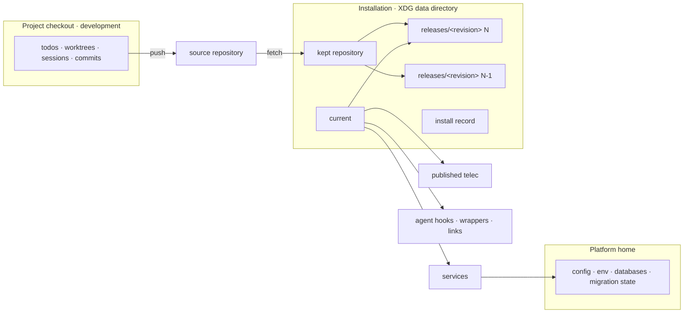
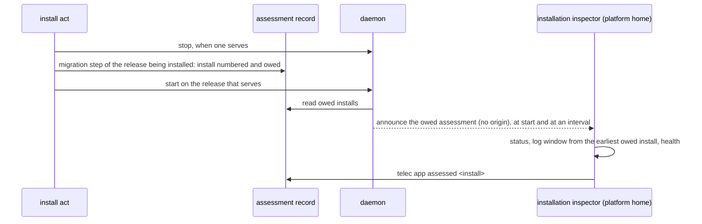

# Installation — Design

## Purpose

Give every change that touches how the platform is put on a machine, started,
updated or operated one account of where things live and how a revision becomes
live. Three places take part and none stands in for another:

- **The project** — a development checkout of the platform's repository, where
  todos, worktrees, sessions and commits live. It is registered like any other
  project and changes nothing live.
- **The installation** — what runs. Its rules — releases, the install act and
  rollback — are owned by reconciliation
  (`local/projects/teleclaude/spec/feature/reconciliation/installed-releases`,
  `local/projects/teleclaude/spec/domain/reconciliation`).
- **The platform home** — the configuration and state every installed release
  reads (`TELECLAUDE_HOME`).

This design owns the relationship between them: which live surface points where,
which state lives outside the code, and how the install act composes the
contracts of the contexts it crosses. It owns none of their rules.

## Inputs/Outputs

**Inputs**

- The source: the repository the installation was installed from, kept in the
  installation as one repository whose remote is that source.
- A target revision: named by the caller, or resolved by the installation's
  channel
  (`local/projects/teleclaude/spec/feature/reconciliation/channel-gated-self-update`).
- The platform home's configuration and state, including the migration state
  each migration system keeps there.

**Outputs**

- The installation, under the XDG data directory in the platform's own folder:
  the kept repository, one release per installed revision, the active-release
  pointer `current`, and the install record.
- Live surfaces bound to `current`: the service definitions, the published
  `telec`, the agent hook commands, the home-level wrappers, shell setup and
  shared-script links, and every path the runtime composes for a session.
- The install record: the active and previous release, whether any migration
  has started since the active release became active and in which stores, and
  the outcome of the most recent act with its reason.

- The assessment record, beside the install record: the installs whose
  assessment is owed, and the most recent recorded assessment with the install
  it covered.
- The owed-assessment announcement: a platform event, with no origin, emitted
  by the daemon at each start and at a fixed interval while an install is owed.



## Invariants

- **Nothing live names a release.** Every live surface and every path the
  runtime composes for a session addresses the active release through
  `current`, never through a release folder. Switching `current` therefore
  rewrites no service definition, hook command or link. A running terminal
  interface is the one process that holds the release it started from; the
  install act moves it to the new release and keeps its release installed
  while it still runs there
  (`local/projects/teleclaude/spec/feature/reconciliation/installed-releases`),
  so a release that is pruned breaks nothing that runs.

- **Runtime state lives outside every release.** The machine environment file,
  the daemon's process record, the install record and every store a migration
  changes live in the platform home or the installation root, never inside a
  release. A release holds code and the environment built from it, and nothing
  any other release needs.
- **The installation is never a project.** It is never registered, never
  discovered as a home, and never the working directory of an agent session.
  Runtime code that needs "the platform's project" resolves it through the
  project registry; work addressed to the platform itself runs in the platform
  home (`local/projects/teleclaude/spec/domain/agent_runtime`). Project-declared
  jobs and help desks stay with the project checkout that declares them.
- **A release is a full build, not a development tree.** A release worktree
  receives its complete environment and build; nothing treats it as a slug
  worktree, a linked development checkout or an owning-checkout lookup, and
  nothing commits in it.
- **The install act is the only path to live.** The bootstrap, the channel
  reaction, `telec app install` and the move off a project checkout all reach
  the live platform through it; a commit in any project reaches nothing live
  (`local/projects/teleclaude/spec/feature/integration/post-commit-maintenance`).
- **The installation reacts for itself.** The channel reaction to its source is
  the installation's own, served by the running daemon;
  it does not depend on a project checkout being registered on the machine.
- **Lifecycle guarantees are unchanged.** `telec app` start, stop, restart and
  status carry the guarantees of
  `local/projects/teleclaude/policy/daemon-availability` and
  `local/projects/teleclaude/spec/feature/agent_runtime/daemon-lifecycle`;
  only what they address changes.

## Primary flows

### Install act

The act is reconciliation's; each step consumes the owning context's contract
and restates none of it.

```mermaid
sequenceDiagram
  participant Caller as bootstrap / channel reaction / telec app install
  participant Rec as reconciliation (install act)
  participant Rel as new release
  participant Life as daemon lifecycle
  participant Home as platform home
  participant TUI as presentation (TUI registry)
  Caller->>Rec: install(target)
  Rec->>Rec: refuse when target is older than the active release
  Rec->>Rel: fetch, add worktree at target, build environment (daemon serving)
  Rec->>Life: stop (preparation settles accepted work)
  Rec->>Rel: run ledger migrations, then open every store the daemon opens
  Rel-->>Rec: each owner: starting a migration
  Rel->>Home: migrate stores
  Rec->>Rec: switch current
  Rec->>Life: start; verify the daemon serves the new revision
  Rec->>Rec: record outcome and whether migrations ran
  Rec->>TUI: reload every running terminal interface
  Rec->>TUI: read the releases running terminal interfaces hold
  Rec->>Rec: prune older releases no running terminal interface holds
  Rec->>Rel: publish schemas, and documentation where no platform checkout does
```

- **Prepare while serving.** Fetching, adding the release worktree and building
  its environment happen while the daemon keeps serving on the active release,
  and the built release then prepares this computer's local Redis by installing
  its server binary when missing; that step never fails the install.
- **Migrate inside a stopped window, and let the owners say what ran.** The
  daemon is stopped through the lifecycle contract's preparation before any
  migration runs. Before its first migration the new release prepares the
  machine for itself: it carries machine environment values whose names the
  configuration schema renamed to their current names, and sets up this
  computer's local Redis (`local/projects/teleclaude/design/architecture/event-delivery`).
  Setting it up writes its configuration and its unit, which the installation
  owns and which stopping the daemon leaves running; it never fails the install,
  and a refusal leaves local events on the cluster Redis. The new release
  then runs its ledger-recorded migrations —
  installation migrations, configuration-document migrations
  (`local/projects/teleclaude/spec/feature/config/document-migration`) and the
  core database runner — and afterwards opens, through each store's own
  initialization, every store the daemon opens at startup — the event store,
  session mirrors and hook outbox among them — and every registered project's
  todo store, so open-time schema and data migrations run while no older reader
  serves. Each owner signals to the install act, before it changes anything,
  that it is starting a migration; an owner that cannot signal counts as having
  started one (`local/projects/teleclaude/spec/feature/reconciliation/installed-releases`). The ledger
  runners already know when they start one; the stores that migrate when opened
  emit the same signal. The configuration owner signals from its document
  migration runner before it migrates each document, whether an install or a
  later writer triggers it
  (`local/projects/teleclaude/spec/feature/config/document-migration`). Any
  started migration counts as having changed state, whatever it
  did; until the first signal, no state has changed.
- **Switch, start, verify.** `current` is switched atomically, the service
  definitions are deployed only when their rendered content changed, and the
  start is verified against the new revision with admission open, as the
  lifecycle contract verifies any start. The install completes there.
- **The ingress receiver outlives the daemon.** On an ingress computer that has
  turned its receiver on (`computer.ingress_receiver`), the service definitions
  include the webhook receiver's
  (`local/projects/teleclaude/spec/feature/integration/single-ingress-webhook-termination`):
  a unit that holds its listening socket and a unit for the receiver process.
  They are deployed, only when their content changed, or withdrawn before the
  daemon is started or restarted, and are never stopped with the daemon; the
  daemon serves the inbound endpoints only while they are absent. A start that
  finds the daemon running leaves the units as they are until its next restart.
  A failed deployment or withdrawal fails a start; at a restart the units are
  withdrawn instead, so the restarted daemon serves the endpoints itself. A
  restart that changes the units under launchd first takes the daemon out of
  launchd, so no relaunch runs while they change and the daemon starts afresh
  on them. The
  receiver follows the active-release pointer: when the pointer moves, it exits
  and its service manager starts it again on the new release while the socket
  stays open. On a computer that is no longer the ingress, deployment removes
  the receiver's units. Switching to a release that cannot run them, by
  rollback or by an install's recovery, first removes them through the outgoing
  release, so the earlier release's daemon serves the inbound endpoints on its
  port again; a removal that fails leaves the active release in place.
- **Move running terminal interfaces, then prune.** The completed act sends
  presentation's reload signal to every terminal interface its registry records
  (`local/projects/teleclaude/design/architecture/tui-state-layout`), then
  prunes against the releases the registry's records name as well as the
  active and previous ones; which releases stay installed is
  `local/projects/teleclaude/spec/feature/reconciliation/installed-releases`'s.
  An interface still on its old release at prune time keeps that release until
  a later install finds it moved.

- **Publication follows the install.** Publication of the configuration
  schemas
  (`local/projects/teleclaude/spec/feature/reconciliation/config-schema-publication`)
  and of the installed commit's documentation and agent artifacts
  (`local/projects/teleclaude/spec/feature/context/sync-pipeline-orchestration`)
  runs after the completed install while the daemon serves. Each keeps its own
  partial-outcome contract; a failure is reported and replayed and never
  changes which release is active. The documentation is the installed
  release's only on a machine with no project checkout of the platform; where
  that checkout is registered, it publishes the platform's documentation from
  its own commits on main, and an install leaves it in place.

### Rollback

Rollback reads the install record. Store owners signal every migration the
active release starts to that record, during the install and whenever the
active release first opens a store afterwards. When no migration has started
since the active release became active, and a previous release is installed, it stops the daemon through the
lifecycle contract, switches `current` to the previous release, starts and
verifies, and records that no further rollback is available. Otherwise it
refuses and changes nothing.

### Channel reaction

The running daemon reacts to the signals its channel contract names
(`local/projects/teleclaude/spec/feature/reconciliation/channel-gated-self-update`),
selects the target under that contract, and invokes the install act. The
pending convergence record keeps the target until the act completes, so a
duplicate signal installs nothing twice.

### Assessment after an install

Every install that opens its stopped window, initial provisioning included,
owes the installation inspector's assessment of the release that runs after it
(`local/projects/teleclaude/spec/feature/reconciliation/installed-releases`).
The obligation belongs to the installation, so the route that reached the act
and whether the machine performs source integration make no difference.



- **Owed inside the stopped window, by the release being installed.** The
  install act that runs is the active release's, but the stopped window's
  migration step runs with the interpreter of the release being installed. That
  step first numbers the install and writes it as owed to the assessment
  record, before any migration, so the obligation is recorded before the
  restart even when an older release's installer performs the install, and
  every outcome after that — completed, returned to the previous release, or
  left stopped — leaves it owed. A write that fails ends the step as a certain
  failure, which the install act recovers as any failure inside the window:
  returned only when no migration has started, an earlier failed window's
  included.
- **Announced while owed.** The daemon reads the assessment record when it
  starts, and again at a fixed interval, and emits the owed-assessment
  announcement each time an install is owed. The repetition covers an
  announcement that reached no subscriber, as on a machine whose installation
  publishes the assessment procedure only after the verified start.
  The announcement activates `sdlc/procedure/maintenance/installation/overview`
  in the platform home of the computer that emitted it
  (`local/projects/teleclaude/design/architecture/procedure-activation`); its
  one standing agent owns every owed assessment of the installation.
- **Discharged by recording.** `telec app assessed <install>` discharges the
  install with that number and every earlier owed one, and leaves a later
  install owed, including a later attempt at the same revision. It refuses while the daemon does not serve the active release.
- **A daemon that does not return** announces nothing; the install stays owed
  in the assessment record and in `telec app status` beside the act's failure, and no
  assessment is recorded for a runtime nobody observed.

### First install and the move off a checkout

The bootstrap checks prerequisites, creates the installation, installs the
source's latest release through the install act and publishes `telec`. On a machine
with no installed release and no daemon serving, that initial provisioning has
nothing to stop or verify: it prepares the release, creates its stores,
switches `current` and publishes `telec`. Every other install — an existing
installation whose daemon is stopped included — starts the daemon on the new
release and verifies it. Services are installed and the daemon started by `telec app start` once
the configuration is valid. Until a daemon serves the machine, `telec config` and the
terminal interface's configuration view execute configuration in their own
process (`local/projects/teleclaude/spec/domain/config`), so the platform can be
configured before its first start; the terminal interface then starts it. On a machine running from its project checkout, one run
creates the installation, moves the machine environment file into the platform
home, installs a release through the install act — a controlled restart: the
checkout's daemon is stopped through its lifecycle, the release migrates,
every live surface is rebound to `current`, and the start is verified — and the
checkout stays a registered project.

## Failure modes

- **Preparation fails** (fetch, worktree, build): nothing has stopped; the
  active release keeps serving and the failure is recorded.
- **Older target**: refused before anything is prepared.
- **Stop withheld** (preparation incomplete or withheld): no migration runs;
  the lifecycle contract's outcome is reported and the active release stays
  active.

- **A failure after the stop before any migration started** — including a
  start that does not verify after an install in which no migration started:
  the attempted daemon is stopped through its lifecycle first. While nothing
  answers on its request surface, its stop is asked again within a bound, until
  the daemon can be prepared or has exited. Then `current` returns to the
  previously active release, the daemon is started on it and verified, and the
  failure is recorded.
- **The attempted daemon cannot be stopped** — its stop stays withheld past
  that bound, or is withheld while it answers: `current` stays on the attempted
  release and its daemon is left running, because a daemon whose preparation is
  not established is never terminated
  (`local/projects/teleclaude/policy/agent-service-control`). The failure is
  recorded where `telec app status` shows it. While no migration has started,
  rollback returns the platform once that daemon can be stopped.

- **A failure after a migration started**: `current`
  is left where the failure found it and the daemon stays stopped, because
  neither release is known to serve the partly migrated state; the install
  record names which stores its migrations reached, the reason is reported
  where `telec app status` shows it, and recovery is a forward repair followed
  by another install.
- **Publication fails after a completed install**: the daemon keeps serving the
  new release; the failure is recorded with the owning publisher's partial
  outcome and replayed.
- **A release folder disappears**: nothing live names it, so only a rollback to
  it is affected, and rollback refuses with that reason.

- **A running terminal interface does not move**: its reload signal is
  refused, or it has not yet reloaded when the act prunes. Its registry record
  still names its release, so that release stays installed, and the first
  install that finds the interface on newer code removes it. An act that
  cannot read the registry, or finds a running interface whose record names
  no release, prunes no release.

- **A store first opened after the install completes** migrates when the
  active release opens it; its owner signals that migration to the install
  record, and from then on rollback refuses. The stopped window opens every
  store the daemon opens at startup and every registered project's todo store,
  so that most migrations run inside it.
- **An owner cannot signal to the install record**: the migration counts as
  started, and rollback refuses.
- **A release before the receiver's switch cannot activate it.** The receiver
  is turned on only by its machine setting, after a release that has the
  receiver is active; the first install of such a release changes nothing for
  intake, so its recovery, run by the release before it, has no receiver units
  to meet.

## See Also

- docs/local/spec/feature/reconciliation/installed-releases.md
- docs/local/policy/agent-service-control.md
- docs/local/policy/daemon-availability.md
- docs/local/adr/0130-the-platform-runs-from-an-installation-not-its-project.md — why the platform runs from an installation and a commit changes nothing live.
- docs/local/adr/0150-the-service-manager-holds-the-webhook-receivers-listening-socket.md — why the receiver's unit holds its socket across receiver restarts.

- docs/local/adr/0131-the-platforms-documentation-publishes-from-its-project-commits.md — why the platform's documentation publishes from its project's commits and from an install only where no platform checkout does.
