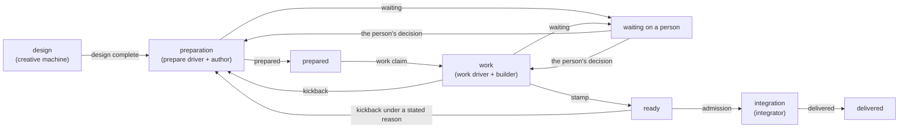

# Lifecycle State Machines — Design

## Purpose

An item's lifecycle is driven by four machines, each owning a distinct lane. A session calls a machine through its entry verb, and the machine either starts the driver of the item's phase or returns the instruction for the phase to the driver that holds the item.

| Lane        | Machine                 | Entry                                                    | Contract                                                                                                                                                                                                          |
| ----------- | ----------------------- | -------------------------------------------------------- | ----------------------------------------------------------------------------------------------------------------------------------------------------------------------------------------------------------------- |
| Item        | the workflow machine    | `telec todo prepare <item>`, `telec todo work <item>`    | `local/projects/teleclaude/spec/feature/workflow/item-lifecycle`, `local/projects/teleclaude/spec/feature/workflow/work-review-cycle`; mechanism `local/projects/teleclaude/design/architecture/workflow-machine` |
| Creative    | the creative machine    | `telec todo design <item>`                               | `creative/design/creative-machine`                                                                                                                                                                                |
| Task        | the task lane           | the lifecycle runner                                     | `sdlc/spec/todo-kind-task`, `local/projects/teleclaude/spec/feature/workflow/work-state-machine`                                                                                                                  |
| Integration | the integration machine | the integrator's trigger and its periodic candidate scan | `local/projects/teleclaude/spec/feature/workflow/integration-state-machine`; design `local/projects/teleclaude/design/architecture/integration-state-machine`                                                     |

The item machine drives preparation and work with two sessions per phase: a driver that holds the item's claim and decides readiness, and a child that owns the artifact. The preparation driver is `sdlc/procedure/lifecycle/prepare/overview-v2` and dispatches the author `sdlc/procedure/lifecycle/prepare/intake-v2`; the work driver is `sdlc/procedure/lifecycle/work/overview-v2` and dispatches the builder `sdlc/procedure/lifecycle/work/build-v2`. Which procedure drives which phase, the child it dispatches and the acts that end the phase come from those procedures' declarations.

How the entry verbs route a request between these lanes, and how an item's worktree is ensured, is `local/projects/teleclaude/design/architecture/next-machine`.

## Inputs/Outputs

**Inputs:**

- the item's stored state, read through the workflow store port (`local/projects/teleclaude/design/architecture/workflow-store`);
- the published procedure declarations;
- entry verb calls from sessions and driver requests from the lifecycle runner;
- events about items, delivered to the session bound to the item by procedure activation.

**Outputs:**

- driver sessions started for an item's phase, and the instruction each driver receives;
- acts recorded on the item's ledger, with the log as their prose rendering;
- events for phase changes, claim changes, waiting, readiness and head advances;
- delivered commits on canonical `main`, with delivery bookkeeping.

## Invariants

- **Lanes are disjoint.** A todo of kind task is driven by the task lane whatever its stored phase; an item the creative lane drives reads as `design` until its design is complete; `ready` after admission and `delivered` are the integrator's. The item machine drives the remaining phases (`local/projects/teleclaude/spec/feature/workflow/item-lifecycle`).
- **One driving procedure per phase.** Every phase the item machine drives has exactly one driving procedure, enforced at documentation validation.
- **One reader of phases.** Every consumer reads an item's phase through the same reading, so no consumer sees an item in a phase another consumer would not (`local/projects/teleclaude/design/architecture/workflow-machine`).
- **Dependency gating.** No driver is started for an item whose dependencies have not cleared its lane (`local/projects/teleclaude/spec/feature/workflow/dependency-graph`).
- **Integration serialization.** Only one integrator pushes `main` at a time, under a singleton lease.
- **Crash recovery.** Every machine resumes from durable state; an act of the item machine records its pending effects and completes them after a crash.

## Primary flows

### An item through its lifecycle



### How the machines connect

```mermaid
sequenceDiagram
    participant C as Caller or lifecycle runner
    participant M as Item machine
    participant A as Procedure activation
    participant D as Driver
    participant I as Integrator

    C->>M: telec todo prepare / work <item>
    M->>A: driver requested for the item's phase
    A->>D: start the driver bound to the item
    D->>M: entry call: claim, then the instruction
    D->>D: dispatch the child, judge its output, perform the ending act
    D->>M: stamp at the integration head
    M-->>I: ready notice; the candidate scan finds the item with or without it
    I->>I: admit, merge, push, deliver
```

## Failure modes

- **A phase with no driving procedure, or two.** Refused at documentation validation; no published state leaves an item in a phase nothing drives.
- **A driver that ends mid-phase.** Its claim is released through the session-end path and the next driver resumes from the store alone (`local/projects/teleclaude/design/architecture/workflow-machine`).
- **A stamp that goes stale before admission.** The item reads as `work` again and a stamp at the new head is required (`local/projects/teleclaude/spec/feature/workflow/work-review-cycle`).
- **A ready notice that never arrives.** The integrator's periodic candidate scan admits the item anyway.
- **Integration contention.** Serialized by the integrator's lease; candidates are taken in order of their ready time.
