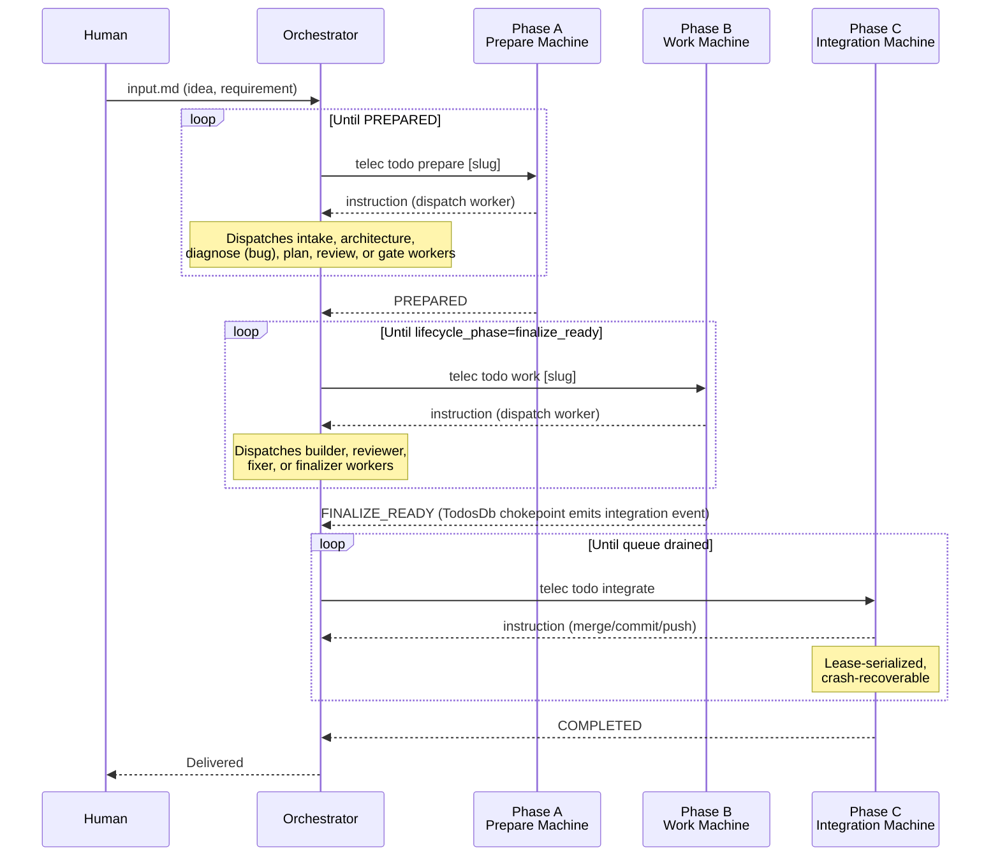
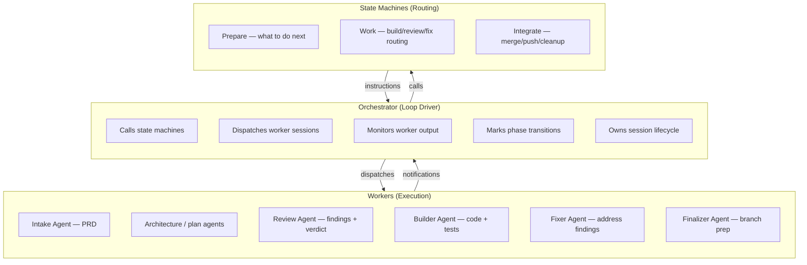

# Lifecycle State Machines — Design

## Purpose

TeleClaude's software development lifecycle is driven by three deterministic state machines, each governing a distinct phase of delivery. The orchestrator calls a machine, executes the returned instruction (typically dispatching a worker session), then calls again. This loop continues until a terminal state.

| Phase | Name                                      | State Machine                    | Entry Point                   | Purpose                                             |
| ----- | ----------------------------------------- | -------------------------------- | ----------------------------- | --------------------------------------------------- |
| **A** | [Prepare](prepare-flow.md)                | `lifecycle_phase` (prepare lane) | `telec todo prepare [slug]`   | Define PRD, architecture, and implementation plan   |
| **B** | [Work](work-state-machine.md)             | `lifecycle_phase` (work lane)    | `telec todo work [slug]`      | Build, review, fix, and finalize the implementation |
| **C** | [Integrate](integration-state-machine.md) | `IntegrationPhase` (12 states)   | `telec todo integrate [slug]` | Merge to main, push, deliver                        |

### Referenced files

| File                                                                                                       | Purpose                                     |
| ---------------------------------------------------------------------------------------------------------- | ------------------------------------------- |
| [`teleclaude/core/next_machine/core.py`](../../../../teleclaude/core/next_machine/core.py)                 | Prepare + Work state machine implementation |
| [`teleclaude/core/integration/state_machine.py`](../../../../teleclaude/core/integration/state_machine.py) | Integration state machine implementation    |

| [`teleclaude/core/integration/candidate_scan.py`](../../../../teleclaude/core/integration/candidate_scan.py) | FIFO candidate discovery by worktree-state scan |

| [`teleclaude/core/integration/lease.py`](../../../../teleclaude/core/integration/lease.py) | Singleton lease for integration serialization |

### Referenced doc snippets

| Snippet ID                                                | Content                                     |
| --------------------------------------------------------- | ------------------------------------------- |
| `sdlc/procedure/lifecycle-overview`                       | Full lifecycle phases and handoffs          |
| `general/procedure/orchestration`                         | Orchestration loop and dispatch rules       |
| `local/projects/teleclaude/spec/integration-orchestrator` | Integration contract (events, lease, queue) |

## Inputs/Outputs

**Inputs:**

`telec todo artifacts list {slug}` shows the following artifacts:

- `input` — human idea or requirement (Phase A entry)
- `prd` — product contract (Phase A output, Phase B input)
- `architecture` — optional thin index/log of the architecture doc-snippet edits (Phase A output, Phase B input)
- `implementation-plan` — technical design (Phase A output, Phase B input)

**Outputs:**

- Instruction blocks for the orchestrator to execute (dispatch worker, mark phase, handoff)
- Lifecycle events at each phase transition (consumed by automation and notifications)
- Delivered code on canonical `main` (Phase C pushes from integration worktree)
- Delivery bookkeeping (todo list updates and cleanup)

## Invariants

- **Deterministic routing**: given the same persisted evidence and `lifecycle_phase`, the same instruction is produced.
- **Sequential phases**: Prepare → Work → Integrate. No phase skipping.
- **Artifact immutability**: machines never modify artifacts directly; they delegate to workers.
- **Dependency blocking**: cannot claim a work item until all its dependencies are complete.
- **Integration serialization**: only one integrator pushes `main` at a time, enforced by a singleton lease.

<!-- planned:single-orchestrator-concurrent-starts -->

- **One orchestrator per todo on a computer**: every start of a lifecycle orchestrator for a todo — a session create door or a lifecycle operation adopting its caller — passes its live-holder check and the creation or claim it admits inside one in-process critical section per project and todo, whatever its lane, so at most one live orchestrator holds the todo. The section records nothing; the session registry and `active_runner` remain the ownership facts (`local/projects/teleclaude/adr/0133-concurrent-driver-starts-serialize-in-process-at-the-start-doors`, `local/projects/teleclaude/adr/0134-a-colliding-driver-start-is-refused-without-waiting`).

<!-- /planned:single-orchestrator-concurrent-starts -->

<!-- planned:single-orchestrator-across-computers -->

- **One orchestrator per todo across computers**: for a project on the GitHub workflow store, the fleet's master admits every orchestrator start of a todo, from any computer, one at a time, and records the claim naming the session and its computer before the session is created or claimed; the starting computer holds its own admission section across that admission. Only the computer a claim names judges whether the claim has ended; every other computer treats it as held. A start that finds the todo held is refused naming the holding session and its computer.

<!-- /planned:single-orchestrator-across-computers -->

- **Crash recovery**: all three machines are re-entrant. Re-calling after a crash resumes from durable state.

## Primary flows

### End-to-end flow

```mermaid
flowchart LR
    subgraph "Phase A — Prepare"
        Input["input"] --> Intake["Intake<br/>PRD"]
        Intake --> PRDReview["PRD<br/>Review"]
        PRDReview --> Architecture["Architecture<br/>(or skip)"]
        Architecture --> PlanDraft["Plan<br/>Drafting"]
        PlanDraft --> PlanReview["Plan<br/>Review"]
        PlanReview --> Gate["DOR<br/>Gate"]
        Gate --> Grounding["Grounding<br/>Check"]
    end

    subgraph "Phase B — Work"
        Build --> Review
        Review -->|"changes requested"| Fix
        Fix --> Review
        Review -->|"approved"| Finalize
    end

    subgraph "Phase C — Integrate"
        Queue["FIFO Queue"] --> Merge["Squash<br/>Merge"]
        Merge --> Push["Push to<br/>main"]
        Push --> Cleanup
    end

    Grounding -->|"PREPARED"| Build
    Finalize -->|"handoff"| Queue
    Cleanup -->|"delivered"| Done["Done"]
```

### How the machines connect

The orchestrator drives each machine in a loop. Phase boundaries are event-driven handoffs — Phase B emits integration readiness events that Phase C consumes via a durable queue.

### Roles and responsibilities

The orchestrator never makes routing decisions — the machines own sequencing. The orchestrator dispatches what is requested.

### Worker dispatch pattern

Workers are dispatched via `telec sessions run`. The machine names the procedure;
the procedure's `dispatch` declaration supplies the agent preference and thinking
mode, and an explicit caller mode overrides it
(`local/projects/teleclaude/spec/feature/agent_runtime/role-aware-agent-dispatch`).
The prepare orchestrator performs intake, architecture and planning in its own
session; the sessions below are the ones a machine dispatches.

| Phase    | Worker Role    | Command                                                                                                                                               |
| -------- | -------------- | ----------------------------------------------------------------------------------------------------------------------------------------------------- |
| Prepare  | Diagnoser      | `sdlc/procedure/lifecycle/prepare/diagnose-peer` (bug)                                                                                                |
| Prepare  | Drift Analyzer | `sdlc/procedure/lifecycle/prepare/drift-analyze`                                                                                                      |
| Prepare  | Reviewer       | `sdlc/procedure/lifecycle/prepare/review-prd`, `sdlc/procedure/lifecycle/prepare/review-architecture`, `sdlc/procedure/lifecycle/prepare/review-plan` |
| Build    | Builder        | `sdlc/procedure/lifecycle/work/build` (all kinds, incl. bug)                                                                                          |
| Review   | Reviewer       | `sdlc/procedure/lifecycle/work/review-build`                                                                                                          |
| Fix      | Fixer          | _(no dispatch — the orchestrator relays the review-findings artifact to the existing builder session)_                                                |
| Finalize | Finalizer      | `sdlc/procedure/lifecycle/work/finalize`                                                                                                              |

### Detailed documentation

Each state machine has its own design document with full state diagrams, sequence diagrams, flow diagrams, and command cross-references:

1. **[Prepare Flow](prepare-flow.md)** — Phase A: PRD → Architecture → Plan, from idea to implementation-ready artifacts
2. **[Work State Machine](work-state-machine.md)** — Phase B: Build/review/fix/finalize routing with quality gates
3. **[Integration State Machine](integration-state-machine.md)** — Phase C: 12 states, lease-serialized merge-to-main delivery

## Failure modes

- **No todo list**: cannot discover work items. Returns error instructing user to create a todo.
- **Dependency cycle**: circular dependencies detected. Logs error, refuses to dispatch.
- **All agents unavailable**: hard error. If some are degraded, notes in guidance and lets orchestrator decide.
- **Worker crash**: orchestrator retries once, then escalates.
- **Phase mark failure**: worker must commit before marking phase.
- **Integration contention**: serialized by lease; concurrent candidates are queued in FIFO order.

<!-- planned:single-orchestrator-concurrent-starts -->

- **Concurrent orchestrator starts**: orchestrator starts of one todo on one computer are decided one at a time; the first creates or claims the orchestrator and each later one is refused naming it. A start that arrives while another is being decided does not wait; it is refused as busy, naming the session being started. Starts on different computers sharing one workflow store are not serialized against each other.
- **Orchestrator stranded in initializing**: an orchestrator session counts as the todo's holder from its creation, so one whose bootstrap failed keeps holding the todo until it is ended; the bootstrap failure is published for a person to act on.

<!-- /planned:single-orchestrator-concurrent-starts -->

<!-- planned:single-orchestrator-across-computers -->

- **Holder's computer does not answer**: a claim naming a computer that does not answer the master stays held, and a start of that todo is refused naming the session and its computer; the todo can be started again once that computer reports the session ended.
- **No master to admit a start**: while no unique live master holds the project and answers, starts of a GitHub-backed todo on other computers are refused naming why and create nothing, and lifecycle runner passes skip those todos.
- **Admission answered but the start failed**: a claim the master recorded for a start that never created or claimed its session is reported ended by its computer once that start has given up, and is cleared at the next admission or by that computer's reconciliation.

<!-- /planned:single-orchestrator-across-computers -->

- **Stale artifacts**: PRD or architecture updated but downstream artifacts not regenerated. Grounding check catches and triggers re-grounding.
- **Stale artifacts**: PRD or architecture updated but downstream artifacts not regenerated. Grounding check catches and triggers re-grounding.

## See Also

- docs/local/adr/0135-github-backed-driver-starts-are-admitted-by-the-mesh-master.md
