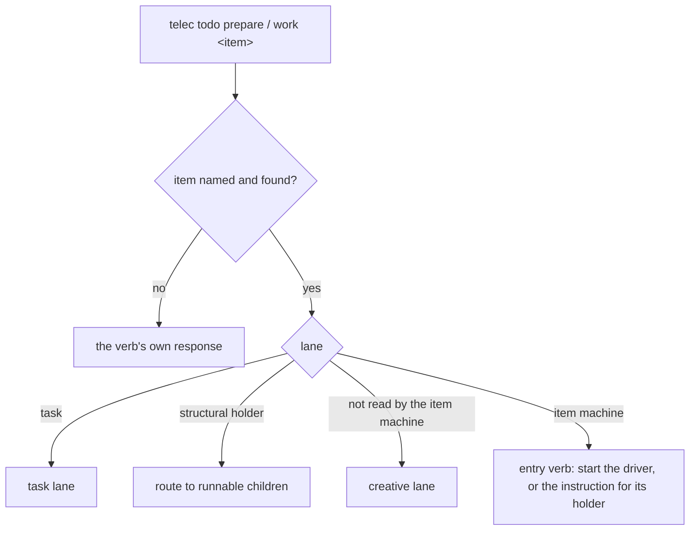
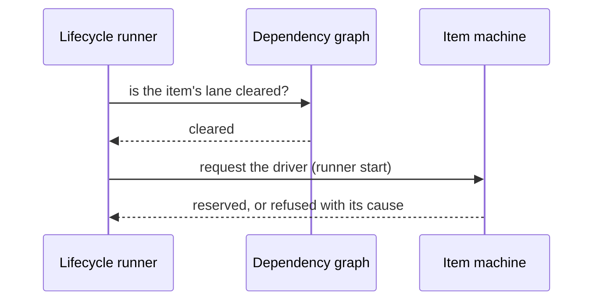

# Next Machine — Design

## Purpose

The next machine is the lifecycle layer that surrounds the item machine (`local/projects/teleclaude/design/architecture/workflow-machine`). It owns three things the item machine does not:

1. **Routing an entry request by lane.** `telec todo prepare` and `telec todo work` are receipt-backed operations. For an item the item machine reads, the operation calls the machine's entry verb and reports what it returned (`local/projects/teleclaude/spec/feature/workflow/item-acts`). A todo of kind task, a structural holder, and an item the machine does not read keep their own lane's path: the task lane, the holder's routing to its children, and the creative lane.
2. **Requesting drivers for eligible work.** The lifecycle runner evaluates a project's todos, gates each by its dependencies, and requests the driver of an eligible item through the same entry verb a session calls, as a runner start; the machine decides the start. A task's drivers are the task procedures, which the runner starts itself.
3. **Ensuring the item's worktree.** Work runs in the item's own worktree, created and prepared on demand (`local/projects/teleclaude/spec/feature/workflow/worktree-prep-lifecycle`).

The responses an entry verb gives outside the item machine — a call without an item, an item that does not exist, a structural holder, a task — are `local/projects/teleclaude/spec/feature/workflow/prepare-state-machine` for preparation and `local/projects/teleclaude/spec/feature/workflow/work-state-machine` for work.

## Inputs/Outputs

**Inputs:**

- the entry operation's item and calling session;
- the item's stored state and kind, and the project's dependency graph, read through the workflow store port;
- the lifecycle runner's evaluation of the project's todo set.

**Outputs:**

- for an item the machine reads, the item machine's result: the started driver's session, the instruction for the holding driver, or the one cause it refused with;
- for any other item, its lane's response;
- a worktree branched and prepared for an item in work.

## Invariants

- **Lanes route before the machine.** A todo of kind task never reaches the item machine's entry verb from this layer, and neither does a structural holder or an item whose phase the machine does not read.
- **One door for a driver start.** A session's call and the lifecycle runner's request reach the same entry verb; the runner's origin is decided inside the write that reserves the driver (`local/projects/teleclaude/spec/feature/workflow/item-lifecycle`, Hold).
- **Dependency blocking.** No driver is requested for an item whose dependencies have not cleared its lane (`local/projects/teleclaude/spec/feature/workflow/dependency-graph`).
- **Worktree preparation is single-flight per item.** At most one ensure-and-prepare runs for an item on a computer at a time, whichever path triggers it (`local/projects/teleclaude/design/architecture/workflow-machine`, `local/projects/teleclaude/spec/feature/workflow/worktree-prep-lifecycle`).
- **Conditional preparation.** A worktree is prepared when it is new or its preparation inputs changed; unchanged known-good worktrees are reused.
- **Git requirement.** Every item lives in git so its worktree can be created from the shared branch.

## Primary flows

### Routing an entry request

### The lifecycle runner

## Failure modes

- **A driver request the machine refuses** is logged with the item, lane and cause; one failing request does not stop the runner's pass.
- **An item whose integration head cannot be read** is refused a driver start naming that cause (`local/projects/teleclaude/spec/feature/workflow/item-lifecycle`).
- **Worktree preparation fails.** The ensure reports the failure with its cause; the next trigger retries it under the same single-flight rule.
- **Git not available.** Worktree commands fail and the request returns the error.
