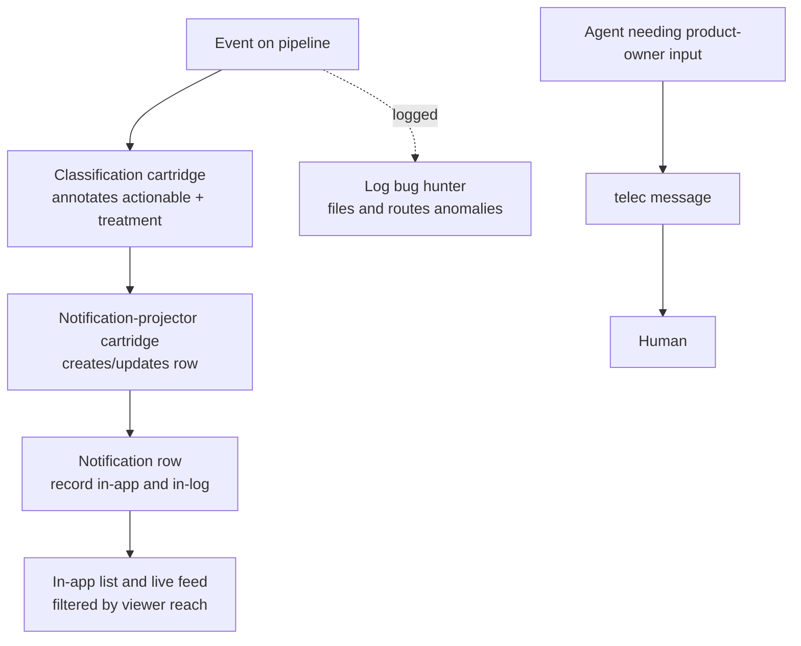

# Notification Delivery — Design

## Required reads

@docs/local/design/process-lifecycle.md

## Purpose

The platform emits a broad stream of events. Every projected event becomes a
notification row that stays visible in-app and in-log. No event interrupts a
human: the event pipeline pushes nothing to Telegram, Discord, WhatsApp, or
email.

Operational anomalies — failed or stalled jobs, dead-lettered events, failed
session bootstraps, failure cascades, degraded entities — belong to
intelligence. They remain in the event stream and the logs, where the log bug
hunter picks them up and routes them into the bug lifecycle. Normal workflow
produces no human notification either: no approval-pending notice and no
success outcome.

A human is reached only when an agent needs their product-owner input. That
agent messages them directly with `telec message`.

## Inputs/Outputs

**Inputs:**

- The projected notification change produced by the notification-projector,
  including its lifecycle family, group key, and the schema-declared meaningful
  fields whose stored values it updates.
- The subject of the projected event and that subject's owner.
- The optional recipient principal a notification addresses.

**Outputs:**

- A notification row written or updated for every projected event — the record.
- The in-app notification list for TUI and web-console clients, and its live
  feed to connected clients, carrying the notifications the viewer's reach
  admits.
- No external push from the event pipeline, to any person or channel.

## Invariants

- **Nothing in the event pipeline interrupts a human.** No event type, level,
  actionability classification, or occurrence-level action authorizes a push to
  an external channel. Technical recovery is agent-owned; it travels to
  evidence and peers, never to the human (`general/policy/human-contract`).
- **A human hears from an agent, not from an event.** An agent that needs a
  human's product-owner input reaches them through `telec message`, the
  person-addressed messaging path. The event pipeline is not a channel to a
  human.
- **The record is complete.** Every projected event writes or updates its
  notification row, so routine events, anomalies, and recoveries all remain
  queryable in-app and in-log.
- **Meaningful row change is a stored-value delta.** A row update is meaningful
  only when a schema-declared field value differs from its stored value.
- **Lifecycle grouping is explicit.** Notification rows group by lifecycle
  family, group key value, and recipient. Related create, update, and resolve
  event types declare the same family deliberately; unrelated event types that
  carry the same `entity` value never update the same row.
- **The in-app list follows the viewer's reach.** The notification row records
  the subject of the event it projects and that subject's owner. The list a TUI
  or web-console client receives, and every live update to it, carry only the
  broadcast notifications whose subject the viewing principal's reach admits
  (`local/projects/teleclaude/spec/feature/identity/data-visibility`); a
  platform administrator and the system principal receive every broadcast
  notification.
- **An addressed row stays off the shared console.** A row that records a
  recipient keeps that recipient, and the shared notification list and its live
  feed exclude it.

## Primary flows

## Failure modes

- **Pushing anomalies to a human** hands technical recovery to the participant
  who owns none of it, and repetition trains the human to ignore the channel —
  so the rare message that needs them is missed as well.
- **Using an event as a channel to a human** reintroduces the interruption this
  design removes under another name. An agent with something for a human uses
  `telec message`; it does not emit an event and rely on delivery.
- **Gating the notification row instead of withholding the push** hides
  anomalies from the in-app list and the log, losing the record intelligence
  and operators diagnose from.
- **Leaking an addressed row through the shared console** — the live feed or
  the unfiltered list — shows a per-person notification to every operator.
