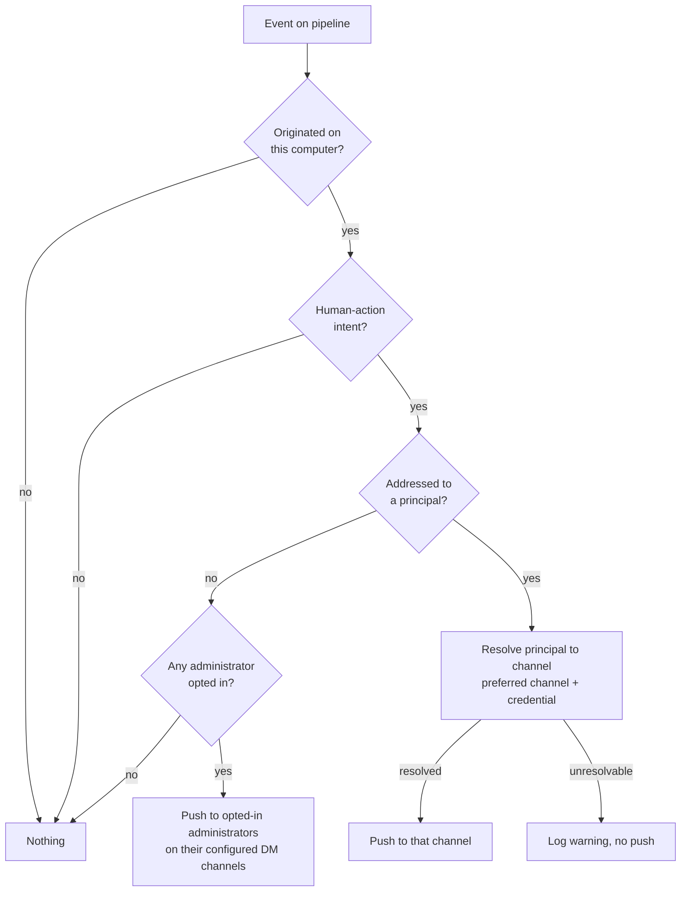

# Notification Delivery — Design

## Required reads

@docs/local/design/process-lifecycle.md

## Purpose

This design defines how an event that asks for a human's attention reaches the
people it is for, which computer sends it, and what the platform keeps of it.

## Inputs/Outputs

**Inputs:**

- The event, with the computer it originated on.
- A structured occurrence-level human-action intent: audience, human-facing topic
  and summary, concrete action or decision, original occurrence timestamp,
  lifecycle family, and incident key.
- The optional recipient principal the intent addresses. An intent that addresses
  no one has the platform administrators as its audience.
- Each platform administrator's admin-push setting, off until that administrator
  turns it on.
- The `EventSchema.delivery_debounce_s` window declared per event type in the event
  catalog. `None` inherits the platform default trailing window; a positive value
  sets a custom window; a value `<= 0` disables debounce so the event delivers
  immediately.
- The grouping identity resolved for each delivery: the lifecycle group key's value
  when the schema declares one, otherwise the event identity.

**Outputs:**

- For an intent that addresses no one, a push to the configured direct-message
  channels of each platform administrator who turned admin push on.
- For an intent addressed to a principal, a single push to that principal's
  resolved channel instead of the administrator fan-out. The channel is resolved
  from the per-person channel configuration the platform uses for person-addressed
  delivery — the person's preferred channel, then the per-channel credential — and
  may be any configured outbound channel
  (`local/projects/teleclaude/spec/feature/integration/outbound-messaging-providers`),
  each delivered through its existing send primitive.
- No stored notification record, and no notification sent to connected app clients.

## Invariants

- **A computer delivers only the events it emitted.** Every computer reads the
  shared event stream, and each one delivers only the events whose origin names it.
  An event from another computer produces nothing there, so each event is delivered
  at most once across the fleet, from the computer where it happened.
- **Delivery needs a human-action intent and an audience.** Event level and
  schema-level actionability classify an event; neither authorizes a push. An event
  without a human-action intent, or without anyone on this computer to receive it,
  is not delivered and leaves nothing behind.
- **Admin push is opt-in per administrator.** The administrator fan-out reaches only
  administrators who turned their admin-push setting on, and the setting stays off
  until they do. It governs the administrator fan-out alone; a notification
  addressed to a principal does not depend on it.
- **A notification is a delivery, not a record.** No notification row is written or
  kept. The event stream gives delivery its at-least-once handling: an event is
  acknowledged after the pipeline has handled it, an event left pending by a failed
  process is reclaimed, and an event that keeps failing is dead-lettered. Pipeline
  duplicate protection keeps the identities of handled events for a bounded period
  so a redelivered event is not delivered twice.
- **External push delivery is debounced on a trailing quiet window.** Delivery to
  the external channels is coalesced per `(recipient, event type, grouping
identity)` over a trailing quiet window. A later matching delivery inside the
  window replaces the pending payload and restarts the window; exactly one push is
  delivered once the window elapses with no further matching delivery.
- **The debounce window is a per-event override.** An event schema sets its own
  `delivery_debounce_s` to widen, narrow, or disable its window; a disabled window
  delivers that event's push immediately.
- **An addressed notification reaches only its principal.** When the intent carries
  a recipient, the push goes to that principal's resolved channel alone and the
  administrator fan-out is bypassed. Addressing is opt-in per intent and additive —
  a producer that addresses no one keeps the administrator audience.
- **Recipient routing reuses the existing person-to-channel resolution and covers
  every configured channel.** The channel for an addressed principal comes from the
  per-person preferred-channel configuration and per-channel credential.
- **The addressed-versus-broadcast decision is made at the push dispatch, not at
  the administrator adapters.** The recipient is resolved once per delivery and
  routes the whole delivery; it is not a per-adapter filter over the administrator
  set, so a principal who is not an administrator still receives a targeted push.
- **An unresolvable recipient withholds the targeted push and never falls back to
  the administrator fan-out.** When an addressed principal resolves to no usable
  channel, an operator-visible warning is logged and no push is delivered.

## Primary flows

What a push says is the operational action card
(`local/projects/teleclaude/design/architecture/operational-action-cards`). Every
channel consumes the same delivery and semantic content; channel renderers do not
reconstruct actionability from event type, level, or prose.

## Failure modes

- **Every computer delivering every event** sends each push once per computer, and
  late from a computer that was asleep.
- **Storing a notification for every event** turns delivery into an unread event
  log: rows nobody consumes, read by other code as if they were an event store.
- **Admin push on by default** interrupts every administrator before anyone has
  chosen to receive notifications.
- **Gating on level or schema actionability instead of a human-action intent**
  admits routine success and self-handled failure.
- **Falling back to the administrator fan-out on an unresolvable recipient**
  re-admits the leak addressing exists to prevent: a per-person notification meant
  for one principal reaches every administrator.
- **Deciding the target by filtering the per-administrator adapters** fails for any
  recipient who is not an administrator, because no adapter is registered for them.
