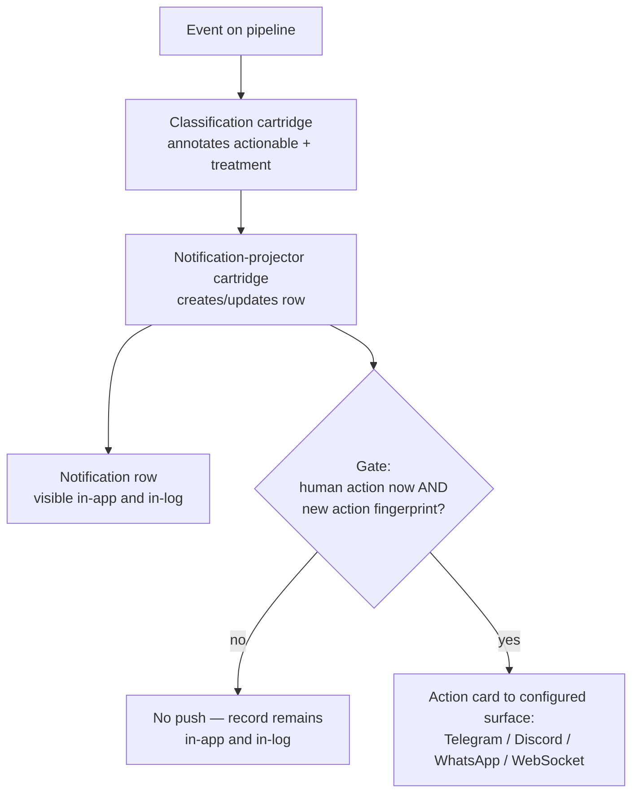
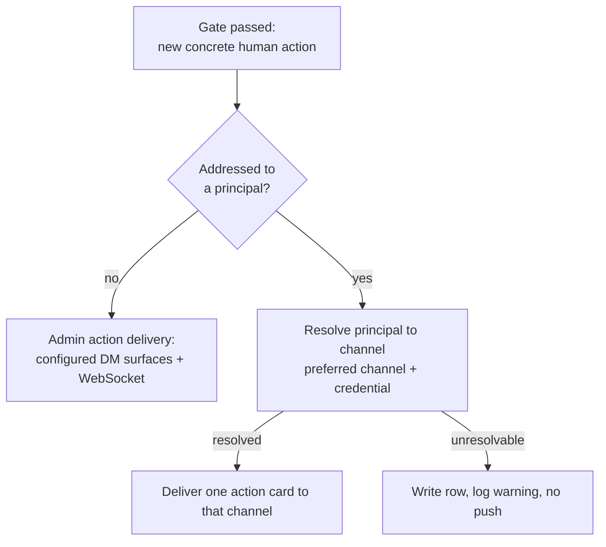

# Notification Delivery — Design

## Required reads

@docs/local/design/process-lifecycle.md

## Purpose

The platform emits a broad stream of events; only an occurrence carrying a
concrete action or decision for a human should interrupt. This design defines the
push gate that separates **action-required occurrences** from everything that is
record-only: routine success, automatically handled failure, repeated same-state
incident activity, and recovery remain visible in-app and in-log without firing
an external push.

Event level and schema-level actionability remain classification inputs; neither
is the interruption decision. The gate keys on structured occurrence-level human
action intent and a durable incident/action fingerprint, so the same requested
action is delivered once and only a material escalation can interrupt again.

## Inputs/Outputs

**Inputs:**

- The event schema classification and level, retained for in-app treatment but
  never sufficient to authorize an external interruption.
- A structured occurrence-level human-action intent: audience, human-facing
  topic and summary, concrete action or decision, original occurrence timestamp,
  lifecycle family, incident key, and action revision.
- The projected notification change produced by the notification-projector,
  including an actual stored-value delta for schema-declared meaningful fields.
- The durable last-delivered action revision for the incident and audience.

- The `EventSchema.delivery_debounce_s` window declared per event type in the
  event catalog. `None` inherits the platform default trailing window of 15
  seconds; a positive value sets a custom window; a value `<= 0` disables
  debounce so the event delivers immediately.
- The grouping identity the projector resolves for each change: the lifecycle
  group key's value when the schema declares one, otherwise the notification id.

- The optional recipient principal an actionable notification carries. An
  actionable notification may address a specific human principal; when it does,
  that principal is the intended audience for the push. An actionable
  notification that addresses no one has the admin set as its audience.

**Outputs:**

- A push delivered to each configured interrupting surface — Telegram, Discord,
  and WhatsApp admin DMs, and the WebSocket app-client push — **only** for events
  that pass the gate.

- A notification row written for every projected event regardless of the gate, so
  routine events remain queryable in-app and in-log; the gate suppresses the
  interruption, not the record.

- For an actionable notification addressed to a principal, a single push
  delivered to that principal's resolved channel instead of the admin fan-out.
  The channel is resolved from the same per-person channel configuration the
  platform already uses for person-addressed delivery — the person's preferred
  channel, then the per-channel credential — and may be any configured channel
  (Telegram, Discord, WhatsApp, or email), each delivered through its existing
  send primitive.
- The persisted notification row retains the addressed recipient, so the stored
  projection distinguishes a targeted notification from a broadcast one and the
  global operator surfaces exclude it from the broadcast view.

## Invariants

- **The push gate is keyed on a current human action, never on level or event
  class alone.** A schema may classify an event type as actionable for in-app
  treatment, but external delivery requires a structured occurrence-level action
  or decision addressed to a human audience.
- **A push is edge-triggered by incident and action revision.** The first current
  human action for an incident may interrupt once. Repeated payloads, changed
  counters, and same-action updates do not interrupt. A later push requires a
  material escalation that changes the requested action.
- **Meaningful row change and interruption eligibility are separate facts.** A
  row update is meaningful only when a schema-declared field value differs from
  its stored value; that fact may reset in-app state but never substitutes for a
  human-action delivery intent.
- **Recovery remains record-only.** Resolution updates the durable incident and
  in-app state but does not send a positive external push.

- **Every push surface honours the same gate.** The interrupting-DM adapters and
  the WebSocket app push apply one shared decision; no surface forwards
  unconditionally. The in-app notification list is fed by the notification table,
  not by the push path, so it is unaffected by the gate.
- **The gate suppresses interruption, not the record.** A routine event still
  projects its notification row; only the push is withheld.

- **External push delivery is debounced on a trailing quiet window.** After the
  gate passes, delivery to the external channels — Telegram, Discord, and
  WhatsApp — is coalesced per `(recipient, event type, grouping identity)` over a
  trailing quiet window (default 15 seconds). A later matching change inside the
  window replaces the pending payload and restarts the window; exactly one push
  is delivered once the window elapses with no further matching change. The
  WebSocket app push is not debounced and delivers immediately.
- **Debounce coalesces delivery, never the record.** The projector writes or
  updates the durable notification row before any push is scheduled, so the
  trailing window delays only the external push, never the row.
- **The debounce window is a per-event override.** An event schema sets its own
  `delivery_debounce_s` to widen, narrow, or disable its window; a disabled
  window delivers that event's push immediately.

- **An addressed notification reaches only its principal, across every delivery
  surface.** When the projected change carries an addressed recipient, the push
  goes to that principal's resolved channel alone; the admin fan-out is bypassed
  on **every** surface it spans. The external DM adapters, the WebSocket app
  push, and the global notification list all carry only recipient-less broadcast
  notifications, so an addressed notification is never shown to the admin set on
  any of them. When the change carries no recipient, delivery is the admin
  fan-out unchanged. Addressing is opt-in per notification and additive — an
  existing producer that addresses no one keeps the broadcast audience.
- **The addressed row is retained but withheld from the operator broadcast.** The
  durable notification row records the recipient so the projection stays
  faithful, but the shared operator surfaces — the WebSocket push and the
  shared notification list — exclude addressed rows; the addressed
  notification is delivered through its principal's channel rather than shown on
  the shared console.
- **Broadcast notifications on the shared console follow the viewer's reach.**
  The notification row records the subject of the event it projects and that
  subject's owner. The notification list a TUI or web-console client receives
  and every live push to it carry only the broadcast notifications whose subject
  the viewing principal's reach admits
  (`local/projects/teleclaude/spec/feature/identity/data-visibility`); a platform
  administrator and the system principal receive every broadcast notification.
  The external DM admin fan-out keeps its audience, the platform administrators.
- **Recipient routing reuses the existing person-to-channel resolution and covers
  every configured channel.** The channel for an addressed principal comes from
  the per-person preferred-channel configuration and per-channel credential, and
  may be any channel that configuration allows — Telegram, Discord, WhatsApp, or
  email — each delivered through its existing send primitive. Delivery stays
  inside the event → projection → durable-row → push model rather than the
  person-addressed messaging send path.
- **The addressed-versus-broadcast decision is made at the push dispatch, not at
  the admin adapters.** The recipient is resolved once per projected change and
  routes the whole delivery; it is not a per-adapter filter over the
  pre-registered admin set, so a principal who is not an admin still receives a
  targeted push.
- **An unresolvable recipient withholds the targeted push and never falls back
  to the admin fan-out.** When an addressed principal resolves to no usable
  channel — including a preferred channel that has no notification delivery
  path — the durable notification row is still written and an operator-visible
  warning is logged, but no push is delivered; a targeted notification is never
  redirected to the admin set.

## Primary flows



The projector carries one structured delivery intent to the shared gate. The
intent includes audience, human-facing summary, concrete action, original
occurrence timestamp, lifecycle-family incident key, and action revision. Every
surface consumes the same decision and semantic content; channel renderers do not
reconstruct actionability from event type, level, or prose.

Notification lifecycle grouping is scoped by explicit lifecycle family, group
key/value, and recipient. Related create/update/resolve event types declare the
same family deliberately; unrelated event types that happen to carry the same
`entity` value never update the same notification row.

The human-facing text fallback renders:

```text
[TeleClaude - Action · <human topic> · <utc-minute>]

<incident summary>
Action: <specific remedy, decision, command, or details link>.
```

Event type, notification identity, exact timestamp, and delivery provenance stay
available as structured details. Create/update verbs and notification row ids are
not rendered as the message body.

When a projected change that passes the gate carries an addressed recipient, the
push forks from the broadcast path to a single targeted delivery:



## Failure modes

- **Gate keyed on level or schema actionability instead of a current human
  action** admits both routine success and negative-but-self-handled activity.
  Classification determines record treatment; only a new concrete human action
  authorizes interruption.
- **Grouping by payload field/value without lifecycle family** lets unrelated
  event classes carrying the same entity overwrite one notification row and
  corrupt incident deduplication.

- **A surface bypassing the gate** — most easily the WebSocket app push, which
  forwards to subscribed clients — re-floods that surface with routine events even
  after the DM adapters are gated. Every surface applies the same decision or none
  is protected.
- **Gating the notification row instead of the push** hides routine events from
  the in-app list and log, losing the record the operator relies on for
  diagnosis. The gate belongs on the push, not on the projection.

- **Falling back to the admin fan-out on an unresolvable recipient** re-admits
  the leak the addressing exists to prevent: a per-person notification meant for
  one principal sprays every admin. An unresolvable recipient withholds the push
  and logs a warning; it never broadcasts.
- **Deciding the target by filtering the per-admin push adapters** fails for any
  recipient who is not a pre-registered admin — a targeted notification to a
  non-admin principal would reach no one, because no adapter is registered for
  them. The addressed-versus-broadcast decision is made where the recipient is
  resolved, not by selecting among the admin adapter set.
- **Leaking an addressed notification through a surface the targeting decision
  did not cover** — the WebSocket app push or the unfiltered notification list —
  re-admits the very leak targeting removes: a per-person notification becomes
  visible to every operator. The single-recipient guarantee holds across every
  push and list surface, not only the external DM adapters.
