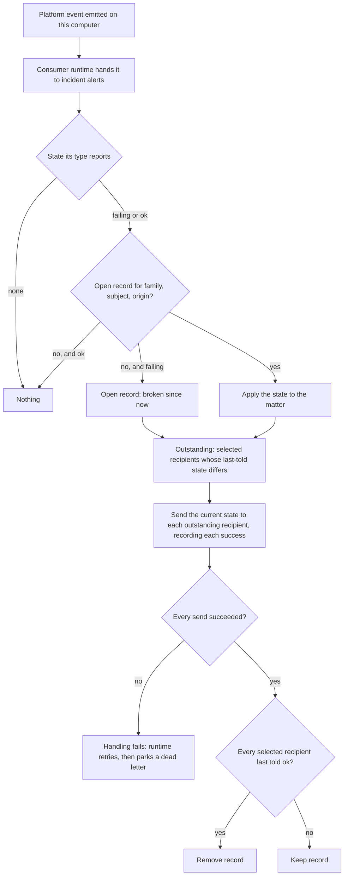

# Notification Delivery — Design

## Required reads

@docs/local/design/process-lifecycle.md

## Purpose

People hear about platform events through consumers that tell people. Each such
consumer runs on the consumer framework
(`local/projects/teleclaude/spec/feature/event-catalog/event-consumers`), decides
which events it tells and to whom, composes one readable message per recipient,
and hands it to person-addressed delivery. Nothing about telling people is
stored except the state a consumer needs to decide its next message.

Incident alerts is the consumer that tells platform administrators about
platform problems (`local/projects/teleclaude/spec/feature/integration/incident-alerts`).
The selection, message composition and delivery it uses are shared by every
consumer that tells people.

## Inputs/Outputs

**Inputs:**

- Platform events handed to the consumer by the consumer runtime: once per event,
  only events its own computer emitted, of types under `teleclaude.`.
- The lifecycle state of the event's type and its family, read from the event
  catalog's state vocabulary
  (`local/projects/teleclaude/spec/domain/event-catalog`, Lifecycle states): the
  type alone says whether the event reports a failing state, an ok state, or no
  state.
- The event's subject and origin, which identify the thing within its lifecycle
  family; its source, which names the computer and the registered project,
  person or company the act happened in; its time; and its type's declaration,
  whose description says what happened.
- The platform administrators on the people roster and each one's notification
  interests, read through config's published interests contract
  (`local/projects/teleclaude/spec/feature/config/notification-interests`): a
  person's interests answer whether they select an event type.
- The consumer's incident record: per lifecycle family and thing, the time the
  thing became broken, and which selected recipients still await the message
  of the transition in progress.

**Outputs:**

- One message per selected recipient, sent through person-addressed messaging on
  the recipient's own routed channel
  (`local/projects/teleclaude/spec/messaging`).
- Incident records opened on a first failure and removed once the recovery has
  reached every selected recipient.
- A failed outcome for a transition whose message did not reach a selected
  recipient: the handling fails, and the consumer runtime retries it and finally
  parks the event as an announced dead letter.

## Invariants

- **A matter is one lifecycle family's state of one thing.** The thing is the
  event's subject within its origin; two families that report on the same
  subject are two matters, and the same subject from two origins is two things.
- **The type decides the matter's state.** A failing state with no open record
  opens one, failing and broken since that event; a failing state while the
  matter is failing changes nothing; an ok state while the matter is failing
  makes it ok; a failing state while the matter is ok and its record is still
  open makes it failing again, broken since that event; an ok state with no open
  record, and an event with no state, change nothing. Who is told what follows
  from the matter's state and each recipient's last-told state (below); a
  recovery states how long the thing was broken. The consumer knows no producer and no type name:
  a family that follows the convention takes part without a change here.
- **The audience is narrowed, never widened.** Incident alerts tell platform
  administrators only, and of those only the ones whose interests select the
  event's type. Administrators reach everything, so the reach rule
  (`local/projects/teleclaude/spec/feature/identity/data-visibility`) holds by
  construction.
- **Interests select whole lifecycles.** Every `teleclaude` interest pattern ends
  in `.*` or is `*`, and every state of a family shares its prefix, so a person
  whose interests select a failure also selects its recovery.
- **Only the origin computer tells.** The consumer acts only on events its own
  computer emitted; each computer keeps its own incident records, and no
  computer tells another computer's events.
- **The record is the only state.** Messages are not stored, listed or pushed to
  any shared surface. The record of an open matter holds its current state, the
  time it became broken, and, per selected recipient, the state that recipient
  was last told. It survives a restart and is removed once every selected
  recipient was last told the matter is ok.
- **A recipient is outstanding while their last-told state differs from the
  matter's.** Each event of a transition sends the matter's current state only
  to outstanding recipients and records each recipient's new last-told state the
  moment the send succeeds, so a message recorded as sent is never sent again.
  An ok state that arrives while some recipients still await the failure makes
  the recovery outstanding for every selected recipient instead; a failing state
  that arrives while some recipients still await the recovery reopens the
  matter, broken since that event, and is outstanding only for the recipients
  who were last told ok.
- **A failed send fails the handling, and only that recipient's message is
  retried.** The other recipients still receive theirs; the consumer runtime
  retries the handling with bounded attempts, sending only to recipients still
  outstanding, and finally parks the event as an announced dead letter, so an
  undelivered alert is a visible failed outcome rather than a completed one.
- **One window is inherent.** When a channel has accepted a message and the
  computer stops before the send is recorded, the next handling sends that
  message again; the channels person-addressed delivery uses take no delivery
  identity a resend could carry.
- **Messages state facts in plain sentences.** What happened (the type's
  declared description), the thing, the computer and the time, written so they
  read the same as plain text and as markdown on every channel; a recovery adds
  how long the thing was broken. No bracketed envelope header, no instruction,
  no action.
- **Notification facts leave the wire when the fleet answers that nobody reads
  them.** Incident alerts are advertised as a fleet capability. While any live
  computer does not carry it, events keep the human action and routing scope an
  older computer's notification projector reads; once the fleet capability map
  shows every live computer carries it, events carry neither
  (`local/projects/teleclaude/spec/feature/reconciliation/fleet-cross-version-interop`).
  A current computer never reads them.

## Primary flows

A message for a failure reads, for example, as the thing, what happened, the
computer and the time on one line; the recovery names the thing, says it works
again, and states the time and how long it was broken. The wording is composed
from the event's facts and its type's declaration, so a new type reads as well
as a known one.

## Failure modes

- **Keying a matter on the subject alone** merges two families that report on
  the same subject, so one family's recovery closes the other's open failure.
- **Taking an open record as already told** loses the alert when handling stops
  after the record is written and before a message is sent; outstanding
  recipients are what the next handling sends to.
- **Treating a failed send as handled** completes the event with a selected
  recipient never told, and no later event tells them.
- **Resending to every recipient on retry** repeats the message to everyone the
  first attempt reached; only outstanding recipients are sent to.
- **Composing from a fixed list of known types** leaves a new family unreadable
  or silent until someone edits the list; composition reads the declaration.
- **Telling from more than one computer** sends an administrator one message per
  computer for a single event; only the origin computer tells.
- **Dropping notification facts before the fleet answers** silences what an
  older computer's projector still tells for events it receives.
