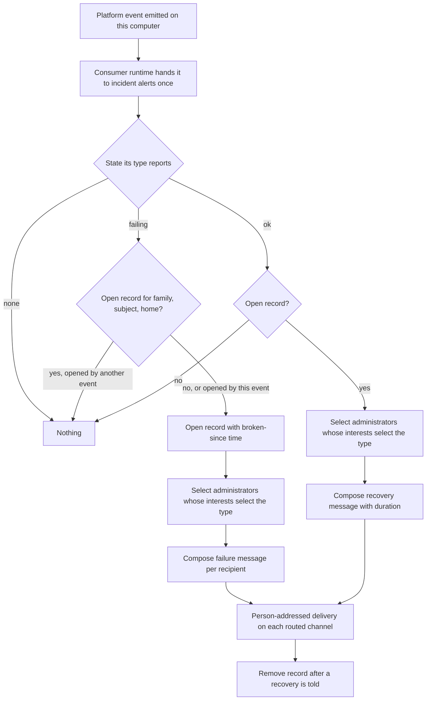

# Notification Delivery — Design

## Required reads

@docs/local/design/process-lifecycle.md

## Purpose

People hear about platform events through consumers that tell people. Each such
consumer runs on the consumer framework
(`local/projects/teleclaude/spec/feature/event-catalog/event-consumers`), decides
which events it tells and to whom, composes one readable message per recipient,
and hands it to person-addressed delivery. Nothing about telling people is
stored except the state a consumer needs to decide its next message.

Incident alerts is the consumer that tells platform administrators about
platform problems (`local/projects/teleclaude/spec/feature/integration/incident-alerts`).
The selection, message composition and delivery it uses are shared by every
consumer that tells people.

## Inputs/Outputs

**Inputs:**

- Platform events handed to the consumer by the consumer runtime: once per event,
  only events its own computer emitted, of types under `teleclaude.`.
- The lifecycle state of the event's type and its family, read from the event
  catalog's state vocabulary
  (`local/projects/teleclaude/spec/domain/event-catalog`, Lifecycle states): the
  type alone says whether the event reports a failing state, an ok state, or no
  state.
- The event's subject and home, which identify the thing within its lifecycle
  family; its source, which names the computer; its time; and its type's
  declaration, whose description says what happened.
- The platform administrators on the people roster and each one's notification
  interests, read through config's published interests contract
  (`local/projects/teleclaude/spec/feature/config/notification-interests`): a
  person's interests answer whether they select an event type.
- The consumer's incident record: per lifecycle family and thing, the time the
  thing became broken.

**Outputs:**

- One message per selected recipient, sent through person-addressed messaging on
  the recipient's own routed channel
  (`local/projects/teleclaude/spec/messaging`).
- Incident records opened on a first failure and removed on recovery.

## Invariants

- **A matter is one lifecycle family's state of one thing.** The thing is the
  event's subject within its home; two families that report on the same subject
  are two matters, and the same subject under two homes is two things.
- **The type decides the transition.** A failing state with no open record
  opens one and tells; a failing state with an open record tells nothing; an ok
  state with an open record tells the recovery with how long the thing was
  broken and removes the record; an ok state with no open record, and an event
  with no state, tell nothing. The consumer knows no producer and no type name:
  a family that follows the convention takes part without a change here.
- **The audience is narrowed, never widened.** Incident alerts tell platform
  administrators only, and of those only the ones whose interests select the
  event's type. Administrators reach everything, so the reach rule
  (`local/projects/teleclaude/spec/feature/identity/data-visibility`) holds by
  construction.
- **Interests select whole lifecycles.** Every `teleclaude` interest pattern ends
  in `.*` or is `*`, and every state of a family shares its prefix, so a person
  whose interests select a failure also selects its recovery.
- **Only the origin computer tells.** The consumer acts only on events its own
  computer emitted; each computer keeps its own incident records, and no
  computer tells another computer's events.
- **The record is the only state.** Messages are not stored, listed or pushed to
  any shared surface. The record survives a restart, so a restart neither tells
  an alert again nor loses a recovery.
- **An alert is never lost; a crash may repeat one.** The record is written before
  the failure is told and removed after the recovery is told. When handling is
  interrupted and the event is handed again, an open record that this same event
  opened is told again rather than taken as already told.
- **One recipient's delivery failure is that recipient's.** A recipient whose
  channel cannot be reached is logged with the reason and the others still
  receive the message; it never fails the event, which would repeat the message
  to everyone already reached.
- **Messages state facts in plain sentences.** What happened (the type's
  declared description), the thing, the computer and the time, written so they
  read the same as plain text and as markdown on every channel; a recovery adds
  how long the thing was broken. No bracketed envelope header, no instruction,
  no action.
- **Events carry no notification facts.** Producers state no human action and no
  routing scope on the wire; an older computer reads both as absent
  (`local/projects/teleclaude/spec/feature/reconciliation/fleet-cross-version-interop`).

## Primary flows

A message for a failure reads, for example, as the thing, what happened, the
computer and the time on one line; the recovery names the thing, says it works
again, and states the time and how long it was broken. The wording is composed
from the event's facts and its type's declaration, so a new type reads as well
as a known one.

## Failure modes

- **Keying a matter on the subject alone** merges two families that report on
  the same subject, so one family's recovery closes the other's open failure.
- **Taking any open record as already told** loses the alert when handling is
  interrupted after the record is written and before the message is sent: the
  event is handed again, finds the record and stays silent. A record that this
  same event opened is told again.
- **Raising a recipient's delivery failure** makes the consumer retry the event
  and repeat the message to every recipient already reached.
- **Composing from a fixed list of known types** leaves a new family unreadable
  or silent until someone edits the list; composition reads the declaration.
- **Pushing from more than one computer** returns the duplicate alerts every
  computer used to send for every event; only the origin computer tells.
- **Storing messages for a list nobody reads** recreates the notification archive
  this design removes.
