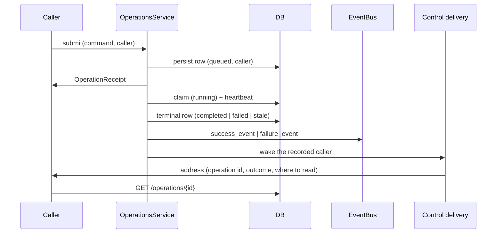

# Operation Receipts — Design

## Required reads

- @docs/local/design/architecture/command-classification.md

## Purpose

A command whose work finishes after its response uses the receipt-first contract. The
daemon persists an operation row before execution begins, returns a durable
`OperationReceipt` immediately, and runs the work in a tracked background task. On the
terminal transition it emits the command's success or failure event and wakes the caller
recorded on the row.

This is the only asynchronous contract. A mutation fast enough to answer inside its own
response is `IMMEDIATE` and carries no operation row; everything else carries one. There
is no lighter asynchronous form, because an outcome with no row cannot be answered for
after the fact.

### Operation kinds inventory

| Kind constant                 | String value     | Endpoint                            |
| ----------------------------- | ---------------- | ----------------------------------- |
| OPERATION_KIND_TODO_WORK      | `todo_work`      | `POST /todos/work`                  |
| OPERATION_KIND_TODO_INTEGRATE | `todo_integrate` | `POST /todos/integrate`             |
| OPERATION_KIND_TODO_CREATE    | `todo_create`    | `POST /todos/create`                |
| OPERATION_KIND_TODO_PREPARE   | `todo_prepare`   | `POST /todos/prepare`               |
| OPERATION_KIND_TODO_RENAME    | `todo_rename`    | `POST /todos/update`                |
| OPERATION_KIND_TODO_REMOVE    | `todo_remove`    | `POST /todos/remove`                |
| OPERATION_KIND_TASK_RUN       | `task_run`       | `POST /tasks/run`                   |
| OPERATION_KIND_AGENT_HANDOFF  | `agent_handoff`  | `POST /sessions/{id}/agent-restart` |
| OPERATION_KIND_AGENT_RESTART  | `agent_restart`  | `POST /sessions/{id}/agent-restart` |
| OPERATION_KIND_SESSION_CLOSE  | `session_close`  | `DELETE /sessions/{id}`             |

## Inputs/Outputs

- **Input:** Any route backed by a RECEIPT command, carrying the caller provenance the
  API boundary resolved and, for a session-scoped command, the computer that owns the
  target.
- **Output (immediate):** `OperationReceipt` — `{operation_id, kind, state: "queued",
status_path, poll_after_ms, computer, success_event, failure_event, recovery_command}`.
- **Output (terminal):** `GET /operations/{operation_id}` returns the full receipt with
  `state: "completed"|"failed"|"stale"` and `result` or `error`.
- **Output (delivery):** the caller recorded on the row is woken with an address —
  operation identity, outcome, and the command that reads the record.
- Operation rows are keyed to the caller session and record the subject the operation runs in —
  the subject of its working folder, or of the session it acts on — with that subject's owner as
  resolved when the operation is created. A row written before operations recorded a subject
  receives once the subject and owner of its working folder or target session; a row whose
  subject cannot be established records it as unknown, which only platform reach and its own
  caller see. A caller may inspect its own,
  and any operation whose subject its reach admits
  (`local/projects/teleclaude/spec/feature/identity/data-visibility`). A read from another computer
  carries no session (`local/projects/teleclaude/spec/feature/identity/cross-computer-authorization`),
  so there a caller's own operation is one whose command the caller's principal started.

## Invariants

- **Persist before execute.** The operation row is written to DB before the background
  task is scheduled. The receipt is always valid even if the daemon crashes immediately
  after returning it.
- **Submit dedupe.** `client_request_id` scoped by operation kind and caller session
  prevents duplicate executions. Re-submitting with the same `client_request_id`
  reattaches to a matching nonterminal operation row.
- **The caller is recorded at submission.** The row carries the caller provenance the
  command arrived with. A caller-less submission is recorded as such; nothing is inferred
  to fill the gap.
- **Atomic terminal transition.** The background task emits the outcome event as the
  final step of writing the terminal DB state. The event and the row transition happen
  in the same logical unit — never split.
- **Outcome is carried by event type.** A terminal transition emits the command's
  `success_event` or its `failure_event`. No consumer distinguishes outcomes by reading a
  field on a shared event type.
- **Every terminal transition delivers.** Completion, failure, and staleness each reach
  the recorded caller if it is still live. Staleness is an outcome, not an absence of one,
  so a daemon restart is observable to the caller rather than silent.
- **Delivery carries an address, never the record.** The wake names the operation, its
  outcome, and where to read it. The row supplies the result, the error, and the progress
  detail when the caller reads it.
- **Delivery failure is terminal and harmless.** A wake that cannot be handed off is not
  retried. The row is unaffected and answers whoever asks later.
- **Stale on restart.** Operations in `queued` or `running` state are marked `stale`
  at daemon startup. Work is never replayed blindly. The receipt remains truthful.
- **The row is the authority.** Outcome events are a nudge toward the row, never the
  record. If an event fires but the row is not yet terminal, trust the row.
- **The owning computer owns the row.** An operation submitted on behalf of a caller
  elsewhere is persisted, executed, and emitted by the computer that runs the work. The
  receipt names that computer so the caller reads the record there.

## Primary flows

1. A route receives a RECEIPT command and calls `OperationsService.submit(command)` with
   the caller provenance the command carries.
2. `OperationsService` deduplicates via `client_request_id`, persists the row
   (`state=queued`, caller recorded), and returns the receipt immediately.
3. A background task claims the queued row (`state=running`), heartbeats periodically,
   and executes the work.
4. On the terminal transition, the task writes the result to the row and emits the
   command's success or failure event.
5. The recorded caller, if still live, is woken through control delivery with an address.
   A caller on another computer is reached by forwarding the notification to that
   computer, which delivers it locally.

<!-- planned-change:cli-accept-or-retry -->

6. The caller reads `GET /operations/{operation_id}` for the full record. A caller that
   chose to wait instead polls the same endpoint and observes the same terminal payload.

<!-- change:cli-accept-or-retry -->

6. The caller reads `GET /operations/{operation_id}` for the full record. The command
   line never waits for the terminal state; it returns the receipt, and the wake is how
   the caller learns the operation has finished.

<!-- /planned-change:cli-accept-or-retry -->

## Failure modes

- **Daemon restart:** Leftover `queued` or `running` operations are marked `stale`
  at startup. That transition emits the failure event and wakes the recorded caller, so a
  caller that was waiting learns the work was abandoned rather than waiting out a timeout.
  Work is never replayed automatically.
- **Background task panic:** If the task dies before the terminal write, the row stays
  `running` until the heartbeat window expires and then becomes `stale`, which delivers.
- **Caller session gone at delivery:** The wake is dropped without retry and the row is
  unchanged. The outcome remains answerable by any later reader.
- **Caller mismatch:** A caller whose reach does not admit the operation's subject, attempting
  to access an operation that is not its own, receives a 404 (not a 403) to avoid session ID
  enumeration.
- **Event fires, row not yet terminal:** Trust the row. The event is a convenience
  signal; the DB row is authoritative.

## See Also

- docs/local/adr/0098-async-work-always-carries-a-receipt.md
- docs/local/adr/0119-the-cli-never-waits-on-a-receipt.md
- docs/local/spec/feature/agent_runtime/control-delivery.md
