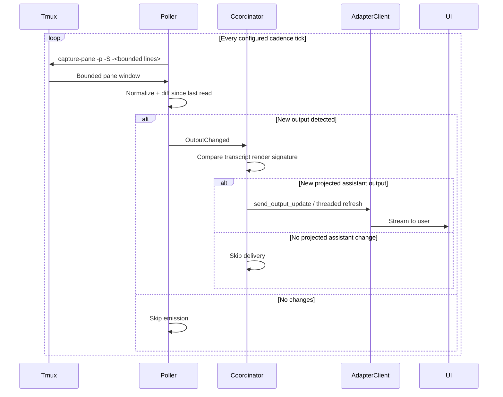
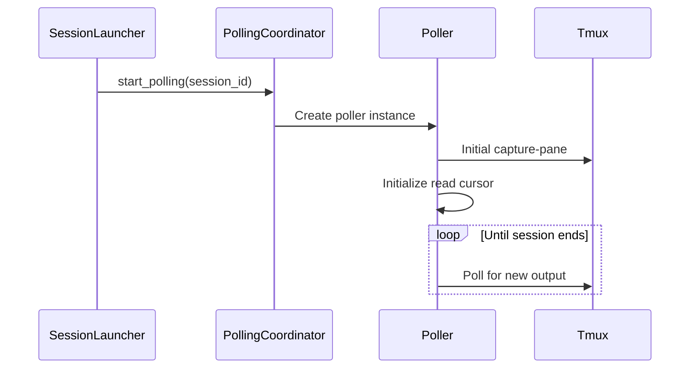
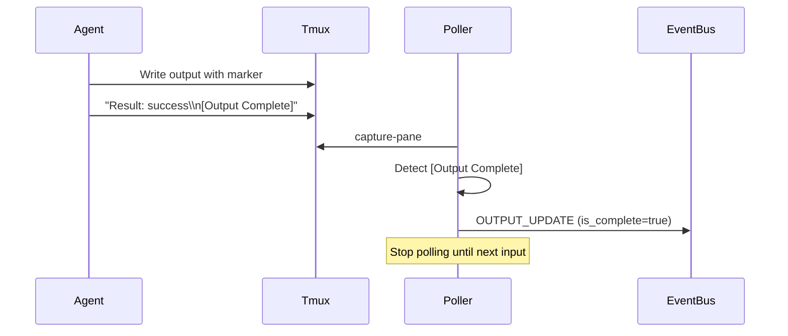

# Output Polling — Design

## Purpose

- Capture and stream real-time output from tmux panes to UI adapters without blocking the main event loop.

1. **OutputPoller**: A per-session worker that reads from the tmux output buffer.
2. **PollingCoordinator**: Manages the collection of pollers and ensures they start/stop with the session lifecycle.
3. **Single data plane**:
   - Output content is transcript driven.
   - Tmux polling and agent hooks are liveness signals that wake projection.
   - Hook `pre_tool_use` never supplies content, but it does schedule transcript projection.
4. **Read**: Poller executes `tmux capture-pane`.
5. **Normalize**: Raw pane output is normalized for generic change detection; raw capture is preserved for Codex-specific synthesis.
6. **Diff**: Normalized pane snapshots are compared against prior normalized capture.
7. **Emit**: `OutputEvent` is yielded to `PollingCoordinator`.
8. **Project**: Session projection decides whether source-visible user or assistant output is eligible for adapter delivery.
9. **Finalize title**: Completed-turn signals (`agent_stop`) finalize semantic title generation from the bounded transcript window for that turn and emit `SESSION_TITLE_CHANGED`.
10. **Broadcast**: `AdapterClient` routes output updates to active observers. Title delivery is not routed through `AdapterClient`; `UiAdapter` consumes `SESSION_TITLE_CHANGED` directly.

## Inputs/Outputs

**Inputs:**

- Tmux pane output buffer via `tmux capture-pane -p`
- Session lifecycle events (start/stop triggers)
- Immediate poll requests from command injection

**Outputs:**

- `OutputEvent` emissions with session_id, chunk, is_complete marker
- Process exit detection and final status
- Turn completion signals for AI sessions

## Invariants

- **One Poller Per Session**: Each active session has exactly one poller instance; no duplicates.
- **Poller Lifecycle Matches Session**: Poller starts when session becomes active, stops when session closes.
- **Normalized change detection**: Generic `OutputChanged` detection compares normalized pane text, not raw ANSI/styling noise.
- **Projection-owned dedupe**: Poller activity wakes session projection, but only eligible source entries after the projection cursor may trigger outbound delivery.
- **Hook activity wakes projection**: `user_prompt_submit`, `pre_tool_use`, `agent_stop`, native metadata updates, and native session refreshes schedule the same transcript projection path used by polling.
- **Origin-gated projection**: If source activity arrives before the matching user-turn origin is fresh, projection defers and leaves the cursor unchanged.
- **Completed-turn title finalization**: Title generation is not part of the live output loop. It runs only when a completed-turn signal finalizes the current transcript window.
- **One title per user turn**: Duplicate `agent_stop` signals inside the same user turn must not generate a second title update.
- **Adapter-owned title QoS**: Raw semantic title changes are delivered through `SESSION_TITLE_CHANGED`; each UI adapter owns latest-only coalescing and platform-specific title pacing.
- **Deterministic cadence**: Output cadence is config-driven (`polling.output_cadence_s`, default `1.0`).
- **Snapshots shared per tick**: Pollers tick on a common beat of the cadence, and the snapshots requested within a tick are taken together, in chained multiplexer calls that each hold as many sessions as the multiplexer's command size allows, run concurrently. The cadence is unchanged however many sessions there are. A session the server no longer holds ends its chain at its own capture; it is reported missing, and a further multiplexer call takes the sessions after it in that chain.
- **No Blocking**: Polling runs in async task; never blocks main event loop or command execution.
- **Graceful Stop**: Poller cleanup completes before session marked fully closed.

## Primary flows

### 1. Poller Startup

### 2. Output Detection and Streaming

1. **Capture**: Execute `tmux capture-pane -p -S -<bounded lines> -t tc_{session_id}`. Hot-path polling uses a small window for activity detection; non-hot fallback reads a bounded pane window before applying any character truncation.
2. **Normalize**: Strip ANSI/control-noise for generic change detection while preserving the raw capture for Codex synthesis.
3. **Diff**: Compare normalized buffer against last normalized read
4. **Emit**: Send `OutputChanged` when normalized pane text changed
5. **Project**: Rebuild source-derived visible output, apply origin gating, and compare against the last projected cursor/render signature
6. **Deliver**: Only if the projected render changed, call adapter output delivery
7. **Finalize title later**: Do not generate titles here; title finalization waits for the completed-turn signal and uses the last user input plus the assistant output that followed it

### 3. Turn Completion Detection (AI Mode)

### 4. Process Exit Detection

- Poller runs `tmux has-session -t tc_{session_id}`
- If session missing → emit OUTPUT_UPDATE with process exit status
- Mark session as closed, stop polling

### Adapter-level Output QoS

Between `AdapterClient.send_output_update` and the platform API sits an optional adapter-level QoS
scheduler (`teleclaude/adapters/qos/output_scheduler.py`). It runs per-adapter and operates in one
of three modes configured under each adapter's `qos:` section:

| Mode            | Behaviour                                                                                                                                                                |
| --------------- | ------------------------------------------------------------------------------------------------------------------------------------------------------------------------ |
| `off`           | Scheduler is bypassed; every emission goes directly to the platform API.                                                                                                 |
| `coalesce_only` | Background loop ticks at `rounding_ms` intervals; within each tick, superseded normal payloads per session are dropped (latest-only). No hard rate cap. Discord default. |
| `strict`        | Tick computed from `group_mpm`, `output_budget_ratio`, and `reserve_mpm`; dispatches ONE session per tick in round-robin order. Telegram default.                        |

### Two-layer rate control (Telegram)

1. **PTB AIORateLimiter** — transport-level: Telegram enforces per-chat limits at the API layer. PTB's
   built-in limiter queues requests and auto-retries, staying inside flood-control thresholds without
   custom sleep logic.
2. **TeleClaude OutputQoSScheduler** — product-level: coalesces stale intermediate output frames
   and paces delivery to stay within the configured group MPM budget across all concurrent sessions.

### Tuning knobs

| Config key                 | Default (Telegram) | Effect                                                        |
| -------------------------- | ------------------ | ------------------------------------------------------------- |
| `group_mpm`                | 20                 | Platform group message budget per minute.                     |
| `output_budget_ratio`      | 0.8                | Fraction of `group_mpm` reserved for output updates.          |
| `reserve_mpm`              | 4                  | Hard reservation for non-output messages (commands, footers). |
| `rounding_ms`              | 100                | Tick rounding granularity.                                    |
| `active_emitter_window_s`  | 10.0               | Window during which a session stays counted as active.        |
| `active_emitter_ema_alpha` | 0.2                | EMA smoothing factor for active session count.                |

### Multi-process caveat

`OutputQoSScheduler` is in-process only. When running multiple daemon workers, each process applies
its own budget independently. A shared Redis token-bucket is the future path for cross-process rate
enforcement — currently out of scope.

## Failure modes

- **Tmux Hangs on Capture**: Poller times out after 5s. Logs error, skips this poll cycle. Session appears frozen until next successful poll.
- **Raw repaint noise**: ANSI/style-only changes may still occur in tmux, but normalized diffing suppresses them for generic output delivery.
- **Projection dedupe miss**: If transcript projection stops comparing projected assistant renders, unchanged output can fan out again even when the poller behaved correctly.
- **Premature projection**: If a wakeup races ahead of origin recording, the projector must defer. Terminal origin recording is itself a projection signal so the deferred pass can resume.
- **Poller Task Crash**: Exception in async task. Poller stops, output streaming halts. Session remains active but frozen. Requires daemon restart.
- **Output Too Large**: Tmux buffer exceeds memory limits. Poller truncates to last N lines. Beginning of output lost.
- **Race Condition on Stop**: Poller emits output after session marked closed. Event ignored by adapters. Harmless.
- **Turn Marker Missing**: AI agent doesn't emit [Output Complete]. Poller continues streaming indefinitely. Summarization may be delayed or incomplete.
