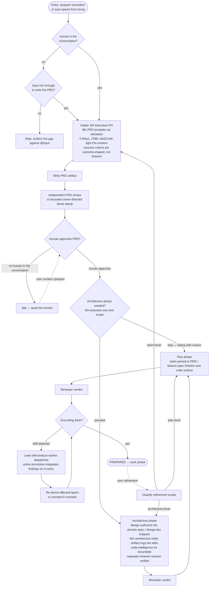

# Prepare Flow — Design

## Purpose

Codify the prepare phase as a deterministic chain of artifact-derivation steps where the PRD is the only human approval gate, lean enough that small work skips phases that don't earn their place, and capable of running autonomously until human intent approval is required. PRDs normally receive independent review before that gate; an exact owner-directed literal correction may use the bounded claimant-stamp path defined by the intake contract.

The flow replaces the prior pair-driven prepare model. One session drives the whole lifecycle, loading a phase-scoped procedure for each step (intake, architecture, plan) and doing the phase's work itself. Each derived artifact is verified by an independently dispatched reviewer session. The active procedure dispatches the reviewer and tails it. The human approves the PRD because only the human owns intent. Architecture and plan advance on reviewer approval because the reviewer is the independent authority for derived artifacts.

## Inputs/Outputs

**Inputs:**

- A todo slug, with or without an existing `input` artifact (dumped earlier or written in-session).
- Whether a human is in the conversation, read from the conversation itself.
- User proficiency from PersonDTO injection (or asked at session start when absent).
- Codebase HEAD for drift detection.
- The platform-quality-flavors set (where applicable to architecture phase).

**Outputs (per surviving phase):**

| Phase        | Artifact                                                             | Authority gate                                        |
| ------------ | -------------------------------------------------------------------- | ----------------------------------------------------- |
| Intake       | `prd` (+ feature spec snippet for Category A)                        | current `prd_review` + `prd_approved`                 |
| Architecture | domain-spec / design-doc snippet updates + thin `architecture` index | `architecture_review` verdict `approve`               |
| Plan         | `implementation-plan`                                                | `plan_review` verdict `approve`                       |
| Terminal     | —                                                                    | `PREPARED` (derived from all gates + fresh grounding) |

The confirmed plan is the handoff input to the work phase.

## Invariants

**Deterministic structure:**

- Intake produces `prd` (and, for Category A work, the feature spec snippet with Gherkin); no downstream phase begins until the current digest has `prd_review=approve` and `prd_approved` is stamped by the human. An owner-directed literal correction may receive that review verdict from the active prepare claimant only under the narrow intake-policy exception.
- Each subsequent phase produces its output and advances on reviewer verdict. There is no downstream human approval stamp.
- The `architecture_skipped` stamp carries a reason and lets the chain proceed without the architecture phase.
- Plan phase is non-skippable; PRD is non-skippable.
- `PREPARED` requires: PRD human-approved, plan reviewer-approved, architecture reviewer-approved unless skipped, grounding fresh.

**No human in the conversation:**

- Intake's only authorized basis is the `input` artifact. A basis too sparse to write a PRD from stops the flow against `@input`; nothing supplies the missing intent.
- A PRD the human has never approved cannot be stamped `prd_approved` — the first approval is the human's. A later revision can carry it (`sdlc/procedure/lifecycle/prepare/overview`).
- Downstream phases do not begin until the human approves that PRD.

**Refinement:**

- Human refinement at any layer invalidates downstream authority: PRD approval for intent changes, reviewer verdicts for derived artifact changes.
- The agent classifies refinement scope (intent / architecture / plan) and re-enters the appropriate phase.

**Drift:**

- Drift is a multi-class derivation. The full taxonomy and per-artifact coverage matrix live in `@spec/feature/workflow/drift-detection` (code, upstream-artifact, owned-snippet, upstream-snippet, age). Per-artifact status collapses by `substantive > pending > cosmetic > fresh`.
- The same shared `derive_lifecycle_drift` function runs at every lifecycle entry point where prepared artifacts must reflect current truth: during the prepare BLOCKED branch AND at the work state machine's entry boundary before the `prepared → build_started` handoff.
- Drift surfacing dispatches a lean drift-analysis worker to ascertain impact; the active procedure integrates findings on re-entry.
- Substantive drift triggers re-derivation of affected layers and clears every downstream review verdict; cosmetic drift is recorded with an evidence anchor and expires lazily per class when current evidence moves past the anchor.
- Work-entry drift is first resolved inside the work lane by the drift analyzer. A substantive verdict, like a kickback stamp, returns the Todo to preparation: the work machine releases the claim, the platform ends the slug's work-lane sessions, and the lifecycle runner dispatches a fresh prepare orchestrator. At PREPARED that orchestrator ends like any other, and the lifecycle runner dispatches a fresh work orchestrator, which continues any existing build against the changed plan (see `@spec/feature/workflow/prepare-state-machine`). No session changes lanes. No human gate on either cosmetic or substantive verdicts; intent-level PRD refinement is the only human-gated path and is orthogonal to drift.

**Independent verification:**

- The independent verification of derived artifacts (architecture, plan) comes from a separate reviewer session dispatched per phase. The active procedure dispatches the reviewer, tails it, and integrates the verdict.
- The PRD normally receives an independently dispatched review before the human intent gate. When the human owner supplies an exact literal replacement and explicitly directs approval, the active prepare claimant may bind `prd_review=approve` to that corrected digest without dispatching another reviewer; the human remains the sole authority for `prd_approved`.

## Primary flows

### The chain

### Use cases (numbered)

**Use case 1 — new work item, human in the conversation (default).**

Trigger: user invokes `/prepare` (with or without slug), or asks an active agent to load the prepare procedure.

Mode: a human is in the conversation.

Flow: agent talks with human; fills PRD template; writes PRD; obtains a current PRD review verdict; presents for approval. Human approves. An exact owner-directed literal correction may be applied and stamped by the active claimant without another reviewer when the intake exception applies. BA assesses size and stamps skip decisions for downstream phases as warranted. Each surviving phase runs through draft → reviewer verdict. Reaches PREPARED when the plan reviewer approves and grounding is fresh.

**Use case 2 — dumped work, auto-spawned, no human present.**

Trigger: `telec todo create <slug> <description> --kind <kind>` without `--icebox`. Daemon writes input artifact and auto-spawns an orchestrator.

Mode: no human in the conversation.

Flow: the orchestrator's only authorized basis is the `input` artifact. When it is rich enough, the BA fills the PRD template from it and writes the PRD artifact; when it is not, the flow stops against `@input` and authors no PRD. Either way `prd_approved` is not stamped and the agent goes idle. When the human later invokes `/prepare {slug}`, the state machine reports the PRD awaiting approval, or the gap awaiting elaboration. Human approves, refines, or elaborates. Flow proceeds from there.

**Use case 3 — refinement / resume of existing todo.**

Trigger: user invokes `/prepare {slug}` on an existing todo.

Flow: agent queries the state machine; gets current layer + outstanding stamps + drift state. Agent presents state to user at proficiency-appropriate register. User indicates direction:

- Continue → proceed with the next outstanding step.
- Refine an artifact → agent clears the relevant downstream approvals and re-enters that artifact's phase with the delta.
- Re-open intake → substantial new thinking; agent restarts at PRD with delta as new input.

Also covers the parked-create case: human comes back to a slug created with `--icebox` (or otherwise parked) that has an `input` artifact but no auto-spawn happened; after `telec todo unfreeze {slug}` the resume is use case 1's intake conversation applied to the existing input.

## Failure modes

- **PRD authored with no human in the conversation, and the human never returns.** Todo sits idle indefinitely. The system does not auto-proceed past `prd_approved` gate. Human's eventual return triggers the approval flow.
- **Drift detected mid-chain or at work entry.** Per-class derivation across the six drift classes (see `@spec/feature/workflow/drift-detection`) flags pending or substantive drift. Lean drift-analysis worker dispatched from the prepare BLOCKED branch. If substantive, the affected artifact's review verdict and every downstream review verdict are cleared, and the active procedure re-enters drafting. If cosmetic, the verdict is recorded with an evidence anchor and the chain continues; the verdict expires lazily when evidence later moves past the anchor on any anchored dimension. The same derivation runs at work entry (`telec todo work`); pending there dispatches the analyzer from the work lane; substantive there returns the Todo to preparation through the lifecycle runner, without a human gate.
- **Reviewer verdict `changes_requested` cannot be addressed by auto-remediation.** Surface to the human as a blocker requiring direction. Do not grind through endless revision rounds.
- **Work item is too large.** BA at intake recommends breakdown in plain register. Creates a container todo and per-part children via `telec todo create <child> "<content>" --kind <k> --group <container>`. Each child gets its own track through the chain. Parent becomes a holder.
- **Standard scaffold doesn't exist for a needed surface.** Architecture phase surfaces this as a blocking finding. Options: defer this work until the flavor is built; split the flavor-build as its own todo first; ask the human whether the product constraint permits a documented one-off.
- **Architecture and PRD disagree post-derivation.** When architecture surfaces something the PRD didn't anticipate (a hidden dependency, an unexpected scope expansion), the Architect surfaces the gap to the human as an open question. May trigger PRD refinement before architecture is finalized.
- **Active procedure drifts into orchestrator-shaped action.** If a procedure dispatches new sessions for its sub-work (instead of doing it itself), that's a regression — the design is one session loading procedures, not many sessions dispatched. The only legitimate dispatches in prepare are the independently dispatched reviewers and the bug lane's diagnosing peer.

### Open design choices still being prototyped

- **Brownfield code-intelligence dependency.** Architecture phase ideally uses a code-intelligence blueprint (graph of services, events, dependencies). When that blueprint doesn't exist yet, the agents fall back to manual grounding. The architecture procedure notes this fallback explicitly.

## See Also

- ~/.teleclaude/docs/sdlc/procedure/lifecycle/prepare/intake.md
- ~/.teleclaude/docs/sdlc/procedure/lifecycle/prepare/architecture.md
- ~/.teleclaude/docs/sdlc/principle/architectural-defaults.md
- ~/.teleclaude/docs/sdlc/concept/intake-frameworks.md
