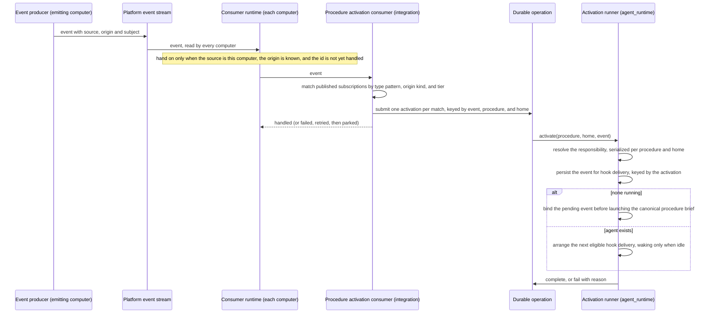
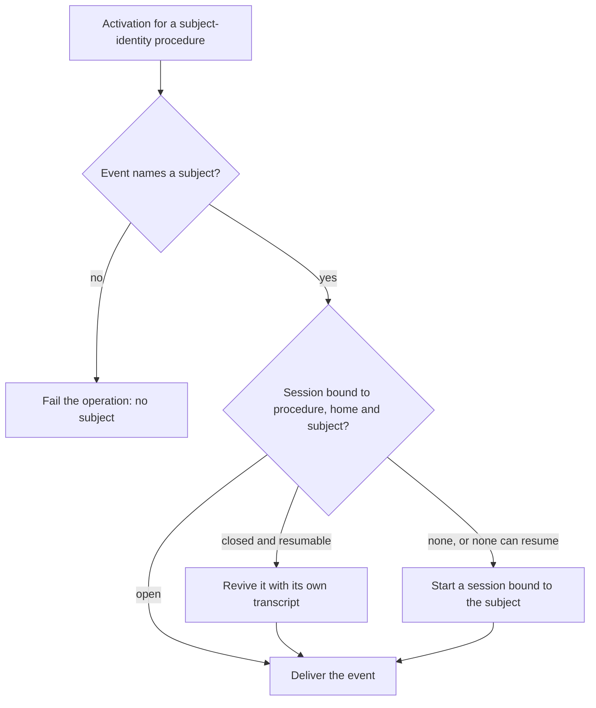

# Procedure Activation — Design

## Purpose

Connect a procedure's declared event subscriptions to the agent that answers
them, without a per-scenario command and without a business workflow engine. A
procedure declares which platform events concern it and which kind of home it
answers. On the computer that emitted a matching event, the event starts that
procedure's standing agent for the home its event's origin names, or wakes the one already
running.

An event states its source computer, its subject — the one thing it is about —
and its home: a registered company, person, or project, none, or unknown
(`local/projects/teleclaude/spec/feature/event-catalog/event-envelope`). A home
of none makes the event a platform event. The home decides which agent answers
and where it works — the company's home, the person's folder, the project's
checkout, or, for a platform event, the platform's own checkout. The source
decides which computer does the work. The subject describes the event to the
agent that receives it, and for a procedure that declares subject identity it
also chooses which of that procedure's agents in the home answers: the one
bound to that subject.

This document owns only the relationship among the participating contexts. Each
rule it relies on is stated by its owner:

| Concern                                                                                       | Owner           | Contract                                                                                                                                                                                                   |
| --------------------------------------------------------------------------------------------- | --------------- | ---------------------------------------------------------------------------------------------------------------------------------------------------------------------------------------------------------- |
| An event's source, origin and subject, the one type-pattern matcher, and the consumer runtime | `event-catalog` | `local/projects/teleclaude/spec/domain/event-catalog`, `local/projects/teleclaude/spec/feature/event-catalog/event-envelope`, `local/projects/teleclaude/spec/feature/event-catalog/event-consumers`       |
| The activation declaration, its validation, and the catalogue consequence                     | `context`       | `local/projects/teleclaude/spec/domain/context`, `local/projects/teleclaude/spec/feature/context/snippet-frontmatter-validation`, `local/projects/teleclaude/spec/feature/context/agents-master-inflation` |
| Whether a registered company, person, or project is present here, and its folder              | `config`        | `local/projects/teleclaude/spec/domain/config`                                                                                                                                                             |
| Matching an event to subscriptions on the computer that emitted it and producing activations  | `integration`   | `local/projects/teleclaude/spec/feature/integration/procedure-subscription-routing`                                                                                                                        |
| The activation runner, the home an agent works in, and each session's company                 | `agent_runtime` | `local/projects/teleclaude/spec/feature/agent_runtime/procedure-standing-agent`, `local/projects/teleclaude/spec/feature/agent_runtime/company-scoped-session-context`                                     |
| Membership facts and the company context tools read inside a session                          | `identity`      | `local/projects/teleclaude/spec/domain/identity`, `local/projects/teleclaude/spec/feature/identity/whoami-resolution`                                                                                      |

## Inputs/Outputs

**Inputs:**

- Platform events from the platform event stream, handed to the procedure
  activation consumer on this computer, each carrying the source, subject, and
  origin its producer stated.
- Each published procedure's declared subscriptions as type patterns, the home
  kind it answers, the agent identity it declares, and its publication tier,
  from the publication index.
- Whether the event's company, person, or project is registered on this
  computer, and its folder here; for a platform event, the platform's own
  checkout on this computer.

**Outputs:**

- On the computer that emitted the event only: one durable operation per
  activation, identified by the event, the procedure, and the home, completing
  when an agent is started, woken, or revived and failing visibly when none of
  these is possible.
- A standing agent session for the procedure and home, or for a procedure
  declaring subject identity a session bound to the procedure, the home, and
  the event's subject, started under the system principal in that home — with
  the session's company set when the home is a company — or an existing one
  woken with the event, or a closed subject-bound one revived with it.

## Invariants

- **Declaration is registration.** A published subscription is live with no
  further act. There is no enabling step between declaring and receiving.
- **Subscriptions are type patterns.** Each subscription is an exact event type
  name, a whole-segment prefix followed by `.*`, or `*`, matched with the one
  type-pattern matcher the event catalog owns. A pattern in any other form is
  refused where it is declared, so it is never published.
- **A procedure answers one home kind.** It declares whether it answers company,
  person, project, or platform events, and it matches only events of a
  subscribed type whose origin is of that kind; a platform procedure matches
  events whose origin is none. A project origin is never converted to its owning
  company or person, a company origin is never broadcast to its projects, and no
  kind takes precedence over another.
- **The publication tier bounds the reach.** A procedure published at global
  tier answers every home of its declared kind; one published in a company's
  tier answers that company's events only; one published in a person's tier
  answers that person's events only.
- **The emitting computer executes.** Only the computer an event's source names
  activates the procedures it matches. Every other computer that reads the event
  does nothing for it, whether or not it holds the same home (ADR-0110). Which
  computers an event reaches has no bearing on activation.
- **Unknown is never acted on.** An event whose origin is unknown activates no
  procedure of any kind, and is never read as a platform event.
- **The home chooses where the agent works.** A company home runs in that
  company's home folder, a person home in that person's folder, a project home
  in that project's checkout, and a platform event in the platform's own
  checkout, on the emitting computer. A named home absent there fails the
  activation; the work is never sent to another home or computer.
- **Activation is one independent consumer.** It reads the platform event stream
  with its own progress on each computer and declares interest in every type,
  events its own computer emitted, and homes that are known. Its failure or lag
  never holds back another consumer, and no other consumer's failure hides an
  event from it (ADR-0116).

- **Identity is the procedure and the home, and the subject when the procedure
  declares it.** A standing agent is identified by the procedure's canonical ID
  and the home — its kind and its slug, or the platform. A procedure that
  declares subject identity identifies each of its agents by the procedure, the
  home, and the subject of the activating event, so each subject has its own
  agent and a later event about that subject reaches the same one. A company, a
  person, and a project that share a slug are three different homes. The
  declared patterns are membership only, so overlapping patterns never merge
  procedures and editing them never forks a second agent. The principal is not
  an identity dimension: every event-started agent runs under the same system
  principal.

- **A replayed event is not activated twice.** The consumer runtime hands the
  consumer each event once per event id. An activation's identity is derived
  from the event's id, the procedure, and the home, and both the activation's
  durable operation and its delivery into the agent are keyed by it, so an
  event handed again after interrupted handling submits only the activations
  not yet submitted and delivers nothing twice. Distinct events stay distinct.

- **The runner starts no second agent; nothing else is guarded.** On the
  emitting computer, the runner's resolve-or-create is serialized per procedure
  and home. It wakes a session already running the procedure for the home under
  the system principal when it finds one or more, and starts one only when it
  finds none; a human-lineage session is never adopted. Starting a
  company-home agent by hand is never refused.
  For a procedure declaring subject identity, it delivers to the session it
  bound to the subject when that session is open, revives it when it has closed
  and can resume its own transcript, and starts a bound one only when neither
  is possible; the same per-procedure-and-home serialization covers every
  subject in the home.

- **The procedure entry starts every activated agent.** The activation runner
  enters the procedure-entry contract with the procedure's identity and the
  home, subject, attendance and delivery facts as entry context; the session
  carries the procedure's declared role and reads a brief holding the
  procedure's effective required-read closure and the shared handling
  instructions Context composes from the published declaration. Domain work
  and lifecycle remain the loaded procedure's responsibility.

<!-- planned:issue-128 -->

- **A subject-identity procedure that declares parameters receives the subject as its arguments.** The activation passes the canonical item identifier that the event's subject carries as the argument text, through the existing parameter binder, so the procedure's first parameter binds it and the agent's session is titled with its role followed by that identifier. The binder refuses a parameter shape that cannot take that one token, and a procedure that declares no parameters is entered with no arguments.

<!-- /planned:issue-128 -->

- **Activation data enters through hooks.** Runtime records the initial event
  before bootstrap can offer its initial hook. The initial brief is the startup
  instruction, and its activation hook carries event data. Later idle deliveries
  use a content-free wake. The procedure's delivery declaration determines
  eligible hooks and the number of pending events selected; pending events
  restricted to wake entry do not enter the current run. The transport preserves
  untrusted event provenance and activation identity under
  `local/projects/teleclaude/spec/feature/agent_runtime/procedure-event-delivery`.
- **Delivery policy has one owner per decision.** Context validates and publishes
  delivery cardinality, interruptibility, and effective required reads;
  integration carries the resolved declarations; runtime enforces delivery
  eligibility and selection. The general event-handling procedures instruct the
  agent's handling, with the same common prose for either cardinality
  (`sdlc/principle/design-fundamentals`, `general/principle/priming`).

- **Company is explicit.** A session has a company only when created with
  `--company`, started from a session that has one, or activated for a company
  home, and only then carries a company profile. Location never supplies a
  company or a profile: an agent activated for a person, a project, or the
  platform works in that home and carries no company.

- **Attendance is the session's own audience statement.** A procedure declares
  whether people watch its agent; the activation carries that declaration, and
  the runner records it in the write that creates the agent's session. An
  unattended agent's work is a run: resolution never revives a closed
  unattended session, so a subject whose unattended agent has closed gets a new
  one. Its other readers are the session listing and live session updates,
  which leave it out of people's default views, the admin-lane decision, which
  gives it no Discord copy or reflection, and the Discord adapter, which gives
  it no thread. It never enters reach, and never changes how an activation's
  event is delivered to the agent.

- **Subscriptions follow the published index.** The subscription set is read
  from the publication index and held in memory with the identity of the index
  it came from. Before matching an event, the consumer establishes whether the
  published index has changed and re-reads it when it has, so additions, edits,
  and removals take effect at the next event with no restart and no separate
  trigger. A set that cannot be read is replaced by none, never kept stale.
- **Attention, not effect.** An activation directs the agent's attention.
  Distinct, late, and superseded events reach it and are reconciled by its
  procedure against its domain's durable work record. Replay protection covers
  activation delivery only, within the platform's retained records; it promises
  no exactly-once business effect. Missed or due attention is recovered by the
  platform's timer and periodic activation.
- **Failure stays with its owner.** Every activation is a durable operation
  submitted before any step that can fail. An activation that cannot be
  fulfilled fails that operation. A submission that itself fails fails the
  consumer's handling of the event, which the consumer runtime retries and,
  when it keeps failing, parks as the consumer's dead letter and announces.
  Neither is reported as success, and the responsibility does not move to
  another agent or computer.

## Primary flows

### Reused mechanisms

| Step                                     | Existing mechanism                                                                      | Relation                                                                                                                   |
| ---------------------------------------- | --------------------------------------------------------------------------------------- | -------------------------------------------------------------------------------------------------------------------------- |
| Event reaches the consumer               | The consumer runtime on the platform event stream                                       | Reused: activation is one consumer, interested in every type, its own computer's events, and known homes                   |
| Source, subject, and home travel with it | Event envelope attributes set by the producer                                           | Reused unchanged                                                                                                           |
| Repeat suppression per event             | The consumer runtime's duplicate protection by event id                                 | Reused unchanged                                                                                                           |
| Pattern matching and validation          | The event catalog's type-pattern matcher                                                | Reused at declaration, publication, and matching                                                                           |
| Subscription becomes matchable           | Publication index read                                                                  | Adapted: entries carry patterns, the declared home kind, and the publishing tier; re-read when the published index changes |
| Start or wake crosses into the runtime   | Local command dispatch with a durable operation receipt                                 | Adapted: the request identity is derived from the event, procedure, and home instead of minted per submission              |
| Find or create the standing agent        | Inbound resolve-or-create seam used by WhatsApp and Discord                             | Adapted: serialized per procedure and home                                                                                 |
| Locate the home                          | Registered company, person, and project folders; the platform's own checkout            | Reused through `config`'s answer and the platform checkout's existing owner                                                |
| Start                                    | The procedure-entry contract, as the scheduled-job runner uses                          | Reused with the home and delivery facts carried as entry context                                                           |
| Event delivery on start and wake         | Durable hook delivery with a content-free idle wake                                     | Adapted: eligibility and cardinality follow the procedure declaration; activation identity absorbs replay                  |
| Outcome record                           | Durable operation outcomes, receipt-first                                               | Reused: the procedure-activation completed/failed event pair                                                               |
| Company on the session                   | Session record                                                                          | Reused for a company home                                                                                                  |
| Company for tools inside the session     | Caller resolution from the session identity document's session id (`telec auth whoami`) | Reused unchanged                                                                                                           |

### Activation

### Subject-bound resolution

For a procedure that declares subject identity, the resolve step finds the
session the runner bound to the procedure, the home, and the event's subject,
closed ones included, and reuses the session-revival flow a conversation uses to
bring a closed session back with its own transcript.

<!-- planned:issue-128 -->

### Single-claim responsibilities

A driver procedure of the item lifecycle declares `session: single-claim` in its `workflow` mapping: each of its sessions serves one claim of one item. The resolve step reads the declaration from the procedure's current published declaration (no session exists yet to have persisted one) and reads the item through the store port of the project the event's home names, never by backend name or procedure identity. A procedure without the declaration resolves exactly as in the previous section.

Two inputs reach such a procedure, and the platform tells them apart by the declared data of the event's type: an event whose data carries a reservation key is a **request**; every other event about the item is a **notice**. Item, project and home are matched in every lookup below.

- **A request** starts or wakes a driver only when its key is the item's current launch reservation and the item has no holder. A request whose key is not the current reservation starts nothing: its activation reaches the terminal outcome `not delivered` with the reason `stale request`. An open session bound to the item for the procedure and home is woken for a request only when it is entitled to that request: an activation assigned to it carries a request event for this item with this key. A closed session is never revived. Otherwise a fresh session is started and bound to the item; it persists the publication current at its start, which governs every claim and act of that session, and it claims by presenting the reservation read from its own accepted activation.
- **A notice** goes only to the open session bound to the item for the procedure and home whose session is the item's holder. It never starts a session, never revives one, and is not given to a session that has only been started for a reservation and has not claimed. With no such holder it ends with the terminal outcome `not delivered` and the reason `no holder`; the platform's evidence of the head, which is recorded on the item and retained, is untouched, and the next driver, which a request starts, resumes from the store alone.

**The inbox of a single-claim responsibility.** Acceptance keeps every activation as a durable inbox row. For such a responsibility only:

- the outcome `not delivered` is a terminal outcome with the closed reasons `stale request`, `no holder` and `session closed`; it is accepted for pending and for suspended rows and sets the row's terminal time;
- a start or a wake takes only the row of the activation that qualified it; it does not take the responsibility's whole backlog. A row already assigned to a session is not touched: a holder keeps every valid undelivered notice, in their durable order, and two valid head notices for a holder that has not yet reached an eligible hook are both offered there, each published commit once;
- a row that is unassigned and still pending or suspended when a start looks at the responsibility is judged by the same two rules applied to its own event; a request for the current reservation is the start's own, a request for another key is `stale request`, a notice with no holder yet is `no holder`. No row is ended as a blanket supersession of a backlog;
- closing the session ends its pending rows as `not delivered` with the reason `session closed` and keeps their assignee, instead of suspending and unassigning them;
- launch recovery reads a request row that is pending with no assigned session as unknown, so the reservation is held, and a request row that is terminal with a retained assignee whose session is closed as proof that the entitled session ended before it claimed.

The inbox terminal result `not delivered` is returned by a completed activation operation. The durable operation retains its existing completed or failed outcomes; an expected decision to deliver nothing is not an operation failure (`local/projects/teleclaude/spec/feature/agent_runtime/durable-operation-outcomes`).

**A reservation is released on terminal evidence for exactly its request.** The request's notice went out, every activation it caused is terminal, and no open session entitled to that request remains that could still claim. An open session bound to the item but entitled only to an earlier request is not counted, signalled or ended. A clock decides nothing: activations never captured, or whose assigned session is not recorded, leave the reservation held and unknown.
<!-- /planned:issue-128 -->

<!-- planned:issue-128 -->

**A request from `prepared` also stands on the prepared body.** For a request whose reservation was made from `prepared`, the item's current intent-body revision must also equal the revision its prepared act named (#124 INV-S3). The judgment that reads the holder and the reservation reads that revision too, immediately before it wakes or creates a session. An item or body that cannot be read does not stand. A request that does not stand starts nothing: its activation reaches `not delivered` with the reason `stale request`, and its reservation is released only on terminal evidence for exactly that request, as above. A reservation made from any other phase is judged by the holder and the reservation alone.

<!-- /planned:issue-128 -->

### Company on a human-directed session

A session created with `--company` operates for that company once
`agent_runtime` validates it against `identity`'s membership resolution; an
unknown company is an error and a foreign one is refused. The company is
recorded on the session record and set on every session it starts. Only such a
session, or one activated for a company home, carries a company profile in its
startup context; standing in a company's project adds none.

The company lives on the session record and nowhere else. A tool inside a
session reads it through the session id: the session identity document names
the session, and `identity` resolves the context from the record that id names
when the tool asks — the session's company when set, otherwise a sole eligible
company as resolved, otherwise an unresolved answer naming the eligible
companies — and publishes it through `telec auth whoami`, which any tool can
run whatever its language. Nothing company-related is written into the session
identity document.

### Catalogue

The catalogue build reads each procedure's activation declaration from the
publication index. A triggered procedure is listed among the self-service
activatable procedures. A subscribed procedure is listed as a configured
responsibility with the event patterns it answers to, so an agent sees that the
work is owned without being offered it.

## Failure modes

- **No standing agent can be started or reached** on the emitting computer —
  the activation's durable operation fails with its reason, readable as an
  operation outcome. Nothing retries on another agent's or computer's behalf.
- **The event's origin is not registered on the emitting computer** — a company, person,
  or project not registered there fails the activation's operation with the
  reason that its home is absent. No other home or computer takes it.
- **Activation submission fails** — the consumer's handling of the event fails.
  The consumer runtime retries it; activations already submitted for the event
  are found by their identity and not submitted again. An event that keeps
  failing is parked as the consumer's dead letter and announced, and later
  events proceed. Nothing is reported as activated that was not.
- **The event was emitted on another computer** — this computer's consumer is
  not handed it and opens no operation. This is the normal case on every
  computer but the emitting one.
- **An event's origin is unknown** — the consumer is not handed it; no procedure
  is activated, whatever kind it answers.
- **An event's origin is of another kind than a procedure answers** — the
  procedure does not match it, and nothing converts the home into its kind.
- **A tier-published procedure meets an event about another company or
  person** — it does not match; only global-tier procedures answer every home of
  their kind.
- **The same event is handed again** — interrupted handling hands it again. Its
  activation identities find the existing operations, and the agent receives no
  second delivery. Once the platform has pruned those records, a repeat is
  treated as a new activation.
- **Concurrent activations for one procedure and home** — serialized
  resolve-or-create leaves one agent; each later activation is delivered to it.
- **A person-home agent works in a person's folder** — it runs under the system
  principal and carries no human identity; what a procedure may do there is
  that procedure's and its domain's contract, never something activation
  grants.
- **A procedure declares both activation modes, declares no home kind, declares
  a malformed pattern, or declares a kind its tier cannot answer** —
  publication fails validation, so no subscription is read from it.
- **A subscription is added, edited, or removed while the daemon runs** — the
  next event finds the published index changed and the consumer re-reads it
  before matching; the edit changes event membership, never which agent
  continues the procedure and home.
- **An event is missed, for example while the emitting computer's daemon is
  down past the stream's retention** — no activation occurs for it, and no
  other computer stands in. The procedure reconciles against its domain's
  durable work record on the next activation, and periodic activation covers
  attention no event triggers.
- **An activated agent emits events its own subscriptions match** — it is
  activated by them like by any other event. Which events a procedure
  subscribes to, and how it treats events its own work caused, is that
  procedure's contract.
- **A requested company does not exist, or the requester is not a member** —
  refused at session creation. No session operates under it.

- **A subject-identity activation's event names no subject** — the activation's
  operation fails stating that no subject was named; no agent is started or
  woken.
- **A subject-bound session has closed** — it is revived with its own
  transcript and receives the event. A closed bound session that cannot resume
  its transcript is succeeded by a new session bound to the same subject. A
  revival that is attempted and fails fails the activation's operation with its
  reason.

<!-- planned:issue-128 -->

- **A single-claim driver's session has closed** — it is not revived. A request for the item's current reservation starts a fresh session; a notice with no open holder ends as `not delivered`.

<!-- /planned:issue-128 -->

- **A subject-bound session's record has been purged** — nothing binds the
  subject any more, and the next event about it starts a new bound agent
  without the earlier context.

## See Also

- docs/local/adr/0110-an-event-activated-procedure-runs-where-its-event-originated.md — why the emitting computer executes and the home chooses where the agent works.
- docs/local/adr/0114-events-take-the-cloudevents-attribute-model.md — why the home, not the subject, names whose an event is.
- docs/local/adr/0116-each-reaction-to-a-platform-event-is-an-independent-consumer.md — why activation runs as an independent consumer with core-owned duplicate protection.
- docs/local/adr/0109-an-event-that-cannot-establish-its-subject-says-so.md — why none and unknown are different homes.
- docs/local/adr/0062-commands-carry-target-computer.md — computer-addressed command dispatch.
- docs/local/spec/feature/agent_runtime/durable-operation-outcomes.md — the outcome record each activation uses.
- docs/local/spec/feature/agent_runtime/scheduled-agent-command-dispatch.md — the generic-command dispatch the activation command mirrors.
