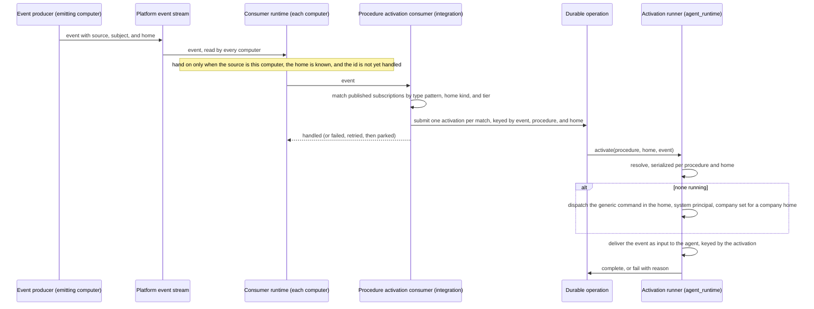

# Procedure Activation — Design

## Purpose

Connect a procedure's declared event subscriptions to the agent that answers
them, without a per-scenario command and without a business workflow engine. A
procedure declares which platform events concern it and which kind of home it
answers. On the computer that emitted a matching event, the event starts that
procedure's standing agent for the event's home, or wakes the one already
running.

An event states its source computer, its subject — the one thing it is about —
and its home: a registered company, person, or project, none, or unknown
(`local/projects/teleclaude/spec/feature/event-catalog/event-envelope`). A home
of none makes the event a platform event. The home decides which agent answers
and where it works — the company's home, the person's folder, the project's
checkout, or, for a platform event, the platform's own checkout. The source
decides which computer does the work. The subject only describes the event to
the agent that receives it.

This document owns only the relationship among the participating contexts. Each
rule it relies on is stated by its owner:

| Concern                                                                                      | Owner           | Contract                                                                                                                                                                                                   |
| -------------------------------------------------------------------------------------------- | --------------- | ---------------------------------------------------------------------------------------------------------------------------------------------------------------------------------------------------------- |
| An event's source, subject, and home, the one type-pattern matcher, and the consumer runtime | `event-catalog` | `local/projects/teleclaude/spec/domain/event-catalog`, `local/projects/teleclaude/spec/feature/event-catalog/event-envelope`, `local/projects/teleclaude/spec/feature/event-catalog/event-consumers`       |
| The activation declaration, its validation, and the catalogue consequence                    | `context`       | `local/projects/teleclaude/spec/domain/context`, `local/projects/teleclaude/spec/feature/context/snippet-frontmatter-validation`, `local/projects/teleclaude/spec/feature/context/agents-master-inflation` |
| Whether a registered company, person, or project is present here, and its folder             | `config`        | `local/projects/teleclaude/spec/domain/config`                                                                                                                                                             |
| Matching an event to subscriptions on the computer that emitted it and producing activations | `integration`   | `local/projects/teleclaude/spec/feature/integration/procedure-subscription-routing`                                                                                                                        |
| The activation runner, the home an agent works in, and each session's company                | `agent_runtime` | `local/projects/teleclaude/spec/feature/agent_runtime/procedure-standing-agent`, `local/projects/teleclaude/spec/feature/agent_runtime/company-scoped-session-context`                                     |
| Membership facts and the company context tools read inside a session                         | `identity`      | `local/projects/teleclaude/spec/domain/identity`, `local/projects/teleclaude/spec/feature/identity/whoami-resolution`                                                                                      |

## Inputs/Outputs

**Inputs:**

- Platform events from the platform event stream, handed to the procedure
  activation consumer on this computer, each carrying the source, subject, and
  home its producer stated.
- Each published procedure's declared subscriptions as type patterns, the home
  kind it answers, and its publication tier, from the publication index.
- Whether the event's company, person, or project is registered on this
  computer, and its folder here; for a platform event, the platform's own
  checkout on this computer.

**Outputs:**

- On the computer that emitted the event only: one durable operation per
  activation, identified by the event, the procedure, and the home, completing
  when an agent is started or woken and failing visibly when neither is
  possible.
- A standing agent session for the procedure and home, started under the system
  principal in that home — with the session's company set when the home is a
  company — or an existing one woken with the event.

## Invariants

- **Declaration is registration.** A published subscription is live with no
  further act. There is no enabling step between declaring and receiving.
- **Subscriptions are type patterns.** Each subscription is an exact event type
  name, a whole-segment prefix followed by `.*`, or `*`, matched with the one
  type-pattern matcher the event catalog owns. A pattern in any other form is
  refused where it is declared, so it is never published.
- **A procedure answers one home kind.** It declares whether it answers company,
  person, project, or platform events, and it matches only events of a
  subscribed type whose home is of that kind; a platform procedure matches
  events whose home is none. A project's home is never converted to its owning
  company or person, a company's home is never broadcast to its projects, and no
  kind takes precedence over another.
- **The publication tier bounds the reach.** A procedure published at global
  tier answers every home of its declared kind; one published in a company's
  tier answers that company's events only; one published in a person's tier
  answers that person's events only.
- **The emitting computer executes.** Only the computer an event's source names
  activates the procedures it matches. Every other computer that reads the event
  does nothing for it, whether or not it holds the same home (ADR-0110). Which
  computers an event reaches has no bearing on activation.
- **Unknown is never acted on.** An event whose home is unknown activates no
  procedure of any kind, and is never read as a platform event.
- **The home chooses where the agent works.** A company home runs in that
  company's home folder, a person home in that person's folder, a project home
  in that project's checkout, and a platform event in the platform's own
  checkout, on the emitting computer. A named home absent there fails the
  activation; the work is never sent to another home or computer.
- **Activation is one independent consumer.** It reads the platform event stream
  with its own progress on each computer and declares interest in every type,
  events its own computer emitted, and homes that are known. Its failure or lag
  never holds back another consumer, and no other consumer's failure hides an
  event from it (ADR-0116).
- **Identity is the procedure and the home.** A standing agent is identified by
  the procedure's canonical ID and the home — its kind and its slug, or the
  platform. A company, a person, and a project that share a slug are three
  different homes. The declared patterns are membership only, so overlapping
  patterns never merge procedures and editing them never forks a second agent.
  The principal is not an identity dimension: every event-started agent runs
  under the same system principal.
- **A replayed event is not activated twice.** The consumer runtime hands the
  consumer each event once per event id. An activation's identity is derived
  from the event's id, the procedure, and the home, and both the activation's
  durable operation and its delivery into the agent are keyed by it, so an
  event handed again after interrupted handling submits only the activations
  not yet submitted and delivers nothing twice. Distinct events stay distinct.
- **The runner starts no second agent; nothing else is guarded.** On the
  emitting computer, the runner's resolve-or-create is serialized per procedure
  and home. It wakes a session already running the procedure for the home under
  the system principal when it finds one or more, and starts one only when it
  finds none; a human-lineage session is never adopted. Starting a
  company-home agent by hand is never refused.
- **One thin command starts every activated agent.** The generic
  procedure-activation command carries the procedure's identity and the home,
  runs in that home, and loads the procedure with its required reads as the
  agent's complete instruction set. It says nothing about lifecycle or about
  later events; the loaded procedure owns both.
- **One delivery path for events.** The triggering event reaches a new agent as
  its first input, through the session-input delivery that wakes an existing
  agent. No event travels as additional startup context, and the event, data
  included, is delivered as untrusted data.
- **Company is explicit.** A session has a company only when created with
  `--company`, started from a session that has one, or activated for a company
  home, and only then carries a company profile. Location never supplies a
  company or a profile: an agent activated for a person, a project, or the
  platform works in that home and carries no company.
- **Subscriptions follow the published index.** The subscription set is read
  from the publication index and held in memory with the identity of the index
  it came from. Before matching an event, the consumer establishes whether the
  published index has changed and re-reads it when it has, so additions, edits,
  and removals take effect at the next event with no restart and no separate
  trigger. A set that cannot be read is replaced by none, never kept stale.
- **Attention, not effect.** An activation directs the agent's attention.
  Distinct, late, and superseded events reach it and are reconciled by its
  procedure against its domain's durable work record. Replay protection covers
  activation delivery only, within the platform's retained records; it promises
  no exactly-once business effect. Missed or due attention is recovered by the
  platform's timer and periodic activation.
- **Failure stays with its owner.** Every activation is a durable operation
  submitted before any step that can fail. An activation that cannot be
  fulfilled fails that operation. A submission that itself fails fails the
  consumer's handling of the event, which the consumer runtime retries and,
  when it keeps failing, parks as the consumer's dead letter and announces.
  Neither is reported as success, and the responsibility does not move to
  another agent or computer.

## Primary flows

### Reused mechanisms

| Step                                     | Existing mechanism                                                                      | Relation                                                                                                                   |
| ---------------------------------------- | --------------------------------------------------------------------------------------- | -------------------------------------------------------------------------------------------------------------------------- |
| Event reaches the consumer               | The consumer runtime on the platform event stream                                       | Reused: activation is one consumer, interested in every type, its own computer's events, and known homes                   |
| Source, subject, and home travel with it | Event envelope attributes set by the producer                                           | Reused unchanged                                                                                                           |
| Repeat suppression per event             | The consumer runtime's duplicate protection by event id                                 | Reused unchanged                                                                                                           |
| Pattern matching and validation          | The event catalog's type-pattern matcher                                                | Reused at declaration, publication, and matching                                                                           |
| Subscription becomes matchable           | Publication index read                                                                  | Adapted: entries carry patterns, the declared home kind, and the publishing tier; re-read when the published index changes |
| Start or wake crosses into the runtime   | Local command dispatch with a durable operation receipt                                 | Adapted: the request identity is derived from the event, procedure, and home instead of minted per submission              |
| Find or create the standing agent        | Inbound resolve-or-create seam used by WhatsApp and Discord                             | Adapted: serialized per procedure and home                                                                                 |
| Locate the home                          | Registered company, person, and project folders; the platform's own checkout            | Reused through `config`'s answer and the platform checkout's existing owner                                                |
| Start                                    | Canonical command-session dispatch, as the scheduled-job runner's generic command uses  | Reused with a sibling generic command carrying procedure and home                                                          |
| Event delivery on start and wake         | Session-input delivery                                                                  | Reused; its occurrence is the activation's identity, so a replay is absorbed                                               |
| Outcome record                           | Durable operation outcomes, receipt-first                                               | Reused: the procedure-activation completed/failed event pair                                                               |
| Company on the session                   | Session record                                                                          | Reused for a company home                                                                                                  |
| Company for tools inside the session     | Caller resolution from the session identity document's session id (`telec auth whoami`) | Reused unchanged                                                                                                           |

### Activation

### Company on a human-directed session

A session created with `--company` operates for that company once
`agent_runtime` validates it against `identity`'s membership resolution; an
unknown company is an error and a foreign one is refused. The company is
recorded on the session record and set on every session it starts. Only such a
session, or one activated for a company home, carries a company profile in its
startup context; standing in a company's project adds none.

The company lives on the session record and nowhere else. A tool inside a
session reads it through the session id: the session identity document names
the session, and `identity` resolves the context from the record that id names
when the tool asks — the session's company when set, otherwise a sole eligible
company as resolved, otherwise an unresolved answer naming the eligible
companies — and publishes it through `telec auth whoami`, which any tool can
run whatever its language. Nothing company-related is written into the session
identity document.

### Catalogue

The catalogue build reads each procedure's activation declaration from the
publication index. A triggered procedure is listed among the self-service
activatable procedures. A subscribed procedure is listed as a configured
responsibility with the event patterns it answers to, so an agent sees that the
work is owned without being offered it.

## Failure modes

- **No standing agent can be started or reached** on the emitting computer —
  the activation's durable operation fails with its reason, readable as an
  operation outcome. Nothing retries on another agent's or computer's behalf.
- **The event's home is absent on the emitting computer** — a company, person,
  or project not registered there fails the activation's operation with the
  reason that its home is absent. No other home or computer takes it.
- **Activation submission fails** — the consumer's handling of the event fails.
  The consumer runtime retries it; activations already submitted for the event
  are found by their identity and not submitted again. An event that keeps
  failing is parked as the consumer's dead letter and announced, and later
  events proceed. Nothing is reported as activated that was not.
- **The event was emitted on another computer** — this computer's consumer is
  not handed it and opens no operation. This is the normal case on every
  computer but the emitting one.
- **An event's home is unknown** — the consumer is not handed it; no procedure
  is activated, whatever kind it answers.
- **An event's home is of another kind than a procedure answers** — the
  procedure does not match it, and nothing converts the home into its kind.
- **A tier-published procedure meets an event about another company or
  person** — it does not match; only global-tier procedures answer every home of
  their kind.
- **The same event is handed again** — interrupted handling hands it again. Its
  activation identities find the existing operations, and the agent receives no
  second delivery. Once the platform has pruned those records, a repeat is
  treated as a new activation.
- **Concurrent activations for one procedure and home** — serialized
  resolve-or-create leaves one agent; each later activation is delivered to it.
- **A person-home agent works in a person's folder** — it runs under the system
  principal and carries no human identity; what a procedure may do there is
  that procedure's and its domain's contract, never something activation
  grants.
- **A procedure declares both activation modes, declares no home kind, declares
  a malformed pattern, or declares a kind its tier cannot answer** —
  publication fails validation, so no subscription is read from it.
- **A subscription is added, edited, or removed while the daemon runs** — the
  next event finds the published index changed and the consumer re-reads it
  before matching; the edit changes event membership, never which agent
  continues the procedure and home.
- **An event is missed, for example while the emitting computer's daemon is
  down past the stream's retention** — no activation occurs for it, and no
  other computer stands in. The procedure reconciles against its domain's
  durable work record on the next activation, and periodic activation covers
  attention no event triggers.
- **An activated agent emits events its own subscriptions match** — it is
  activated by them like by any other event. Which events a procedure
  subscribes to, and how it treats events its own work caused, is that
  procedure's contract.
- **A requested company does not exist, or the requester is not a member** —
  refused at session creation. No session operates under it.

## See Also

- docs/local/adr/0110-an-event-activated-procedure-runs-where-its-event-originated.md — why the emitting computer executes and the home chooses where the agent works.
- docs/local/adr/0114-events-take-the-cloudevents-attribute-model.md — why the home, not the subject, names whose an event is.
- docs/local/adr/0116-each-reaction-to-a-platform-event-is-an-independent-consumer.md — why activation runs as an independent consumer with core-owned duplicate protection.
- docs/local/adr/0109-an-event-that-cannot-establish-its-subject-says-so.md — why none and unknown are different homes.
- docs/local/adr/0062-commands-carry-target-computer.md — computer-addressed command dispatch.
- docs/local/spec/feature/agent_runtime/durable-operation-outcomes.md — the outcome record each activation uses.
- docs/local/spec/feature/agent_runtime/scheduled-agent-command-dispatch.md — the generic-command dispatch the activation command mirrors.
