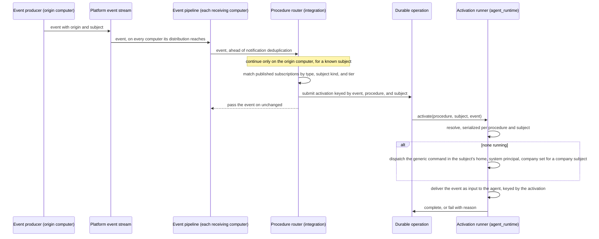

# Procedure Activation — Design

## Purpose

Connect a procedure's declared event subscriptions to the agent that answers
them, without a per-scenario command and without a business workflow engine. A
procedure declares which platform events concern it and which kind of subject
it answers. On the computer a matching event originated on, the event starts
that procedure's standing agent for the event's subject, or wakes the one
already running.

An event's subject is what its producer states it is about
(`local/projects/teleclaude/spec/feature/event-catalog/event-envelope`): a
registered company, person, or project, none, or unknown. A subject of none
makes the event a platform event. The subject decides which agent answers and
where it works — the company's home, the person's folder, the project's
checkout, or, for a platform event, the platform's own checkout. The event's
origin decides which computer does the work.

This document owns only the relationship among the participating contexts. Each
rule it relies on is stated by its owner:

| Concern                                                                                | Owner           | Contract                                                                                                                                                                                                   |
| -------------------------------------------------------------------------------------- | --------------- | ---------------------------------------------------------------------------------------------------------------------------------------------------------------------------------------------------------- |
| An event's origin and subject, and the stream that carries it                          | `event-catalog` | `local/projects/teleclaude/spec/domain/event-catalog`, `local/projects/teleclaude/spec/feature/event-catalog/event-envelope`                                                                               |
| The activation declaration, its validation, and the catalogue consequence              | `context`       | `local/projects/teleclaude/spec/domain/context`, `local/projects/teleclaude/spec/feature/context/snippet-frontmatter-validation`, `local/projects/teleclaude/spec/feature/context/agents-master-inflation` |
| Whether a registered company, person, or project is present here, and its folder       | `config`        | `local/projects/teleclaude/spec/domain/config`                                                                                                                                                             |
| Matching an event to a subscription on its origin computer and producing an activation | `integration`   | `local/projects/teleclaude/spec/feature/integration/procedure-subscription-routing`                                                                                                                        |
| The activation runner, the subject's home, and each session's company                  | `agent_runtime` | `local/projects/teleclaude/spec/feature/agent_runtime/procedure-standing-agent`, `local/projects/teleclaude/spec/feature/agent_runtime/company-scoped-session-context`                                     |
| Membership facts and the company context tools read inside a session                   | `identity`      | `local/projects/teleclaude/spec/domain/identity`, `local/projects/teleclaude/spec/feature/identity/whoami-resolution`                                                                                      |

## Inputs/Outputs

**Inputs:**

- Platform events as they reach this computer's event pipeline, each carrying
  the origin and subject its producer stated. Which computers an event reaches
  is the producer's distribution choice and is not changed here.
- Each published procedure's declared subscriptions, the subject kind it
  answers, and its publication tier, from the publication index.
- Whether the subject's company, person, or project is registered on the origin
  computer, and its folder there; for a platform event, the platform's own
  checkout on that computer.

**Outputs:**

- On the origin computer only: one durable operation per activation, identified
  by the event, the procedure, and the subject, completing when an agent is
  started or woken and failing visibly when neither is possible.
- A standing agent session for the procedure and subject, started under the
  system principal in the subject's home — with the session's company set when
  the subject is a company — or an existing one woken with the event.

## Invariants

- **Declaration is registration.** A published subscription is live with no
  further act. There is no enabling step between declaring and receiving.
- **A procedure answers one subject kind.** It declares whether it answers
  company, person, project, or platform events, and it matches only events of a
  subscribed type whose subject is of that kind; a platform procedure matches
  events whose subject is none. A project's subject is never converted to its
  owning company or person, a company's subject is never broadcast to its
  projects, and no kind takes precedence over another.
- **The publication tier bounds the reach.** A procedure published at global
  tier answers every subject of its declared kind; one published in a company's
  tier answers that company's events only; one published in a person's tier
  answers that person's events only.
- **The origin computer executes.** Only the computer an event was emitted on
  activates the procedures it matches. Every other computer the event reaches
  does nothing for it, whether or not it holds the same home, and an event that
  names no origin activates nothing (ADR-0110).
- **Unknown is never acted on.** An event whose subject is unknown activates no
  procedure of any kind, and is never read as a platform event.
- **The subject chooses the home.** A company subject runs in that company's
  home, a person subject in that person's folder, a project subject in that
  project's checkout, and a platform event in the platform's own checkout, on
  the origin computer. A named home absent there fails the activation; the work
  is never sent to another home or computer.
- **The consumer adds no transport.** Activation reacts only to events that
  reach it. Distribution, observation on other computers, and visibility remain
  the producer's and the transport's.
- **Identity is the procedure and the subject.** A standing agent is identified
  by the procedure's canonical ID and the subject — its kind and its slug, or
  the platform. A company, a person, and a project that share a slug are three
  different subjects. The declared event list is membership only, so
  overlapping lists never merge procedures and editing a list never forks a
  second agent. The principal is not an identity dimension: every event-started
  agent runs under the same system principal.
- **A replayed event is not activated twice.** An activation's identity is
  derived from the event's own identity, the procedure, and the subject, and
  both the activation's durable operation and its delivery into the agent are
  keyed by it. Within the records the platform retains, a replay of the same
  event for the same procedure and subject finds the existing activation and
  delivers nothing further; distinct events stay distinct.
- **Activation precedes notification deduplication.** Activation is decided in
  the platform event pipeline before the stage that drops events already
  projected as notifications, so an event retried because a later stage failed
  still reaches activation, where its identity absorbs the repeat. Activation
  passes every event on unchanged and never stops the stages after it.
- **The runner starts no second agent; nothing else is guarded.** On the origin
  computer, the runner's resolve-or-create is serialized per procedure and
  subject. It wakes a session already running the procedure for the subject
  under the system principal when it finds one or more, and starts one only when
  it finds none; a human-lineage session is never adopted. Starting such a
  session by hand is never refused.
- **One thin command starts every activated agent.** The generic
  procedure-activation command carries the procedure's identity and the
  subject, runs in the subject's home, and loads the procedure with its required
  reads as the agent's complete instruction set. It says nothing about
  lifecycle or about later events; the loaded procedure owns both.
- **One delivery path for events.** The triggering event reaches a new agent as
  its first input, through the session-input delivery that wakes an existing
  agent. No event travels as additional startup context, and the event's
  content is delivered as untrusted data.
- **Company is explicit.** A session has a company only when created with
  `--company`, started from a session that has one, or activated for a company
  subject, and only then carries a company profile. Location never supplies a
  company or a profile: an agent activated for a person, a project, or the
  platform works in that home and carries no company.
- **Subscriptions follow the published index.** The subscription set is read
  from the publication index and held in memory with the digest of the index it
  came from. Before acting on an event, the router establishes whether the
  published index has changed and re-reads it when it has, so additions, edits,
  and removals take effect at the next event with no restart and no separate
  trigger. A set that cannot be read is replaced by none, never kept stale.
- **Attention, not effect.** An activation directs the agent's attention.
  Distinct, late, and superseded events reach it and are reconciled by its
  procedure against its domain's durable work record. Replay protection covers
  activation delivery only, within the platform's retained records; it promises
  no exactly-once business effect. Missed or due attention is recovered by the
  platform's timer and periodic activation.
- **Failure stays with its owner.** The router's first act for a match submits
  the activation with a durable operation receipt, so every activation has an
  operation before any step that can fail. An activation that cannot be
  fulfilled fails that operation; a submission that itself fails is emitted as
  a platform error event. Neither is reported as success, and the
  responsibility does not move to another agent or computer.

## Primary flows

### Reused mechanisms

| Step                                   | Existing mechanism                                                                      | Relation                                                                                                           |
| -------------------------------------- | --------------------------------------------------------------------------------------- | ------------------------------------------------------------------------------------------------------------------ |
| Event reaches the consumer             | Platform event stream, consumed by each computer's event pipeline                       | Reused unchanged                                                                                                   |
| Origin and subject travel with it      | Event envelope facts set by the producer                                                | Reused unchanged                                                                                                   |
| Where activation is decided            | System event pipeline stage ahead of deduplication, as the integration trigger runs     | Adapted: a pipeline stage that matches and submits, then passes the event on                                       |
| Subscription becomes matchable         | Publication index read                                                                  | Adapted: entries carry the declared subject kind and the publishing tier; re-read when the published index changes |
| Start or wake crosses into the runtime | Local command dispatch with a durable operation receipt                                 | Adapted: the request identity is derived from the event, procedure, and subject instead of minted per submission   |
| Find or create the standing agent      | Inbound resolve-or-create seam used by WhatsApp and Discord                             | Adapted: serialized per procedure and subject                                                                      |
| Locate the home                        | Registered company, person, and project folders; the platform's own checkout            | Reused through `config`'s answer and the platform checkout's existing owner                                        |
| Start                                  | Canonical command-session dispatch, as the scheduled-job runner's generic command uses  | Reused with a sibling generic command carrying procedure and subject                                               |
| Event delivery on start and wake       | Session-input delivery                                                                  | Reused; its occurrence is the activation's identity, so a replay is absorbed                                       |
| Outcome record                         | Durable operation outcomes, receipt-first                                               | Reused: the `agent_runtime.procedure_activation` completed/failed event pair                                       |
| Company on the session                 | Session record                                                                          | Reused for a company subject                                                                                       |
| Company for tools inside the session   | Caller resolution from the session identity document's session id (`telec auth whoami`) | Reused unchanged                                                                                                   |

### Activation

### Company on a human-directed session

A session created with `--company` operates for that company once
`agent_runtime` validates it against `identity`'s membership resolution; an
unknown company is an error and a foreign one is refused. The company is
recorded on the session record and set on every session it starts. Only such a
session, or one activated for a company subject, carries a company profile in
its startup context; standing in a company's project adds none.

The company lives on the session record and nowhere else. A tool inside a
session reads it through the session id: the session identity document names
the session, and `identity` resolves the context from the record that id names
when the tool asks — the session's company when set, otherwise a sole eligible
company as resolved, otherwise an unresolved answer naming the eligible
companies — and publishes it through `telec auth whoami`, which any tool can
run whatever its language. Nothing company-related is written into the session
identity document.

### Catalogue

The catalogue build reads each procedure's activation declaration from the
publication index. A triggered procedure is listed among the self-service
activatable procedures. A subscribed procedure is listed as a configured
responsibility with the events it answers to, so an agent sees that the work is
owned without being offered it.

## Failure modes

- **No standing agent can be started or reached** on the origin computer — the
  activation's durable operation fails with its reason, readable as an
  operation outcome. Nothing retries on another agent's or computer's behalf.
- **The subject's home is absent on the origin computer** — a company,
  person, or project not registered there fails the activation's operation with
  the reason that its home is absent. No other home or computer takes it.
- **Activation submission fails** — no operation can be opened. The failure is
  emitted as a platform error event, nothing is reported as activated, and the
  event continues through the pipeline.
- **The event reaches a computer it did not originate on** — that computer
  activates nothing and opens no operation; its routing decision names the
  origin as elsewhere. This is the normal case wherever the event's
  distribution reaches beyond its origin.
- **An event names no origin** — no computer activates anything for it; each
  records a routing decision naming the absent origin.
- **An event's subject is unknown** — no procedure is activated, whatever kind
  it answers; the routing decision names the unknown subject.
- **An event's subject is of another kind than a procedure answers** — the
  procedure does not match it, and nothing converts the subject into its kind.
- **A tier-published procedure meets an event about another company or
  person** — it does not match; only global-tier procedures answer every
  subject of their kind.
- **The same event is replayed** — a retried stream entry or a reprocessed event
  reaches the router again. Its activation identity finds the existing
  operation, and the agent receives no second delivery. Once the platform has
  pruned those records, a replay is treated as a new activation.
- **A later pipeline stage fails after activation** — the stream entry is
  retried; the router sees it again and its identity absorbs the repeat, while
  notification deduplication still governs the stages after it.
- **Concurrent activations for one procedure and subject** — serialized
  resolve-or-create leaves one agent; each later activation is delivered to it.
- **A person-subject agent works in a person's folder** — it runs under the
  system principal and carries no human identity; what a procedure may do there
  is that procedure's and its domain's contract, never something activation
  grants.
- **A procedure declares both activation modes, declares no subject kind, or
  declares a kind its tier cannot answer** — publication fails validation, so
  no subscription is read from it.
- **A subscription is added, edited, or removed while the daemon runs** — the
  next event finds the published index changed and the router re-reads it
  before matching; the edit changes event membership, never which agent
  continues the procedure and subject.
- **An event is missed, for example while its origin computer's daemon is down**
  — no activation occurs for it, and no other computer stands in. The procedure
  reconciles against its domain's durable work record on the next activation,
  and periodic activation covers attention no event triggers.
- **A requested company does not exist, or the requester is not a member** —
  refused at session creation. No session operates under it.

## See Also

- docs/local/adr/0110-an-event-activated-procedure-runs-where-its-event-originated.md — why the origin computer executes and the subject chooses the home.
- docs/local/adr/0105-event-access-follows-the-subject-its-producer-states.md — why consumers decide their own reaction from facts the producer states.
- docs/local/adr/0109-an-event-that-cannot-establish-its-subject-says-so.md — why none and unknown are different subjects.
- docs/local/adr/0062-commands-carry-target-computer.md — computer-addressed command dispatch.
- docs/local/spec/feature/agent_runtime/durable-operation-outcomes.md — the outcome record each activation uses.
- docs/local/spec/feature/agent_runtime/scheduled-agent-command-dispatch.md — the generic-command dispatch the activation command mirrors.
