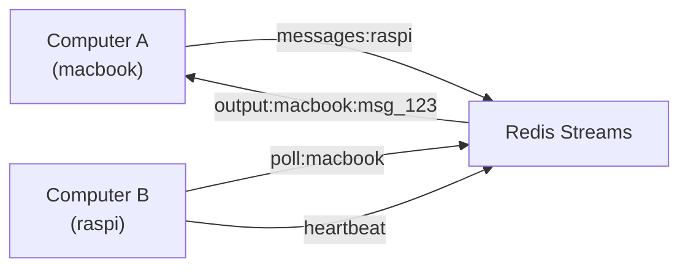
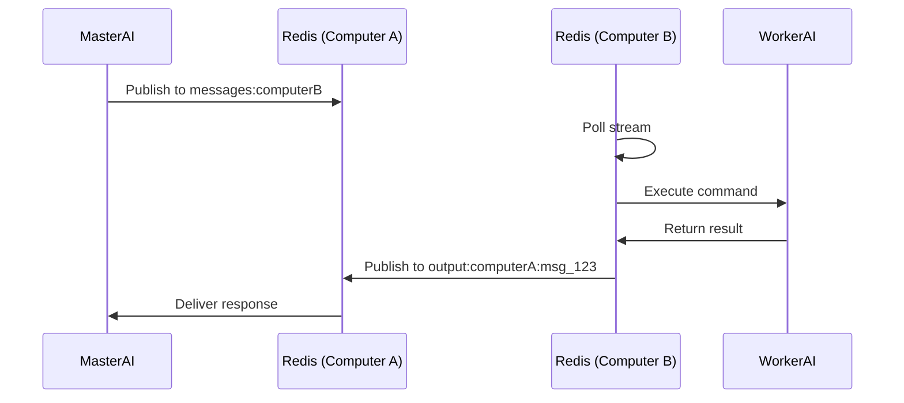
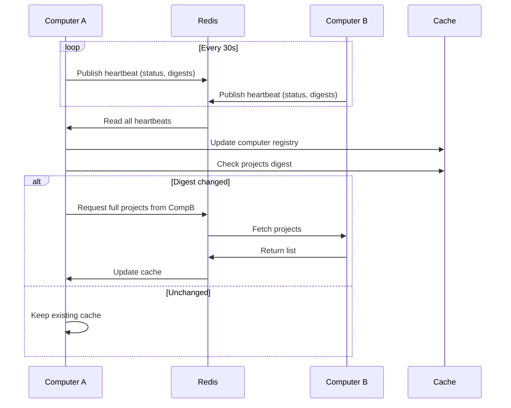

# Redis Transport — Design

## Purpose

- Provide reliable cross-computer messaging and responses between TeleClaude daemons.

- Each computer polls a Redis stream named for its computer identity.
- Requests are answered on `output:{computer}:{message_id}` streams for one-shot responses.
- Heartbeats maintain a registry of online computers with TTL-based expiry.
- A computer's projects digest triggers its peers' projects-and-todos refresh.

- Redis transport implements RemoteExecutionProtocol for request/response.
- Redis transport never performs UI messaging.
- Redis is optional; Telegram multi-computer operation does not require it.

## Inputs/Outputs

**Inputs:**

- Commands on `messages:{computer_name}` streams from remote peers
- Heartbeat messages with computer status, projects digest, todos digest
- Response streams `output:{computer_name}:{message_id}` for request/reply pattern

**Outputs:**

- Command responses published to caller's response stream
- Heartbeat broadcasts every 30s with system stats and digest fingerprints
- Cache invalidation triggers when digests change

## Invariants

- **Optional Dependency**: Redis is never required for local operations or Telegram multi-computer operation.
- **Stream Per Computer**: Each computer polls exactly one command stream named after its computer identity.
- **One-Shot Responses**: Response streams are created per-message and auto-expire after TTL.
- **Heartbeat TTL**: Computer registry entries expire after 60s without heartbeat; marks computer offline.
- **Digest-Driven Refresh**: A peer's projects and todos are pulled only when the digest its heartbeat advertises differs from the one advertised at the last pull. A peer that advertises a digest is never pulled because a cached copy aged, and one pull per peer answers projects, todos and preparation views alike.
- **Single Connection Lifecycle**: Redis connection is managed by one reconnect loop; all tasks wait on readiness.

- **Bounded Backpressure**: The shared Redis client draws connections from a single bounded pool that blocks a caller for a bounded time when every connection is in use, rather than failing immediately. A momentary saturation waits for a connection to be released instead of surfacing a connection error to every subsystem at once; only a saturation that outlasts the bound raises.

## Primary flows

### 1. Cross-Computer Command Execution

### 2. Heartbeat and Discovery

### 3. Digest-Based Cache Invalidation

| Component          | Heartbeat Field      | Cache Action                    |
| ------------------ | -------------------- | ------------------------------- |
| Projects and todos | `projects_digest`    | Pull if changed                 |
| Sessions           | N/A                  | Event-driven only (no digest)   |
| Stats              | `cpu`, `mem`, `disk` | Update immediately on heartbeat |

### 4. Stream Cleanup

- Command streams: Trimmed to max 10,000 messages (MAXLEN ~10000 APPROXIMATE)
- Response streams: Auto-expire after 1 hour (TTL)
- Heartbeat entries: Redis key expiry after 60s

The transport layer reads each command's `response_mode` to determine caller wait
behavior: `IMMEDIATE` awaits the handler result, and `RECEIPT` submits the command to
the owning computer's `OperationsService` and answers with the receipt that names that
computer. The handler table and the response_mode layer are orthogonal — any handler can
operate under any mode. See command-classification for the full dispatch model.

### 5. Command as wire payload

The unit crossing the transport is the **serialized command** — the same `InternalCommand`
the origin's API boundary built — carried on the `messages:{computer}` stream with its
`session_id` and identity metadata, and answered on `output:{computer}:{message_id}`. The
owning computer deserializes the payload back into the identical command type and dispatches
it through the same handler table and `response_mode` layer it uses for locally-originated
commands, keyed on `command_type`.

There is no second command vocabulary: the transport does not translate a command into a
string that the peer re-parses, and there are no per-command remote wrappers. Command
serialization is the single crossing contract; adding a command makes it forwardable with no
transport change. The routing decision is the command's `computer` field — foreign computer
forwards, local computer (or unset) executes in place. See command-classification for the
dispatch model.

An API request addressed to another computer crosses the same way: as one relay command
that carries the request whole, dispatched and forwarded like every other command. The
owning computer reconstructs the request and runs it through its own API boundary, and
the response crosses back on the one-shot response stream. The transport carries no
per-route vocabulary and no read-specific command set for API-originated work.

A computer advertises the relay in the capability set its heartbeat carries. A peer
without it rejects the relay command as a command it does not know, and the relaying
computer reports that peer as running a build without the relay. A relay command
carries a deadline, and a computer that reads it from its stream after that deadline
refuses it without running it.

## Failure modes

- **Redis Unavailable**: Daemon starts without Redis transport. Cross-computer commands fail. Local and Telegram operations unaffected.
- **Network Partition**: Computer heartbeats stop arriving. Registry marks computer offline after TTL. Commands to partitioned computer timeout.
- **Stream Accumulation**: If consumer lags, streams grow beyond MAXLEN. Oldest messages trimmed. Commands may be lost if not processed in time.
- **Response Stream Collision**: Extremely rare. Two messages with same ID overwrite response stream. Mitigated by UUID message IDs.
- **Digest Not Recomputed**: The digest is a SHA-256 of the exact projects-with-todos answer, so an unchanged digest means an unchanged answer. When this computer cannot read its own projects, it keeps advertising the last digest, and peers keep their copy until a later pass succeeds.
- **Peer Without a Digest**: A computer whose build advertises no digest is refreshed when a read finds its cached copy older than the cache TTL, at most one pull per peer at a time.
- **Heartbeat Storm**: Many computers restart simultaneously and publish heartbeats. Redis handles gracefully; cache refresh tasks may queue.
- **Reconnect Storm Prevention**: Redis reconnects are serialized; tasks wait on readiness to avoid connection floods.
- **Stale Registry**: Computer dies without sending offline heartbeat. Registry shows online until TTL expires (max 60s stale window).
