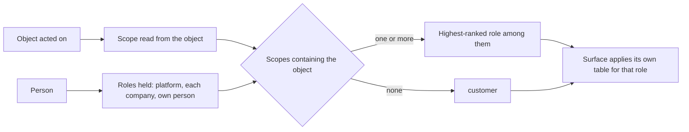

# Scoped Roles — Design

## Required reads

- @docs/local/spec/feature/identity/organizational-membership.md

## Purpose

A person holds a role, and a role is held at a scope. The role says what its
holder may do; the scope says where. This design owns the scopes, what each
scope contains, and how a person's effective role for one object is resolved.
What each role may do stays with the surfaces that decide it: command bands in
`local/projects/teleclaude/design/cli-authorization-matrix` and the scope a command is judged at
in `local/projects/teleclaude/spec/feature/identity/command-clearance`, configuration standing in
`local/projects/teleclaude/spec/feature/identity/configuration-target-clearance`, documentation
depth in `local/projects/teleclaude/design/architecture/context-selection`, history reach in
`local/projects/teleclaude/spec/feature/session_mirrors/role-scoped-history-access`, a new
session's role and its help-desk confinement in
`local/projects/teleclaude/spec/feature/agent_runtime/session-lifecycle`, and operation status in
`local/projects/teleclaude/design/architecture/operation-receipts`.

## Inputs/Outputs

**Inputs.**

- The person's platform role, from the person registry, when one is declared.
- The person's company memberships, each carrying a role, and their project
  assignments, as identity resolves them
  (`local/projects/teleclaude/spec/feature/identity/organizational-membership`).
- The object an operation acts on, and the scope that object belongs to.

**Outputs.**

- One effective role per person and object, drawn from the one role vocabulary.

## Invariants

1. **One vocabulary.** `admin`, `member`, `customer`, ranked in that order,
   mean the same at every scope. `customer` is the role of someone holding no
   role where they act.

2. **A role is held at a scope.**
   - **Platform** — the person registry's role. It contains every object.
   - **Company** — a roster membership's role. It contains the company itself,
     the projects that company owns, and the platform's shared documentation,
     which every company inherits as its lineage.
   - **Person** — every person is `admin` of their own person scope: their own
     settings and their own person documentation tier.
3. **Project reach below `admin`.** A company role below `admin` reaches only
   the company projects the person is assigned to. `admin` reaches every project
   the company owns, which is identity's coverage fact.
4. **Effective role.** For a person and an object, the effective role is the
   highest-ranked role the person holds at any scope containing that object.
   Where no scope contains it, the effective role is `customer`.
5. **No role without a grant.** A person without a declared platform role holds
   none at platform scope; the registry supplies no default.
6. **Read from the object.** Every person authorization decision reads the
   effective role for the object it acts on. The object's scope is read from the
   object itself — the project an action targets, the tier a snippet belongs to,
   the company a configuration names, the project a session runs in — never
   supplied by the caller. No decision reads the platform role alone.
7. **Platform-only objects.** Machine and global configuration, the person
   registry, the company registry, fleet-wide event delivery, and system job
   reports belong to platform scope, so only a platform role reaches them.
8. **Agents carry the person, not a role copy.** A session acting for a person
   is judged by that person's effective role for the object it acts on. An
   agent's system role still narrows what it may do and never widens the
   person's role.
9. **The computer holding the object decides.** A command that acts on an
   object another computer holds — a session running there, a session to start
   there, an operation it owns — is authorized on that computer, the person band
   and the object's rules together as one decision; the caller's computer does
   not clear the person band for it. The caller's computer establishes who is
   calling and carries only the caller's principal over the daemon relay — a
   command the daemon forwards on its own account carries the daemon's system
   principal
   (`local/projects/teleclaude/spec/feature/identity/cross-computer-authorization`).
   The target resolves that principal's roles from its own person registry,
   company rosters, and project registry; a role or scope carried with the
   request is never an input. The caller's computer decides only what it alone
   holds about its own caller: that the caller is identified, that a session
   caller's system role is admitted by the command's agent band (invariant 8),
   and that the caller's dispatch chain permits the act; each narrows and none
   widens. A listing or search that names another computer is answered there the
   same way: that computer returns only what the caller's reach admits there
   (invariant 10). Records a computer receives from its peers without a request
   — replicated session records, relayed events — carry their subject and the
   subject's owner as the computer that produced them resolved them; the
   receiving computer admits them by the caller's reach over those facts, and a
   caller still sees the records recorded under its own principal
   (`local/projects/teleclaude/spec/feature/identity/cross-computer-authorization`).
10. **Seeing reads reach, not the effective role.** Which records a person may
    see in a listing, search, push, or documentation read is read from
    identity's reach over the record's subject, never from the effective role
    (`local/projects/teleclaude/spec/domain/identity`,
    `local/projects/teleclaude/spec/feature/identity/data-visibility`). A platform
    administrator reaches every record. Below that, reach follows company
    membership, project assignment, project ownership, and the person's own
    home, the company scope's shared-documentation lineage reaches a company
    administrator, and a person always sees records recorded under their own
    principal. A platform role below administrator clears commands at platform
    scope (invariant 4) but makes no record visible by itself.

## Primary flows

### Resolving an effective role

### What a company administrator reaches

| Object                                                                   | Effective role                               |
| ------------------------------------------------------------------------ | -------------------------------------------- |
| Their company, its roster, its documentation tier                        | `admin`                                      |
| A project their company owns, and every session and history record in it | `admin`                                      |
| The platform's shared documentation                                      | `admin`                                      |
| Their own settings and person tier                                       | `admin`                                      |
| A project owned by another company, or by no company                     | `customer`, unless another role reaches it   |
| Machine or global configuration, the person or company registry          | `customer`, unless they hold a platform role |

### Documentation depth under scoped roles

`admin` reads every tier its scopes contain in full. Any other role reads its
own company tier, its reached projects, and its own person tier in full, and the
platform's shared documentation at public-only depth, the same at platform and
company scope.

## Failure modes

| Scenario                                                                   | Behavior                                                                                                                                                                                                                                                                                                                                                            |
| -------------------------------------------------------------------------- | ------------------------------------------------------------------------------------------------------------------------------------------------------------------------------------------------------------------------------------------------------------------------------------------------------------------------------------------------------------------- |
| Organizational resolution fails                                            | The company scopes contribute no role; decisions proceed on what remains, failing closed.                                                                                                                                                                                                                                                                           |
| An assignment names a project its company no longer owns                   | It contributes no role; identity reports it as stale.                                                                                                                                                                                                                                                                                                               |
| A caller supplies a scope or role                                          | The scope is read from the object and the role from the registry and roster. A supplied role only lowers where a new session is placed — a door that offers a narrower experience, such as a help desk's entry link, confines a person below their effective role — and never raises it; later decisions about that session still read the person's effective role. |
| A person holds roles at several scopes containing one object               | The highest-ranked one applies.                                                                                                                                                                                                                                                                                                                                     |
| A role is withdrawn or a membership removed                                | The change applies from that person's next decision.                                                                                                                                                                                                                                                                                                                |
| A relayed message carries no principal                                     | It violates the relay contract and is rejected at the transport boundary as malformed.                                                                                                                                                                                                                                                                              |
| The target holds no role for the relayed principal that reaches the object | The effective role there is `customer`; the act proceeds only if the command admits `customer`.                                                                                                                                                                                                                                                                     |
| The target computer is unreachable or cannot resolve its facts             | The act fails and is reported for that computer; the caller's computer decides nothing in its place.                                                                                                                                                                                                                                                                |

## See Also

- docs/local/adr/0103-person-roles-are-one-vocabulary-held-at-a-scope.md
- docs/local/adr/0067-authorization-reads-the-object-not-the-caller-role.md
