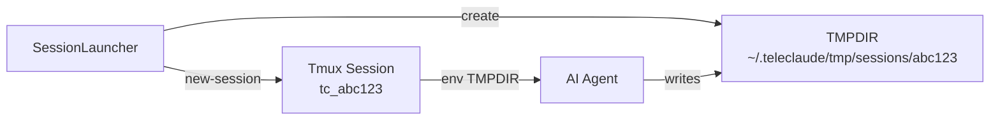
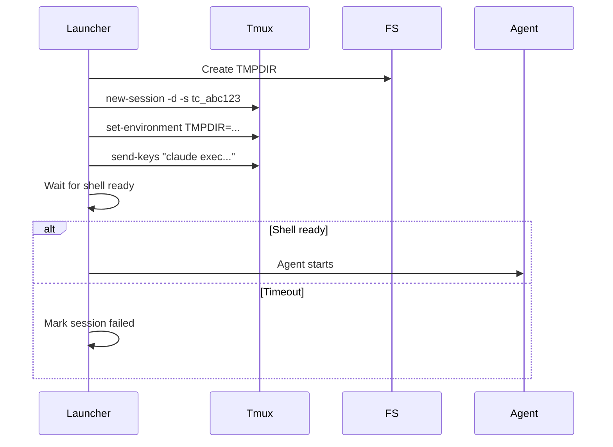
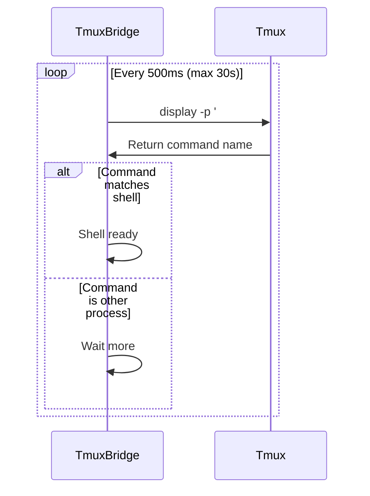

# Tmux Management — Design

## Purpose

Describe how TeleClaude manages tmux sessions and input injection.

- Session names are derived from session_id with a stable prefix.
- Each session gets a dedicated TMPDIR to avoid filesystem watcher issues.
- tmux commands enforce timeouts to prevent hangs.
- Session tmp directories are created under ~/.teleclaude/tmp/sessions by default.
- Shell readiness is determined by comparing the tmux command to the user shell.

## Inputs/Outputs

**Inputs:**

- Session creation command (agent type, project_path, title, message)
- User messages to inject into pane
- Control sequences (Ctrl-C, Ctrl-D)

**Outputs:**

- Tmux session named `tc_{session_id[:8]}`
- Per-session TMPDIR at `~/.teleclaude/tmp/sessions/{session_id}`
- Shell-ready signal detection
- Session output captured via polling

## Invariants

- **Stable Session Names**: Tmux session name derived deterministically from session_id; never changes.
- **Unique TMPDIR**: Each session gets isolated temp directory to prevent cross-session interference.
- **Timeout Enforcement**: All tmux commands have 30s timeout to prevent daemon hangs.
- **Shell Readiness Wait**: Input injection waits for shell prompt before proceeding.
- **Cleanup on Close**: TMPDIR and tmux session both destroyed when session closes.
- **Owned Server**: TeleClaude hosts every managed pane on tmux's default server, so the socket path in a process's tmux environment is what distinguishes a TeleClaude pane from one hosted by a foreign harness on its own socket. Hook lineage classification depends on this distinction.

## Primary flows

### 1. Session Creation

### 2. Input Injection

1. **Wait for Ready**: Check tmux pane command vs shell command
2. **Send Keys**: Use `tmux send-keys -l -t tc_{session_id}` for literal text
3. **Submit**: Send Enter key to submit command
4. **Trigger Poll**: Immediately poll output to capture response

### 3. Shell Readiness Detection

### 4. Cleanup

1. **Kill Session**: `tmux kill-session -t tc_{session_id}`
2. **Delete TMPDIR**: `rm -rf ~/.teleclaude/tmp/sessions/{session_id}`
3. **Final Poll**: Capture remaining output before closure
4. **Mark Closed**: Update database status

## Failure modes

- **Tmux Not Installed**: Session creation fails immediately. User sees error. No recovery without tmux installation.
- **Shell Readiness Timeout**: Agent starts but shell never ready. Input injection waits 30s then fails. Session marked failed.
- **TMPDIR Creation Failure**: Permissions or disk space issue. Session creation aborted. No partial state.
- **Zombie Process**: Tmux session killed but agent process survives. Orphaned process consumes resources. Requires manual cleanup.
- **Command Timeout**: Tmux command hangs for >30s. Command aborted, session may be in inconsistent state. Restart required.
- **Pane Not Found**: Input injection fails because pane already closed. Returns error but doesn't crash daemon.
- **TMPDIR Conflict**: Multiple sessions with same ID prefix (first 8 chars) collide. Extremely rare. Sessions interfere with each other's temp files.

- **Occupied Shell Input**: Shell readiness reads only the foreground program's name, so a shell whose editing buffer already holds unsubmitted text — typed through an attached terminal, for example — reads as ready. A launch command pasted and submitted there joins that text into one command line, and what the shell then runs depends on that text: it may fail, run something else, or start an agent with the wrong arguments. When the pending text is itself a command ending in an argument, as an earlier agent launch is, the launch's leading environment assignment becomes part of that argument and the agent runs under an identity other than the one registered for the launch, so the session record no longer matches the running agent. Agent restart discards the shell's pending input, leaving any pane mode first, before it places its relaunch command; input that arrives between that discard and the placement still joins the command. The other launch paths place their command without discarding pending input.

<!-- planned-change:fix-a-platform-wake-whose-tmux-submit-timed -->

- **Submit Fails After Paste**: Paste and submit are separate host commands, and the paste-and-submit primitive reports only whether both completed. When the host refuses the submit command after the paste landed, for example while it cannot spawn processes, the pasted text stays in the composer unsubmitted and the caller sees a plain failure. Queue-backed platform input whose placement had begun ends as a failed delivery rather than being placed again (`local/projects/teleclaude/spec/inbound-queue`, Worker Design), so the composer keeps that one unsubmitted copy until someone submits or clears it.

<!-- change:fix-a-platform-wake-whose-tmux-submit-timed -->

- **Submit Fails After Paste**: Paste and submit are separate host commands, and the paste-and-submit primitive reports whether the paste completed apart from whether the submit completed. When the submit command is refused after the paste landed — for example while the host cannot spawn processes — the pasted text stays in the composer unsubmitted, and conversation input for that session waits behind the occupied composer. When the submit command outlasts its timeout instead, whether its key reached the pane and produced a turn is unknown. In either case queue-backed platform input owes a submit: each retry on the inbound queue's schedule observes the composer and, without placing the text again, submits it while no terminal attached to the session has been used, and no input has been placed into the composer outside the queue, since the platform began placing it (`local/projects/teleclaude/spec/feature/agent_runtime/session-input-delivery`, Target validation and delivery outcomes). The owed submit is retried until it goes through, the composer empties, other input joins the text in the composer — after which it stays for a person to submit — or the session ends. While the host cannot complete a submit at all, the copy stays in the composer and conversation input waiting behind it expires.

<!-- /planned-change:fix-a-platform-wake-whose-tmux-submit-timed -->
