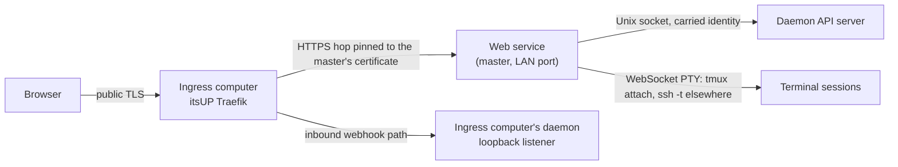
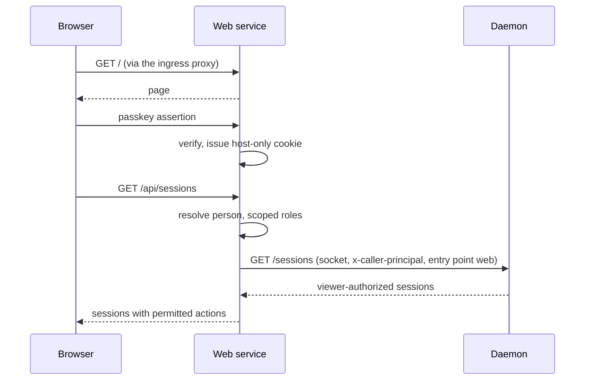

# Web Console — Design

## Required reads

- @docs/local/design/architecture/api-server.md
- @docs/local/adr/0122-the-web-console-sits-behind-the-single-itsup-fleet.md

## Purpose

Give the operator a browser client of the platform with the same reach as the
TUI, from anywhere, without exposing the daemon. The console is three parts:

- **The page.** A single-page application built from `frontend/` in this
  repository and served by the web service. It holds an identity and nothing
  else; it evaluates no rule.
- **The web service.** A Python process in the `teleclaude` package, installed
  and operated as a native service like the daemon on the computer where
  `computer.is_master` holds. It serves the page, authenticates people, decides
  what each person may see and do, forwards preview traffic, and acts on the
  daemon over the Unix socket carrying the authenticated person's identity. It
  is a client of the API server exactly as the TUI is: it consumes the same
  identity, DTOs, snapshot semantics and event ordering.
- **The daemon.** Unchanged. It serves the web service as one more socket
  client and trusts the identity the web service carries.

## Inputs/Outputs

**Inputs**

- Browser requests and WebSocket upgrades arriving from the ingress computer's
  reverse proxy over the pinned hop.
- The person's authentication: an invitation link for onboarding, a passkey for
  login, an email code for recovery.
- The daemon's API: HTTP reads, typed mutations, operation receipts and the
  WebSocket stream, over the Unix socket.
- Configuration: the `web_console` section, the self-signed certificate and key
  generated at install, and the ingress computer's address.

**Outputs**

- The served page, its API responses and its WebSocket events, each filtered to
  what the authenticated person may see.
- Requests to the daemon carrying `x-caller-principal`, `x-caller-email` and
  `x-caller-entry-point: web`.
- Terminal byte streams to the browser from a PTY running `tmux attach` on this
  computer or `ssh -t` to another.
- Forwarded preview traffic for hosts under the preview domain.

## Invariants

- **The web service is the authenticated edge.** Authentication happens there,
  once, at the border. The browser's session cookie is host-only, `Secure`,
  `HttpOnly` and `SameSite=Lax`, and stops at the web service; every
  state-changing request and WebSocket upgrade is refused unless its `Origin` is
  the console's own origin. Nothing a browser sends is forwarded to the daemon
  as identity: the web service strips any caller header a browser supplies and
  sets its own.
- **The daemon is reached only over the Unix socket.** The web service never
  speaks to the daemon's TCP listener, and the daemon opens no listener for the
  console. Carried identity is honoured only on the socket
  (`local/projects/teleclaude/spec/feature/identity/identity-header-trust-boundary`).
- **One path per operation.** Every read and mutation the console performs is a
  daemon projection or route the TUI also uses. The web service holds no file
  authority over shared domain state and opens no store directly.
- **Access is decided in the web service, by shared code.** The web service runs
  the platform's one caller resolver and scoped-role decision in-process, filters
  lists, events, transcripts and artifacts by the person's reach, and attaches
  the permitted actions to each object. The daemon keeps only its object-scope
  rules and trusts the carried identity, as every client contract requires.
- **The pinned hop is the only way in.** The LAN port serves HTTPS with the
  certificate generated at install and accepts connections from the ingress
  computer's address only. The certificate's public half lives in the itsUP
  project's files; it is handed over once and again only when regenerated.
- **Webhooks are not on this path.** The inbound webhook endpoints remain on the
  ingress computer's daemon under the single-ingress contract.
- **Runs on the master, configured by one section.** The web service is enabled
  where `computer.is_master` holds and reads `web_console.port` and
  `web_console.trusted_proxy`; both have defaults, and no other computer flag
  describes the console.
- **A one-computer install is the same shape without the hop.** With no
  separate ingress computer, the reverse proxy and the web service share a host
  and the trusted proxy address is loopback.

## Primary flows

### Login and first request

### Live updates

The web service holds one WebSocket connection to the daemon per authenticated
person and fans events out to that person's browser connections after filtering
by reach. Reconnection re-establishes the complete eligible snapshot from the
daemon before incremental changes resume, as the API server's connection
completeness invariant provides.

### Terminal

The browser opens a WebSocket to the web service for a session; the web service
resolves the session's attachment from the daemon's projection and runs
`tmux attach` in a PTY on this computer, or `ssh -t` to the owning computer,
relaying bytes both ways. The daemon is not on the byte path.

### Certificate lifecycle

`make install` on the master generates the certificate and key when they are
absent, with the computer's LAN address as a subject alternative name and a
multi-year validity. The public half is committed once into the itsUP project's
files, where the ingress computer's reverse proxy pins it. Regeneration repeats
the handoff.

## Failure modes

| Condition                                                            | Effect                                                                                                  |
| -------------------------------------------------------------------- | ------------------------------------------------------------------------------------------------------- |
| Master down                                                          | Console unreachable; webhooks and every other computer unaffected.                                      |
| Ingress computer down                                                | Console and webhooks unreachable, as for any public traffic today.                                      |
| Certificate regenerated without the itsUP handoff                    | The ingress computer refuses the hop; the console is unreachable until the public half is handed over.  |
| Request on the LAN port from an address other than the trusted proxy | Refused at connection; nothing reaches the web service's routes.                                        |
| Browser request carrying a caller header                             | The header is dropped; the request runs as the authenticated person or is refused when unauthenticated. |
| Daemon unreachable                                                   | The page loads; every daemon-backed view reports the daemon as unavailable and retries with backoff.    |
| Owning computer unreachable for a terminal or preview                | That terminal or preview fails naming the computer; the rest of the console continues.                  |
