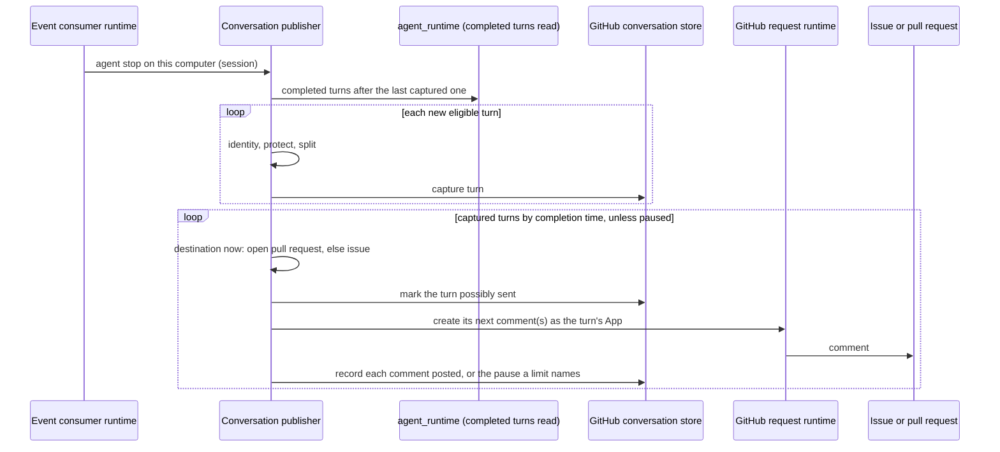

# Work Item Conversation — Design

## Required reads

- @docs/local/spec/feature/workflow/github-work-record.md

## Purpose

Compose the owners that together put a work item's conversation on GitHub.
What a reader sees is owned by
`local/projects/teleclaude/spec/feature/workflow/github-work-record`
(Conversation). This design owns only how the participants relate:

| Concern                                                                                                                | Owner                              | Contract consumed or published                                                                                   |
| ---------------------------------------------------------------------------------------------------------------------- | ---------------------------------- | ---------------------------------------------------------------------------------------------------------------- |
| What a completed turn is, what it contains, when it completed                                                          | `agent_runtime`                    | Completed turns read (`local/projects/teleclaude/spec/feature/agent_runtime/session-transcript-retrieval`)       |
| That a session stopped                                                                                                 | `agent_runtime`                    | The agent activity event the runtime emits for an agent stop (`local/projects/teleclaude/spec/event-vocabulary`) |
| Which sessions belong to which item, where and when a turn goes, under which App, what is removed, the comment's shape | `workflow`                         | `local/projects/teleclaude/design/architecture/workflow-store` (Conversation) and the work record                |
| Secrets the platform holds                                                                                             | `config`                           | The resolved values of every sensitive declaration                                                               |
| Each GitHub request and its credential                                                                                 | `workflow` (GitHub adapter module) | `local/projects/teleclaude/design/architecture/workflow-store` (GitHub adapter)                                  |
| Delivery of the stop event, its progress and recovery                                                                  | `event-catalog`                    | `local/projects/teleclaude/spec/feature/event-catalog/event-consumers`                                           |

The publisher is part of the workflow store's GitHub adapter module, beside
the question comments and pull request reviews it already writes. It runs on
every computer and handles only the sessions that computer runs: it reads
their turns from `agent_runtime`, protects and splits them, keeps them in the
computer's GitHub conversation store and posts them; it never reads a native
transcript, a session row or an output-delivery cursor itself, and no
computer hands turns to another (ADR-0154).

## Inputs/Outputs

**Inputs**

- The runtime's agent-stop activity event for a session on this computer:
  the signal that a turn may have completed. It carries no content.
- The completed turns read: for a session, its completed turns after a
  given turn, each with its turn identity, its ordinal, its completion time,
  its authored input parts with their authorship, and the agent's
  user-visible text.
- The session's role, working item slug, project and creation time, read
  through the runtime's session identity facts.
- The project's store selection, the item's repository-work status, its
  issue, and whether its pull request is open, from the working copy.
- The App inventory and role mapping
  (`local/projects/teleclaude/spec/teleclaude-config`, `github.apps`,
  `github.roles`) and the resolved values of every sensitive declaration.

**Outputs**

- One or more conversation comments per completed turn, on the destination
  decided when the turn is posted, in the shape the work record specifies, as
  the App the workflow store's adapter chooses.
- The publisher's bookkeeping in the computer's GitHub conversation store
  (workflow-store design, GitHub conversation store).

## Invariants

- Every eligible turn a computer ran appears on its destination once. The
  turns of the sessions one computer ran are posted in completion order, and a
  turn's comments follow each other unless posting was interrupted part-way.
- A turn is captured, protected, at the moment the publisher first sees it
  completed. Its source can disappear afterwards without losing it.
- Publishing never delays, refuses or alters a session's turn and never
  messages a session. Its comments are App comments, which comment routing
  never delivers.
- A conversation comment is never read as record, content or ledger: it is
  authored by a role App, and the store trusts only the App its declaration
  names. Turn comments are never posted as the platform App.

## Primary flows

### Capturing and posting

The stop event wakes the publisher; it carries no content and its loss loses
nothing, because each pass captures every completed turn after the last
captured one and posts every captured turn not yet on GitHub. The event
consumer is a live consumer whose declared recovery operation is a full pass
over every eligible session this computer runs, run at consumer start and on
reconnection; the store's periodic refresh runs the same pass.

### Recovering position

Before the publisher posts a turn it marked possibly sent, after an
interrupted post or a lost reply, it reads the destination's comments by the
turn's App from GitHub and takes each comment whose envelope names the turn's
session, ordinal and part as posted; the turn continues from its next missing
part. A create whose reply was lost is found the same way before anything is
posted again.

## Failure modes

- **GitHub unavailable.** Captured turns stay in the conversation store; the
  next pass posts them. The session is unaffected.
- **A rate-limit response.** This computer posts no conversation until the
  time it names (workflow-store design, GitHub request budget); captured turns
  wait.
- **Protection cannot complete.** The turn is captured and posted as a
  withheld turn; its content never reaches GitHub.
- **No App for the identity, or the App is not installed with issue and pull
  request write access.** The turn stays unposted with that cause logged; the
  turns after it on this computer wait behind it, so order holds when the
  cause is fixed.
- **A turn the runtime never saw complete.** A turn with no later turn, no
  covering agent stop and an open session is not completed and is not
  captured until one of those holds.
- **A transcript file the chain names is missing or fails to read.** The
  completed-turns read defines the outcome
  (`local/projects/teleclaude/spec/feature/agent_runtime/session-transcript-retrieval`,
  Completed turns read). The conversation shows nothing for a missing file,
  and a failed read leaves the session's capture for the next pass.
- **A lost conversation store.** Captured turns not yet on GitHub are lost
  with it; the new store starts the computer's mirroring again, so sessions
  created before it are no longer posted.
- **A computer that is gone for good.** Its unposted turns are not posted
  (ADR-0154).
- **A computer that does not hold the project.** It publishes nothing for its
  sessions on that project's items.
- **A record write GitHub refuses.** It keeps the store's existing refusal and
  retry contract; the conversation's pause covers only conversation requests.

## See Also

- docs/local/design/architecture/workflow-store.md
- docs/local/adr/0154-a-work-items-conversation-is-mirrored-by-each-computer-for-its-own-sessions.md
