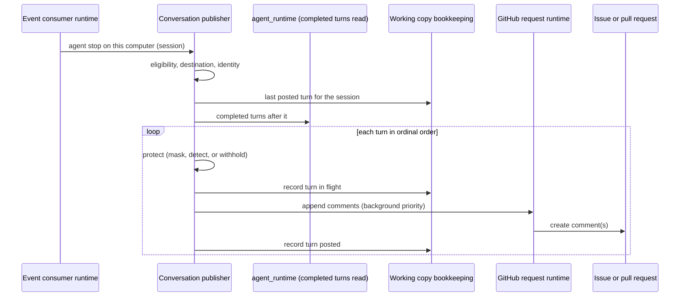

# Work Item Conversation — Design

## Required reads

- @docs/local/spec/feature/workflow/github-work-record.md

## Purpose

Compose the owners that together put a work item's conversation on GitHub.
What a reader sees is owned by
`local/projects/teleclaude/spec/feature/workflow/github-work-record`
(Conversation). This design owns only how the participants relate:

| Concern                                                                                                         | Owner                              | Contract consumed or published                                                                                   |
| --------------------------------------------------------------------------------------------------------------- | ---------------------------------- | ---------------------------------------------------------------------------------------------------------------- |
| What a completed turn is and what it contains                                                                   | `agent_runtime`                    | Completed turns read (`local/projects/teleclaude/spec/feature/agent_runtime/session-transcript-retrieval`)       |
| That a session stopped                                                                                          | `agent_runtime`                    | The agent activity event the runtime emits for an agent stop (`local/projects/teleclaude/spec/event-vocabulary`) |
| Which sessions belong to which item, where the turn goes, under which App, what is removed, the comment's shape | `workflow`                         | This design and the work record                                                                                  |
| Secrets the platform holds                                                                                      | `config`                           | The declared secret values the configuration publishes                                                           |
| Each GitHub request, its credential and its share of the rate budget                                            | `workflow` (GitHub adapter module) | `local/projects/teleclaude/design/architecture/workflow-store` (GitHub request budget)                           |
| Delivery of the stop event, its progress and recovery                                                           | `event-catalog`                    | `local/projects/teleclaude/spec/feature/event-catalog/event-consumers`                                           |

The publisher is part of the workflow store's GitHub adapter module, beside
the question comments and pull request reviews it already writes. It reads
the session's turns from `agent_runtime` and never reads a native transcript,
a session row or an output-delivery cursor itself.

## Inputs/Outputs

**Inputs**

- The runtime's agent-stop activity event for a session on this computer:
  the signal that a turn may have completed. It carries no content.
- The completed turns read: for a session, its completed turns after a
  given turn, each with its turn identity, its ordinal, its authored input
  parts with their authorship, and the agent's user-visible text.
- The session's role, working item slug and project, read through the
  runtime's session identity facts.
- The project's store selection, the item's repository-work status, its issue
  and its open pull request, from the store's own bookkeeping.
- The App inventory and role mapping
  (`local/projects/teleclaude/spec/teleclaude-config`, `github.apps`,
  `github.roles`) and the declared secret values.

**Outputs**

- One or more conversation comments per completed turn on the item's open
  pull request, otherwise on its issue, in the shape the work record
  specifies, posted by the App chosen below.
- The publisher's bookkeeping in the working copy: per session, the last turn
  whose comments are on GitHub, and any turn whose posting is in flight.

**Eligibility.** A session's conversation belongs to an item when all hold:
the session's project on this computer selects the GitHub store; its working
item slug names an item of that project that is repository work; and its role
is one the workflow dispatches for an item: `prepare-orchestrator`,
`work-orchestrator`, `intaker`, `architect`, `planner`, `prd-reviewer`,
`architecture-reviewer`, `plan-reviewer`, `build-reviewer`, `builder`,
`finalizer`, `diagnoser`, `drift-analyzer` and `deferrer`. A session with no
role, any other role, or no working item is never published: a commit
review belongs to the project's ledger rather than one item, and the
integrator and coordinator work across items.

**Identity.** A review role, resolved through its composite role, posts as
the App `github.roles` maps for `reviewer`. Every other eligible role posts
as the App mapped for that role when one is, and otherwise as the App mapped
for `builder`, which is the author identity. The App the project's store
declaration names never posts a turn.

**Input parts.** Each authored input part is written under its author: a
person's comment that comment routing delivered from GitHub
(`local/projects/teleclaude/spec/feature/integration/github-comment-routing`)
in full, quoted under that person's login with its link; a peer session's
message under that session's id and role; platform and runtime content under
the platform. A message a person gave the session through any other channel
is not written; the turn states that the person spoke.

**Protection.** Before any request carries a turn, the publisher masks every
declared secret value, replaces each credential-like string detect-secrets
recognizes, and replaces each personal-data entity Presidio recognizes with
its entity label. Presidio runs with its English small model, a credential
recognizer set without the hexadecimal high-entropy detector, and the
person, contact, location, nationality, financial, network and medical
entities; it does not replace dates, URLs or UUIDs, which are the platform's
own identifiers and timestamps rather than personal data in this
conversation. A turn whose declared secrets cannot be read, or whose
detection raises, is written as a withheld turn and nothing of its content
leaves the computer.

## Invariants

- A completed turn of an eligible session appears on its item exactly once:
  its comments are posted in order, the session's turns appear in ordinal
  order, and the next turn of a session is not posted before every comment of
  the previous one is.
- Publishing never delays, refuses or alters a session's turn and never
  messages a session. Its comments are App comments, which comment routing
  never delivers.
- A conversation comment is never read as record, content or ledger: it is
  authored by a role App, and the store trusts only the App its declaration
  names.
- The publisher holds no turn content at rest. Its bookkeeping holds turn
  identities and posting state; content is read from the runtime when a turn
  is posted.
- Conversation requests never cause a record write to be refused: they run at
  background priority on the store's GitHub request runtime.

## Primary flows

### Publishing a completed turn

The stop event wakes the publisher; it never carries content and its loss
loses nothing, because each pass posts every completed turn after the
recorded position. The event consumer is a live consumer whose declared
recovery operation is a full pass over every eligible session on this
computer, run at consumer start and on reconnection.

### Recovering position

The recorded position lives in the working copy. When it is absent for a
session, after a rebuilt working copy or an interrupted post, the publisher
reads the item's comments by the session's App from GitHub and takes the last
turn whose envelope names that session as posted; a turn found partly posted
is completed from its next missing part. A turn in flight whose create reply
was lost is found the same way before anything is posted again.

## Failure modes

- **GitHub unavailable or rate limited.** The turn stays unposted and the
  position does not move; the next pass, on the next stop or the periodic
  refresh, posts it. The session is unaffected.
- **Protection cannot complete.** The turn is posted as a withheld turn,
  which advances the position; its content is never retried onto GitHub.
- **No App for the identity, or the App is not installed with issue and pull
  request write access.** The turn stays unposted with that cause logged;
  later turns of that session wait behind it, so order holds when the cause is
  fixed.
- **A turn the runtime reports unreadable.** Its transcript entries are no
  longer on disk; it is posted as a withheld turn, as the work record states
  for a turn whose content cannot be read, so the session's later turns are
  not held back.
- **A turn the runtime never saw complete.** A turn with no later turn, no
  covering agent stop and an open session is not completed and is not
  posted until one of those holds.
- **Sessions on different computers.** Each computer publishes the sessions
  it hosts, with its own App inventory. Turns of one session keep their order;
  turns of sessions on different computers interleave by when each computer
  posted them.
- **A computer that does not hold the project.** It publishes nothing for its
  sessions on that project's items.

## See Also

- docs/local/design/architecture/workflow-store.md
- docs/local/design/architecture/conversation-delivery.md
- https://docs.github.com/en/rest/using-the-rest-api/rate-limits-for-the-rest-api
- https://github.com/Yelp/detect-secrets
- https://presidio.dataprivacystack.org/supported_entities/
