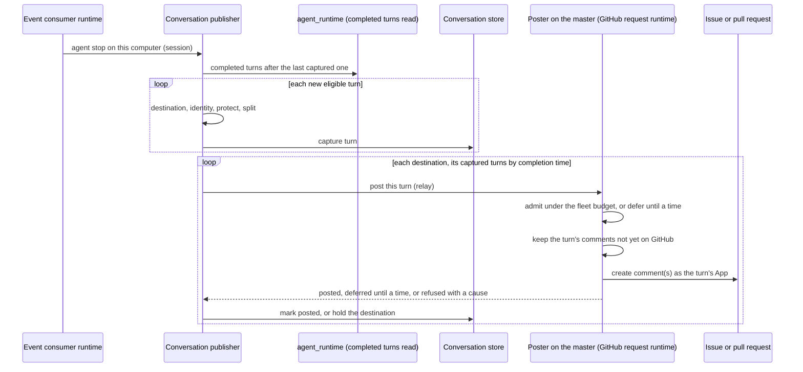

# Work Item Conversation — Design

## Required reads

- @docs/local/spec/feature/workflow/github-work-record.md

## Purpose

Compose the owners that together put a work item's conversation on GitHub.
What a reader sees is owned by
`local/projects/teleclaude/spec/feature/workflow/github-work-record`
(Conversation). This design owns only how the participants relate:

| Concern                                                                                                                | Owner                              | Contract consumed or published                                                                                   |
| ---------------------------------------------------------------------------------------------------------------------- | ---------------------------------- | ---------------------------------------------------------------------------------------------------------------- |
| What a completed turn is, what it contains, when it completed                                                          | `agent_runtime`                    | Completed turns read (`local/projects/teleclaude/spec/feature/agent_runtime/session-transcript-retrieval`)       |
| That a session stopped                                                                                                 | `agent_runtime`                    | The agent activity event the runtime emits for an agent stop (`local/projects/teleclaude/spec/event-vocabulary`) |
| Which sessions belong to which item, where and when a turn goes, under which App, what is removed, the comment's shape | `workflow`                         | `local/projects/teleclaude/design/architecture/workflow-store` (Conversation) and the work record                |
| Secrets the platform holds                                                                                             | `config`                           | The resolved values of every sensitive declaration                                                               |
| Each GitHub request, its credential and its share of the rate budget                                                   | `workflow` (GitHub adapter module) | `local/projects/teleclaude/design/architecture/workflow-store` (GitHub request budget)                           |
| Delivery of the stop event, its progress and recovery                                                                  | `event-catalog`                    | `local/projects/teleclaude/spec/feature/event-catalog/event-consumers`                                           |
| Carrying a captured turn to the fleet's master and its outcome back                                                    | `integration`                      | The computer-addressed relay person-addressed messaging uses (`local/projects/teleclaude/spec/messaging`)        |

The publisher is part of the workflow store's GitHub adapter module, beside
the question comments and pull request reviews it already writes. It has two
parts. On every computer, the capturer reads the turns of the sessions that
computer hosts from `agent_runtime`, protects and splits them, and keeps them
until they are posted; it never reads a native transcript, a session row or an
output-delivery cursor itself. On the fleet's master computer
(`local/projects/teleclaude/spec/teleclaude-config`, `computer.is_master`),
the poster sends every computer's turns to GitHub, so the conversation's
whole fleet has one request budget and one stop.

## Inputs/Outputs

**Inputs**

- The runtime's agent-stop activity event for a session on this computer:
  the signal that a turn may have completed. It carries no content.
- The completed turns read: for a session, its completed turns after a
  given turn, each with its turn identity, its ordinal, its completion time,
  its authored input parts with their authorship, and the agent's
  user-visible text.
- The session's role, working item slug and project, read through the
  runtime's session identity facts.
- The project's store selection, the item's repository-work status, its
  issue, and its pull request with the times GitHub reports for its opening
  and, once closed, its closing.
- The project's conversation start, the first conversation-start entry on its
  ledger issue.
- The App inventory and role mapping
  (`local/projects/teleclaude/spec/teleclaude-config`, `github.apps`,
  `github.roles`) and the resolved values of every sensitive declaration.

**Outputs**

- One or more conversation comments per completed turn, on the destination
  the turn's completion time decides, in the shape the work record specifies,
  posted by the master as the App the workflow store's adapter chooses.
- The capturer's bookkeeping in the conversation store of the computer
  hosting the session: each captured turn, already protected and split into
  its comments, with its repository, destination, App and completion time, and
  which of its comments are on GitHub, and for each session the last turn
  taken from the runtime. The master keeps a handed-over turn only from the
  moment it begins posting it until its last comment is on GitHub, and its
  budget state, durably (workflow-store design, GitHub conversation store).

**Conversation store.** The capturer's bookkeeping and what the master
keeps live in the GitHub conversation store; eligibility, the conversation
start, the destination, the App, input parts and protection are decided by
the workflow store's GitHub adapter
(`local/projects/teleclaude/design/architecture/workflow-store`,
Conversation). The capturer applies them when it captures a turn.

## Invariants

- Every eligible turn appears on its destination exactly once, all of its
  comments consecutive, with no other comment of the conversation between
  them. On each destination the turns a computer posts appear in
  completion order across every session of the item it hosts, and each turn's
  envelope carries its completion time, so a turn another computer posts late
  shows when it happened.
- A turn is captured, protected, at the moment the publisher first sees it
  completed. Its source can disappear afterwards without losing it.
- Publishing never delays, refuses or alters a session's turn and never
  messages a session. Its comments are App comments, which comment routing
  never delivers.
- A conversation comment is never read as record, content or ledger: it is
  authored by a role App, and the store trusts only the App its declaration
  names.
- Only the master sends conversation requests, admitted by the request budget
  of the workflow store design. Turn comments are never posted as the
  platform App; the one conversation-start entry is.

## Primary flows

### Capturing and publishing

The stop event wakes the publisher; it carries no content and its loss loses
nothing, because each pass captures every completed turn after the last
captured one and posts every captured turn not yet on GitHub. The event
consumer is a live consumer whose declared recovery operation is a full pass
over every eligible session this computer hosts, run at consumer start and on
reconnection; the store's periodic refresh runs the same pass.

### Across computers

The workflow dispatches an item's sessions from its claim holder, so the
sessions of one item that run at the same time share a computer, and that
computer hands their turns to the master in completion order, one turn at a
time per destination, each after the previous one was posted. Each computer
hands over only the sessions it hosts and never waits for another computer.
When an item's work moves to another computer while the first still holds
turns, those turns appear when the first computer hands them over, after the
new computer's later turns, each showing its completion time
(`local/projects/teleclaude/spec/feature/workflow/github-work-record`,
Conversation).

A turn is handed over whole, all its comments in one request. Before the
master posts the first of them it keeps every one in its conversation store,
and while it holds a turn begun and not finished on a destination it posts
nothing else there: it finishes that turn from what it keeps, after a restart
too, whether or not the capturing computer can still be reached, and answers
any other turn for that destination deferred until then.

### Recovering position

Bookkeeping lives in the capturing computer's conversation store. Before the
master posts a turn the capturer marks as possibly sent before, after an
interrupted hand-over, a lost reply or a lost conversation store, it reads the destination's
comments by the turn's App from GitHub and takes each turn whose envelope names
its session and ordinal as posted; a turn found partly posted is
completed from its next missing part, from the protected parts it captured. A
create whose reply was lost is found the same way before anything is posted
again. After a lost conversation store, turns are captured again from the
runtime from the first turn of each eligible session missing from GitHub.

A master that finds a destination's last conversation comment to be part of a
turn whose remaining comments it does not keep, because it became master or
lost its conversation store, posts nothing else on that destination until the
turn's capturing computer hands that turn over again and the master finishes
it; the capturing computer keeps every turn until the master answers it
posted.

## Failure modes

- **GitHub unavailable or the budget spent.** The master answers deferred
  until a time; captured turns stay on their computer and their destination
  holds; the next pass after that time hands them over again. The session is
  unaffected.
- **The master unreachable, or no master in the fleet.** Captured turns stay on
  their computer and are handed over once a master answers; nothing is posted
  meanwhile and no other computer posts in its place.
- **The master lacks the turn's App.** The master answers refused with that
  cause; the turn stays captured and its destination holds, as for a missing
  App mapping.
- **Protection cannot complete.** The turn is captured and posted as a
  withheld turn; its content never reaches GitHub.
- **No App for the identity, or the App is not installed with issue and pull
  request write access.** The turn stays unposted with that cause logged; its
  destination holds behind it, so order holds when the cause is fixed.
- **A turn the runtime never saw complete.** A turn with no later turn, no
  covering agent stop and an open session is not completed and is not
  captured until one of those holds.
- **A transcript file the chain names is missing or fails to read.** The
  completed-turns read defines the outcome
  (`local/projects/teleclaude/spec/feature/agent_runtime/session-transcript-retrieval`,
  Completed turns read). The conversation shows nothing for a missing file,
  and a failed read leaves the session's capture for the next pass.
- **A lost conversation store.** Captured turns not yet on GitHub are
  captured again from the runtime, and each destination's position is read
  back from GitHub. A rebuilt working copy leaves the conversation store as it
  is.
- **A computer that does not hold the project.** It publishes nothing for its
  sessions on that project's items.
- **A record write GitHub refuses.** GitHub's secondary limits change without
  notice and cannot be inspected, so a record write can still meet one; it
  keeps the store's existing refusal and retry contract. Its limit response,
  passed to the master when another computer receives it, stops the whole
  fleet's conversation until the time it names. While that computer cannot
  reach the master it keeps the notice and delivers it when the relay
  answers; meanwhile the master learns of a limit shared with its own
  requests from the response to its next request.
- **A new master, or a master that lost its budget record.** It posts
  nothing for an hour, the longest budget window; a longer pause stops it at
  the response to its first request.
- **A turn left part-posted by a master that no longer keeps it, while its
  capturing computer cannot be reached.** That destination holds, with
  nothing else posted on it, until the capturing computer hands the turn over
  again; every other destination proceeds.

## See Also

- docs/local/design/architecture/workflow-store.md
- docs/local/design/architecture/conversation-delivery.md
- https://docs.github.com/en/rest/using-the-rest-api/rate-limits-for-the-rest-api
- https://github.com/Yelp/detect-secrets
- https://presidio.dataprivacystack.org/supported_entities/
