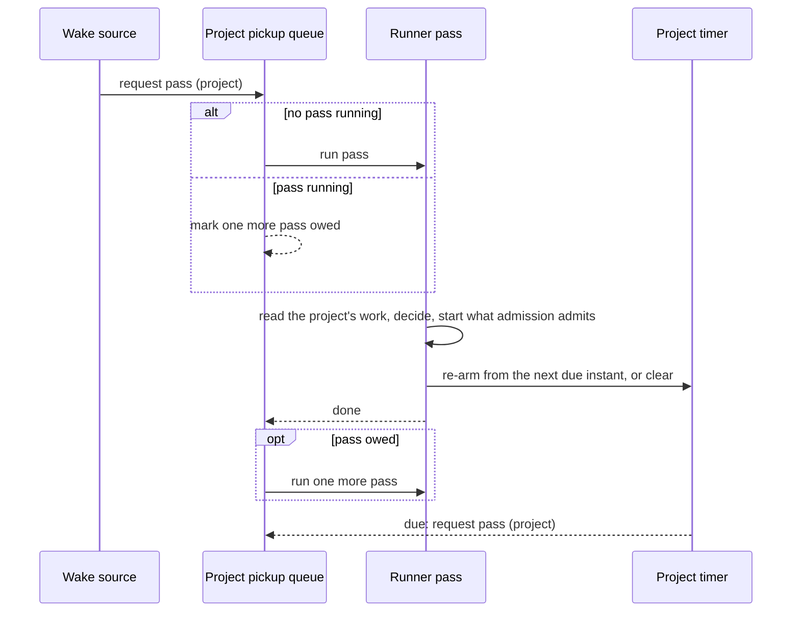
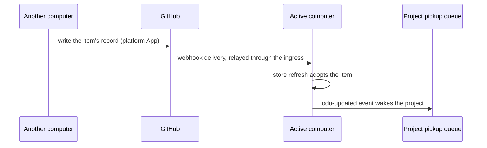

# Work Pickup — Design

## Purpose

The behavior this design delivers is
`local/projects/teleclaude/spec/feature/workflow/work-pickup`: when pickup
evaluates a project. This design states how the workflow context wakes the
lifecycle runner so that every change pickup decides on reaches it, and nothing
else does.

Pickup is level-triggered. A wake names a project and nothing more; the pass it
requests reads the project's whole current work and decides from that, as
`run_lifecycle_runner` does today. What woke it never changes what it decides.

## Inputs/Outputs

**Inputs — what requests a pass for a project:**

| Source                    | Where it comes from                                                                                                                                 | Computer                       |
| ------------------------- | --------------------------------------------------------------------------------------------------------------------------------------------------- | ------------------------------ |
| Local todo events         | todo created for pickup, updated, phase advanced, delivered; the router's existing triggers                                                         | the computer that emitted them |
| Claim released or cleared | the active computer's clear of a claim, whether its own release or one another computer relays, emits the todo-updated event                        | the active computer            |
| Removal and reactivation  | the workflow's removal and reactivation emit the todo-updated event                                                                                 | the computer that made them    |
| Session ended             | the existing session-ended events for a session in the project's checkout                                                                           | the session's computer         |
| Adopted changes           | a store refresh that adopts an item emits the todo-updated event for it (`local/projects/teleclaude/design/architecture/workflow-store`)            | the computer that refreshed    |
| Active computer naming    | changes to the workflow-owned naming register: confirmed completion requests pickup; an unresolved naming retains a project retry                   | the named computer             |
| Project timer             | the project's next due instant: a schedule, or recovery of a failed start, unanswered claim judgment, failed pass or assignment-blocked naming work | the computer that armed it     |
| Daemon start              | one pass for every project the daemon serves, once its event platform runs                                                                          | every computer                 |

**Outputs:** the existing pass outcomes — orchestrator starts through driver
admission (`local/projects/teleclaude/spec/feature/workflow/driver-admission`),
claim clearing, the pass log line — and the project's re-armed timer.

## Invariants

- **One pass per project at a time.** A wake for a project whose pass is
  running records that another pass is owed; when the running pass ends, one
  more pass runs. Any number of wakes during a pass yield one follow-up pass.
  Passes of different projects are independent.
- **A wake is accepted, not awaited.** The router and every other source
  request the pass and return; the event that woke pickup is handled once the
  request is recorded. A pass lost to a stop or crash before it ran is made up
  by the daemon-start pass.
- **Each project has at most one timer**, set to its next due instant. Every
  pass recomputes it from what the pass found: the earliest next occurrence of
  a scheduled task it held back as not yet due, and a retry within a minute
  when a start failed for a reason that can clear by itself, when a claim is
  held only because a computer did not answer its judgment, or when the pass
  itself failed, together with any naming recovery contribution for
  assignment-blocked dispatch or claim reconciliation.
  A pass that finds none of these clears the timer. The timer
  is derived state, kept in process memory and rebuilt from the project's
  work record and the local naming-recovery projection at daemon start.
- **A refusal that names another computer is no failed start.** A start
  refused because another computer is the project's active computer, or
  because the project names no active computer, arms no retry by itself.
  While this target has unresolved naming, that refusal retains the naming
  recovery contribution for otherwise-ready dispatch or claim reconciliation.
- **The next occurrence of a recurring rule** is computed by the same rule
  owner that decides whether a schedule is due, so the timer fires inside the
  minute the rule matches.
- **No unconditional wake.** A project without due work or an unresolved
  recovery obligation has no timer. The daemon enumerates the projects it
  serves only at its start.

## Primary flows

### A wake becomes a pass



### A change made on another computer



### Naming the active computer

```mermaid
sequenceDiagram
    participant Caller as Computer running the set
    participant Register as Workflow naming register
    participant GH as GitHub
    participant Named as Named computer

    Caller->>Register: retain unresolved naming and publish registration
    Register-->>Named: requested-work notification
    Named->>Named: register project recovery; return from notification
    Caller->>GH: make the naming mutation
    alt confirmed success
        Caller->>Register: retain completion and publish completion
        Register-->>Named: completed naming notification
        Named->>Named: request existing admitted runner directly
        Named->>Register: acknowledge accepted pickup revision
    else proven no effect
        Caller->>Register: settle matching head; preserve aggregate work
    else remote outcome unknown
        Register-->>Named: current naming remains unresolved
        Named->>Named: retain uncertainty; retry assignment-blocked work
    end
```

The workflow context owns one current naming cohort per repository and
canonical target identity on the cluster Redis, separate from stream history.
A cohort contains its current head identity and outcome, standing uncertainty,
and pickup and acknowledgement revisions. Repeated namings reuse these fields;
they do not append attempt records. Registration installs a fresh head and
publishes requested work atomically, preserving earlier pickup work and arming
standing uncertainty before displacing an unsettled head. Only acknowledged
registration permits the variable write. A failed or unacknowledged
registration performs no GitHub mutation. The operation stays
inside the existing caller's wait; a late local result is uncertainty, not
permission to start another mutation.

The writer records confirmed success only after GitHub acknowledges the
mutation. A no-effect outcome requires positive evidence that this attempt
cannot change the variable. Timeout, cancellation, loss of the response and
an interrupted writer leave the effect unknown. Recovery observes that
obligation and does not repeat the external mutation. These are
external-effect bookkeeping rules (`sdlc/policy/state-storage`).

Head settlement and aggregate pickup work have separate transitions. A result
settles only its matching head. A nonmatching late success leaves the newer
head untouched and still advances pickup owed. Unknown outcomes preserve
standing uncertainty. Pickup acceptance acknowledges only the revision it
accepted; a stale acknowledgement cannot clear work a later completion added.
Coalesced uncertainty is monotone until conclusive evidence settles every
effect it represents. A later successful head or name match does not clear it.

Each register update and its notification form a durable handover under
`local/projects/teleclaude/design/architecture/event-delivery`. Notification
facts distinguish registered work from confirmed completion. A workflow-owned
live consumer on the target registers the affected project with a supervised
recovery task and returns promptly. Its source recovery captures notification
progress before recovering this computer's indexed records, then applies
subsequent updates by cohort incarnation, head identity and revision. Startup and reconnection
use that same handover. Runner requests begin once the request surface is
bound. No notification handler waits for a write or performs a preliminary
GitHub read.

The target persists its current naming-recovery projection in a machine-local,
workflow-owned database with a separate write-isolation unit from waiting
command paths. It contains the last known current records and their revisions,
not an event archive. Timers reconstruct from that local state while cluster
Redis is unavailable; reconnect recovery brings the projection up to date.
Source-confirmed retirement removes a projected record. Its capacity follows
the current register and bounded notification-recovery window. Durable source
state and derived projection remain distinct (`sdlc/policy/state-storage`).

A confirmed completion advances pickup owed and requests the existing project runner directly. Driver
admission remains the authority for every start
(`local/projects/teleclaude/spec/feature/workflow/driver-admission`). Once that
request is accepted, its pickup revision is acknowledged; the daemon-start
pass covers loss of the transient pickup request. A later naming can supersede the
completed one without making its notification an admission authority.

An unresolved head or standing uncertainty enables work-record adoption on
this target even while another computer is active. Activation and recovery
persist that eligibility before enabling delivery-triggered adoption, then
request current-source catch-up and an initial full runner pass. Catch-up
remains owed until it succeeds; it does not replace the initial pass when no
new revision is adopted. The store owns the refresh and adoption handover
(`local/projects/teleclaude/design/architecture/workflow-store`).

Naming uncertainty contributes a project retry only when assignment blocks
an otherwise-ready dispatch or existing claim-reconciliation work. A pass
without either removes that contribution, leaving the durable uncertainty
dormant. The existing runner performs the decision; there is no preliminary
variable read or variable-edge observer. A wrong-computer or no-active cause
is carried by the existing structured admission payload through the create
door and client. Assignment-blocked reconciliation is likewise a typed pass
outcome. Neither is inferred from a formatted explanation.

The contribution remains armed independently of pass completion, and a
deadline reached during a pass records a follow-up owed. It shares the
project's timer with schedules and other retries; recomputation changes only
the naming contribution. Existing failed-pass, undecidable-start and
unanswered-claim recovery retain their own contributions. Neither a negative
variable read nor a positive match settles an unknown mutation.

Current storage grows with retained repository/target identities, not with
naming attempts. Each cohort and local projection replaces its fixed-size
current fields; neither retains per-attempt history or tombstones. There is no
logical full-register refusal. Ordinary retirement requires a settled head,
no standing uncertainty and no unacknowledged pickup work, checked against the
current incarnation and revision atomically. Uncertainty has no age-based
expiry. Authorised scope retirement does not cancel an external effect;
reactivation preserves unresolved uncertainty, and callbacks from a retired
incarnation cannot mutate a new one. Register state follows the cluster
Redis's persistence contract; stream trimming does not delete it.

## Failure modes

- **A wake arrives while the daemon drains.** It is not acted on; the next
  process's daemon-start pass evaluates the project.
- **A GitHub delivery is lost**, or arrives while the ingress is not
  receiving. The change waits for the project's next delivery or store refresh
  (`local/projects/teleclaude/design/architecture/workflow-store`); pickup does
  not look for it.
- **The named computer is not running** when it is named active. The event
  notification is supplementary; the current naming record remains in the
  register. The computer recovers it at startup and evaluates its project.
- **A claim whose computer does not answer.** The active computer's pickup
  judges it again within a minute, for as long as the computer stays silent;
  the claim stays held meanwhile
  (`local/projects/teleclaude/spec/feature/workflow/driver-admission`).
- **Naming registration fails:** the variable is not written and the naming
  is reported as refused. Older unsettled namings do not prevent registration.
- **The naming is interrupted after registration:** its remote effect stays
  unknown until conclusive evidence settles it. Its recovery contribution
  survives daemon restart and stream trimming. Standing uncertainty can remain
  in its cohort indefinitely without allocating attempt history.
- **Completion publication fails after the confirmed write:** completion and
  the recognition obligation remain in the register; target source recovery
  and its already registered recovery task read current state.
- **The target restarts:** notification progress and source recovery restore
  pending recovery contributions before subsequent notification handling.
- **The target cannot reach the cluster register:** already registered local
  recovery continues, but a naming it has not learned waits for source
  recovery on reconnection. Timely pickup during that coverage gap is not
  established by notification retention.
- **GitHub holds the project's requests back** after a rate limit. A
  delivery-triggered refresh waits for GitHub's stated time, because GitHub
  forbids requests before it; the delivered change is adopted when it passes
  (`local/projects/teleclaude/design/architecture/workflow-store`).
- **A pass fails.** Its failure is logged and the project's timer retries
  within a minute; the wake that requested it was already handled.
- **A start keeps failing** for a reason that can clear by itself, such as
  GitHub not answering: pickup retries it within a minute for as long as the
  todo stays startable, each retry a pass of its project.

## See Also

- docs/local/adr/0153-pickup-is-woken-by-changes-and-its-own-timers-with-no-periodic-resync.md
